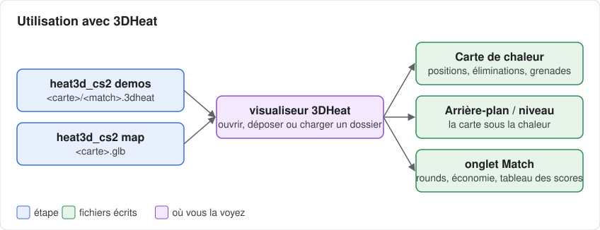

# Utiliser avec 3DHeat {#using-it-with-3dheat}

Les sorties vont dans ces emplacements de la [visionneuse 3DHeat](https://holdi601.github.io/3DHeat) :

| Fichier | Où | Ce qu'il apporte |
|---|---|---|
| `<match>.3dheat` (par défaut) | onglet **Carte de chaleur**, panneau **Source**, ou onglet **Match** | la table et le document de match ensemble, un fichier par match ([conteneur](https://holdi601.github.io/3DHeat/container.html)) |
| `<match>.parquet` | onglet **Carte de chaleur**, panneau **Source** | positions et événements sous forme de carte de chaleur, replay en boîtes, trajets |
| `<match>.match.json` | onglet **Match**, **Charger des matchs…** | le tableau des scores, les rounds, le fil des kills, les statistiques entre matchs, les liens vers la carte de chaleur |
| `<map>.glb` | panneau **Arrière-plan / niveau**, **Modèle 3D…** | la carte sous la carte de chaleur |

La documentation de la visionneuse décrit chaque onglet en détail : ses pages
[Analyse de match](https://holdi601.github.io/3DHeat/match-analysis.html),
[Chargement des fichiers](https://holdi601.github.io/3DHeat/loading-files.html),
[Mappage des colonnes](https://holdi601.github.io/3DHeat/column-mapping.html)
et [Replay en boîtes](https://holdi601.github.io/3DHeat/box-replay.html). Cette page est la partie CS2 de cette documentation.



La visionneuse : [github.com/Holdi601/3DHeat](https://github.com/Holdi601/3DHeat),
documentation [holdi601.github.io/3DHeat](https://holdi601.github.io/3DHeat/).

## Une session type {#a-typical-session}

```bash
python -m heat3d_cs2 demos D:\Demos\event -o out
python -m heat3d_cs2 map <map> -o out/<map>/<map>.glb
```

1. **Carte de chaleur -> Source :** choisissez le dossier `out/<map>` (ou déposez-le).
   Chaque `.parquet` s'y trouve devient un jeu de données ; les fichiers `.json` et `.glb` du même
   dossier sont ignorés comme « pas un fichier CSV/Parquet ». Chargez-le.
2. **Arrière-plan / niveau -> Modèle 3D… :** choisissez `out/<map>/<map>.glb`.
   **Enregistrer dans la bibliothèque** le garde dans le navigateur pour la prochaine fois.
3. **Match -> Charger des matchs… :** choisissez les fichiers `.match.json` du
   même dossier (plusieurs à la fois), ou déposez-les sur la vue pendant que l'onglet
   Match est ouvert.

Ne chargez qu'une seule table de carte à la fois : les coordonnées de cartes différentes se chevauchent, et une carte de chaleur de deux cartes à la fois ne veut rien dire. Le dossier par carte existe pour cela.

## La table s'ouvre sans rien régler {#the-table-opens-with-nothing-to-set}

La visionneuse lit l'entrée `heat3d` du pied du premier fichier sélectionné
([La table de carte de chaleur](output-table.md#the-heat3d-footer-hints)) et la pose par-dessus ses propres suppositions :

| Réglage de la visionneuse | Valeur |
|---|---|
| Position | `x`, `y`, `z` |
| Axe vertical dans la source | Z est vers le haut |
| Inverser Y | activé - pour que la carte soit du bon sens, et non en miroir |
| Échelle des unités | 1 - distances en unités du jeu (affichées en « m » ; 1 unité = 1 pouce) |
| Temps | `time`, en secondes |
| Personne | `player` |
| Groupe | `side` (T / CT) |
| Session | `roundId` - chaque round est une session, `<match> #NN` |
| Direction du regard | vecteur, `dirX` / `dirY` / `dirZ` |
| Colonnes de filtre | `event`, `match`, `round`, `roundTime`, `phase`, `weapon`, `place`, `won`, `buy`, `opening`, `team` |
| Taille d'entité | 32 - le replay en boîtes dessine un joueur de 32 unités de large, avec un rayon de regard de 4 x 32 |

Chaque valeur indiquée reste visible dans le mappage des colonnes et peut être changée. Les autres colonnes (`headshot`, `traded`, `other`, `steamid`, `health`, `money`,
`damage`, `duration`, ...) peuvent y être ajoutées comme filtres à la main.

Gardez l'échelle des unités à 1 quand une carte est chargée : le `.glb` est dans les mêmes unités du jeu, et le niveau n'est pas remis à l'échelle avec la table.

### Filtres utiles {#useful-filters}

- `event` = `position` pour savoir où étaient les joueurs ; `kill` / `death` pour les endroits où les duels ont été gagnés et perdus ; `smoke`, `flash`, `molotov`, `he` pour l'endroit où l'utilitaire a atterri ; `throw` pour l'endroit d'où il a été lancé ; `plant` pour les lieux de pose.
- `side` (le groupe) = `T` ou `CT`, `phase` = `live` pour exclure la phase après, `buy` = `eco` / `force` / `full` pour les rounds d'une même économie, `won` = 1 pour les rounds gagnés par le camp de la ligne.
- `opening` = 1 avec `kill` et `death` pour les duels d'ouverture.
- `roundTime` comme intervalle pour un moment du round : les 20 premières secondes, la phase après pose.

## L'onglet Match {#the-match-tab}

L'onglet Match accepte un fichier JSON dont le `format` est `heat3d-cs2-match` et qui a les tableaux `rounds`, `players` et `teams`
([Le document du match](output-match-json.md)). Il affiche le score et les mi-temps, une bande de rounds colorée par le camp gagnant avec une marque pour la manière dont chacun s'est terminé, l'économie de chaque round, la pose, le fil des kills, les clutchs et les survivants, le tableau des scores, et les statistiques de tous les matchs chargés.

Ses liens **Afficher dans la carte de chaleur** ne chargent rien : ils posent des filtres sur la table déjà chargée dans l'onglet Carte de chaleur - `match`, `round` (et la session du round `<match> #NN`), `event`, le joueur, le camp. Cela fonctionne parce que le document du match et la table portent les mêmes noms de match, numéros de round, noms de joueurs et camps. **Rejouer le round** passe la carte de chaleur en replay en boîtes et joue la session du round depuis son début.

Chargez donc les deux : les tables d'une carte dans l'onglet Carte de chaleur, leurs documents de match dans l'onglet Match. Un document de match sans sa table affiche quand même le tableau des scores et les rounds, et les liens indiquent qu'aucune donnée de carte de chaleur n'est chargée.

## Sans 3DHeat {#without-3dheat}

- La table est du Parquet ordinaire : pandas, Polars, DuckDB, Spark, le paquet `arrow` de R la lisent ; l'entrée `heat3d` est ignorée, et les colonnes de texte se lisent comme des chaînes ou des catégories.
- Le document du match est du JSON ordinaire.
- La carte est un binaire glTF valide, en pouces et non en mètres : multipliez par 0,0254 pour les outils qui supposent des mètres. Son repère est celui de glTF lui-même (Y vers le haut) ; donc pour superposer la table ailleurs, dessinez le (x, y, z) de chaque ligne sous la forme (x, z, -y), comme le fait 3DHeat.
