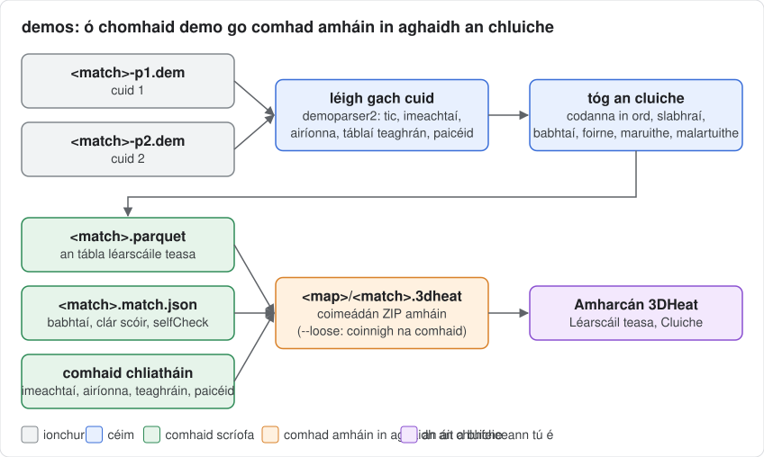

# 3DHeat CS2 {#dheat-cs2}

**Cad é?** Is féidir le Counter-Strike 2 taifeadadh de chluiche a shábháil, ar a dtugtar
*demo*. Casann an uirlis seo demo ina chomhaid is féidir leis an amharcán 3DHeat a thaispeáint i 3D:
cá raibh gach duine ina sheasamh, ag fáil bháis, ag caitheamh agus ag cur buama, babhta ar bhabhta. Is féidir léi
léarscáil CS2 a athrú ina samhail 3D chun iad a thaispeáint uirthi freisin.

**Cén fáth a n-úsáidfinn é?** Chun d'fhíorchluichí féin a athbhreithniú, chun go leor cluichí
den léarscáil chéanna a leagan ar a chéile mar léarscáil teasa amháin, agus do staitisticí cluiche ar nós ADR
(damáiste meánach in aghaidh an bhabhta) agus KAST (cuid na mbabhtaí inar mharaigh imreoir,
inar chuidigh, inar tháinig slán nó inar malartaíodh é).

**Sampla:** `alpha-vs-bravo-m1.dem` isteach, `out/de_x/alpha-vs-bravo-m1.3dheat`
amach (is ainm léarscáile cumtha é `de_x`).



Níos mine: casann 3DHeat CS2 **demos Counter-Strike 2** ina dtábla léarscáile teasa agus ina
cháipéis chluiche in aghaidh an chluiche, agus **léarscáil CS2** ina gheoiméadracht leibhéil. Déantar na haschuir
don amharcán telemetry [3DHeat](https://holdi601.github.io/3DHeat/)
([foinse](https://github.com/Holdi601/3DHeat)), ach is gnáthchomhaid iad - Parquet, JSON agus glTF dénártha - is féidir le haon rud eile
a léamh freisin.

Is pacáiste Python beag é, `heat3d_cs2`, a ritear ón líne ordaithe. Léann sé
demos ón diosca (ní íoslódálann sé aon cheann) le
[demoparser2](https://github.com/LaihoE/demoparser), agus onnmhairíonn sé léarscáileanna ón gcluiche
suiteáilte le tógáil líne ordaithe de Source2Viewer
([ValveResourceFormat](https://github.com/ValveResourceFormat/ValveResourceFormat)).

## Tús tapa {#quick-start}

An bhfuil tú nua leis an líne ordaithe? Léigh [Sula dtosaíonn tú](before-you-start.md) ar dtús.

```bash
pip install -r requirements.txt
python -m heat3d_cs2 demos <demo files or folders> -o out   # every match in them
python -m heat3d_cs2 map <map> -o out/<map>/<map>.glb       # the map from the installed game
python -m heat3d_cs2 scoreboard out/<map>/<match>.3dheat    # a match's scoreboard as text
```

Ba chóir duit `1 match(es), 1 at a time ...` a fheiceáil agus ansin líne amháin in aghaidh an chluiche
(féach [Orduithe](../commands.md#what-is-printed)).

Scríobhann `demos`, in aghaidh an chluiche, comhad amháin isteach i bhfillteán a ainmnítear i ndiaidh na léarscáile:
`out/<map>/<match>.3dheat`, [coimeádán `.3dheat`](../output-container.md) - formáid
comhad-amháin-in-aghaidh-an-chluiche an amharcáin ([sonraíocht](https://holdi601.github.io/3DHeat/container.html)).
Coinníonn sé na baill seo; scríobhann `--loose` mar chomhaid ar leith iad ina ionad:

| Ball | Cad atá ann | Lódáilte i |
|---|---|---|
| `<match>.parquet` (ról `table`) | gach imreoir beo ocht n-uaire sa soicind lena staid (sláinte, airgead, splanc, scóipeáilte, crios, fardal, ...), agus gach imeacht san áit inar tharla sé (marú, bás, gortú, lámhaigh, caitheamh, pléascadh grenáidí, dalladh, plandáil, díghalrú, pléascadh, agus deireadh babhta in aghaidh an imreora leis an méid a d'íoc an babhta leo), sraith an ceann | cluaisín Léarscáil teasa |
| `<match>.match.json` (ról `match`, cáipéis an chluiche) | foirne, scór, gach babhta (buaiteoir, conas, geilleagar, plandáil, maruithe in ord, clutches, marthanóirí) agus líne scórchláir gach imreora | cluaisín Cluiche |
| `<match>.events/props/strings/packets.parquet` | gach rud eile atá sa demo, iomlán (comhaid chliatháin) | coinnithe ar mhaithe le hiomláine |

Scríobhann `map` `<map>.glb`: mogall imbhuailte na léarscáile - urláir, ballaí, boscaí,
gan maisiúchán - roinnte ina thalamh agus ina struchtúr, sa fhráma agus sna haonaid chéanna leis na táblaí,
mar sin luíonn sé go díreach faoin léarscáil teasa (painéal Cúlra / leibhéal).

## Léarscáil na ndoiciméad seo {#map-of-this-documentation}

| Leathanach | Cad a chlúdaíonn sé |
|---|---|
| [Sula dtosaíonn tú](before-you-start.md) | Python, teirminéal, ionadchoinneálaithe, cuma an rath agus na n-earráidí coitianta |
| [Suiteáil](../installing.md) | Python, na pacáistí, CLI Source2Viewer, an áit a gcaithfidh CS2 a bheith |
| [Orduithe](../commands.md) | `demos`, `map`, `scoreboard`: gach rogha, cad a phriontáiltear, cóid scoir |
| [Demo a léamh](../reading-demos.md) | cad a léitear ó chomhad demo: tic samplaithe, airíonna imreoirí, rialacha cluiche, imeachtaí |
| [Cluiche a thógáil](../building-matches.md) | codanna agus slabhraí, clog an chluiche, babhtaí, foirne agus taobhanna, sraitheanna, maruithe, malartuithe, osclaíochtaí, damáiste, splancanna, geilleagar |
| [Staitisticí](../statistics.md) | an clár scóir: K/D/A, ADR, KAST, HS%, osclaíochtaí, malartuithe, il-mharuithe, clutches, utility, splancanna |
| [An tábla léarscáile teasa](../output-table.md) | an comhad Parquet: gach colún, a chineál, cé na himeachtaí a líonann é, leideanna footer `heat3d`, na haiseanna |
| [Cáipéis an chluiche](../output-match-json.md) | an doiciméad `.match.json`, réimse ar réimse |
| [Comhad amháin in aghaidh an chluiche](../output-container.md) | an coimeádán `.3dheat` a scríobhann `demos` de réir réamhshocraithe, `--loose` |
| [Onnmhairiú léarscáile](../map-export.md) | conas a onnmhairítear mogall imbhuailte léarscáile, an fráma, ainmniú nód, aonaid |
| [Úsáid le 3DHeat](../using-with-3dheat.md) | táblaí, cáipéisí cluiche agus léarscáileanna a lódáil i gcluaisíní Léarscáil teasa agus Cluiche an amharcáin |
| [Teorainneacha](../limits.md) | cad a ghlactar leis, cad nach láimhseáiltear, cad nach bhfuil fíoraithe |
| [Nuashonruithe](../updates.md) | an seic eisiúna ag tosú agus `python -m heat3d_update` |
| [Forbairt](../development.md) | leagan amach an chóid, tástálacha, an fheistis demo sintéiseach |
| [Tagairt orduithe](../cli-reference.md) | `--help` gach ordaithe, ginte ón gcód |
| [Cothabháil](../maintaining.md) | seicliosta eisiúna na leathanach seo |

## Cad i gcoinne a seiceáiltear é {#what-it-is-checked-against}

Ní comhad glan amháin in aghaidh an chluiche iad demos ón bhfiántas. Láimhseálann an tiontaire
cluiche roinnte thar chomhaid in aon ord, freastalaí atosaithe i lár cluiche, dhá
chluiche dhifriúla stóráilte faoi aon ainm amháin, babhtaí athchóirithe ó chúltaca, taifeadadh a thosaíonn déanach nó a chríochnaíonn go luath,
sosanna, agus cóitseálaithe ar thaobh foirne - féach [Cluiche a thógáil](../building-matches.md). Seiceáilte thar bhailiúchán mór
demos comórtais: i ngach cluiche leanann an
scór buaiteoirí na mbabhtaí, is básanna an taobh eile iad maruithe gach taobh,
agus tosaíonn gach babhta cúigear in aghaidh cúigir.

## Cad ar a dtugann tú é {#what-to-point-it-at}

Demos de do chluichí féin, demos a d'íoslódáil tú de láimh ó shuíomh comórtais,
nó demos ó API a bhfuil rochtain agat air. Baineann ábhar demo lena fhoilsitheoir
agus a eagraithe: úsáid an méid a thagann amach le haghaidh d'anailíse féin, agus
ná hathdháil demos ná sonraí díorthaithe astu. Is minic a thoirmisceann suíomhanna
a thairgeann demos íoslódáil uathoibrithe ina dtéarmaí, agus sin an fáth go léann
an uirlis demos ón diosca agus nach bhfaigheann sí aon cheann.

## Cuid de 3DHeat {#part-of-3dheat}

Tá 3DHeat CS2 ar cheann de na huirlisí saora timpeall ar amharcán 3DHeat, stór
dá chuid féin ag gach ceann lena eisiúintí agus a cheadúnas féin:

| Uirlis | Cad a dhéanann sí | Doiciméid |
|---|---|---|
| [3DHeat](https://github.com/Holdi601/3DHeat) | an amharcán: léarscáileanna teasa, anailís rása agus athbhreithniú cluiche i 3D | [suíomh](https://holdi601.github.io/3DHeat/) |
| [GameFiles](https://github.com/Holdi601/3DHeat-GameFiles) | cúrsaí agus leibhéil as na comhaid a sheolann cluichí, mar shamhlacha 3D | [suíomh](https://holdi601.github.io/3DHeat-GameFiles/) |
| [GameCapture](https://github.com/Holdi601/3DHeat-GameCapture) | telemetry cuarta ó chluichí rásaíochta; leibhéil atógtha ó fhíseán cluiche | [suíomh](https://holdi601.github.io/3DHeat-GameCapture/) |
| [Unreal Exporter](https://github.com/Holdi601/3DHeat-UnrealExporter) | breiseán d'Unreal Editor a onnmhairíonn leibhéal mar shamhail 3D amháin | [suíomh](https://holdi601.github.io/3DHeat-UnrealExporter/) |
| [CS2](https://github.com/Holdi601/3DHeat-CS2) | demos Counter-Strike 2 ina dtáblaí agus ina gcáipéisí cluiche; léarscáileanna ina samhlacha 3D | [suíomh](https://holdi601.github.io/3DHeat-CS2/) |
| [Watcher](https://github.com/Holdi601/3DHeat-Watcher) | taifeadann sé an méid a fhoilsíonn cluichí faoi d'imirt, sa chúlra | [suíomh](https://holdi601.github.io/3DHeat-Watcher/) |
| [Ext-WarThunder](https://github.com/Holdi601/3DHeat-Ext-WarThunder) | athsheinmeanna War Thunder ina dtáblaí agus ina gcáipéisí cluiche | [suíomh](https://holdi601.github.io/3DHeat-Ext-WarThunder/) |
| [Ext-WoT](https://github.com/Holdi601/3DHeat-Ext-WoT) | athsheinmeanna World of Tanks ina dtáblaí agus ina gcáipéisí cluiche | [suíomh](https://holdi601.github.io/3DHeat-Ext-WoT/) |
| [Ext-WoWs](https://github.com/Holdi601/3DHeat-Ext-WoWs) | athsheinmeanna World of Warships ina dtáblaí agus ina gcáipéisí cluiche | [suíomh](https://holdi601.github.io/3DHeat-Ext-WoWs/) |
| [Ext-Squad](https://github.com/Holdi601/3DHeat-Ext-Squad) | demos freastalaí Squad ina dtáblaí agus ina gcáipéisí cluiche | [suíomh](https://holdi601.github.io/3DHeat-Ext-Squad/) |
| [Ext-DCS](https://github.com/Holdi601/3DHeat-Ext-DCS) | léarscáileanna DCS World ina samhlacha 3D | [suíomh](https://holdi601.github.io/3DHeat-Ext-DCS/) |
| [Ext-IL2](https://github.com/Holdi601/3DHeat-Ext-IL2) | léarscáileanna IL-2 Sturmovik ina samhlacha 3D | [suíomh](https://holdi601.github.io/3DHeat-Ext-IL2/) |

## Ceadúnas {#licence}

MIT - féach [`LICENSE`](https://github.com/Holdi601/3DHeat-CS2/blob/main/LICENSE),
agus [`LICENSES.md`](https://github.com/Holdi601/3DHeat-CS2/blob/main/LICENSES.md)
do na pacáistí tríú páirtí agus an méid a éilíonn na cluichí a léann sí.
