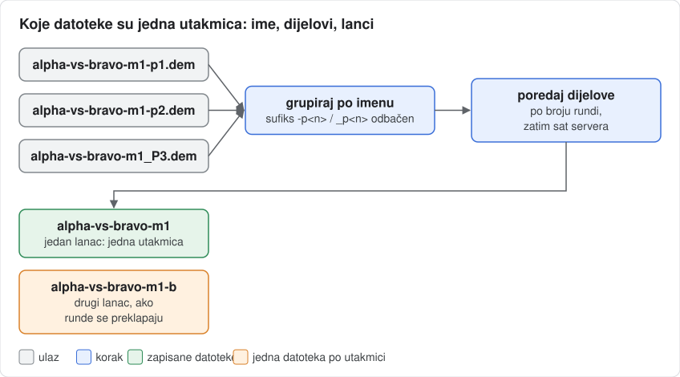

# Sastavljanje meča {#building-a-match}

Kako se meč sastavlja iz svojih dijelova demo snimke: koje datoteke pripadaju zajedno, jedan sat kroz sve njih, runde i kako je svaka pobijeđena, timovi i njihove strane te svaki redak tablice toplinske karte s ubojstvima, razmjenama, prvim ubojstvima, štetom, bljeskovima i ekonomijom. Kod:
[`heat3d_cs2/match.py`](https://github.com/Holdi601/3DHeat-CS2/blob/main/heat3d_cs2/match.py).
Rezultatna tablica izračunata iz njega nalazi se na stranici [Statistika](statistics.md).

## Pregled {#overview}

1. Čita se svaka datoteka imena meča ([Čitanje demo snimke](reading-demos.md)).
2. Rješavaju se dvostruki redci igrača (vraćene runde) u svakoj datoteci.
3. Datoteke se razvrstavaju u **lance** - mečeve - i svaki lanac se stavlja u red.
4. Svaki dio se smješta na **sat meča**.
5. **Runde** se pronalaze u svakom dijelu; izvještaj o rundi iz kasnijeg dijela zamjenjuje izvještaj iz ranijeg.
6. **Igrači** i **timovi** dobivaju imena, a sve strane i rezultat svake runde dani su nazivom tima. Kad su strane poznate, slijede duljina poluvremena, runde pištoljima i **kupovina** svake strane.
7. Grade se **redci**: pozicije, pucnji, bacanja, detonacije, postavljanja bombe, deaktivacije, ubojstva, smrti, ozljede, bljeskovi, eksplozije.
8. Svaki redak dobiva oznaku runde, faze, vremena u rundi, je li njegova strana pobijedila te kupovinu svoje strane; redci izvan svih rundi se izostavljaju.

## Vraćene runde: jedan redak po igraču po ticku {#restored-rounds-one-row-per-player-per-tick}

Kad se runda vrati iz sigurnosne kopije unutar jedne datoteke, demo nosi stara tijela igrača uz nova nekoliko sekundi: dva retka za jednog igrača u jednom ticku, jedan tamo gdje ga je poništena runda ostavila, a drugi na mjestu oživljavanja u vraćenoj rundi. Za svakog takvog igrača dupli tikovi se obilaze **unatrag** počevši od prvog pojedinačnog retka nakon njih: u svakom ticku zadržava se kandidat najbliži poziciji koja slijedi, i on postaje referenca za tik prije. Ako nema pojedinačnog retka nakon njih, zadržava se zadnji kandidat. Tako svaki igrač zadržava redak koji vodi dalje, tamo gdje ide sljedeće.

## Živi dio datoteke {#the-live-part-of-a-file}

**Živi početak** datoteke je tik njezina zadnjeg događaja `round_announce_match_start`, ili tik 0 ako ga nema (kasniji dio podijeljenog meča obično ga nema). Sve prije živog početka se izostavlja, kao i sve označeno sa `is_warmup_period`. Runda s nožem ili ponovno pokretanje prije najave tako se izostavlja; runda s nožem koja *nije* praćena najavom početka meča ne prepoznaje se kao takva (vidi [Ograničenja](limits.md)).

**Runde** datoteke su događaji `round_freeze_end` od živog početka nadalje, izvan zagrijavanja, prepoznati po njihovom `total_rounds_played` (nultom indeksu runde koja je pred nama, koji broji igra). Datoteka bez njih nema runde i ne pripada nijednom meču.

## Sat {#the-clock}

Vremena su u sekundama. Unutar datoteke vrijeme se broji u **tikovima**: `game_time` poslužitelja na prvom uzorkovanom tiku, plus tikovi od tada / 64. Vlastiti sat poslužitelja stoji za vrijeme pauze dok tikovi teku dalje; čitan kroz sat, dva trenutka pauzirane utakmice imala bi isto vrijeme.

Svaka datoteka ima *prvi sat* (vrijeme na njezinom živom početku) i *zadnji sat* (na njezinom zadnjem uzorkovanom tiku).

### Dijelovi i lanci {#parts-and-chains}

Datoteke označene kao jedan meč ([Naredbe](commands.md#which-files-are-one-match)) najprije se razvrstavaju prema indeksu njihove prve runde, zatim prema prvom satu. Zatim se svaka, tim redom, pridružuje prvom lancu koji nastavlja ili započinje novi lanac. Dio nastavlja lanac kad je indeks njegove prve runde barem jednak zadnjem indeksu zadnjeg dijela lanca, **i** vrijedi jedno od sljedećeg:

- sat poslužitelja teče dalje: njegov prvi sat nije raniji od zadnjeg sata lanca umanjenog za 5 s; ili
- broj rundi teče dalje: indeks njegove prve runde jest zadnji indeks lanca ili onaj iza njega.

Odlučuje broj rundi, a sat razrješava neodlučne slučajeve, jer poslužitelj koji je ponovno pokrenut radi vraćanja runde ponovno počinje svoj sat, dok dva različita meča pod istim imenom (isti timovi na istoj karti na dva događaja) imaju preklapajuće brojeve rundi. Lanci se poredaju prema broju rundi koje obuhvaćaju, najviše prvo; prvi zadržava ime meča, a ostali se zapisuju kao `<ime>-b`, `<ime>-c`, ...

### Sat meča {#the-match-clock}

Nula meča je prvi sat prvog dijela: **vrijeme meča 0 je živi početak prve datoteke**. Svaki kasniji dio smješta se na nju:

- gdje sat poslužitelja teče dalje (njegov prvi sat nije raniji od zadnjeg sata prethodnog dijela umanjenog za 5 s), koristi se sat poslužitelja kakav jest;
- gdje je ponovno pokrenut, dio se smješta tako da slijedi **jednu sekundu** nakon što je prethodni dio završio.

## Runde {#rounds}

Za svaki `round_freeze_end` dijela (tim redom po tiku) prozor runde ide do sljedećeg freeze enda u tom dijelu ili do kraja datoteke. Unutar njega runda se **odlučuje** na prvom uzorkovanom tiku na kojem stanje igre pokazuje `total_rounds_played` = indeks runde + 1 i `round_win_status` 1 (neriješeno), 2 (T pobijedili) ili 3 (CT pobijedili). Runda bez takvog uzorka u svom prozoru bila je prekinuta krajem datoteke; njezin broj ide na popis **nepotpunih** rundi meča (osim ako je neki drugi dio ima potpunu).

| Polje runde | Iz |
|---|---|
| `number` | indeks + 1 (počinje od 1, kako igra broji) |
| `start` | vrijeme meča na kraju freeze time - igrači se mogu kretati |
| `end` | vrijeme meča na prvom uzorku koji pokazuje da je runda odlučena |
| `until` | vrijeme meča na sljedećem `round_prestart` nakon `end`, ako je unutar prozora; inače kraj prozora ili zadnji tik datoteke, što god nastupi prvo (a nikad prije `end`) |
| `winner` | `T` za win status 2, `CT` za 3, prazno za 1: neriješeno je odlučeno, bez pobjednika |
| `reason` | `round_win_reason` na tom uzorku, imenovan kako je dolje |
| `score` | ime tima -> broj pobjeda nakon ove runde: `team_rounds_total` svake strane na uzorku koji odlučuje; gdje ga demo nema, rezultat prethodne runde plus jedan za pobjednika |
| `sides` | ime tima -> `T` / `CT` u ovoj rundi |
| `equipment` | strana -> zbroj `current_equip_value` **živih** igrača te strane na prvom uzorku na kraju freeze enda ili poslije |
| `buy` | strana -> `pistol`, `eco`, `force` ili `full` ([Ekonomija](#economy-and-buy-types)) |
| `plant` | prvi `bomb_planted` nakon freeze enda i do `end`, ili ništa |
| `exploded` | vrijeme meča prvog `bomb_exploded` nakon tog postavljanja i prije sljedećeg freeze enda, ako postoji (nije u dokumentu meča; određuje vrijeme retka `explode`) |

`reason`, iz igrinog `CSRoundEndReason`:

| Kod | `reason` |
|---|---|
| 1 | `bomb` (cilj je minirana) |
| 7 | `defuse` (deaktivirana) |
| 8, 9 | `elimination` (CT pobjeđuju / T pobjeđuju eliminacijom) |
| 10 | `draw` (neriješeno) |
| 12 | `time` (cilj je spašen) |
| 17, 18 | `surrender` (predaja) |
| sve drugo | `other` |

Kad više dijelova sadrži istu rundu (po indeksu), zadržava se verzija kasnijeg dijela. Runde se zatim popisuju po indeksu. Meč čija prva runda nije runda 1 bilježi nedostajuće brojeve (`missing` u dokumentu meča); redak naredbe kaže *zabilježeno od runde N*.

### Postavljanje bombe {#the-plant}

| Polje | Iz |
|---|---|
| `site` | `A` ili `B`: zona bombe u kojoj igra kaže da je postavljač stajao (`which_bomb_zone`, 1 A, 2 B); bez toga naziv mjesta postavljača (`BombsiteA`, `BombsiteB`); bez toga slovo koje je drugo postavljanje iste datoteke u istoj zoni dalo (broj entiteta događaja je broj entiteta zone). Prazno kad ništa ne kaže - nikad broj. |
| `time` | sekunde **u rundi** (od njezinog freeze enda), kao vrijeme ubojstva |
| `player`, `steamid` | postavljač |
| `x`, `y`, `z` | položaj postavljača, u jedinicama igre: gdje bomba leži |
| `place` | naziv mjesta postavljača u trenutku postavljanja |

### Faze {#the-phases}

Vrijeme od `start` do `end` je **živa** faza runde; od `end` do `until` njezina **nakon** faza, u kojoj pobjednici love, a gubitnici štede. Redak pripada rundi čiji `[start, until)` sadrži njegovo vrijeme, a `after` je kad je njegovo vrijeme kasnije od `end`. Freeze time leži između rundi i ni u jednoj nije.

## Igrači i timovi {#players-and-teams}

**Igrač** je svatko tko je bio živ barem jednom na strani (tim 2 ili 3), izvan freeze timea i zagrijavanja, nakon živog početka. Trener ili komentator na strani tima nikad nije živ i nije igrač. Svaki igrač ključ je Steam ID; ime je zadnje viđeno.

**Tim** igrača je naziv kluba koji mu je igra dala za njegovu stranu (`team_clan_name`), onaj viđen najčešće - demo ga briše na samom svom kraju. Meč odigran bez naziva klubova imenuje timove prema strani na kojoj su počeli: `Started T` i `Started CT`.

**Strane** svake runde proizlaze iz toga tko je bio na kojoj strani između freeze enda i kraja runde: svakoj strani dodjeljuje se oznaka tima koju nosi većina njezinih igrača. Popis `teams` meča je po redu pojavljivanja, runda po rundi, strana T prije CT; obično je tim koji je počeo na T prvi.

## Redci {#the-rows}

Svaki uzorak pozicije i svaki događaj postaje jedan redak [tablice toplinske karte](output-table.md). Igrači su na strani samo kad je njihov `team_num` 2 ili 3.

### Pozicije {#positions}

Iz uzorkovanih redaka živih igrača na strani, izvan freeze timea i zagrijavanja, nakon živog početka: položaj, smjer pogleda, zdravlje, oklop, novac, vrijednost opreme, oružje u ruci, mjesto.

Smjer pogleda je jedinični vektor u okviru igre:
`(cos pitch * cos yaw, cos pitch * sin yaw, -sin pitch)` - pitch igre je pozitivan kad se gleda dolje, pa pogled prema dolje daje negativan Z.

Oružje u ruci je `active_weapon_name` kako ga igra imenuje, osim što svako ime koje sadrži `Knife`, `Bayonet`, `Karambit` ili `Daggers` postaje `Knife`.

### Pucnji i bacanja {#shots-and-throws}

Iz `weapon_fire`, na položaju strijelca. Noževi (`knife`, `bayonet` u ID-u oružja) i C4 se izostavljaju. Granate (`smokegrenade`, `flashbang`, `hegrenade`, `molotov`, `incgrenade`, `decoy`) su retci **bacanja**, sve ostalo retci **pucnja**. Oružje je imenovano kako ga igra prikazuje (dolje).

### Detonacije granata {#grenade-detonations}

| Događaj | Redak | `weapon` |
|---|---|---|
| `smokegrenade_detonate` | `smoke` | Smoke Grenade |
| `flashbang_detonate` | `flash` | Flashbang |
| `hegrenade_detonate` | `he` | High Explosive Grenade |
| `inferno_startburn` (molotov i zapaljiva) | `molotov` | Molotov |
| `decoy_detonate` | `decoy` | Decoy Grenade |

Položaj je **gdje je granata eksplodirala** (`x`, `y`, `z` događaja); igrač i strana su bacača. Demo ne imenuje mjesto za granatu, samo za igrače, pa je `place` prazan: redak ne tvrdi mjesto na kojem nije bio. Mjesto bacača u tom trenutku čuva se kao `throwerPlace`.

### Postavljanja i deaktivacije {#plants-and-defuses}

Redci `plant` i `defuse` na položaju igrača, oružje `C4 Explosive`. Postavljena bomba koja je eksplodirala dobiva redak **explode**: na položaju postavljanja, u vrijeme `bomb_exploded`, s postavljačem kao igračem (s njegovim Steam ID-om), stranom `T`, T timom runde kao `team` i mjestom postavljanja. Uključuje i bombu koja eksplodira nakon što su Ti već pobijedili eliminacijom. Gdje demo nema `bomb_exploded`, runda koju je pobijedila bomba (`reason` = `bomb`) s postavljanjem dobiva redak na `end` runde.

### Ubojstva i smrti {#kills-and-deaths}

Svaki `player_death` u rundi daje jedan **zapis ubojstva** (tablica `kills` meča) s:

| Polje | Značenje |
|---|---|
| attacker, victim, assister | imena, Steam ID-ovi, strane; napadač je prazan za svijet (pad, bomba) |
| `weapon` | oružje iz događaja, imenovano kako ga igra prikazuje |
| `headshot` | zastavica događaja |
| `wallbang` | `penetrated` > 0 |
| `throughSmoke` | `thrusmoke` |
| `flashAssist` | `assistedflash` |
| `noscope`, `attackerBlind` | zastavice događaja (`noscope`, `attackerblind`); stupci redaka `kill` i `death` te u kills dokumenta meča |
| `suicide` | napadač i žrtva isti igrač: npr. vlastita granata |
| `teamkill` | napadač i žrtva na istoj strani, s napadačem, i nije samoubojstvo |
| `opening` | prvo ubojstvo neprijatelja u rundi (dolje) |
| `traded`, `trade` | dolje |
| pozicije | položaj i mjesto napadača i žrtve |

Iz svakog zapisa tablica dobiva redak **death** na položaju žrtve (svaka smrt, uključujući one od svijeta, teamkillove i samoubojstva) i - za ubojstva od strane neprijatelja (napadač, bez teamkilla, bez samoubojstva) - redak **kill** na položaju ubojice.

**Prvo ubojstvo.** Prvo ubojstvo neprijatelja u svakoj rundi dok je živa je njegov prvi dvoboj. Teamkill, samoubojstvo ili smrt od svijeta prije njega se preskače, pa je prvo ubojstvo i dalje prvi dvoboj runde; runda bez ijednog ubojstva neprijatelja dok je živa nema prvo ubojstvo.

**Razmjena** i **trade**. Smrt od strane neprijatelja je **razmijenjena** kad njezina ubojica bude ubijena od strane jednog od žrtvinih suigrača unutar **5 sekundi** nakon nje (više od 0 i najviše 5 s kasnije, u istoj rundi); prvo takvo ubojstvo je **razmjena** (trade). U tablici je stupac `traded` na retku `kill` 1 za ubojstvo razmjenom; na retku `death` 1 za smrt koja je osvećena. Ubojstva iz faze nakon također se računaju.

### Šteta {#damage}

Iz `player_hurt`, samo između **neprijatelja** (oba na strani, različite strane). Šteta je zdravlje stvarno **izgubljeno**: za svaku žrtvu u svakoj rundi zdravlje kreće od 100; svaki pogodak broji `min(dmg_health, health prije)`, a `health` iz događaja (što je ostalo) postaje "prije" za sljedeći pogodak. Pogodak u glavu od 137 štete na igraču s 40 zdravlja broji se kao 40, kako je to broji igrina tablica rezultata. Pogoci od `hegrenade`, `inferno`, `molotov` i `incgrenade` su šteta **pomoćnim sredstvima**. Svaki pogodak je redak **hurt** na položaju žrtve, napadač kao `other`. Šteta od suigrača i samoozljeđivanje nisu ni u tablici ni u statistici.

### Bljeskovi {#flashes}

Iz `player_blind`, samo **neprijatelji** (ne suigrači, i ne trener ili komentator koji gleda): jedan redak **blind** po zaslijepljenom igraču, na položaju zaslijepljenog igrača, bljeskalica kao `other`, trajanje slijepila u sekundama kao `duration`. Svako trajanje se čuva; statistika broji samo slijepila od najmanje jedne sekunde.

## Imena oružja {#weapon-names}

ID oružja iz događaja (`ak47`, `weapon_ak47`, `knife_karambit`) prikazuje se kako ga igra imenuje u `active_weapon_name` igrača, pa se oružje ubojstva i oružje u ruci čitaju jednako: `ak47` -> `AK-47`, `m4a1` -> `M4A4`, `m4a1_silencer` -> `M4A1-S`, `hkp2000` -> `P2000`, `taser` -> `Zeus x27`, `inferno` i `molotov` -> `Molotov`, `incgrenade` -> `Incendiary Grenade`, `c4` i `planted_c4` -> `C4 Explosive`, `world` -> `World`, i tako za svako oružje i granatu (tablica `WEAPONS` u `match.py`). Sve što u ID-u ima `knife` ili `bayonet` je `Knife`. ID koji nije u tablici čuva se kako jest.

## Ekonomija i vrste kupovine {#economy-and-buy-types}

Na kraju freeze timea vrijednost opreme svake strane zbroji se po njezinim živim igračima na prvom uzorku od tada, i podijeli se s brojem njih:

| Runda | Prosječna oprema po igraču | `buy` |
|---|---|---|
| runda s pištoljima (prva u svakom regularnom poluvremenu) | bilo koja | `pistol` |
| ostale | ispod 1.500 $ | `eco` |
| ostale | od 1.500 $ do ispod 4.000 $ | `force` |
| ostale | 4.000 $ ili više | `full` |

Runde s pištoljima slijede poluvrijeme kojim je meč odigran, a ne fiksni format. Poluvrijeme završava tamo gdje se strane prvi put zamijene između dvije runde koje slijede jedna za drugom, obje u regularnom dijelu: njegova duljina (`halfLength` u dokumentu meča) je runda prije zamjene - 12 u formatu od 24 runde, 15 u onom od 30. Runda 1 i runda nakon poluvremena su runde s pištoljima. Runda je produžetak kad je broj produžetaka igre (`m_nOvertimePlaying`) iznad 0 na njezinom freeze endu; gdje demo nema taj broj, svaka runda nakon dva poluvremena je takva. Poluvremena produžetka počinju s novcem koji postavlja poslužitelj i nemaju runde s pištoljima, iako se strane također zamijene. Snimka koja nikad ne pokaže zamjenu na poluvremenu - počinje nakon nje ili završava prije - ostavlja poluvrijeme nepoznatim, a samo runda 1 je runda s pištoljima.

## Oznake i redoslijed {#labelling-and-order}

Na kraju svakom retku se dodaje:

- `match` - ime meča; `map` - karta iz zaglavlja dema;
- `round` i `roundId` (`<meč> #NN`, dvije znamenke);
- `phase` - `live` ili `after`;
- `roundTime` - sekunde od završetka freeze timea runde;
- `won` - 1 ako je strana retka pobijedila rundu, 0 ako nije, prazno za redak bez strane;
- `buy` - kupovina strane retka te runde;
- `team` - tim igrača retka, po Steam ID-u.

Redci čije je vrijeme ni u jednoj rundi - prije freeze enda prve runde, tijekom freeze timea, nakon zadnje runde - se odbacuju. Redci se sortiraju po vremenu, a unutar istog vremena po imenu događaja.
