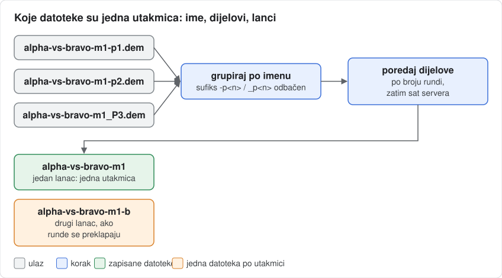

# Naredbe {#commands}

Nov u naredbeni redak? Prvo pročitajte [Prije nego što počnete](before-you-start.md). Ove naredbe upisujte u Terminal otvoren u mapi u koju ste raspakirali ili klonirali program; `<...>` su oznake mjesta, a putanja s razmacima ide u navodnike.

```text
python -m heat3d_cs2 demos <demo datoteke ili mape> -o <mapa> [--every 8] [--jobs N] [--map TEXT] [--force] [--no-bulk] [--loose]
python -m heat3d_cs2 map <ime karte ili putanja do njezine .vpk> -o <datoteka.glb> [--game MAPA] [--source2viewer EXE]
python -m heat3d_cs2 scoreboard <meč.3dheat ili meč.json>
```

`python -m heat3d_cs2 --help` i `python -m heat3d_cs2 <naredba> --help` navode iste opcije; [Pregled naredbi](../cli-reference.md) prikazuje sve. Svako pokretanje prvo provjerava novo izdanje, kako je opisano na [Ažuriranja](updates.md) (isključuje se s `HEAT3D_NO_UPDATE=1`).

Kod: [`heat3d_cs2/cli.py`](https://github.com/Holdi601/3DHeat-CS2/blob/main/heat3d_cs2/cli.py).

## `demos` - demo snimke u tablice i dokumente meča {#demos---demos-into-tables-and-match-documents}

```powershell
python -m heat3d_cs2 demos D:\Demos\event -o out
python -m heat3d_cs2 demos alpha-vs-bravo-m1-p1.dem alpha-vs-bravo-m1-p2.dem -o out
python -m heat3d_cs2 demos D:\Demos -o out --map final --jobs 4
```

| Argument | Zadano | Radi |
|---|---|---|
| `paths` (jedna ili više) | - | datoteke demo snimki i mape. Datoteka se uzima kad joj je nastavak `.dem` (bilo koja veličina slova). Mapa se pretražuje **rekurzivno** za datotekama koje završavaju na `.dem`, bilo koja veličina slova, poredanim po imenu. Komprimirane snimke (`.dem.zst`, `.dem.bz2`, arhive) se ne čitaju: prije toga ih raspakirajte. |
| `-o`, `--out` | obavezno | mapa u koju se piše; stvara se po potrebi |
| `--every N` | `8` | uzorkuj svakog igrača svakih *N* tikova. CS2 demo snimke rade na 64 tika u sekundi, pa `--every 8` znači osam uzoraka u sekundi, `--every 4` šesnaest, a `--every 64` jedan. Događaji se uvijek čitaju u svom tiku, bez obzira na *N*. |
| `--jobs N` | `0` = pola jezgri procesora | koliko se meča pretvara istovremeno, svaki u svom procesu. Nikad manje od 1, nikad više od broja mečeva za obraditi. |
| `--map TEXT` | - | samo mečevi čije **ime** sadrži *TEXT*, bez obzira na veličinu slova (`--map final`). Filtrira po imenu datoteke, ne po karti koju demo zapravo sadrži. |
| `--force` | isključeno | pretvori mečeve koji su već zapisani, prepisujući ih |
| `--loose` | isključeno | čuvaj svaki meč kao zasebne datoteke - tablicu, `.match.json`, prateće datoteke - umjesto da ih spakira u jedan `.3dheat` spremnik. Vidi [Jedna datoteka po meču](output-container.md). |
| `--container` | uključeno | spakiraj svaki meč u jednu `.3dheat` datoteku; to je zadano, pa je ova opcija tu samo da bude eksplicitna |
| `--no-bulk` | isključeno | izostavi tok entiteta, naredbe igrača i tok animacija iz prateće datoteke paketa - više od pola veličine demo snimke i kad je komprimirana. Samoprovjera dokumenta meča ih tada broji kao `lost`, po imenu. |


### Koje su datoteke jedan meč {#which-files-are-one-match}



Ime meča je ime datoteke demo snimke bez nastavka i bez oznake dijela: `-p<znamenke>` ili `_p<znamenke>` na kraju, bez obzira na veličinu slova. Tako su `alpha-vs-bravo-m1-p1.dem`, `alpha-vs-bravo-m1-p2.dem` i `alpha-vs-bravo-m1_P3.dem` dijelovi jednog meča, `alpha-vs-bravo-m1`. Datoteke se grupiraju samo po tom imenu - dvije datoteke istog imena u različitim mapama također su u istoj grupi.

Oznaka dijela ništa ne govori o redoslijedu: `-p2` može biti raniji dio. Dijelovi se poredaju prema broju rundi koje sadrže, pa prema satu poslužitelja, a grupa koja se pokaže kao dva različita meča (npr. isti timovi na istoj karti na dva događaja) dijeli se na **lance**: lanac s najviše rundi zapisuje se pod samim imenom, sljedeći kao `<ime>-b`, zatim `<ime>-c`, i tako dalje. Datoteka bez ijedne runde (samo zagrijavanje, pauza) ne pripada nijednom lancu. Kako se lanci pronalaze, opisano je na [Sastavljanje meča](building-matches.md#parts-and-chains).

### Što se zapisuje {#what-is-written}

Za svaki meč, u mapu nazvanu prema karti koju navodi zaglavlje demo snimke (`unknown` kad ga nema), jedna datoteka `.3dheat`:

```text
out/
  de_x/
    alpha-vs-bravo-m1.3dheat
    alpha-vs-bravo-m2.3dheat
  de_y/
    ...
```

Na sintetičkoj demo snimci s dvije runde iz testova:


S `--loose` svaki meč je tablica, njegov dokument meča i četiri prateće datoteke jedna pored druge ([Jedna datoteka po meču](output-container.md)):


Toplinska karta prikazuje jednu kartu, pa učitavanje jedne mape u preglednik znači učitavanje mečeva jedne karte. Vidi [Toplinska tablica](output-table.md) i [Dokument meča](output-match-json.md).

### Što se preskače {#what-is-skipped}

Prije čitanja bilo čega, svaka datoteka `*.3dheat` ispod `--out` (spremnik se piše cijel ili nimalo) i svaka datoteka `*.parquet` koja uz sebe ima svoj dokument meča (`<ime>.match.json`) se popisuje, pa se meč čije ime odgovara jednom od njihovih imena (bez nastavka) preskače, osim ako nije `--force`. Tablica bez svog dokumenta meča - pokretanje zaustavljeno između pisanja to dvoje - ne računa se, pa se taj meč ponovno pretvara. Provjera je samo po imenu: meč pretvoren u drugu mapu karte ili s drugim `--every` i dalje se računa kao gotov. Kad nema ništa za raditi:

```text
nothing to do: no demos found, or every match already written (--force redoes them)
```

### Što se ispisuje {#what-is-printed}

Prvo količina posla, zatim po jedan redak za svaki meč kad završi (redom kojim završavaju, a ne redom datoteka):

```text
3 match(es), 3 at a time
alpha-vs-bravo-m1: de_x, 21 rounds (Alpha 13 Bravo 8), 412,377 rows, lost 0
alpha-vs-bravo-m2: de_y, 30 rounds (Bravo 16 Alpha 14), 598,104 rows, 1 incomplete round(s) left out, lost 0
alpha-vs-bravo-m3: de_y, 18 rounds (Alpha 13 Bravo 5), 330,981 rows, recorded from round 3, lost 1,204,331 (svc_PacketEntities, svc_UserCmds, DEM_AnimationData)
```

(Brojevi su ilustrativni.) Rezultat je onaj zadnje runde, tim po tim, redom kojim ga dokument meča navodi. *incomplete round(s) left out* broji runde koje demo nije završio prije nego su odlučene; *recorded from round N* kaže da snimka počinje kasno; *lost* je samoprovjera dokumenta meča - koliko stavki demo snimke nije završilo nigdje, i kojih vrsta (`--no-bulk` čini bulk izgubljenim). Meč koji ništa ne daje kaže zašto:

```text
alpha-vs-bravo-m4: no round in 1 file(s) - nothing written
alpha-vs-bravo-m4-b: no complete round in 1 file(s) - nothing written
```

Greška u jednom meču ne zaustavlja ostale; ispisuje se kao `<ime>: failed - <greška>`.

### Izlazni kod {#exit-code}

`0` kad su svi mečevi pretvoreni (ili nema što raditi), `1` kad je barem jedan neuspješan.

### Koliko traje {#how-long-it-takes}

Svaki meč se čita i gradi u radnom procesu. Mapa od nekoliko stotina demo snimki traje minute uz zadane `--jobs`. Memorija po poslu raste s duljinom meča i s manjim `--every`: svaki radnik drži svaki uzorkovani redak igrača svog meča (otprilike deset igrača puta 64 / *N* redaka u sekundi snimke) prije pisanja.

Prateće datoteke traju dulje od tablice: svako svojstvo koje parser čita čita se u svakom tiku, u prozorima tikova (otprilike dvije minute za demo od 40 minuta, najviše oko 3 GB memorije po poslu), a zatim se demo još jednom prođe radi okvira i poruka.

## `map` - geometrija karte kao `.glb` {#map---a-maps-geometry-as-glb}


```powershell
python -m heat3d_cs2 map <karta> -o out/<karta>/<karta>.glb
python -m heat3d_cs2 map <karta> -o <karta>.glb --game "D:\Games\Steam\steamapps\common\Counter-Strike Global Offensive"
python -m heat3d_cs2 map "D:\maps\<karta>.vpk" -o <karta>.glb --source2viewer C:\Tools\Source2Viewer-CLI.exe
```

| Argument | Zadano | Radi |
|---|---|---|
| `name` | - | ime karte (npr. `de_x`), ili putanja do njezine `.vpk` datoteke. Putanja koja završava na `.vpk` i postoji koristi se kakva jest; sve drugo traži se prema nazivu datoteke u instaliranoj igri. |
| `-o`, `--out` | obavezno | `.glb` koji se piše; njegova mapa se stvara po potrebi |
| `--game FOLDER` | Steamove biblioteke | mapa instalacije CS2 (ona koja sadrži `game\csgo`), kad Steam ne zna za nju. Uz `--game`, pretražuje se samo ta mapa. |
| `--source2viewer EXE` | `HEAT3D_SOURCE2VIEWER`, zatim `PATH` | izvršna datoteka Source2Viewer CLI |

Ispis pri uspjehu:

```text
out/de_x/de_x.glb: de_x, 412,880 triangles (151,204 ground) in 14 parts
```

(brojevi su ilustrativni). Pisanje `.glb` uz tablice karte (`out/<karta>/<karta>.glb`) drži podatke i geometriju karte u jednoj mapi. Kako izvoz radi: [Izvoz karte](map-export.md).

Greške, svaka ispisana kao `error: ...` s izlaznim kodom `2`:

| Poruka | Znači |
|---|---|
| `no de_x.vpk found in an installed CS2 - pass --game <CS2 folder> or the .vpk path` | karta nije ni u jednoj Steam biblioteci koja je pronađena, ili je ime krivo |
| `Source2Viewer-CLI not found: ...` | nijedan od `--source2viewer`, `HEAT3D_SOURCE2VIEWER`, `PATH` ne daje postojeću datoteku |
| `Source2Viewer did not export de_x's collision mesh:` i iza toga kraj njegova ispisa | nije uspjelo, ili nije napisalo `.glb` |
| `de_x's collision mesh has nothing but clip brushes` | nakon izostavljanja clip i sky elemenata ništa nije ostalo |

## `scoreboard` - meč kao tekst {#scoreboard---a-match-as-text}

```bash
python -m heat3d_cs2 scoreboard out/de_x/alpha-vs-bravo-m1.3dheat
python -m heat3d_cs2 scoreboard out/de_x/alpha-vs-bravo-m1.match.json   # nakon demos --loose
```

Ispisuje rezultatnu tablicu meča iz njegova [dokumenta meča](output-match-json.md), bez otvaranja preglednika. Čita dokument unutar `.3dheat` spremnika, ili samostalni `<meč>.match.json`.
Na sintetičkoj demo snimci s dvije runde iz testova:


```text
alpha-vs-bravo-m1 - de_test  Alpha 2  Bravo 0

Alpha
player                 K   D   A  +/-    ADR   KAST   HS%  OK-OD  clutch
ash                    1   0   0   +1   50.0 100.0%    0%   0-0     1/1
ace                    1   1   0   +0   50.0 100.0%  100%   1-0     0/0

Bravo
player                 K   D   A  +/-    ADR   KAST   HS%  OK-OD  clutch
ben                    1   1   0   +0   50.0 100.0%    0%   0-0     0/1
bob                    0   1   0   -1    0.0 100.0%    0%   0-1     0/0

rounds  1:TK 2:TB
```

- Prvi red: ime meča, karta i konačni rezultat po timovima.
- Tablica za svaki tim, redom kojim je navedeno `teams` u dokumentu meča; igrači redom iz dokumenta meča (po ubojstvima minus smrtima, pa po ubojstvima, najbolji prvi). Imena se skraćuju na 19 znakova.
- Stupci: **K** ubojstva, **D** smrti, **A** asistencije *uključujući* asistencije bljeskom, **+/-** ubojstva minus smrti, **ADR**, **KAST** (%), **HS%** (zaokruženo na cijeli postotak), **OK-OD** prva ubojstva - prve smrti, **clutch** osvojeni clutchevi / odigrani clutchevi. Definicije: [Statistika](statistics.md).
- Niz rundi: `<runda>:<strana pobjednica><kako>`, s **B** bomba eksplodirala, **D** deaktivirana, **K** eliminacija, **T** isteklo vrijeme, i **?** za sve ostalo (neriješeno, predaja, drugo). Neriješeno nema stranu pobjednicu: `<runda>:?`.

Datoteka koja nije ispravan JSON, ili nije pronađena, zaustavlja se s greškom; JSON dokument bez polja dokumenta meča ne uspijeva s Python greškom (dalje se ne provjerava).
