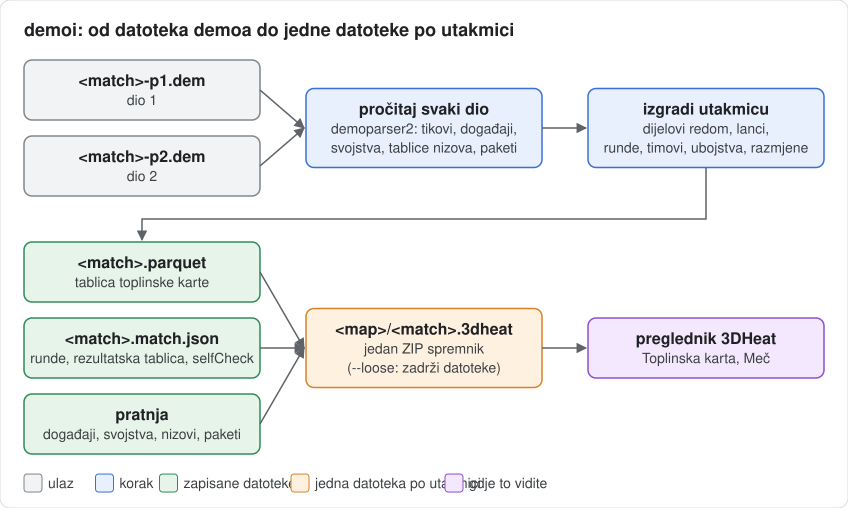

# 3DHeat CS2 {#dheat-cs2}

**Što je to?** Counter-Strike 2 može spremiti snimku utakmice, zvanu *demo*. Ovaj alat pretvara demo u datoteke koje preglednik 3DHeat može prikazati u 3D: gdje je svatko stajao, poginuo, bacio i postavio bombu, runda po rundu. Može i pretvoriti CS2 kartu u 3D model na kojem ih prikazuje.

**Zašto bih ga koristio?** Da pregledate vlastite utakmice, da više utakmica jedne karte složite jednu preko druge kao jednu toplinsku kartu, te za statistiku utakmica poput ADR-a (prosječna šteta po rundi) i KAST-a (udio rundi u kojima je igrač ubio, asistirao, preživio ili je netko iz njegova tima odmah osvetio njegovu smrt).

**Primjer:** `alpha-vs-bravo-m1.dem` ulazi, `out/de_x/alpha-vs-bravo-m1.3dheat` izlazi (`de_x` je izmišljeno ime karte).



Detaljnije: 3DHeat CS2 pretvara **demoe Counter-Strike 2** u tablicu toplinske karte i dokument meča po utakmici, a **CS2 kartu** u geometriju razine. Izlazi su
napravljeni za [3DHeat](https://holdi601.github.io/3DHeat/) preglednik telemetrije
([izvorni kod](https://github.com/Holdi601/3DHeat)), ali su obične datoteke - Parquet, JSON i
binarni glTF - koje može čitati i bilo što drugo.

Riječ je o malom Python paketu, `heat3d_cs2`, pokretanom iz naredbenog retka. Čita
demoe s diska (ne preuzima nijedan) pomoću
[demoparser2](https://github.com/LaihoE/demoparser), a karte izvozi iz instalirane igre
pomoću naredbenog izdanja Source2Viewer
([ValveResourceFormat](https://github.com/ValveResourceFormat/ValveResourceFormat)).

## Brzi početak {#quick-start}

Ne znate ništa o naredbenom retku? Prvo pročitajte [Prije nego što počnete](before-you-start.md).

```bash
pip install -r requirements.txt
python -m heat3d_cs2 demos <demo files or folders> -o out   # svaka utakmica u njima
python -m heat3d_cs2 map <map> -o out/<map>/<map>.glb       # karta iz instalirane igre
python -m heat3d_cs2 scoreboard out/<map>/<match>.3dheat    # rezultatska tablica utakmice kao tekst
```

Trebali biste vidjeti `1 match(es), 1 at a time ...`, a zatim redak po utakmici
(vidi [Naredbe](../commands.md#what-is-printed)).

`demos` piše, za svaku utakmicu, jednu datoteku u mapu nazvanu po karti:
`out/<map>/<match>.3dheat`, [`.3dheat` spremnik](../output-container.md) - format preglednika
s jednom datotekom po utakmici ([specifikacija](https://holdi601.github.io/3DHeat/container.html)).
Sadrži ove dijelove; `--loose` ih umjesto toga piše kao zasebne datoteke:

| Dio | Što sadrži | Učitava se na |
|---|---|---|
| `<match>.parquet` (uloga `table`) | svakog živog igrača osam puta u sekundi sa stanjem (zdravlje, novac, bljesak, nišan, zona, inventar, ...), i svaki događaj kad se dogodio (ubojstvo, smrt, ozljeda, hitac, bacanje, eksplozije granata, zasljepljenje, postavljanje, deaktiviranje, eksplozija, i kraj runde po igraču s onim što mu je runda donijela), po jedan redak | kartica Toplinska karta |
| `<match>.match.json` (uloga `match`, dokument meča) | timovi, rezultat, svaka runda (pobjednik, kako, ekonomija, postavljanje, ubojstva redom, clutchevi, preživjeli) i redak rezultatske tablice svakog igrača | kartica Meč |
| `<match>.events/props/strings/packets.parquet` | sve ostalo što demo sadrži, cijelo (prateće datoteke) | čuva se radi potpunosti |

`map` piše `<map>.glb`: mrežu sudara karte - podovi, zidovi, kutije,
bez ukrasa - podijeljenu na tlo i građevine, u istom okviru i
mjernim jedinicama kao tablice, pa leži točno ispod toplinske karte (panel Pozadina / razina).

## Karta ove dokumentacije {#map-of-this-documentation}

| Stranica | Što obuhvaća |
|---|---|
| [Prije nego što počnete](before-you-start.md) | Python, terminal, mjesta za upis, kako izgledaju uspjeh i česte greške |
| [Instalacija](../installing.md) | Python, paketi, CLI Source2Viewera, gdje mora biti CS2 |
| [Naredbe](../commands.md) | `demos`, `map`, `scoreboard`: svaka opcija, što se ispisuje, kodovi izlaza |
| [Čitanje demoa](../reading-demos.md) | što se čita iz datoteke demoa: uzorkovani tikovi, svojstva igrača, pravila igre, događaji |
| [Izrada utakmice](../building-matches.md) | dijelovi i lanci, sat utakmice, runde, timovi i strane, retci, ubojstva, razmjene, otvaranja, šteta, bljeskovi, ekonomija |
| [Statistika](../statistics.md) | rezultatska tablica: K/D/A, ADR, KAST, HS%, otvaranja, razmjene, višestruka ubojstva, clutchevi, pomoćna sredstva, bljeskovi |
| [Tablica toplinske karte](../output-table.md) | Parquet datoteka: svaki stupac, njegov tip, koji događaji ga popunjavaju, savjeti u podnožju `heat3d`, osi |
| [Dokument meča](../output-match-json.md) | dokument `.match.json`, polje po polje |
| [Jedna datoteka po utakmici](../output-container.md) | `.3dheat` spremnik koji `demos` piše zadano, `--loose` |
| [Izvoz karte](../map-export.md) | kako se mreža sudara karte izvozi, okvir, imenovanje čvorova, mjerne jedinice |
| [Korištenje s 3DHeatom](../using-with-3dheat.md) | učitavanje tablica, dokumenata meča i karata u kartice Toplinska karta i Meč preglednika |
| [Ograničenja](../limits.md) | što se pretpostavlja, što se ne obrađuje, što nije provjereno |
| [Ažuriranja](../updates.md) | provjera izdanja pri pokretanju i `python -m heat3d_update` |
| [Razvoj](../development.md) | raspored koda, testovi, sintetički demo |
| [Referenca naredbi](../cli-reference.md) | `--help` svake naredbe, generirano iz koda |
| [Održavanje](../maintaining.md) | popis za izdavanje ovih stranica |

## Što je provjereno {#what-it-is-checked-against}

Demoi iz divljine nisu jedna čista datoteka po utakmici. Pretvarač obrađuje utakmicu
razbijenu na datoteke u bilo kojem redoslijedu, poslužitelj ponovno pokrenut usred utakmice, dvije
različite utakmice pohranjene pod jednim imenom, runde vraćene iz sigurnosne kopije, snimku koja počinje kasno ili
završava rano, pauze i trenere na strani tima -
vidi [Izrada utakmice](../building-matches.md). Provjereno na velikoj zbirci turnirskih demoa: u svakoj utakmici
rezultat prati pobjednike rundi, ubojstva jedne strane su smrti druge, a svaka runda počinje s pet na pet.

## Na što ga usmjeriti {#what-to-point-it-at}

Demoi vaših vlastitih utakmica, demoi koje ste ručno preuzeli s turnirske stranice,
ili demoi s API-ja kojem imate pristup. Demo je snimka čiji sadržaj
pripada izdavaču i organizatorima: rezultate koristite za vlastitu analizu, a demoe ili podatke izvedene iz njih ne distribuirajte dalje. Stranice koje nude demoe često u svojim uvjetima zabranjuju automatizirano preuzimanje, zato alat čita demoe s diska i ne preuzima nijedan.

## Dio 3DHeata {#part-of-3dheat}

3DHeat CS2 je jedan od besplatnih alata oko preglednika 3DHeat, svaki sa svojim
repozitorijem, izdanjima i licencom:

| Alat | Što radi | Dokumentacija |
|---|---|---|
| [3DHeat](https://github.com/Holdi601/3DHeat) | preglednik: toplinske karte, analiza utrka i pregled meča u 3D | [stranica](https://holdi601.github.io/3DHeat/) |
| [GameFiles](https://github.com/Holdi601/3DHeat-GameFiles) | staze i razine iz datoteka koje igre isporučuju, kao 3D modeli | [stranica](https://holdi601.github.io/3DHeat-GameFiles/) |
| [GameCapture](https://github.com/Holdi601/3DHeat-GameCapture) | telemetrija krugova iz igara utrka; razine rekonstruirane iz videa igranja | [stranica](https://holdi601.github.io/3DHeat-GameCapture/) |
| [Unreal Exporter](https://github.com/Holdi601/3DHeat-UnrealExporter) | dodatak za Unreal Editor koji izvozi razinu kao jedan 3D model | [stranica](https://holdi601.github.io/3DHeat-UnrealExporter/) |
| [CS2](https://github.com/Holdi601/3DHeat-CS2) | demoi Counter-Strike 2 u tablice i dokumente meča; karte u 3D modele | [stranica](https://holdi601.github.io/3DHeat-CS2/) |
| [Watcher](https://github.com/Holdi601/3DHeat-Watcher) | bilježi što igre objavljuju o vašem igranju, u pozadini | [stranica](https://holdi601.github.io/3DHeat-Watcher/) |
| [Ext-WarThunder](https://github.com/Holdi601/3DHeat-Ext-WarThunder) | War Thunder replay-i u tablice i dokumente meča | [stranica](https://holdi601.github.io/3DHeat-Ext-WarThunder/) |
| [Ext-WoT](https://github.com/Holdi601/3DHeat-Ext-WoT) | World of Tanks replay-i u tablice i dokumente meča | [stranica](https://holdi601.github.io/3DHeat-Ext-WoT/) |
| [Ext-WoWs](https://github.com/Holdi601/3DHeat-Ext-WoWs) | World of Warships replay-i u tablice i dokumente meča | [stranica](https://holdi601.github.io/3DHeat-Ext-WoWs/) |
| [Ext-Squad](https://github.com/Holdi601/3DHeat-Ext-Squad) | demoi Squad servera u tablice i dokumente meča | [stranica](https://holdi601.github.io/3DHeat-Ext-Squad/) |
| [Ext-DCS](https://github.com/Holdi601/3DHeat-Ext-DCS) | karte DCS Worlda u 3D modele | [stranica](https://holdi601.github.io/3DHeat-Ext-DCS/) |
| [Ext-IL2](https://github.com/Holdi601/3DHeat-Ext-IL2) | karte IL-2 Sturmovik u 3D modele | [stranica](https://holdi601.github.io/3DHeat-Ext-IL2/) |

## Licenca {#licence}

MIT - vidi [`LICENSE`](https://github.com/Holdi601/3DHeat-CS2/blob/main/LICENSE),
i [`LICENSES.md`](https://github.com/Holdi601/3DHeat-CS2/blob/main/LICENSES.md)
za pakete trećih strana i to što igre koje čita nalažu.
