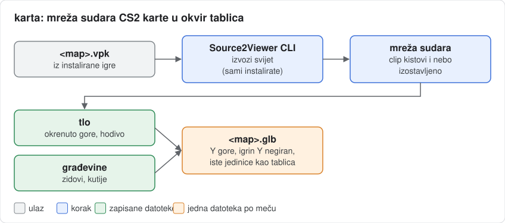

# Izvoz karte (`map`) {#map-export-map}

`python -m heat3d_cs2 map <karta> -o <datoteka.glb>` zapisuje CS2 kartu kao geometriju razine: **kolizijsku mrežu** svijeta, u okviru i jedinicama u kojima se crtaju [toplinske tablice](output-table.md). Kod:
[`heat3d_cs2/mapexport.py`](https://github.com/Holdi601/3DHeat-CS2/blob/main/heat3d_cs2/mapexport.py),
[`heat3d_cs2/glb.py`](https://github.com/Holdi601/3DHeat-CS2/blob/main/heat3d_cs2/glb.py).
Opcije i poruke: [Naredbe](commands.md#map---a-maps-geometry-as-glb).



## Zašto kolizijska mreža {#why-the-collision-mesh}

Kolizijska mreža je ono na čemu igrači stoje i iza čega se skrivaju - podovi, zidovi, stepenice, kutije - bez ukrasa: bez rekvizita koji samo izgledaju kao nešto, bez tekstura, s daleko manje trokuta nego kod mreža za prikaz. Toplinskoj karti to treba ispod sebe: nešto prema čemu se čitaju položaji, a ne prikaz karte.

## Kako se dobiva {#how-it-is-obtained}

1. **Pronađite kartu.** Putanja koja završava na `.vpk` i postoji koristi se kakva jest. Inače se traži `<ime>.vpk` u `<mapa CS2>\game\csgo\maps\`, gdje je mapa CS2 `--game`, ili `steamapps\common\Counter-Strike Global Offensive` u svakoj pronađenoj Steam biblioteci (vidi [Instalacija](installing.md#where-cs2-is-looked-for)).
2. **Pronađite Source2Viewerov CLI**: `--source2viewer`, zatim `HEAT3D_SOURCE2VIEWER`, zatim `Source2Viewer-CLI` / `Source2Viewer-CLI.exe` na `PATH`.
3. **Izvezite fiziku svijeta.** Source2Viewer se pokreće ovako:

   ```text
   Source2Viewer-CLI -i <karta>.vpk -d -f maps/<karta>/world_physics.vmdl_c --gltf_export_format glb -o <privremena mapa>
   ```

   Dekodira kompiliranu fiziku Source 2 iz vlastite arhive karte i zapisuje model (prazan: svijet nema vlastitu mrežu za prikaz) i njegovu fiziku uz njega. Najveći zapisani `.glb` je fizika. Ako Source2Viewer ne uspije ili ne zapiše `.glb`, naredba se zaustavlja i prikazuje zadnjih 800 znakova njegova ispisa i grešaka.
4. **Pročitajte ga.** Svaki čvor scene obilazi se s transformacijom (matrica, ili translacija-rotacija-skala), i uzima se svaki primitiv trokuta, s indeksnim međuspremnikom ili bez njega, u svjetskim položajima.
5. **Izostavite što nije zid ni pod.** Čvor čije ime sadrži `clip` - igrački clipovi, NPC clipovi, clipovi granata: nevidljivi zidovi koji zaustavljaju igrače i granate - ili `sky`, bez obzira na veličinu slova, otpada.
6. **Imenujte površinu.** Fizičke grupe nose ime po svojoj površini; ime malim slovima, bez vodećeg `physics`, `physics_group` ili `physics_passbullets` (i podvlake iza njega), jest površina: `physics_group_concrete` je `concrete`, `physics_passbullets_chainlink` je `chainlink`, a sam `physics_group` je `world`. Površine kroz koje prolaze meci čuvaju se.
7. **Natrag u okvir igre.** Source2Viewer piše glTF u metrima s Y prema gore: Y, Z, X igre pomnoženi s 0,0254. To se poništava - svaka točka postaje (X, Y, Z) igre u inčima.
8. **Razdvojite tlo od strukture**, trokut po trokut: ploha čija normala gleda prema gore najmanje 0,7 (njezina Z komponenta, normalizirana) - nagibi do otprilike 45 stupnjeva, otprilike najstrmije što igrač u CS2 hoda - je **tlo**; sve ostalo, uključujući zidove i stropove, je **struktura**.
9. **U okvir preglednika.** Svaka točka zapisuje se kao (X, Z, -Y): Y prema gore, Y igre negiran - okvir u kojem preglednik crta tablice kad slijedi njihove `heat3d` savjete. Rotacija, ne zrcaljenje.
10. **Zapišite `.glb`.** Ako ništa ne ostane (samo clip elementi), naredba se zaustavlja s greškom. Inače ispisuje datoteku, kartu, broj trokuta, koliko ih je tla, i broj dijelova.

Ovdje se ne čita ništa osim vlastite `.vpk` karte, i ništa od Source2Vieweru nije uključeno niti kopirano.

## Datoteka {#the-file}

Binarni glTF 2.0 (`.glb`), jedan međuspremnik, zapisan pomoću `heat3d_cs2` (`asset.generator`):

| Aspekt | Što |
|---|---|
| Čvorovi | jedan po dijelu, svi u korijenu, bez transformacija, svaki sa svojom mrežom istog imena |
| Imena čvorova | `ground:<površina>` ili `structure:<površina>` (`ground:concrete`, `structure:metal`, `structure:world`), poredano po imenu |
| Primitivi | jedan po mreži, trokuti, `POSITION` (float32, s min/max) i `NORMAL` (float32), indeksi `uint32` |
| Sjenčanje | ravno: jedan vrh po kutu trokuta, svaki nosi normalu svog trokuta |
| Materijali, teksture, UV, boje | nema |
| Jedinice | jedinice igre (**inči**), ne metri - suprotno onome što glTF pretpostavlja |
| Okvir | (X, Z, -Y) igre: Y glTF-a je visina igre, Z glTF-a je -Y igre |

Prefiks `ground:` / `structure:` je konvencija svih izvoznika razina 3DHeat: preglednik uzima dio tako imenovan zdravo za gotovo umjesto da nagađa iz geometrije, pa podovi dobivaju sjenčanje tla, a zidovi crtež strukture, bez ikakvog koraka klasifikacije.

Budući da su jedinice inči, druga glTF aplikacija prikazuje kartu oko 39 puta preveliku (čita ih kao metre); ondje skalirajte s 0,0254 ako je važno. U 3DHeat-u leži točno ispod tablice, koja je u istim jedinicama sa skalom 1.

## Provjera da je okvir ispravan {#the-check-that-the-frame-is-right}

Test `test_players_stand_on_the_exported_floor` (pokreće se samo kad su dani demo snimka i Source2Viewer, vidi [Razvoj](development.md#tests)) izvozi kartu na kojoj je demo snimka odigrana, uzima 300 nasumičnih uzoraka pozicija igrača iz meča i za svaki gleda ravno dolje tražeći najviši trokut tla najviše 4 jedinice iznad stopala igrača. Traži da najmanje 98 % uzoraka pronađe tlo i da srednja visina iznad njega bude manja od 5 jedinica. Zrcaljena karta na tome pada: na karti zrcaljenoj pogrešnom osi velik dio igrača stoji nad ničim. README navodi brojke ove provjere za karte trenutnog natjecateljskog izbora.

## Što ne radi {#what-it-does-not-do}

- Nema geometrije prikaza, tekstura ni ukrasa - vidi *zašto* iznad.
- Izvozi se samo ono što je u modelu `world_physics` karte. Jesu li pokretni dijelovi (vrata) ili razbijive stvari u njemu, nije provjereno.
- Nema pojednostavljivanja: preglednik 3DHeat pojednostavljuje pri uvozu prema postavci **Cilj pojednostavljivanja**.
- Karte koje nisu u instaliranoj igri (radionička karta negdje na disku) rade kad se njihova `.vpk` preda kao putanja i sadrži `maps/<ime>/world_physics.vmdl_c`; nije provjereno.
