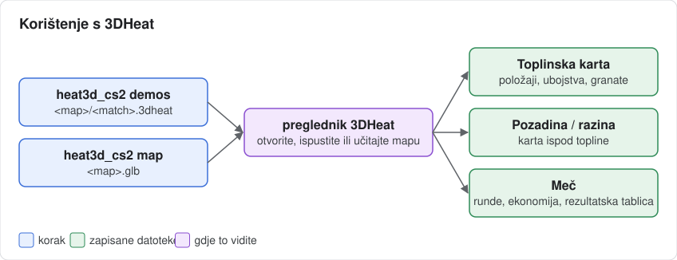

# Korištenje s 3DHeatom {#using-it-with-3dheat}

Izlazi idu na ova mjesta u [pregledniku 3DHeat](https://holdi601.github.io/3DHeat):

| Datoteka | Gdje | Što daje |
|---|---|---|
| `<meč>.3dheat` (zadano) | kartica **Toplinska karta**, panel **Izvor**, ili kartica **Meč** | tablicu i dokument meča zajedno, jedna datoteka po meču ([spremnik](https://holdi601.github.io/3DHeat/container.html)) |
| `<meč>.parquet` | kartica **Toplinska karta**, panel **Izvor** | položaje i događaje kao toplinsku kartu, reprodukciju kutije, rute |
| `<meč>.match.json` | kartica **Meč**, **Učitaj datoteke mečeva…** | rezultatnu tablicu, runde, tok ubojstava, statistiku kroz mečeve, poveznice u toplinsku kartu |
| `<karta>.glb` | panel **Pozadina / razina**, **3D model…** | kartu ispod toplinske karte |

Vlastita dokumentacija preglednika opisuje svaku karticu u cijelosti: stranice
[Analiza meča](https://holdi601.github.io/3DHeat/match-analysis.html),
[Učitavanje datoteka](https://holdi601.github.io/3DHeat/loading-files.html),
[Mapiranje stupaca](https://holdi601.github.io/3DHeat/column-mapping.html)
i [Reprodukcija kutije](https://holdi601.github.io/3DHeat/box-replay.html).
Ova stranica je CS2 strana toga.



Preglednik: [github.com/Holdi601/3DHeat](https://github.com/Holdi601/3DHeat),
dokumentacija [holdi601.github.io/3DHeat](https://holdi601.github.io/3DHeat/).

## Tipična sesija {#a-typical-session}

```bash
python -m heat3d_cs2 demos D:\Demos\event -o out
python -m heat3d_cs2 map <karta> -o out/<karta>/<karta>.glb
```

1. **Toplinska karta -> Izvor:** odaberite mapu `out/<karta>` (ili je povucite). Svaka `.parquet` datoteka u njoj postaje jedan skup podataka; datoteke `.json` i `.glb` u istoj mapi preskaču se kao "not a csv/parquet file". Učitajte.
2. **Pozadina / razina -> 3D model…:** odaberite `out/<karta>/<karta>.glb`. **Spremi u biblioteku** ga čuva u pregledniku za sljedeći put.
3. **Meč -> Učitaj datoteke mečeva…:** odaberite `.match.json` datoteke iz iste mape (nekoliko odjednom), ili ih povucite na prikaz dok je kartica Meč otvorena.

Učitavajte istovremeno tablice samo jedne karte: koordinate različitih karata se preklapaju, a toplinska karta dviju karata istovremeno ne znači ništa. Mapa po karti tu je upravo zato.

## Tablica se otvara bez ičega za postaviti {#the-table-opens-with-nothing-to-set}

Preglednik čita unos `heat3d` u podnožju prve odabrane datoteke
([Toplinska tablica](output-table.md#the-heat3d-footer-hints)) i stavlja ga preko vlastitih pretpostavki:

| Postavka preglednika | Postavite na |
|---|---|
| Položaj | `x`, `y`, `z` |
| Os prema gore u izvoru | Z je gore |
| Zrcali Y | uključeno - da karta bude ispravno okrenuta, a ne zrcaljena |
| Mjerilo jedinica | 1 - udaljenosti u jedinicama igre (označene kao "m"; 1 jedinica = 1 inč) |
| Vrijeme | `time`, sekunde |
| Osoba | `player` |
| Grupa | `side` (T / CT) |
| Sesija | `roundId` - svaka runda je sesija, `<meč> #NN` |
| Smjer pogleda | vektor, `dirX` / `dirY` / `dirZ` |
| Stupci filtra | `event`, `match`, `round`, `roundTime`, `phase`, `weapon`, `place`, `won`, `buy`, `opening`, `team` |
| Veličina entiteta | 32 - reprodukcija kutije crta igrača široko 32 jedinice, s zrakom pogleda 4 x 32 |

Svaka vrijednost iz savjeta i dalje se vidi u mapiranju stupaca i može se promijeniti. Ostali stupci (`headshot`, `traded`, `other`, `steamid`, `health`, `money`, `damage`, `duration`, ...) mogu se tamo ručno dodati kao filtri.

Mjerilo jedinica ostavite na 1 kad je karta učitana: `.glb` je u istim jedinicama igre, a razina se ne mijenja mjerilom zajedno s tablicom.

### Korisni filtri {#useful-filters}

- `event` = `position` za to gdje su igrači bili; `kill` / `death` za to gdje su dvoboji dobiveni i izgubljeni; `smoke`, `flash`, `molotov`, `he` za to gdje su pala pomoćna sredstva; `throw` za to odakle su bačena; `plant` za mjesta postavljanja.
- `side` (grupa) = `T` ili `CT`, `phase` = `live` da se izostavi faza nakon, `buy` = `eco` / `force` / `full` za runde jedne ekonomije, `won` = 1 za runde koje je strana retka pobijedila.
- `opening` = 1 uz `kill` i `death` za prve dvoboje.
- `roundTime` kao raspon za trenutak runde: prvih 20 sekundi, faza nakon postavljanja.

## Kartica Meč {#the-match-tab}

Kartica Meč prihvaća JSON datoteku čiji je `format` `heat3d-cs2-match` i koja ima polja `rounds`, `players` i `teams` ([Dokument meča](output-match-json.md)). Prikazuje rezultat i poluvremena, traku rundi obojanu prema strani pobjednici s oznakom za to kako je svaka završila, ekonomiju svake runde, postavljanje, tok ubojstava, clutcheve i preživjele, rezultatnu tablicu te statistiku kroz sve učitane mečeve.

Njezine poveznice **Prikaži na toplinskoj karti** ništa ne učitavaju: postavljaju filtre na tablici koja je već učitana u kartici Toplinska karta - `match`, `round` (i sesiju runde `<meč> #NN`), `event`, igrač, strana. To radi jer dokument meča i tablica nose ista imena mečeva, brojeve rundi, imena igrača i strane. **Reproduciraj rundu** prebacuje toplinsku kartu na reprodukciju kutije i pušta sesiju runde od njezinog početka.

Zato učitajte oboje: tablice jedne karte u kartici Toplinska karta, a njihove dokumente meča u kartici Meč. Dokument meča bez svoje tablice i dalje prikazuje rezultatnu tablicu i runde, a poveznice kažu da nema podataka toplinske karte.

## Bez preglednika 3DHeat {#without-3dheat}

- Tablica je običan Parquet: pandas, Polars, DuckDB, Spark, R-ov `arrow` ju sve čitaju; unos `heat3d` se ignorira, a tekstualni stupci čitaju se kao nizovi ili kategorije.
- Dokument meča je običan JSON.
- Karta je ispravan binarni glTF, u inčima, a ne u metrima: za alate koji pretpostavljaju metre skalirajte s 0,0254. Okvir je vlastiti okvir glTF-a (Y prema gore), pa tablicu drugdje preklapate tako da svaki redak (x, y, z) crtate kao (x, z, -y), kao što to radi 3DHeat.
