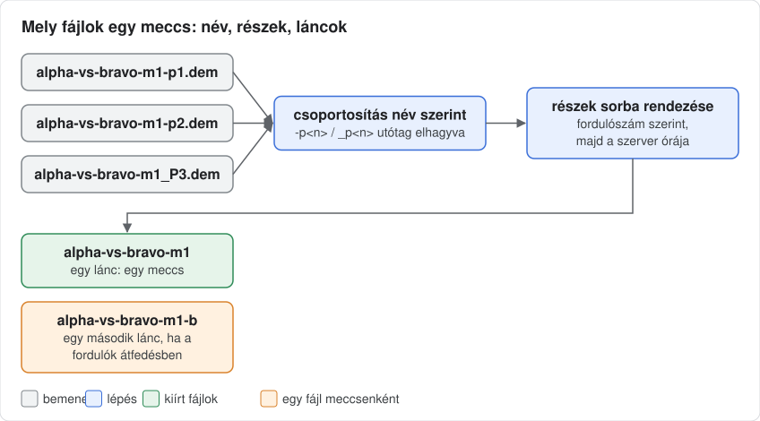

# Meccs felépítése {#building-a-match}

Hogyan áll össze egy meccs a demó-részeiből: mely fájlok tartoznak össze, egy közös óra mindegyikben, a körök
és az, hogyan nyerték őket, a csapatok és oldalaik, valamint a hőtérképes táblázat minden sora a gyilkosságokkal,
trade-ekkel, nyitó párharcokkal, sebzéssel, villanásokkal és gazdasággal. Kód:
[`heat3d_cs2/match.py`](https://github.com/Holdi601/3DHeat-CS2/blob/main/heat3d_cs2/match.py).
Az ebből számolt eredménytábla a [Statisztika](statistics.md) oldalon van.

## Áttekintés {#overview}

1. Egy meccsnév minden fájlját beolvassuk ([Demó beolvasása](reading-demos.md)).
2. Minden fájl duplikált játékossorait (visszaállított köröket) feloldjuk.
3. A fájlokat **láncokba** - meccsekbe - rendezzük, és minden láncot sorrendbe teszünk.
4. Minden részt a **meccsórára** helyezünk.
5. A **köröket** minden részben megtaláljuk; egy későbbi rész leírása egy körről felülírja a korábbit.
6. A **játékosokat** és **csapatokat** elnevezzük, minden kör oldalait és állását csapatnév szerint adjuk meg. Az oldalak ismeretében következik a félidő hossza, a pisztolykörök és minden oldal **vásárlása**.
7. Felépülnek a **sorok**: pozíciók, lövések, dobások, robbanások, lerakások, hatástalanítások, ölések, halálok, találatok, villanások, robbanások.
8. Minden sort megkap a körét, a fázisát, a kör-idejét, azt, hogy az oldala nyert-e, és az oldala vásárlását; a körökön kívül eső sorok kimaradnak.

## Visszaállított körök: egy sor játékosonként, tickenként {#restored-rounds-one-row-per-player-per-tick}

Ha egy kört egy fájlon belül egy mentésből állítanak vissza, a demó néhány másodpercig a játékosok régi testeit is
megtartja az újak mellett: két sor egy játékosnak ugyanazon a ticken, az egyik ott, ahol az érvénytelenített kör
hagyta őket, a másik a visszaállított kör spawn-pontján. Az ilyen játékosoknál a duplikált tickeken **visszafelé**
haladunk, az utánuk következő első egyedi sortól kezdve: minden ticken az a jelölt marad, amelyik a következő
pozícióhoz a legközelebb van, és ez lesz a referencia az előző tickhez. Ha utánuk nincs egyedi sor, az utolsó
jelöltet tartjuk meg. Így minden játékos azt a sort tartja meg, amelyik a következő helyzetéhez vezet.

## A fájl élő része {#the-live-part-of-a-file}

Egy fájl **élő kezdete** a legutolsó `round_announce_match_start` esemény ticke, vagy 0, ha nincs ilyen (a meccs
egy későbbi része általában nem tartalmaz ilyet). Minden, ami az élő kezdet előtt van, kimarad, és kimarad minden,
amit `is_warmup_period` jelöl. Egy kés-kör vagy újraindítás a bejelentés előtt tehát kimarad; az a kés-kör, amelyet
*nem* követ meccskezdési bejelentés, nem ismerszik fel (lásd [Korlátok](limits.md)).

A fájl **körei** azok a `round_freeze_end` események, amelyek az élő kezdettől vannak, bemelegítésen kívül, és a
`total_rounds_played` alapján azonosítottak (a játék 0-tól kezdődő indexe a következőnek lejátszandó körről). Ha egy
fájlban nincs ilyen, annak nincs köre, és nem tartozik egyetlen meccshez sem.

## Az óra {#the-clock}

Az idő másodpercben van. Egy fájlon belül az időt **tickekben** számoljuk: a szerver `game_time`-ja az első
mintavételezett ticknél, plusz az attól eltelt tickek / 64. A szerver saját órája szünetnél megáll, miközben a
tickek tovább futnak; az órán keresztül olvasva a szünetelt meccs két pillanata azonos időt kapna.

Minden fájlnak van *első órája* (az időpont az élő kezdetnél) és *utolsó órája* (az utolsó mintavételezett ticknél).

### Részek és láncok {#parts-and-chains}

Az azonos néven elnevezett fájlok ([Parancsok](commands.md#which-files-are-one-match)) először az első körük indexe,
majd az első órájuk szerint rendeződnek. Ezután mindegyik, ebben a sorrendben, az első olyan láncba csatlakozik,
amelyet folytat, vagy új láncot indít. Egy rész akkor folytat egy láncot, ha első körének indexe legalább a lánc
utolsó részének utolsó indexe, **és** az alábbiak közül valamelyik teljesül:

- a szerver órája folyamatos: első órája nem korábbi, mint a lánc utolsó órája mínusz 5 s; vagy
- a körszámlálás folyamatos: első körének indexe a lánc utolsó indexe vagy az utána következő.

A számlálás dönt, az óra oldja a döntetlent, mert egy kör visszaállítása miatt újraindított szerver órája újrakezdődik,
míg két különböző meccs azonos néven (ugyanazok a csapatok ugyanazon a pályán két eseményen) átfedő körszámokkal
rendelkezik. A láncok a lefedett körök száma szerint vannak sorba rendezve, a legtöbbel kezdve; az első megtartja a
meccs nevét, a többit `<név>-b`, `<név>-c`, ... néven írjuk ki.

### A meccsóra {#the-match-clock}

A meccs nullapontja az első rész első órája: **a meccsidő 0 az első fájl élő kezdete**. Minden későbbi rész erre
kerül:

- ahol a szerver órája folyamatos (első órája nem korábbi, mint az előző rész utolsó órája mínusz 5 s), a szerver
  órája marad, ahogy van;
- ahol újraindult, a rész **egy másodperccel** az előző rész vége után következik.

## Körök {#rounds}

Minden részben minden `round_freeze_end`-hez (tick-sorrendben) a kör ablaka a következő freeze end-ig tart abban a
részben, vagy a fájl végéig. Ezen belül a kör **eldőlt** az első mintánál, ahol a játékállapot
`total_rounds_played` = a kör indexe + 1, és `round_win_status` 1 (döntetlen), 2 (a T-k nyertek) vagy 3 (a CT-k
nyertek). Az olyan kör, amelynek ablakában nincs ilyen minta, a fájl végénél megszakadt; a sorszáma a meccs
**hiányos** listájába kerül (kivéve, ha egy másik részben teljes).

| Körmező | Honnan |
|---|---|
| `number` | az index + 1 (1-alapú, ahogy a játék számol) |
| `start` | a freeze time végének meccsideje - a játékosok már mozoghatnak |
| `end` | az első minta meccsideje, amelyen a kör eldöntöttnek látszik |
| `until` | az `end` utáni első `round_prestart` meccsideje, ha az ablakon belül van; egyébként az ablak vége vagy a fájl utolsó ticke, amelyik előbb jön (és sosem `end` előtt) |
| `winner` | `T` a 2-es, `CT` a 3-as győzelmi állapotnál; üres az 1-esnél: a döntetlen eldőlt, de nincs győztes |
| `reason` | a `round_win_reason` abban a mintában, az alábbiak szerint elnevezve |
| `score` | csapatnév -> megnyert körök ez után: minden oldal `team_rounds_total`-ja az eldöntő mintánál; ahol a demóban ez nincs meg, az előző kör állása plusz egy a győztesnek |
| `sides` | csapatnév -> `T` / `CT` ebben a körben |
| `equipment` | oldal -> az oldal **élő** játékosainak `current_equip_value`-jának összege a freeze time végén, az első mintánál vagy utána |
| `buy` | oldal -> `pistol`, `eco`, `force` vagy `full` ([Gazdaság](#economy-and-buy-types)) |
| `plant` | az első `bomb_planted` a freeze time vége után és `end`-ig, vagy nincs |
| `exploded` | az első `bomb_exploded` meccsideje az adott lerakás után és a következő freeze end előtt, ha van (nincs a meccsdokumentumban; a `explode` sort ez időzíti) |

A `reason` a játék `CSRoundEndReason`-jéből:

| Kód | `reason` |
|---|---|
| 1 | `bomb` (a célpontot felrobbantották) |
| 7 | `defuse` |
| 8, 9 | `elimination` (a CT-k nyertek / a T-k nyertek eliminálással) |
| 10 | `draw` |
| 12 | `time` (a célpontot megvédték) |
| 17, 18 | `surrender` |
| minden más | `other` |

Ha több rész ugyanazt a kört tartalmazza (index szerint), a későbbi rész változata marad. A körök ezután index
szerint vannak felsorolva. Ha a meccs első köre nem az 1., a hiányzó számokat rögzítjük (`missing` a
meccsdokumentumban); a parancssor ilyenkor *recorded from round N*, vagyis *N. körtől rögzítve* sort ír ki.

### A lerakás {#the-plant}

| Mező | Honnan |
|---|---|
| `site` | `A` vagy `B`: a bombazóna, amelyben a játék szerint a lerakó állt (`which_bomb_zone`, 1 A, 2 B); ennek hiányában a lerakó helynéve (`BombsiteA`, `BombsiteB`); ennek hiányában az a betű, amelyet ugyanazon fájl ugyanazon zónájának egy másik lerakása adott (az esemény `site`-ja a zóna entitásszáma). Üres, ha semmi nem mondja meg - sosem a szám. |
| `time` | másodpercek **a körbe** (a freeze time vége óta), mint egy gyilkosságnál |
| `player`, `steamid` | a lerakó |
| `x`, `y`, `z` | a lerakó pozíciója játékegységekben: ahol a bomba fekszik |
| `place` | a lerakó helynéve a lerakásnál |

### A fázisok {#the-phases}

A `start` és `end` közötti idő a kör **élő** fázisa; az `end` és `until` közötti az **utána** fázis, ahol a
győztesek vadásszák az ellenfelet, a vesztesek pedig takarékoskodnak. Egy sor ahhoz a körhöz tartozik, amelynek
`[start, until)` intervalluma tartalmazza az idejét, és `after`, ha az ideje `end` után van. A freeze time a körök
között van, és egyikben sincs benne.

## Játékosok és csapatok {#players-and-teams}

Egy **játékos** mindenki, aki legalább egyszer élt egy oldalon (2-es vagy 3-as csapat), freeze time-on és
bemelegítésen kívül, az élő kezdet után. Egy csapat oldalán lévő edző vagy kaszter sosem él, így nem játékos.
Minden játékost Steam-azonosító kulcsol; a név a legutoljára látott.

Egy játékos **csapata** az a klánnév, amelyet a játék az oldalának adott (`team_clan_name`), a leggyakrabban látott;
a demó a végén törli. Klánnevek nélkül játszott meccsen a csapatok nevét az oldal adja, amelyen kezdtek:
`Started T` és `Started CT`.

Minden kör **oldalai** abból jönnek, hogy ki volt melyik oldalon a freeze end és a kör vége között: minden oldal azt
a csapatcímkét kapja, amelyet a legtöbb játékosa visel. A meccs `teams` listája a megjelenés sorrendjében van,
körről körre, a T-oldal előbb; általában a T-oldalon kezdő csapat az első.

## A sorok {#the-rows}

Minden pozíciómintából és minden eseményből a [hőtérképes táblázat](output-table.md) egy sora lesz. A játékosok
csak akkor vannak oldalon, ha a `team_num` értékük 2 vagy 3.

### Pozíciók {#positions}

Az oldal élő játékosainak mintavételezett sorai alapján, freeze time-on és bemelegítésen kívül, az élő kezdet után:
pozíció, nézési irány, életerő, páncél, pénz, felszerelési érték, a kézben tartott fegyver, a hely.

A nézési irány egy egységvektor a játék koordinátarendszerében: `(cos pitch * cos yaw, cos pitch * sin yaw, -sin pitch)`.
A játék pitch-e lefelé nézésnél pozitív, így a lefelé nézés negatív Z-t ad.

A kézben tartott fegyver az `active_weapon_name`, ahogy a játék nevezi, azzal a kivétellel, hogy minden olyan név,
amely `Knife`, `Bayonet`, `Karambit` vagy `Daggers` szót tartalmaz, `Knife` lesz.

### Lövések és dobások {#shots-and-throws}

A `weapon_fire` eseményből, a lövő pozíciójánál. A kések (`knife`, `bayonet` a fegyverazonosítóban) és a C4
kimaradnak. A gránátok (`smokegrenade`, `flashbang`, `hegrenade`, `molotov`, `incgrenade`, `decoy`) **dobás**
sorok lesznek, minden más **lövés** sor. A fegyvert úgy nevezzük, ahogy a játék mutatja (lent).

### Gránátrobbanások {#grenade-detonations}

| Esemény | Sor | `weapon` |
|---|---|---|
| `smokegrenade_detonate` | `smoke` | Smoke Grenade |
| `flashbang_detonate` | `flash` | Flashbang |
| `hegrenade_detonate` | `he` | High Explosive Grenade |
| `inferno_startburn` (molotov és incendiary) | `molotov` | Molotov |
| `decoy_detonate` | `decoy` | Decoy Grenade |

A pozíció az, **ahol a gránát felrobbant** (az esemény `x`, `y`, `z` mezője); a játékos és az oldal a dobóé. A demó
gránátnak nem ad helyet, csak játékosoknak, ezért a `place` üres: a sor nem állít olyan helyet, ahol nem volt. A
dobó helye abban a pillanatban `throwerPlace`-ként marad meg.

### Lerakások és hatástalanítások {#plants-and-defuses}

`plant` és `defuse` sorok a játékos pozíciójánál, `weapon` = `C4 Explosive`. Egy felrobbant lerakott bomba kap egy
**explode** sort: a lerakás pozíciójánál, a `bomb_exploded` idejénél, a lerakó játékosként (a Steam-azonosítójával),
`T` oldallal, a `team` a kör T-csapata, és a lerakás helyével. Ide tartozik az is, amikor a bomba akkor robban, miután
a T-k már eliminálással nyertek. Ahol a demóban nincs `bomb_exploded`, a bomba által nyert (`reason` = `bomb`),
lerakással rendelkező kör sorát a kör `end`-jénél kapja.

### Ölések és halálok {#kills-and-deaths}

Minden `player_death` egy körben egy **gyilkosság-rekordot** ad (a meccs `kills` táblázata), az alábbiakkal:

| Mező | Jelentése |
|---|---|
| attacker, victim, assister | nevek, Steam-azonosítók, oldalak; a támadó üres a világ esetében (esés, bomba) |
| `weapon` | az esemény fegyvere, ahogy a játék nevezi |
| `headshot` | az esemény jelzője |
| `wallbang` | `penetrated` > 0 |
| `throughSmoke` | `thrusmoke` |
| `flashAssist` | `assistedflash` |
| `noscope`, `attackerBlind` | az esemény jelzői (`noscope`, `attackerblind`); a `kill` és `death` sorok oszlopai, és a meccsdokumentum kills-ében is |
| `suicide` | a támadó és az áldozat ugyanaz a játékos: például a saját gránátja |
| `teamkill` | a támadó és az áldozat ugyanazon az oldalon van, van támadó, és nem öngyilkosság |
| `opening` | a kör első ellenséges gyilkossága (lent) |
| `traded`, `trade` | lent |
| pozíciók | a támadó és az áldozat pozíciója és helye |

Ebből a táblázat egy **death** sort kap az áldozat pozíciójánál (minden halál, a világé, a csapattársaké és az
öngyilkosságoké is), és - az ellenség által okozott gyilkosságokra (van támadó, nem csapattárs-ölés, nem öngyilkosság)
- egy **kill** sort a gyilkos pozíciójánál.

**Nyitó párharc.** A kör első ellenséges gyilkossága, amíg az élő, a kör nyitó párharca. A csapattárs-ölés, az
öngyilkosság vagy a világnak okozott halál ezt megelőzően kimarad, így a nyitó a kör első párharca marad; ha a kör
élő részében nincs ellenséges gyilkosság, akkor nincs nyitó.

**Traded és trade.** Egy ellenség által okozott halál **traded** (megbosszult), ha a gyilkosát az áldozat oldalának
valamelyik tagja 5 másodpercen belül megöli (több mint 0 és legfeljebb 5 s később, ugyanabban a körben); az első ilyen
gyilkosság a **trade** gyilkosság. A táblázaton a `kill` sor `traded` oszlopa 1 a trade gyilkosságnál; a `death` soré
1, ha a halált megbosszulták. Az utána fázis gyilkosságai is számítanak.

### Sebzés {#damage}

A `player_hurt` eseményből, csak **ellenségek** között (mindkettő oldalon van, különböző oldalon). A sebzés az
életerő, amelyet ténylegesen **elvesztettek**: minden áldozatnál, minden körben az életerő 100-ról indul; minden
találat `min(dmg_health, az előtte lévő életerő)`-t ad, és az esemény `health` mezője (ami maradt) lesz a következő
találat "előtte" értéke. Egy 137-es sebzésű fejlövés 40 életerejű játékosnál 40-et ér, ahogy a játék eredménytáblája
is számolja. A `hegrenade`, `inferno`, `molotov` és `incgrenade` találatai **segédeszköz-sebzések** (utility). Minden
találat egy **hurt** sor az áldozat pozíciójánál, a támadó `other`-ként. A csapattársak közti sebzés és az
önsebzés sincs sem a táblázatban, sem a statisztikában.

### Villanások {#flashes}

A `player_blind`-ból, csak **ellenségek** között (nem csapattársak, és nem edző vagy néző kaszter): egy **blind** sor
minden megvakított játékosnál, a megvakított játékos pozíciójánál, a villantó `other`-ként, a vakítás ideje
másodpercben `duration`-ként. Minden időtartam megmarad; a statisztika csak legalább egy másodperces vakítást számol.

## Fegyvernevek {#weapon-names}

Egy eseményből származó fegyverazonosító (`ak47`, `weapon_ak47`, `knife_karambit`) úgy jelenik meg, ahogy a játék a
játékosok `active_weapon_name`-jében nevezi, így a gyilkosság fegyvere és a kézben tartott fegyver ugyanúgy olvasódik:
`ak47` -> `AK-47`, `m4a1` -> `M4A4`, `m4a1_silencer` -> `M4A1-S`, `hkp2000` -> `P2000`, `taser` -> `Zeus x27`,
`inferno` és `molotov` -> `Molotov`, `incgrenade` -> `Incendiary Grenade`, `c4` és `planted_c4` -> `C4 Explosive`,
`world` -> `World`, és így tovább minden fegyverre és gránátra (a `match.py` `WEAPONS` táblázata). Minden olyan
azonosító, amelyben `knife` vagy `bayonet` van, `Knife`. A táblázatban nem szereplő azonosító úgy marad, ahogy van.

## Gazdaság és vásárlástípusok {#economy-and-buy-types}

A freeze time végén minden oldal felszerelési értékét összeadjuk az élő játékosain, az első onnantól vett mintánál, és
elosztjuk a játékosok számával:

| Kör | Átlagos felszerelés játékosonként | `buy` |
|---|---|---|
| pisztolykör (minden szabályos félidő első köre) | bármi | `pistol` |
| egyéb | $1500 alatt | `eco` |
| egyéb | $1500 és $4000 között | `force` |
| egyéb | $4000 vagy több | `full` |

A pisztolykörök azt a félidőt követik, amellyel a meccset játszották, nem egy rögzített formátumot. A félidő ott ér
véget, ahol az oldalak először cserélnek két egymást követő, szabályos körön belül: a hossza (`halfLength` a
meccsdokumentumban) a csere előtti kör - 12 a 24 körös formátumban, 15 a 30 körösben. Az 1. kör és a félidő utáni kör
a pisztolykörök. Egy kör hosszabbítás, ha a játék hosszabbítási száma (`m_nOvertimePlaying`) a freeze time végén
0-nál nagyobb; ahol a demóban nincs ilyen szám, ott minden kör két félidő után következik. A hosszabbítási félidők a
szerver által beállított pénzzel indulnak, és nincs bennük pisztolykör, bár az oldalaik ott is cserélnek. Egy felvétel,
amely sosem mutatja a félidei cserét - a felvétel a csere után indul, vagy előtte ér véget -, nem ismeri a félidőt,
és csak az 1. kör pisztolykör.

## Címkézés és sorrend {#labelling-and-order}

Végül minden sor kap:

- `match` - a meccs neve; `map` - a demó fejlécéből a pálya;
- `round` és `roundId` (`<match> #NN`, két számjeggyel);
- `phase` - `live` vagy `after`;
- `roundTime` - másodpercek a kör freeze time-jának vége óta;
- `won` - 1, ha a sor oldala megnyerte a kört, 0, ha nem, üres, ha a sornak nincs oldala;
- `buy` - a sor oldalának vásárlása abban a körben;
- `team` - a sor játékosának csapata, Steam-azonosító szerint.

Azok a sorok, amelyek ideje egyik körbe sem esik - az első kör freeze end-je előtt, a freeze time alatt, az utolsó kör
után -, kimaradnak. A sorok idő szerint vannak rendezve, azonos időn belül eseménynév szerint.
