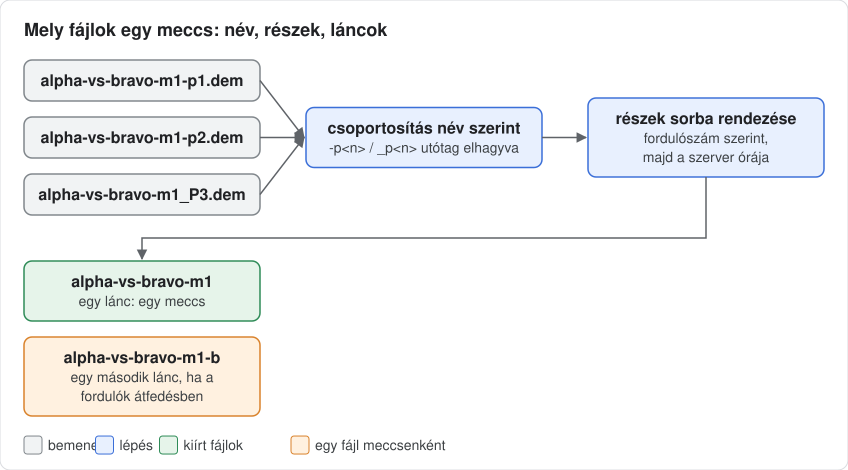

# Parancsok {#commands}

Még nem használt parancssort? Olvasd el először a [Mielőtt elkezded](before-you-start.md) oldalt.
Ezeket a parancsokat abban a *terminálban* gépeld be, amelyet abban a mappában nyitottál meg, ahová kicsomagoltad
vagy klónoztad a programot; a `<...>` helyőrzők, és az útvonal, amelyben szóköz van, idézőjelbe kerül.

```text
python -m heat3d_cs2 demos <demo files or folders> -o <folder> [--every 8] [--jobs N] [--map TEXT] [--force] [--no-bulk] [--loose]
python -m heat3d_cs2 map <map name | path to its .vpk> -o <file.glb> [--game FOLDER] [--source2viewer EXE]
python -m heat3d_cs2 scoreboard <match.3dheat | match.json>
```

A `python -m heat3d_cs2 --help` és a `python -m heat3d_cs2 <verb> --help` ugyanezeket a kapcsolókat sorolja fel; a
[Parancsreferencia](../cli-reference.md) mindet megmutatja. Minden indításkor először lefut a kiadás-ellenőrzés, amelyet a
[Frissítések](updates.md) oldal ír le (kikapcsolható a `HEAT3D_NO_UPDATE=1` beállítással).

Kód: [`heat3d_cs2/cli.py`](https://github.com/Holdi601/3DHeat-CS2/blob/main/heat3d_cs2/cli.py).

## `demos` - demók táblázatokká és meccsdokumentumokká {#demos---demos-into-tables-and-match-documents}

```powershell
python -m heat3d_cs2 demos D:\Demos\event -o out
python -m heat3d_cs2 demos alpha-vs-bravo-m1-p1.dem alpha-vs-bravo-m1-p2.dem -o out
python -m heat3d_cs2 demos D:\Demos -o out --map final --jobs 4
```

| Argumentum | Alapérték | Mit csinál |
|---|---|---|
| `paths` (egy vagy több) | - | demófájlok és mappák. Egy fájl akkor kerül fel, ha kiterjesztése `.dem` (akármilyen nagybetűvel). Egy mappát **rekurzívan** átnézünk a `.dem` végű fájlokra, bármilyen nagybetűvel, rendezett sorrendben. A tömörített demók (`.dem.zst`, `.dem.bz2`, archívumok) nem olvashatók: előbb csomagold ki őket. |
| `-o`, `--out` | kötelező | a mappa, amelybe írunk; szükség esetén létrejön |
| `--every N` | `8` | minden játékost minden *N* tickenként mintavételez. A CS2-demók másodpercenként 64 ticket futnak, így a 8 másodpercenként nyolc mintát, a 4 tizenhatot, a 64 egyet jelent. Az események mindig a saját tickjükön olvasódnak, bármi is legyen *N*. |
| `--jobs N` | `0` = a processzormagok fele | hány meccset konvertálunk egyszerre, mindegyik a saját folyamatában. Soha nincs kevesebb 1-nél, és sosem több, mint ahány meccs van. |
| `--map TEXT` | - | csak azokat a meccseket, amelyek **nevében** szerepel a *TEXT* (kis- és nagybetű nem számít), például `--map final`. A fájlnévre szűr, nem arra a pályára, amelyet a demó végül tartalmaz. |
| `--force` | ki | a már megírt meccseket is konvertálja, felülírva őket |
| `--loose` | ki | minden meccset külön fájlokként tart meg - táblázat, `.match.json`, kísérőfájlok - egy `.3dheat` konténerbe csomagolás helyett. Lásd: [Egy fájl meccsenként](output-container.md). |
| `--container` | be | minden meccset egy `.3dheat` fájlba csomagol; ez az alapértelmezés, ezért csak a kifejezetté tétel miatt van |
| `--no-bulk` | ki | a kísérő csomagfájlból kihagyja az entitásfolyamot, a játékosok parancsait és az animációs folyamot - a demó méretének több mint a fele még tömörítve is. A meccsdokumentum önellenőrzése ezeket `lost`-nak számolja, név szerint. |


### Melyik fájlok egy meccs {#which-files-are-one-match}



A meccs neve a demófájl neve a kiterjesztés és a rész-utótag nélkül: a végén álló `-p<számjegyek>` vagy
`_p<számjegyek>` (bármilyen kis- vagy nagybetűvel). Így az `alpha-vs-bravo-m1-p1.dem`, az
`alpha-vs-bravo-m1-p2.dem` és az `alpha-vs-bravo-m1_P3.dem` ugyanannak a meccsnek a részei, az `alpha-vs-bravo-m1`-nek.
A fájlokat kizárólag ez a név csoportosítja - két, azonos nevű fájl különböző mappákban is együtt lesz csoportosítva.

Az utótag a sorrendről nem mond semmit: a `-p2` lehet a korábbi félidő. A részeket a bennük lévő körszám, majd a
szerver órája szerint rendezzük, és az a csoport, amelyről kiderül, hogy két különböző meccset tartalmaz (ugyanazok a
csapatok ugyanazon a pályán két eseményen, mondjuk), **láncokra** bomlik: a legtöbb kört tartalmazó láncot a név
maga alatt írjuk ki, a következőt `<név>-b`, majd `<név>-c` néven, és így tovább. Az a fájl, amelyben nincs kör
(csak bemelegítés, egy szünet), nem tartozik egyik láncba sem. A láncok keresésének módját a
[Meccs felépítése](building-matches.md#parts-and-chains) oldal írja le.

### Mi íródik ki {#what-is-written}

Minden meccshez, abba a mappába, amelyet a demó fejléce pályának nevez (`unknown`, ha nem nevez meg egyet), egy
`.3dheat` fájl:

```text
out/
  de_x/
    alpha-vs-bravo-m1.3dheat
    alpha-vs-bravo-m2.3dheat
  de_y/
    ...
```

A tesztek szintetikus, két körös demóján:


A `--loose` kapcsolóval minden meccs a táblázat, a meccsdokumentum és négy kísérőfájl egymás mellett
([Egy fájl meccsenként](output-container.md)):


Egy hőtérkép egy pálya adatait mutatja, így egy mappa betöltése a megjelenítőben egy pálya meccseinek betöltését
jelenti. Lásd: [A hőtérképes táblázat](output-table.md) és [A meccsdokumentum](output-match-json.md).

### Mi marad ki {#what-is-skipped}

Mielőtt bármit olvasna, a program összegyűjti az `--out` alatti összes `*.3dheat` fájlt (egy konténer egészben íródik
vagy egyáltalán nem), és minden olyan `*.parquet` fájlt, amelynek a mellette lévő meccsdokumentuma
(`<name>.match.json`) van. Azt a meccset, amelynek neve megegyezik ezeknek a fájlnevével (kiterjesztés nélkül), kihagyja,
hacsak nincs `--force`. Az a táblázat, amelynek nincs meccsdokumentuma - egy futtatás, amely a kettő írása között állt
le -, nem számít, így az a meccs újra konvertálódik. Az ellenőrzés csak a név alapján történik: az a meccs, amely
egy másik pálya mappájába, vagy más `--every` értékkel lett konvertálva, szintén készként számít. Ha nincs több teendő:

```text
nothing to do: no demos found, or every match already written (--force redoes them)
```

### Mi íródik a képernyőre {#what-is-printed}

Először a munka mennyisége, majd meccsenként egy sor, ahogy az egyes meccsek elkészülnek (a befejezés sorrendjében, nem a
fájlok sorrendjében):

```text
3 match(es), 3 at a time
alpha-vs-bravo-m1: de_x, 21 rounds (Alpha 13 Bravo 8), 412,377 rows, lost 0
alpha-vs-bravo-m2: de_y, 30 rounds (Bravo 16 Alpha 14), 598,104 rows, 1 incomplete round(s) left out, lost 0
alpha-vs-bravo-m3: de_y, 18 rounds (Alpha 13 Bravo 5), 330,981 rows, recorded from round 3, lost 1,204,331 (svc_PacketEntities, svc_UserCmds, DEM_AnimationData)
```

(A számok példaszámok.) Az állás az utolsó kör állása, csapatonként abban a sorrendben, ahogy a meccsdokumentum
felsorolja őket. Az *incomplete round(s) left out* a demó által megszakított, még el nem döntött köröket számolja;
a *recorded from round N* azt mondja, hogy a felvétel későn kezdődik; a *lost* a meccsdokumentum önellenőrzése - hány
elem nem jutott sehova a demóból, és milyen fajtából (a `--no-bulk` a csomagot teszi elveszetté). Az a meccs, amely
semmit sem ad, megmondja, miért:

```text
alpha-vs-bravo-m4: no round in 1 file(s) - nothing written
alpha-vs-bravo-m4-b: no complete round in 1 file(s) - nothing written
```

Az egyik meccs hibája nem állítja meg a többit; `<name>: failed - <error>` alakban íródik ki.

### Kilépési kód {#exit-code}

`0`, ha minden meccs konvertálódott (vagy nem volt teendő), `1`, ha legalább egy meccs hibát okozott.

### Mennyi ideig tart {#how-long-it-takes}

Minden meccset egy munkavégző folyamat olvas be és épít fel. Néhány száz demót tartalmazó mappa az alapértelmezett
`--jobs` értékkel percekig tart. A folyamatonkénti memória nő a meccs hosszával és egy kisebb `--every` értékkel:
minden munkavégző a meccs minden mintavételezett játékossorát tartja (nagyjából tíz játékos x 64 / *N* sor
felvételi másodpercenként), mielőtt kiírná.

A kísérőfájlok tovább tartanak, mint a táblázat: a feldolgozó minden tulajdonságot, amit olvas, minden tickben beolvas,
tickek ablakonként (egy 40 perces demónál körülbelül kétpercnyi ablak, folyamatonként legfeljebb mintegy 3 GB
memóriával), majd a demón még egyszer végigmegy a képkockákért és üzenetekért.

## `map` - a pálya geometriája `.glb`-ként {#map---a-maps-geometry-as-glb}


```powershell
python -m heat3d_cs2 map <map> -o out/<map>/<map>.glb
python -m heat3d_cs2 map <map> -o <map>.glb --game "D:\Games\Steam\steamapps\common\Counter-Strike Global Offensive"
python -m heat3d_cs2 map "D:\maps\<map>.vpk" -o <map>.glb --source2viewer C:\Tools\Source2Viewer-CLI.exe
```

| Argumentum | Alapérték | Mit csinál |
|---|---|---|
| `name` | - | a pálya neve (például `de_x`), vagy a `.vpk`-jának útvonala. A `.vpk` végű, létező útvonal úgy használódik, ahogy van; minden más a telepített játékban a fájlnév tőrésze alapján keresődik. |
| `-o`, `--out` | kötelező | a `.glb`, amelyet írunk; a mappája szükség esetén létrejön |
| `--game FOLDER` | a Steam könyvtárai | a CS2 telepítési mappa (amelyben a `game\csgo` van), ha a Steam nem ismeri. A `--game` megadásával csak azt a mappát keressük át. |
| `--source2viewer EXE` | `HEAT3D_SOURCE2VIEWER`, majd `PATH` | a Source2Viewer CLI futtatható fájlja |

Sikeres futás után ez íródik ki:

```text
out/de_x/de_x.glb: de_x, 412,880 triangles (151,204 ground) in 14 parts
```

(a számok példaszámok). A `.glb` a pálya táblázatai mellé írva (`out/<map>/<map>.glb`) egy mappában tartja a pálya
adatait és geometriáját. Hogyan működik az export: [Pályaexport](map-export.md).

Hibák, mindegyik `error: ...` alakban, `2`-es kilépési kóddal:

| Üzenet | Jelentése |
|---|---|
| `no de_x.vpk found in an installed CS2 - pass --game <CS2 folder> or the .vpk path` | a pálya nincs a talált Steam-könyvtárak egyikében sem, vagy a név hibás |
| `Source2Viewer-CLI not found: ...` | a `--source2viewer`, a `HEAT3D_SOURCE2VIEWER` és a `PATH` közül egyik sem adott létező fájlt |
| `Source2Viewer did not export de_x's collision mesh:` és utána a kimenete vége | elhasalt, vagy nem írt `.glb`-t |
| `de_x's collision mesh has nothing but clip brushes` | a klipek és az égbolt kihagyása után nem maradt semmi |

## `scoreboard` - egy meccs szövegesen {#scoreboard---a-match-as-text}

```bash
python -m heat3d_cs2 scoreboard out/de_x/alpha-vs-bravo-m1.3dheat
python -m heat3d_cs2 scoreboard out/de_x/alpha-vs-bravo-m1.match.json   # a demos --loose után
```

Kiírja a meccs eredménytábláját a [meccsdokumentumából](output-match-json.md), a megjelenítő megnyitása nélkül. A
`.3dheat` konténeren belüli dokumentumot, vagy egy különálló `<match>.match.json`-t olvas. A tesztek szintetikus,
két körös demóján:


```text
alpha-vs-bravo-m1 - de_test  Alpha 2  Bravo 0

Alpha
player                 K   D   A  +/-    ADR   KAST   HS%  OK-OD  clutch
ash                    1   0   0   +1   50.0 100.0%    0%   0-0     1/1
ace                    1   1   0   +0   50.0 100.0%  100%   1-0     0/0

Bravo
player                 K   D   A  +/-    ADR   KAST   HS%  OK-OD  clutch
ben                    1   1   0   +0   50.0 100.0%    0%   0-0     0/1
bob                    0   1   0   -1    0.0 100.0%    0%   0-1     0/0

rounds  1:TK 2:TB
```

- Az első sor: a meccs neve, a pálya, és csapatonként a végső állás.
- Csapatonként egy táblázat, a meccsdokumentum `teams` sorrendjében; a játékosok a meccsdokumentum sorrendjében
  (gyilkosság mínusz halál, majd gyilkosság, a legjobb elöl). A nevek 19 karakterre vannak vágva.
- Oszlopok: **K** gyilkosság, **D** halál, **A** asszisztálás, *beleértve* a villantási asszisztot, **+/-** gyilkosság
  mínusz halál, **ADR**, **KAST** (%), **HS%** (egész százalékra kerekítve), **OK-OD** nyitó gyilkosságok - nyitó halálok,
  **clutch** megnyert klucsok / játszott klucsok. Meghatározások: [Statisztika](statistics.md).
- A körsáv: `<kör><győztes oldal><hogyan>`, ahol **B** bomba robbant, **D** hatástalanítva, **K** eliminálás,
  **T** lejárt az idő, a **?** pedig minden más (döntetlen, feladás, egyéb). Döntetlennél nincs győztes oldal:
  `<kör>:?`.

Az a fájl, amely nem érvényes JSON, vagy nem található, hibával áll meg; a meccsdokumentum mezői nélküli JSON-dokumentum
egy Python-hibával esik el (további ellenőrzés nincs).
