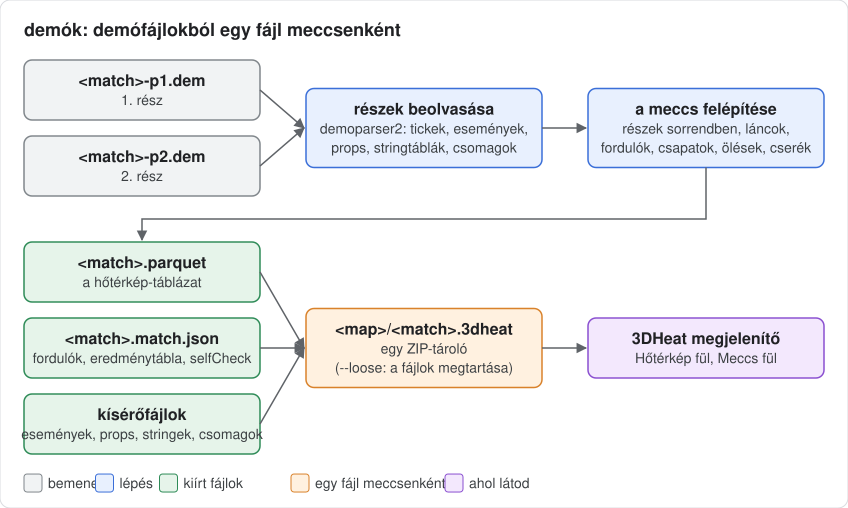

# 3DHeat CS2 {#dheat-cs2}

**Mi ez?** A Counter-Strike 2 el tud menteni egy meccsről felvételt, úgynevezett *demót*. Ez az eszköz a
demót olyan fájlokká alakítja, amelyeket a 3DHeat megjelenítő 3D-ben meg tud mutatni: hol állt, hol halt meg,
dobott és telepített mindenki, fordulóról fordulóra. Egy CS2-térképet is 3D-modellé alakíthat, amelyre ezeket
ki lehet rakni.

**Mire jó?** A saját meccseid átnézésére, egy térkép több meccsének egymásra rakására egyetlen hőtérképként, és
meccsstatisztikákhoz, mint az ADR (átlagos sebzés fordulónként) és a KAST (azon fordulók aránya, amelyekben
a játékos ölt, asszisztál, életben marad, vagy a halálát társa megtorolja).

**Példa:** `alpha-vs-bravo-m1.dem` be, `out/de_x/alpha-vs-bravo-m1.3dheat` ki (a `de_x` egy kitalált térképnév).



Részletesebben: a 3DHeat CS2 a **Counter-Strike 2 demókat** meccsenként egy hőtérkép-táblázattá és egy
meccsdokumentummá, a **CS2-térképet** pedig pálya-geometriává alakítja. A kimenet a
[3DHeat](https://holdi601.github.io/3DHeat/) telemetriai megjelenítőnek készül
([forrás](https://github.com/Holdi601/3DHeat)), de közönséges fájlok – Parquet, JSON és bináris glTF –,
amelyeket bármi más is olvasni tud.

Egy kis Python-csomag, `heat3d_cs2`, parancssorból futtatva. A demókat a lemezről olvassa (letöltést nem végez),
a [demoparser2](https://github.com/LaihoE/demoparser) segítségével, a térképeket pedig a telepített játékból
exportálja a Source2Viewer parancssori változatával
([ValveResourceFormat](https://github.com/ValveResourceFormat/ValveResourceFormat)).

## Gyors kezdés {#quick-start}

Még nem használt parancssort? Előbb olvasd el a [Mielőtt elkezded](before-you-start.md) oldalt.

```bash
pip install -r requirements.txt
python -m heat3d_cs2 demos <demo files or folders> -o out   # minden meccs bennük
python -m heat3d_cs2 map <map> -o out/<map>/<map>.glb       # a térkép a telepített játékból
python -m heat3d_cs2 scoreboard out/<map>/<match>.3dheat    # egy meccs eredménytáblája szövegként
```

Ezt kell látnod: `1 match(es), 1 at a time ...`, majd soronként egy meccset
(lásd: [Parancsok](../commands.md#what-is-printed)).

A `demos` meccsenként egy fájlt ír egy térkép nevű mappába: `out/<map>/<match>.3dheat`, egy
[`.3dheat` tároló](../output-container.md) – a megjelenítő egy-fájl-egy-meccs formátuma
([leírás](https://holdi601.github.io/3DHeat/container.html)). Ez a következő tagokat tartalmazza; a `--loose`
kapcsoló ezeket külön fájlokként írja:

| Tag | Mit tartalmaz | Hol töltődik be a megjelenítőben |
|---|---|---|
| `<match>.parquet` (szerep `table`) | minden élő játékos másodpercenként nyolcszor az állapotával (életerő, pénz, vakítás, célzás, zóna, felszerelés...), és minden esemény, ahol történt (ölés, halál, sebzés, lövés, dobás, gránát-robbanások, vakítás, telepítés, hatástalanítás, robbanás, és fordulóvég játékosonként azzal, mennyit fizetett neki a forduló), soronként egy | Hőtérkép fül |
| `<match>.match.json` (szerep `match`, a meccsdokumentuma) | csapatok, eredmény, minden forduló (győztes, hogyan, gazdaság, telepítés, ölések sorrendben, clutch-ek, túlélők), és minden játékos eredménytáblasora | Meccs fül |
| `<match>.events/props/strings/packets.parquet` | minden más, amit a demó tartalmaz, egészben (kísérőfájlok) | a teljesség kedvéért megtartva |

A `map` a `<map>.glb` fájlt írja: a térkép ütközési hálóját – padlókat, falakat, dobozokat, díszítés nélkül –,
talajra és szerkezetre bontva, ugyanabban a keretben és mértékegységben, mint a táblázatok, így pontosan a
hőtérkép alatt fekszik (Háttér / pálya panel).

## A dokumentáció térképe {#map-of-this-documentation}

| Oldal | Mit tartalmaz |
|---|---|
| [Mielőtt elkezded](before-you-start.md) | Python, egy terminál, helyőrzők, mit jelent a siker és a gyakori hibák |
| [Telepítés](../installing.md) | Python, a csomagok, a Source2Viewer CLI, hol kell lennie a CS2-nek |
| [Parancsok](../commands.md) | `demos`, `map`, `scoreboard`: minden kapcsoló, mit ír ki, kilépési kódok |
| [Demó olvasása](../reading-demos.md) | mit olvasunk egy demófájlból: mintavett tickek, játékostulajdonságok, játékszabályok, események |
| [Meccs felépítése](../building-matches.md) | részek és láncok, a meccsóra, fordulók, csapatok és oldalak, sorok, ölések, hatástalanítások, nyitások, sebzés, vakítások, gazdaság |
| [Statisztikák](../statistics.md) | az eredménytábla: K/D/A, ADR, KAST, HS%, nyitások, hatástalanítások, többes ölések, clutch-ek, segédeszközök, vakítások |
| [A hőtérkép-táblázat](../output-table.md) | a Parquet-fájl: minden oszlop, típusa, mely események töltik, a `heat3d` lábléc-tippek, a tengelyek |
| [A meccsdokumentum](../output-match-json.md) | a `.match.json` dokumentum, mezőnként |
| [Egy fájl meccsenként](../output-container.md) | a `.3dheat` tároló, amelyet a `demos` alapértelmezésben ír, és a `--loose` |
| [Térkép exportálása](../map-export.md) | hogyan exportálódik egy térkép ütközési hálója, a keret, a csomópontnevek, a mértékegységek |
| [Használat a 3DHeat-tel](../using-with-3dheat.md) | táblázatok, meccsdokumentumok és térképek betöltése a megjelenítő Hőtérkép és Meccs fülére |
| [Korlátok](../limits.md) | mi feltételezett, mi nincs kezelve, mi nincs ellenőrizve |
| [Frissítések](../updates.md) | a kiadás-ellenőrzés indításkor és a `python -m heat3d_update` |
| [Fejlesztés](../development.md) | a kód felépítése, tesztek, a szintetikus demó-mintája |
| [Parancsleírás](../cli-reference.md) | minden parancs `--help` kimenete, a kódból generálva |
| [Karbantartás](../maintaining.md) | ezekhez az oldalakhoz tartozó kiadási ellenőrzőlista |

## Mihez ellenőrizték {#what-it-is-checked-against}

A vadonból származó demók nem egy-fájl-egy-meccs formában érkeznek. A konverter kezeli azt, ha egy meccs több
fájlra bomlik, bármilyen sorrendben; ha a szerver a meccs közepén újraindult; ha két különböző meccs egy néven van
tárolva; ha a fordulók biztonsági mentésből álltak helyre; ha a felvétel későn kezdődik vagy korán végződik;
szünetekre; és edzőkre egy csapat oldalán – lásd: [Meccs felépítése](../building-matches.md). Egy nagy gyűjtemény
turnademóján ellenőrizve: minden meccsen a végeredmény követi a fordulók győzteseit, minden oldal ölései a másik
oldal halálai, és minden forduló öt az öt ellen kezdődik.

## Mire irányítsd {#what-to-point-it-at}

A saját meccseid demóira, arra a demóra, amelyet kézzel töltöttél le egy torna oldaláról, vagy egy olyan API
demóira, amelyhez hozzáférésed van. A demó olyan felvétel, amelynek tartalma a kiadójáé és a szervezőké: a belőle
készült kimenetet a saját elemzésedre használd, a demókat és a belőlük származó adatokat ne terjeszd tovább.
Sok demókínáló oldal a feltételeiben tiltja az automatikus letöltést, ezért az eszköz a lemezről olvas, és nem tölt le semmit.

## A 3DHeat része {#part-of-3dheat}

A 3DHeat CS2 a 3DHeat megjelenítő körüli ingyenes eszközök egyike, mindegyiknek saját tárolója, kiadásai és
licence van:

| Eszköz | Mit csinál | Dokumentáció |
|---|---|---|
| [3DHeat](https://github.com/Holdi601/3DHeat) | a megjelenítő: hőtérképek, versenyelemzés és meccsáttekintés 3D-ben | [oldal](https://holdi601.github.io/3DHeat/) |
| [GameFiles](https://github.com/Holdi601/3DHeat-GameFiles) | pályák és pályaszintek a játékok fájljaiból, 3D-modellként | [oldal](https://holdi601.github.io/3DHeat-GameFiles/) |
| [GameCapture](https://github.com/Holdi601/3DHeat-GameCapture) | körtelemetria versenyjátékokból; pályák rekonstruálva játékvideóból | [oldal](https://holdi601.github.io/3DHeat-GameCapture/) |
| [Unreal Exporter](https://github.com/Holdi601/3DHeat-UnrealExporter) | Unreal Editor bővítmény, amely egy pályát 3D-modellként exportál | [oldal](https://holdi601.github.io/3DHeat-UnrealExporter/) |
| [CS2](https://github.com/Holdi601/3DHeat-CS2) | Counter-Strike 2 demók táblázatokba és meccsdokumentumokba; térképek 3D-modellekbe | [oldal](https://holdi601.github.io/3DHeat-CS2/) |
| [Watcher](https://github.com/Holdi601/3DHeat-Watcher) | a játékmenetéről rögzíti, amit a játékok közzétesznek, a háttérben | [oldal](https://holdi601.github.io/3DHeat-Watcher/) |
| [Ext-WarThunder](https://github.com/Holdi601/3DHeat-Ext-WarThunder) | War Thunder visszajátszások táblázatokba és meccsdokumentumokba | [oldal](https://holdi601.github.io/3DHeat-Ext-WarThunder/) |
| [Ext-WoT](https://github.com/Holdi601/3DHeat-Ext-WoT) | World of Tanks visszajátszások táblázatokba és meccsdokumentumokba | [oldal](https://holdi601.github.io/3DHeat-Ext-WoT/) |
| [Ext-WoWs](https://github.com/Holdi601/3DHeat-Ext-WoWs) | World of Warships visszajátszások táblázatokba és meccsdokumentumokba | [oldal](https://holdi601.github.io/3DHeat-Ext-WoWs/) |
| [Ext-Squad](https://github.com/Holdi601/3DHeat-Ext-Squad) | Squad-szerverdemók táblázatokba és meccsdokumentumokba | [oldal](https://holdi601.github.io/3DHeat-Ext-Squad/) |
| [Ext-DCS](https://github.com/Holdi601/3DHeat-Ext-DCS) | DCS World térképek 3D-modellként | [oldal](https://holdi601.github.io/3DHeat-Ext-DCS/) |
| [Ext-IL2](https://github.com/Holdi601/3DHeat-Ext-IL2) | IL-2 Sturmovik térképek 3D-modellként | [oldal](https://holdi601.github.io/3DHeat-Ext-IL2/) |

## Licenc {#licence}

MIT – lásd a [`LICENSE`](https://github.com/Holdi601/3DHeat-CS2/blob/main/LICENSE) fájlt,
és a [`LICENSES.md`](https://github.com/Holdi601/3DHeat-CS2/blob/main/LICENSES.md) fájlt a harmadik féltől
származó csomagokról, és arról, mit írnak elő az általa olvasott játékok.
