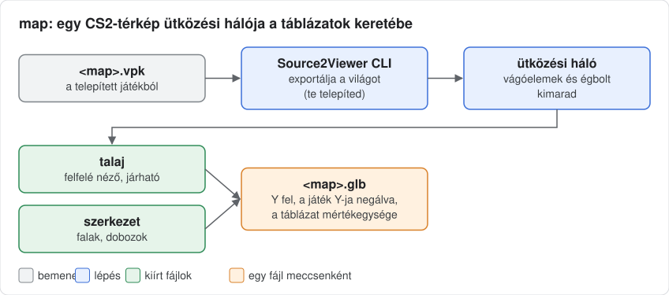

# Pályaexport (`map`) {#map-export-map}

A `python -m heat3d_cs2 map <map> -o <file.glb>` egy CS2-pályát pályageometriaként ír ki: a világ **ütközési hálóját**,
abban a koordinátarendszerben és egységekben, amelyekben a [hőtérképes táblázatok](output-table.md) rajzolódnak. Kód:
[`heat3d_cs2/mapexport.py`](https://github.com/Holdi601/3DHeat-CS2/blob/main/heat3d_cs2/mapexport.py),
[`heat3d_cs2/glb.py`](https://github.com/Holdi601/3DHeat-CS2/blob/main/heat3d_cs2/glb.py).
A kapcsolók és üzenetek: [Parancsok](commands.md#map---a-maps-geometry-as-glb).



## Miért az ütközési háló {#why-the-collision-mesh}

Az ütközési háló az, amire a játékosok állnak, és ami mögé bújnak - padló, falak, lépcsők, dobozok -, a díszítés nélkül:
nincsenek olyan kellékek, amelyek csak úgy néznek ki valamilyenek, nincsenek textúrák, és sokkal kevesebb háromszög van benne,
mint a renderelési hálókban. Ez az, ami a hőtérképnek kell alá: valami, amihez a pozíciókat lehet viszonyítani, nem a
pálya látványos megjelenítése.

## Hogyan kapjuk meg {#how-it-is-obtained}

1. **A pálya megtalálása.** A létező, `.vpk`-ra végződő útvonal úgy használódik, ahogy megadták. Egyébként a
   `<name>.vpk`-t keressük a `<CS2 mappa>\game\csgo\maps\` mappában, ahol a CS2 mappa a `--game`, vagy a
   `steamapps\common\Counter-Strike Global Offensive` minden talált Steam-könyvtárban (lásd [Telepítés](installing.md#where-cs2-is-looked-for)).
2. **A Source2Viewer CLI megtalálása**: a `--source2viewer`, majd a `HEAT3D_SOURCE2VIEWER`, majd a `PATH`-on lévő
   `Source2Viewer-CLI` / `Source2Viewer-CLI.exe`.
3. **A világ fizikájának exportálása.** A Source2Viewert így futtatjuk:

   ```text
   Source2Viewer-CLI -i <map>.vpk -d -f maps/<map>/world_physics.vmdl_c --gltf_export_format glb -o <temporary folder>
   ```

   A pálya saját archívumából dekódolja a Source 2 lefordított fizikáját, és kiírja a modellt (üres: a világnak nincs
   saját renderelési hálója) és a fizikáját mellé. A legnagyobb kiírt `.glb` a fizika. Ha a Source2Viewer hibázik, vagy nem ír
   `.glb`-t, a parancs leáll, és megmutatja a kimenete és a hibái utolsó 800 karakterét.
4. **Beolvasás.** A jelenet minden csomópontját a transzformációjával (mátrix, vagy eltolás-forgatás-skálázás) bejárjuk,
   és minden háromszög-primitívet veszünk, indexpufferrel vagy anélkül, világkoordinátákban.
5. **A falnak és padlónak nem valót kihagyjuk.** Az a csomópont, amelynek a neve tartalmazza a `clip`-et - játékos-klip,
   NPC-klip, gránát-klip: a láthatatlan falak, amelyek megállítják a játékosokat és a gránátokat - vagy a `sky`-t, bármilyen
   nagybetűvel, kimarad.
6. **A felület elnevezése.** A fizikai csoportokat a felületük nevezi el; a kisbetűs név, a vezető `physics`,
   `physics_group` vagy `physics_passbullets` (és az utána lévő aláhúzás) nélkül a felület: a `physics_group_concrete`
   `concrete`, a `physics_passbullets_chainlink` `chainlink`, a puszta `physics_group` `world`. A golyók által átjárható
   felületek megmaradnak.
7. **Vissza a játék koordinátarendszerébe.** A Source2Viewer méterben és Y-felfelé írja a glTF-et: a játék (Y, Z, X)
   értékét megszorozva 0,0254-gyel. Ezt visszacsináljuk - minden pont a játék (X, Y, Z) hüvelykben lesz.
8. **A talaj és a szerkezet szétválasztása**, háromszögenként: amelyik lap normálvektora legalább 0,7-tel felfelé mutat
   (a Z-komponense, normalizálva) - a mintegy 45 fokos lejtőkig, nagyjából a legmeredekebb, amelyen egy CS2-játékos sétál -,
   az **talaj**; minden más, a falak és a mennyezetek is, **szerkezet**.
9. **A megjelenítő koordinátarendszerébe.** Minden pont (X, Z, -Y) alakban íródik: Y felfelé, a játék Y-ja negálva - az a
   koordinátarendszer, amelyben a megjelenítő a táblázatokat rajzolja, ha követi a `heat3d` tippjeiket. Forgatás, nem tükrözés.
10. **A `.glb` megírása.** Ha nem maradt semmi (csak klip-testek), a parancs hibával áll meg. Egyébként kiírja a fájlt, a
    pályát, a háromszögek számát, hogy ebből mennyi a talaj, és a részek számát.

Ezen belül a világ `world_physics` részén és a pálya saját `.vpk`-ján kívül semmit nem olvasunk, és a Source2Viewer
semmilyen részét nem csomagoljuk vagy másoljuk.

## A fájl {#the-file}

Egy glTF 2.0 bináris (`.glb`), egy pufferrel, amelyet a `heat3d_cs2` ír (az `asset.generator`):

| Szempont | Mi |
|---|---|
| Csomópontok | részenként egy, mind a gyökérben, transzformáció nélkül, mindegyiknek saját, azonos nevű hálója van |
| Csomópontnevek | `ground:<surface>` vagy `structure:<surface>` (`ground:concrete`, `structure:metal`, `structure:world`), névsor szerint |
| Primitívek | hálónként egy, háromszögek, `POSITION` (float32, min/max-szal) és `NORMAL` (float32), `uint32` indexek |
| Árnyalás | lapos: a háromszögsarkonként egy csúcs, mindegyik a saját háromszögének normálvektorával |
| Anyagok, textúrák, UV-k, színek | nincs |
| Egységek | játékegységek (**hüvelyk**), nem méter - ellentétben azzal, amit a glTF feltételez |
| Koordinátarendszer | a játék (X, Z, -Y): a glTF Y-ja a játék magassága, a glTF Z-je a játék -Y-ja |

A `ground:` / `structure:` előtag minden 3DHeat-szintexportáló konvenciója: a megjelenítő szó nélkül elfogadja az így
elnevezett részt, nem tippel a geometriából, így a padlók a talaj árnyalását, a falak a szerkezet rajzolását kapják
osztályozási lépés nélkül.

Mivel az egységek hüvelykben vannak, egy másik glTF-megjelenítő a pályát kb. 39-szer túl nagynak mutatja (méterként olvassa);
ott, ha számít, 0,0254-gyel szorozd. A 3DHeatben pontosan a táblázat alatt fekszik, mert az is ugyanazokban az
egységekben van, 1-es skálával.

## Az ellenőrzés, hogy a koordinátarendszer jó {#the-check-that-the-frame-is-right}

A `test_players_stand_on_the_exported_floor` teszt (csak akkor fut, ha van demó és Source2Viewer, lásd
[Fejlesztés](development.md#tests)) azt a pályát exportálja, amelyen a demó játszódott, veszi a meccs 300 véletlen
pozíciómintáját, és mindegyiknél egyenesen lefelé nézve megkeresi a legmagasabb talaj-háromszöget, legfeljebb 4 egységgel a
játékos lába felett. Megköveteli, hogy a minták legalább 98%-ánál legyen talaj, és hogy a talajtól mért medián magasság
5 egység alatt legyen. Egy tükrözött pálya megbukik: rosszul tükrözött tengelyű pályán a játékosok nagy része semmi felett áll.
A README az aktuális versenypálya-készlet pályáin mért eredményeket közli.

## Mit nem csinál {#what-it-does-not-do}

- Nincs renderelési geometria, textúra vagy díszítés - lásd fent a *miért*.
- Csak az, ami a pálya `world_physics` modelljében van, exportálódik. Hogy a mozgó részek (ajtók) vagy a törhető tárgyak
  benne vannak-e, nem ellenőriztük.
- Nincs egyszerűsítés: a 3DHeat megjelenítő az importáláskor egyszerűsít, a **Egyszerűsítési cél** beállításával.
- A telepített játékon kívüli pályák (a máshol lemezen lévő műhelypályák) működnek, ha a `.vpk`-jukat útvonalként adjuk meg,
  és tartalmazzák a `maps/<name>/world_physics.vmdl_c` fájlt; ez nincs ellenőrizve.
