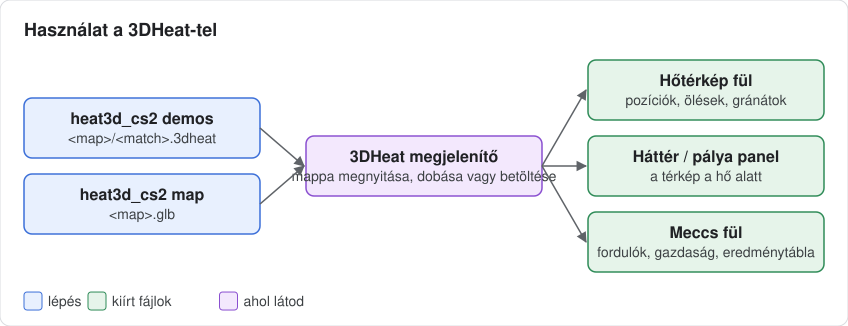

# Használat a 3DHeat-tel {#using-it-with-3dheat}

A kimenetek ezekbe a helyekre kerülnek a [3DHeat megjelenítőben](https://holdi601.github.io/3DHeat):

| Fájl | Hol | Mit ad |
|---|---|---|
| `<match>.3dheat` (az alapértelmezett) | **Hőtérkép** fül, **Forrás** panel, vagy a **Meccs** fül | a táblázat és a meccsdokumentum együtt, meccsenként egy fájl ([konténer](https://holdi601.github.io/3DHeat/container.html)) |
| `<match>.parquet` | **Hőtérkép** fül, **Forrás** panel | pozíciók és események hőtérképként, dobozos visszajátszásként, útvonalként |
| `<match>.match.json` | **Meccs** fül, **Meccsfájlok betöltése…** | az eredménytábla, a körök, az eseménynapló, a statisztikák meccsek között, linkek a hőtérképre |
| `<map>.glb` | **Háttér / pálya** panel, **3D-modell…** | a pálya a hőtérkép alatt |

A megjelenítő saját dokumentációja minden fület részletesen leír: a
[Meccselemzés](https://holdi601.github.io/3DHeat/match-analysis.html),
[Fájlok betöltése](https://holdi601.github.io/3DHeat/loading-files.html),
[Oszlop-hozzárendelés](https://holdi601.github.io/3DHeat/column-mapping.html) és
[Dobozos visszajátszás](https://holdi601.github.io/3DHeat/box-replay.html) oldalait. Ez az oldal a CS2 oldala ennek.



A megjelenítő: [github.com/Holdi601/3DHeat](https://github.com/Holdi601/3DHeat), dokumentációja
[holdi601.github.io/3DHeat](https://holdi601.github.io/3DHeat/).

## Egy tipikus munkamenet {#a-typical-session}

```bash
python -m heat3d_cs2 demos D:\Demos\event -o out
python -m heat3d_cs2 map <map> -o out/<map>/<map>.glb
```

1. **Hőtérkép fül -> Forrás:** válaszd ki az `out/<map>` mappát (vagy húzd rá). Minden `.parquet` egy adathalmaz lesz; a
   `.json` és `.glb` fájlok ugyanabban a mappában kimaradnak mint "nem csv/parquet fájl". Töltsd be.
2. **Háttér / pálya -> 3D-modell…:** válaszd ki az `out/<map>/<map>.glb` fájlt. A **Mentés a könyvtárba** a böngészőben
   megtartja a következő alkalomra.
3. **Meccs fül -> Meccsfájlok betöltése…:** válaszd ki ugyanabból a mappából a `.match.json` fájlokat (többet egyszerre), vagy
   húzd őket a nézetre, miközben a Meccs fül nyitva van.

Egyszerre csak egy pálya táblázatait töltsd be: a különböző pályák koordinátái átfedik egymást, és két pálya hőtérképe
együtt nem jelent semmit. A pályánkénti mappa éppen ezért van.

## A táblázat beállítás nélkül nyílik meg {#the-table-opens-with-nothing-to-set}

A megjelenítő a kiválasztott első fájl `heat3d` lábléc-bejegyzését olvassa ([A hőtérképes táblázat](output-table.md#the-heat3d-footer-hints)),
és ráteszi a saját találgatásai fölé:

| Megjelenítő beállítás | Erre állítva |
|---|---|
| Pozíció | `x`, `y`, `z` |
| Felfelé mutató tengely a forrásban | a Z felfelé van |
| Y tükrözése | bekapcsolva - így a pálya a jó irányban áll, nem tükrözve |
| Egységlépték | 1 - a távolságok játékegységekben (m-ben feliratozva; 1 egység = 1 hüvelyk) |
| Idő | `time`, másodperc |
| Személyazonosító | `player` |
| Csoport | `side` (T / CT) |
| Munkamenet | `roundId` - minden kör egy munkamenet, `<match> #NN` |
| Nézési irány | vektor, `dirX` / `dirY` / `dirZ` |
| Szűrőoszlopok | `event`, `match`, `round`, `roundTime`, `phase`, `weapon`, `place`, `won`, `buy`, `opening`, `team` |
| Entitás mérete | 32 - a dobozos visszajátszás 32 egység széles játékost rajzol, 4 x 32-es nézési sugárral |

Minden tippelt érték még látszik az oszlop-hozzárendelésben, és átállítható. A többi oszlopot (`headshot`, `traded`, `other`,
`steamid`, `health`, `money`, `damage`, `duration`, ...) kézzel lehet szűrőként hozzáadni.

A pálya betöltésekor tartsd 1-en az egységléptéket: a `.glb` ugyanazokban a játékegységekben van, és a pálya nem skálázódik
a táblázattal együtt.

### Hasznos szűrők {#useful-filters}

- `event` = `position`: hol voltak a játékosok; `kill` / `death`: hol nyertek és vesztettek párharcot; `smoke`, `flash`,
  `molotov`, `he`: hol ért célba a segédeszköz; `throw`: honnan dobták; `plant`: a lerakások helyei.
- `side` (a csoport) = `T` vagy `CT`, `phase` = `live`, hogy az utána fázist kihagyd, `buy` = `eco` / `force` / `full` egy
  adott gazdaságú körökre, `won` = 1 azokra a körökre, amelyeket a sor oldala nyert.
- `opening` = 1 a `kill` és `death` sorokkal a nyitó párharcokra.
- `roundTime` tartományként egy kör egy pillanatára: az első 20 másodperc, a lerakás utáni rész.

## A Meccs fül {#the-match-tab}

A Meccs fül olyan JSON-fájlt fogad el, amelynek `format`-ja `heat3d-cs2-match`, és amelynek van `rounds`, `players` és
`teams` tömbje ([A meccsdokumentum](output-match-json.md)). Megmutatja az állást és a feleket, egy körsávot, amelyet a
győztes oldal színez, egy jelöléssel arra, hogyan ért véget minden kör, minden kör gazdaságát, lerakását, gyilkossági
naplóját, klucsait és túlélőit, az eredménytáblát, és a statisztikákat az összes betöltött meccsen.

A **Megjelenítés a hőtérképen** linkek nem töltenek be semmit: a már betöltött táblázatra állítanak szűrőket a Hőtérkép
fülön - `match`, `round` (és a kör munkamenete, `<match> #NN`), `event`, a játékos, az oldal. Ez azért működik, mert a
meccsdokumentum és a táblázat ugyanazokat a meccsneveket, körszámokat, játékosneveket és oldalakat tartalmazza. A
**Kör visszajátszása** a hőtérképet dobozos visszajátszásra kapcsolja, és lejátssza a kör munkamenetét az elejétől.

Ezért mindkettőt töltsd be: egy pálya táblázatait a Hőtérkép fülön, a meccsdokumentumait a Meccs fülön. A táblázat nélküli
meccsdokumentum is mutatja az eredménytáblát és a köröket, a linkek pedig jelzik, hogy nincs hőtérképes adat betöltve.

## 3DHeat nélkül {#without-3dheat}

- A táblázat közönséges Parquet: a pandas, a Polars, a DuckDB, a Spark, az R `arrow` csomagja mind beolvassa, a `heat3d`
  bejegyzést figyelmen kívül hagyják, a szöveges oszlopok szövegként vagy kategóriaként olvasódnak.
- A meccsdokumentum közönséges JSON.
- A pálya érvényes glTF bináris, hüvelykben, nem méterben: méterben számoló eszközöknél 0,0254-gyel szorozd. A koordinátarendszere
  a glTF saját (Y felfelé), így ha máshol akarod ráhúzni a táblázatot, minden sor (x, y, z) pontját (x, z, -y) alakban rajzold
  ki, ahogy a 3DHeat is teszi.
