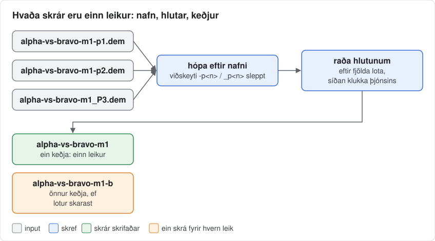

# Að smíða leik {#building-a-match}

Hvernig leikur er gerður úr hlutum demo-skrárinnar: hvaða skrár eiga saman, ein
klukka yfir þær allar, loturnar og hvernig hver vannst, liðin og hliðar þeirra,
og hver röð hitakortstöflunnar með fellingum, hefndum, opnunum,
skaða, blindum og hagkerfi. Kóði:
[`heat3d_cs2/match.py`](https://github.com/Holdi601/3DHeat-CS2/blob/main/heat3d_cs2/match.py).
Stigataflan sem er reiknuð út frá því er á síðunni [Tölfræði](statistics.md).

## Yfirlit {#overview}

1. Hver skrá með sama leikjanafni er lesin ([Að lesa demo](reading-demos.md)).
2. Tvöfaldar leikmannaraðir hverrar skrár (endurheimtar lotur) eru leystar.
3. Skránum er raðað í **keðjur** - leiki - og hver keðja er sett í
   röð.
4. Hver hluti er settur á **leikklukkuna**.
5. **Loturnar** eru fundnar í hverjum hluta; frásögn síðari hluta af lotu
   kemur í stað þeirrar fyrri.
6. **Leikmenn** og **lið** eru nefnd, og hlið hverrar lotu og staða
   eru gefnar eftir liðsheiti. Þegar hliðarnar eru þekktar fylgja lengd hálfleiksins,
   skammbyssulotur og **kaup** hverrar hliðar.
7. **Raðirnar** eru smíðaðar: staðsetningar, skot, köst, sprengingar, sprengjusetningar,
   aftengingar, fellingar, dauðsföll, högg, blindur, sprengingar.
8. Hver röð fær merki með lotu sinni, fasa, lotutíma, hvort hlið hennar
   vann og kaupum hliðarinnar; raðir utan allra lota eru felldar niður.

## Endurheimtar lotur: ein röð fyrir hvern leikmann í hverju tikki {#restored-rounds-one-row-per-player-per-tick}

Þegar lota er endurheimt úr öryggisafriti inni í einni skrá geymir demo-skráin
gamla líkama leikmannanna við hlið nýju í nokkrar sekúndur: tvær raðir fyrir einn
leikmann í einu tikki, önnur þar sem ógilda lotan skildi við hann, hin við
byrjunarstað endurheimtu lotunnar. Fyrir hvern slíkan leikmann eru tvöföldu tikkin gengin
**afturábak** frá fyrstu stöku röðinni á eftir þeim: í hverju tikki er sá
frambjóðandi sem er næstur stöðunni sem á eftir kemur geymdur, og hann verður
viðmiðið fyrir tikkið á undan. Ef engin stök röð er á eftir er síðasti frambjóðandinn
geymdur. Þannig heldur hver leikmaður röðinni sem leiðir áfram þangað sem hann fer næst.

## Lifandi hluti skráar {#the-live-part-of-a-file}

**Lifandi byrjun** skráar er tikk síðasta `round_announce_match_start`-atburðar
hennar, eða tikk 0 ef enginn er til (síðari hluti skiptsa leiks hefur yfirleitt
engan). Allt fyrir lifandi byrjun er sleppt, og líka allt sem er
merkt `is_warmup_period`. Hnífalota eða endurræsing fyrir
tilkynninguna er því sleppt; hnífalota sem *ekki* fylgir tilkynning um
upphaf leiks þekkist ekki sem slík (sjá [Takmarkanir](limits.md)).

**Lotur** skráar eru `round_freeze_end`-atburðirnir frá lifandi byrjun,
utan upphitunar, auðkenndir með `total_rounds_played` (0-grunnuð
vísitala lotunnar sem er um það bil að vera spiluð í leiknum). Skrá án þeirra hefur engar lotur
og tilheyrir engum leik.

## Klukkan {#the-clock}

Tímar eru í sekúndum. Innan skráar er tími talinn í **tikkum**: `game_time`
þjónsins í fyrsta sýnatekna tikkinu, plús tikk síðan þá / 64.
Eigin klukka þjónsins stendur kyrr í hléi á meðan tikkin halda áfram;
lesnar gegnum klukkuna fengju tvö augnablik í leik í hléi sama tímann.

Hver skrá hefur *fyrstu klukku* (tímann við lifandi byrjun hennar) og *síðustu klukku*
(við síðasta sýnatekna tikk hennar).

### Hlutar og keðjur {#parts-and-chains}

Skrám sem heita sama leikjanafni ([Skipanir](commands.md#which-files-are-one-match))
er fyrst raðað eftir vísitölu fyrstu lotu þeirra, síðan eftir fyrstu
klukku þeirra. Síðan gengur hver, í þeirri röð, í fyrstu keðjuna sem hún heldur áfram,
eða byrjar nýja keðju. Hluti heldur keðju áfram þegar vísitala fyrstu lotu hans er að minnsta kosti
vísitala síðustu lotu síðasta hluta keðjunnar, **og** annaðhvort

- klukka þjónsins heldur áfram: fyrsta klukka hans er ekki fyrr en síðasta
  klukka keðjunnar mínus 5 s; eða
- lotutalningin heldur áfram: vísitala fyrstu lotu hans er síðasta vísitala keðjunnar eða
  sú næsta á eftir.

Talningin ræður og klukkan sker úr jafntefli, því að þjónn sem var endurræstur til að
endurheimta lotu byrjar klukkuna aftur, á meðan tveir ólíkir leikir undir
einu nafni (sömu lið á sama korti á tveimur mótum) hafa skarast
lotutalningu. Keðjum er raðað eftir því hve margar lotur þær spanna, flestar fyrst;
sú fyrsta heldur leikjanafninu, hinar eru skrifaðar sem `<name>-b`,
`<name>-c`, ...

### Leikklukkan {#the-match-clock}

Núll leiksins er fyrsta klukka fyrsta hlutans: **leiktími 0 er lifandi
byrjun fyrstu skrárinnar**. Hver síðari hluti er settur á hana:

- þar sem klukka þjónsins heldur áfram (fyrsta klukka hans er ekki fyrr en síðasta klukka
  fyrri hlutans mínus 5 s) er klukka þjónsins notuð eins og hún er;
- þar sem hann var endurræstur er hlutinn settur þannig að hann komi **einni sekúndu** eftir að
  fyrri hlutinn endaði.

## Lotur {#rounds}

Fyrir hvert `round_freeze_end` hluta (í tikkaröð) nær gluggi lotunnar
að næsta freeze end í þeim hluta, eða að enda skrárinnar. Innan hans er
lotan **ákvörðuð** í fyrsta sýnatekna tikki þar sem leikstaðan sýnir
`total_rounds_played` = vísitala lotunnar + 1 og `round_win_status` 1 (jafntefli),
2 (T vann) eða 3 (CT vann). Lota án slíks sýnis í glugga sínum
var skorin af við enda skrárinnar; númer hennar fer á **incomplete**-lista leiksins
(nema annar hluti hafi lotuna heila).

| Reitur lotu | Úr |
|---|---|
| `number` | vísitalan + 1 (frá 1, eins og leikurinn telur) |
| `start` | leiktími loka frystitímans - leikmenn geta hreyft sig |
| `end` | leiktími fyrsta sýnis sem sýnir lotuna ákvarðaða |
| `until` | leiktími næsta `round_prestart` eftir `end`, ef það er innan gluggans; annars enda gluggans eða síðasta tikk skráarinnar, það sem kemur á undan (og aldrei fyrir `end`) |
| `winner` | `T` fyrir sigurstöðu 2, `CT` fyrir 3, tómt fyrir 1: jafntefli er ákveðið, án sigurvegara |
| `reason` | `round_win_reason` í því sýni, nefnt eins og hér að neðan |
| `score` | liðsheiti -> lotur unnar eftir þessa: `team_rounds_total` hverrar hliðar í ákvörðunarsýninu; þar sem demo-skráin hefur það ekki, staða fyrri lotu plús einn fyrir sigurvegarann |
| `sides` | liðsheiti -> `T` / `CT` í þessari lotu |
| `equipment` | hlið -> samanlagt `current_equip_value` **lifandi** leikmanna þeirrar hliðar í fyrsta sýni við eða eftir freeze end |
| `buy` | hlið -> `pistol`, `eco`, `force` eða `full` ([Hagkerfi](#economy-and-buy-types)) |
| `plant` | fyrsta `bomb_planted` eftir freeze end og fram að `end`, eða ekkert |
| `exploded` | leiktími fyrsta `bomb_exploded` eftir þá sprengjusetningu og fyrir næsta freeze end, ef eitthvert er (ekki í leikjaskjalinu; það tímasetur `explode`-röðina) |

`reason`, úr `CSRoundEndReason` leiksins:

| Kóði | `reason` |
|---|---|
| 1 | `bomb` (skotmarkið sprengt) |
| 7 | `defuse` |
| 8, 9 | `elimination` (CT vinna / T vinna með útrýmingu) |
| 10 | `draw` |
| 12 | `time` (skotmarkið bjargað) |
| 17, 18 | `surrender` |
| allt annað | `other` |

Þegar nokkrir hlutar geyma sömu lotu (eftir vísitölu) er útgáfa síðari hlutans
geymd. Loturnar eru síðan taldar upp eftir vísitölu. Leikur þar sem fyrsta lota er
ekki lota 1 skráir vantandi númer (`missing` í leikjaskjalinu); 
skipanalínan segir *recorded from round N*.

### Sprengjusetningin {#the-plant}

| Reitur | Úr |
|---|---|
| `site` | `A` eða `B`: sprengjusvæðið sem leikurinn segir að setjandinn hafi staðið á (`which_bomb_zone`, 1 A, 2 B); án þess, staðarheiti setjandans (`BombsiteA`, `BombsiteB`); án þess, bókstafurinn sem önnur sprengjusetning í sömu skrá á sama svæði gaf (`site` atburðarins er einingarnúmer svæðisins). Tómt þegar ekkert segir til um það - aldrei númerið. |
| `time` | sekúndur **inn í lotuna** (frá freeze end hennar), eins og tími fellingar |
| `player`, `steamid` | setjandinn |
| `x`, `y`, `z` | staða setjandans, leikeiningar: þar sem sprengjan liggur |
| `place` | staðarheiti setjandans við sprengjusetninguna |

### Fasarnir {#the-phases}

Tíminn frá `start` til `end` er **live**-fasi lotunnar; frá `end` til
`until` **after**-fasi hennar, þar sem sigurvegararnir veiða og taparar bjarga sér. Röð
tilheyrir lotunni þar sem `[start, until)` inniheldur tíma hennar, og er
`after` þegar tími hennar er síðar en `end`. Frystitíminn liggur milli lota
og er í engri.

## Leikmenn og lið {#players-and-teams}

**Leikmaður** er hver sá sem var á lífi að minnsta kosti einu sinni á hlið (lið 2 eða 3),
utan frystitíma og upphitunar, eftir lifandi byrjun. Þjálfari eða lýsandi á
hlið liðs er aldrei á lífi og er enginn leikmaður. Hver leikmaður er auðkenndur með Steam
ID; nafnið er það síðasta sem sást.

**Lið** leikmanns er klanheitið sem leikurinn gaf hlið hans
(`team_clan_name`), það sem sést oftast hjá honum - demo-skráin hreinsar það
í lok sínu. Leikur spilaður án klanheita nefnir lið sín eftir hliðinni sem
þau byrjuðu á: `Started T` og `Started CT`.

**Hliðar** hverrar lotu koma frá því hver var á hvorri hlið milli freeze end
og loka lotunnar: hver hlið fær liðsmerkið sem flestir leikmenn hennar
bera. `teams`-listi leiksins er í röð birtingar, lotu fyrir lotu, T-
hlið á undan CT; yfirleitt er liðið sem byrjaði á T fyrst.

## Raðirnar {#the-rows}

Hver staðarsýni og hver atburður verður að einni röð
[hitakortstöflunnar](output-table.md). Leikmenn eru á hlið aðeins þegar
`team_num` þeirra er 2 eða 3.

### Staðsetningar {#positions}

Úr sýnatekum röðum lifandi leikmanna á hlið, utan frystitíma og
upphitunar, eftir lifandi byrjun: staða, sjónstefna, líf, brynja,
peningar, búnaðarverðmæti, vopn í hendi, staður.

Sjónstefnan er einingarvigur í hnitakerfi leiksins:
`(cos pitch * cos yaw, cos pitch * sin yaw, -sin pitch)` - pitch leiksins er
jákvætt þegar horft er niður, svo að horfa niður gefur neikvætt Z.

Vopnið í hendi er `active_weapon_name` eins og leikurinn nefnir það, nema að hvert
nafn sem inniheldur `Knife`, `Bayonet`, `Karambit` eða `Daggers` verður `Knife`.

### Skot og köst {#shots-and-throws}

Úr `weapon_fire`, á stöðu skotmannsins. Hnífar (`knife`, `bayonet` í
vopnaauðkenninu) og C4 eru sleppt. Handsprengjur (`smokegrenade`,
`flashbang`, `hegrenade`, `molotov`, `incgrenade`, `decoy`) eru **throw**-
raðir, allt annað **shot**-raðir. Vopnið er nefnt eins og leikurinn sýnir
það (hér að neðan).

### Sprengingar handsprengna {#grenade-detonations}

| Atburður | Röð | `weapon` |
|---|---|---|
| `smokegrenade_detonate` | `smoke` | Smoke Grenade |
| `flashbang_detonate` | `flash` | Flashbang |
| `hegrenade_detonate` | `he` | High Explosive Grenade |
| `inferno_startburn` (molotov og incendiary) | `molotov` | Molotov |
| `decoy_detonate` | `decoy` | Decoy Grenade |

Staðan er **þar sem handsprengjan sprakk** (`x`, `y`, `z` atburðarins);
leikmaðurinn og hliðin eru kastarans. Demo-skráin nefnir engan stað fyrir
handsprengju, aðeins fyrir leikmenn, svo `place` er skilið eftir tómt: röð heldur ekki fram
stað sem hún var ekki á. Staður kastarans á því augnabliki er geymdur sem
`throwerPlace`.

### Sprengjusetningar og aftengingar {#plants-and-defuses}

`plant`- og `defuse`-raðir á stöðu leikmannsins, vopn `C4 Explosive`.
Sprengja sem var sett og sprakk fær **explode**-röð: á stöðu
sprengjusetningarinnar, á tíma `bomb_exploded`, setjandinn sem leikmaður (með
Steam ID sitt), hlið `T`, T-lið lotunnar sem `team`, og staður
sprengjusetningarinnar. Það á líka við sprengju sem springur eftir að T höfðu þegar unnið
með útrýmingu. Þar sem demo-skráin hefur ekkert `bomb_exploded` fær lota unnin með sprengjunni
(`reason` = `bomb`) með sprengjusetningu röðina við `end` lotunnar.

### Fellingar og dauðsföll {#kills-and-deaths}

Hvert `player_death` í lotu gefur eina **fellingarskrá** (`kills`-tafla
leiksins) með:

| Reitur | Er |
|---|---|
| attacker, victim, assister | nöfn, Steam ID, hliðar; árásarmaðurinn er tómur fyrir heiminn (fallskaði, sprengjan) |
| `weapon` | vopn atburðarins nefnt eins og leikurinn sýnir það |
| `headshot` | fáni atburðarins |
| `wallbang` | `penetrated` > 0 |
| `throughSmoke` | `thrusmoke` |
| `flashAssist` | `assistedflash` |
| `noscope`, `attackerBlind` | fánar atburðarins (`noscope`, `attackerblind`); dálkar `kill`- og `death`-raða, og í fellingum leikjaskjalsins |
| `suicide` | árásarmaður og fórnarlamb sami leikmaður: til dæmis eigin handsprengja |
| `teamkill` | árásarmaður og fórnarlamb á sömu hlið, með árásarmanni, og ekki sjálfsvíg |
| `opening` | fyrsta felling lotunnar á andstæðingi (hér að neðan) |
| `traded`, `trade` | hér að neðan |
| positions | staða og staður árásarmannsins og fórnarlambsins |

Úr hverri skrá fær taflan **death**-röð á stöðu fórnarlambsins
(hvert dauðsfall, líka heimsins, liðsfellingar og sjálfsvíg) og - fyrir fellingar
af hendi andstæðings (árásarmaður, ekki teamkill, ekki sjálfsvíg) - **kill**-röð á
stöðu banamannsins.

**Opnun.** Fyrsta felling á andstæðingi í hverri lotu á meðan hún er lifandi er
opnunareinvígi hennar. Teamkill, sjálfsvíg eða dauði af hendi heimsins á undan er
sleppt, svo opnunin er áfram fyrsta einvígi lotunnar; lota
án fellingar á andstæðingi á meðan hún er lifandi hefur enga.

**Traded** og **trade.** Dauði af hendi andstæðings er **traded** þegar banamaður hans
er felldur af einum úr hlið fórnarlambsins innan **5 sekúndna** eftir það (meira en
0 og í mesta lagi 5 s síðar, í sömu lotu); fyrsta slík felling er
**trade**-felling. Í töflunni er `traded`-dálkur `kill`-raðar 1 fyrir trade-
fellingu; hjá `death`-röð er hann 1 fyrir dauða sem var hefnt. Fellingar
after-fasans teljast líka.

### Skaði {#damage}

Úr `player_hurt`, aðeins milli **andstæðinga** (báðir á hlið, ólíkar
hliðar). Skaðinn er líf sem raunverulega **tapast**: fyrir hvert fórnarlamb í hverri
lotu byrjar líf í 100; hvert högg telur `min(dmg_health, health before)`,
og `health` atburðarins (það sem er eftir) verður „fyrir“-gildi næsta höggs. Haus­skot með 137
skaða á leikmann með 40 líf telur 40, eins og stigatafla leiksins telur það. Högg frá `hegrenade`, `inferno`, `molotov` og
`incgrenade` eru **hjálpartækja**skaði. Hvert högg er **hurt**-röð á stöðu
fórnarlambsins, árásarmaðurinn sem `other`. Liðsskaði og sjálfsskaði eru
hvorki í töflunni né tölfræðinni.

### Blindur {#flashes}

Úr `player_blind`, aðeins **andstæðingar** (ekki liðsfélagar, og ekki þjálfari eða
lýsandi sem fylgist með): ein **blind**-röð fyrir hvern blindaðan leikmann, á stöðu
blindaða leikmannsins, kastarinn sem `other`, blindutíminn í sekúndum sem
`duration`. Hver lengd er geymd; tölfræðin telur aðeins blindur sem eru
að minnsta kosti ein sekúnda.

## Vopnaheiti {#weapon-names}

Vopnaauðkenni úr atburði (`ak47`, `weapon_ak47`, `knife_karambit`) er sýnt
eins og leikurinn nefnir það í `active_weapon_name` leikmannanna sjálfra, svo vopn fellingar
og vopn í hendi lesast eins: `ak47` -> `AK-47`, `m4a1` -> `M4A4`,
`m4a1_silencer` -> `M4A1-S`, `hkp2000` -> `P2000`, `taser` -> `Zeus x27`,
`inferno` og `molotov` -> `Molotov`, `incgrenade` -> `Incendiary Grenade`,
`c4` og `planted_c4` -> `C4 Explosive`, `world` -> `World`, og svo framvegis fyrir
hverja byssu og handsprengju (`WEAPONS`-taflan í `match.py`). Allt með
`knife` eða `bayonet` í auðkenninu er `Knife`. Auðkenni sem er ekki í töflunni er geymt eins og
það er.

## Hagkerfi og kaupgerðir {#economy-and-buy-types}

Við lok frystitímans er búnaðarverðmæti hverrar hliðar lagt saman yfir
lifandi leikmenn hennar í fyrsta sýni frá þeim tíma, og deilt með fjölda
þeirra:

| Lota | Meðalbúnaður á leikmann | `buy` |
|---|---|---|
| skammbyssulota (fyrsta hvers venjulegs hálfleiks) | hvað sem er | `pistol` |
| önnur | undir $1,500 | `eco` |
| önnur | $1,500 að undir $4,000 | `force` |
| önnur | $4,000 eða meira | `full` |

Skammbyssulotur fylgja hálfleiknum sem leikurinn var spilaður með, ekki föstu
sniði. Hálfleikurinn endar þar sem hliðar skipta fyrst um sæti milli tveggja lota sem
fylgja hvor annarri, báðar í venjulegum leiktíma: lengd hans (`halfLength` í
leikjaskjalinu) er lotan á undan skiptunum - 12 í 24 lotna sniðinu, 15 í
30 lotna sniðinu. Lota 1 og lotan eftir hálfleikinn eru skammbyssulotur.
Lota er framlenging þegar framlengingartalning leiksins
(`m_nOvertimePlaying`) er yfir 0 við freeze end hennar; þar sem demo-skrá hefur enga
slíka talningu er sérhver lota eftir tvo hálfleiki framlenging. Framlengingarhálfleikir byrja með
peningum sem þjónninn setur og hafa enga skammbyssulotu, þótt hliðar
skipti líka um sæti. Upptaka sem sýnir aldrei hliðaskiptin í hálfleik - hún byrjar eftir þau, eða
endar á undan - lætur hálfleikinn vera óþekktan, og aðeins lota 1 er skammbyssulota.

## Merking og röð {#labelling-and-order}

Að lokum fær hver röð:

- `match` - leikjanafnið; `map` - kortið úr haus demo-skrárinnar;
- `round` og `roundId` (`<match> #NN`, tveir tölustafir);
- `phase` - `live` eða `after`;
- `roundTime` - sekúndur frá því frystitími lotunnar endaði;
- `won` - 1 ef hlið raðarinnar vann lotuna, 0 ef ekki, tómt fyrir röð án
  hliðar;
- `buy` - kaup hliðar raðarinnar í þeirri lotu;
- `team` - lið leikmanns raðarinnar, eftir Steam ID.

Raðir þar sem tíminn er í engri lotu - fyrir freeze end fyrstu lotu,
á frystitíma, eftir síðustu lotu - eru felldar niður. Raðirnar eru raðaðar
eftir tíma, og eftir atburðarheiti innan sama tíma.
