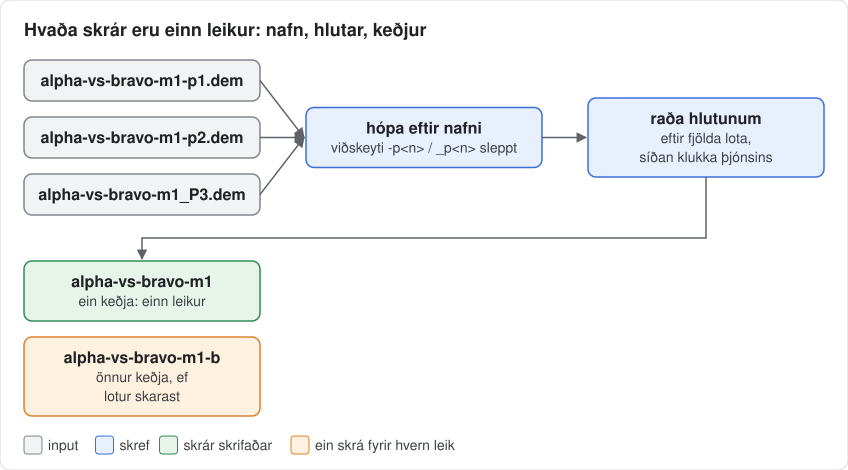
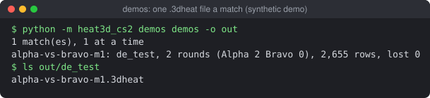

# Skipanir {#commands}

Hefurðu aldrei notað skipanalínu? Lestu fyrst [Áður en þú byrjar](before-you-start.md).
Skrifaðu þetta í skipanalínu sem er opin í möppunni sem þú pakkaðir upp eða klónaðir;
`<...>` eru staðgenglar, og slóð með bilum fer innan gæsalappa.

```text
python -m heat3d_cs2 demos <demo files or folders> -o <folder> [--every 8] [--jobs N] [--map TEXT] [--force] [--no-bulk] [--loose]
python -m heat3d_cs2 map <map name | path to its .vpk> -o <file.glb> [--game FOLDER] [--source2viewer EXE]
python -m heat3d_cs2 scoreboard <match.3dheat | match.json>
```

`python -m heat3d_cs2 --help` og `python -m heat3d_cs2 <verb> --help` sýna
sömu valkosti; [Skipanayfirlitið](../cli-reference.md) sýnir þá alla. Hver ræsing keyrir fyrst útgáfuathugunina sem er lýst í
[Uppfærslur](updates.md) (slökkt með `HEAT3D_NO_UPDATE=1`).

Kóði: [`heat3d_cs2/cli.py`](https://github.com/Holdi601/3DHeat-CS2/blob/main/heat3d_cs2/cli.py).

## `demos` - demo-skrár í töflur og leikjaskjöl {#demos---demos-into-tables-and-match-documents}

```powershell
python -m heat3d_cs2 demos D:\Demos\event -o out
python -m heat3d_cs2 demos alpha-vs-bravo-m1-p1.dem alpha-vs-bravo-m1-p2.dem -o out
python -m heat3d_cs2 demos D:\Demos -o out --map final --jobs 4
```

| Færibreyta | Sjálfgefið | Gerir |
|---|---|---|
| `paths` (ein eða fleiri) | - | demo-skrár og möppur. Skrá er tekin þegar endingin er `.dem` (hvaða stafagerð sem er). Mappa er leituð **endurkvæmt** að skrám sem enda á `.dem`, hvaða stafagerð sem er, í raðaðri röð. Þjappaðar demo-skrár (`.dem.zst`, `.dem.bz2`, safnskrár) eru ekki lesnar: pakkaðu þeim fyrst upp. |
| `-o`, `--out` | nauðsynlegt | mappan sem er skrifað í; búin til eftir þörfum |
| `--every N` | `8` | sýni hvern leikmann á hverju *N*-ta tikki. CS2 demo-skrár ganga á 64 tikkum á sekúndu, svo 8 eru átta sýni á sekúndu, 4 eru sextán, 64 er eitt. Atburðir eru alltaf lesnir á sínu eigin tikki, hvert sem *N* er. |
| `--jobs N` | `0` = helmingur örgjörvakjarna | hve margir leikir eru umbreyttir í einu, hver í sínu ferli. Aldrei færri en 1, aldrei fleiri en leikirnir sem á að gera. |
| `--map TEXT` | - | aðeins leikir þar sem **nafnið** inniheldur *TEXT*, án tillits til stafagerðar (`--map final`). Síar á skráarnafnið, ekki á kortið sem demo-skráin reynist geyma. |
| `--force` | slökkt | umbreytir leikjum sem þegar eru skrifaðir og skrifar yfir þá |
| `--loose` | slökkt | geymir hvern leik sem aðskildar skrár - töflu, `.match.json`, hliðarskrár - í stað þess að pakka þeim í einn `.3dheat`-gám. Sjá [Ein skrá fyrir hvern leik](output-container.md). |
| `--container` | kveikt | pakkar hverjum leik í eina `.3dheat`-skrá; sjálfgefið, svo það er aðeins til að vera skýr |
| `--no-bulk` | slökkt | sleppir einingastraumnum, skipunum leikmanna og hreyfistraumnum úr packets-hliðarskránni - meira en helmingur stærðar demo-skrár, jafnvel þjappaðrar. Sjálfsathugun leikjaskjalsins telur þau þá `lost`, með nafni. |


### Hvaða skrár eru einn leikur {#which-files-are-one-match}



Leikjanafnið er nafn demo-skrárinnar án endingar og án
hlutaviðskeytis: `-p<digits>` eða `_p<digits>` í endann, hvaða stafagerð sem er. Svo
`alpha-vs-bravo-m1-p1.dem`, `alpha-vs-bravo-m1-p2.dem` og
`alpha-vs-bravo-m1_P3.dem` eru hlutar eins leiks, `alpha-vs-bravo-m1`.
Skrám er hópað eftir því nafni einu - tvær skrár með sama nafni í
ólíkum möppum eru líka hópaðar saman.

Viðskeytið segir ekkert um röð: `-p2` getur verið fyrri helmingurinn. Hlutunum
er raðað eftir lotutalningunni sem þeir geyma, og síðan eftir klukku þjónsins,
og hópur sem reynist geyma tvo ólíka leiki (sömu
lið á sama korti á tveimur mótum, til dæmis) er skipt í **keðjur**: keðjan
með flestar lotur er skrifuð undir nafninu sjálfu, sú næsta sem
`<name>-b`, síðan `<name>-c`, og svo framvegis. Skrá án lotu (aðeins upphitun,
hlé) tilheyrir engri keðju. Hvernig keðjur eru fundnar er lýst í
[Að smíða leik](building-matches.md#parts-and-chains).

### Hvað er skrifað {#what-is-written}

Fyrir hvern leik, í möppu sem heitir eftir kortinu sem haus demo-skrárinnar
nefnir (`unknown` ef hann nefnir ekkert), ein `.3dheat`-skrá:

```text
out/
  de_x/
    alpha-vs-bravo-m1.3dheat
    alpha-vs-bravo-m2.3dheat
  de_y/
    ...
```

Á gervi-demo-skránni með tveimur lotum úr prófununum:



Með `--loose` er hver leikur taflan, leikjaskjalið hans og fjórar hliðarskrár hlið við hlið
([Ein skrá fyrir hvern leik](output-container.md)):


Hitakort er af einu korti, svo að hlaða einni möppu í skoðaranum er að hlaða leikjum
eins korts. Sjá [Hitakortstaflan](output-table.md) og
[Leikjaskjalið](output-match-json.md).

### Hverju er sleppt {#what-is-skipped}

Áður en nokkuð er lesið er hver `*.3dheat` hvar sem er undir `--out` (gámur
er skrifaður heill eða alls ekki), og hver `*.parquet` sem hefur
leikjaskjal sitt (`<name>.match.json`) við hliðina, talin upp, og leik þar sem nafnið
er jafnt skráarnafni þeirra (án endingar) er sleppt, nema
`--force`. Tafla án leikjaskjals síns - keyrsla stöðvuð milli þess að
skrifa hvort tveggja - telst ekki með, svo sá leikur er umbreyttur aftur. Athugunin er eftir nafni
eingöngu: leikur umbreyttur í
aðra kortamöppu, eða með annað `--every`, telst samt búinn.
Þegar ekkert er eftir að gera:

```text
nothing to do: no demos found, or every match already written (--force redoes them)
```

### Hvað er prentað {#what-is-printed}

Fyrst magn vinnunnar, síðan ein lína fyrir hvern leik þegar hann klárast (í
þeirri röð sem þeir klárast, ekki röð skránna):

```text
3 match(es), 3 at a time
alpha-vs-bravo-m1: de_x, 21 rounds (Alpha 13 Bravo 8), 412,377 rows, lost 0
alpha-vs-bravo-m2: de_y, 30 rounds (Bravo 16 Alpha 14), 598,104 rows, 1 incomplete round(s) left out, lost 0
alpha-vs-bravo-m3: de_y, 18 rounds (Alpha 13 Bravo 5), 330,981 rows, recorded from round 3, lost 1,204,331 (svc_PacketEntities, svc_UserCmds, DEM_AnimationData)
```

(Tölurnar eru til útskýringar.) Staðan er sú í síðustu lotu, lið fyrir lið
í þeirri röð sem leikjaskjalið telur þau upp. *incomplete round(s) left out* telur
lotur sem demo-skrá skar af áður en þær voru ákvarðaðar; *recorded from round N* segir
að upptakan byrji seint; *lost* er sjálfsathugun leikjaskjalsins - hve mörg atriði
úr demo-skránni fóru hvergi, og af hvaða gerðum (`--no-bulk` gerir magnið lost).
Leikur sem gefur ekkert segir hvers vegna:

```text
alpha-vs-bravo-m4: no round in 1 file(s) - nothing written
alpha-vs-bravo-m4-b: no complete round in 1 file(s) - nothing written
```

Villa í einum leik stöðvar ekki hina; hún er prentuð sem
`<name>: failed - <error>`.

### Útgöngukóði {#exit-code}

`0` þegar hver leikur var umbreyttur (eða ekkert var að gera), `1` þegar að
minnsta kosti einn mistókst.

### Hve langan tíma það tekur {#how-long-it-takes}

Hver leikur er lesinn og smíðaður í vinnuferli. Mappa með nokkur hundruð
demo-skrám tekur nokkrar mínútur með sjálfgefnu `--jobs`. Minni
á hvert verk vex með lengd leiksins og með minna `--every`: hvert vinnuferli
geymir hverja sýnatekna leikmannaröð leiksins síns (um það bil tíu leikmenn sinnum
64 / *N* raðir á sekúndu af upptöku) áður en skrifað er.

Hliðarskrárnar taka lengri tíma en taflan: hver eiginleiki sem þáttarinn les er
lesinn á hverju tikki, einn glugga af tikkum í einu (um tvær mínútur fyrir
40 mínútna demo-skrá, nálægt 3 GB af minni í mesta lagi á hvert verk), síðan er demo-skráin
gengin einu sinni enn fyrir ramma sína og skilaboð.

## `map` - geometría korts sem `.glb` {#map---a-maps-geometry-as-glb}


```powershell
python -m heat3d_cs2 map <map> -o out/<map>/<map>.glb
python -m heat3d_cs2 map <map> -o <map>.glb --game "D:\Games\Steam\steamapps\common\Counter-Strike Global Offensive"
python -m heat3d_cs2 map "D:\maps\<map>.vpk" -o <map>.glb --source2viewer C:\Tools\Source2Viewer-CLI.exe
```

| Færibreyta | Sjálfgefið | Gerir |
|---|---|---|
| `name` | - | heiti kortsins (eins og `de_x`), eða slóðin að `.vpk`-skrá þess. Slóð sem endar á `.vpk` og er til er notuð eins og hún er; allt annað er flett upp eftir skráarstofni í uppsetta leiknum. |
| `-o`, `--out` | nauðsynlegt | `.glb`-skráin sem er skrifuð; mappan hennar er búin til eftir þörfum |
| `--game FOLDER` | söfn Steam | CS2-uppsetningarmappan (sú sem inniheldur `game\csgo`), þegar Steam veit ekki um hana. Með `--game` er aðeins sú mappa leituð. |
| `--source2viewer EXE` | `HEAT3D_SOURCE2VIEWER`, síðan `PATH` | keyrsluskrá Source2Viewer CLI |

Prentað þegar það tekst:

```text
out/de_x/de_x.glb: de_x, 412,880 triangles (151,204 ground) in 14 parts
```

(tölur til útskýringar). Að skrifa `.glb`-skrána við hliðina á töflum kortsins
(`out/<map>/<map>.glb`) heldur gögnum og geometríu korts í einni möppu. Hvernig
útflutningurinn virkar: [Kortaútflutningur](map-export.md).

Villur, hver prentuð sem `error: ...` með útgöngukóða `2`:

| Skilaboð | Þýðir |
|---|---|
| `no de_x.vpk found in an installed CS2 - pass --game <CS2 folder> or the .vpk path` | kortið er ekki í neinu Steam-safni sem fannst, eða heitið er rangt |
| `Source2Viewer-CLI not found: ...` | ekkert af `--source2viewer`, `HEAT3D_SOURCE2VIEWER`, `PATH` gaf skrá sem er til |
| `Source2Viewer did not export de_x's collision mesh:` og á eftir endir úttaksins | það mistókst, eða skrifaði enga `.glb` |
| `de_x's collision mesh has nothing but clip brushes` | eftir að clip og himinn voru tekin út var ekkert eftir |

## `scoreboard` - leikur sem texti {#scoreboard---a-match-as-text}

```bash
python -m heat3d_cs2 scoreboard out/de_x/alpha-vs-bravo-m1.3dheat
python -m heat3d_cs2 scoreboard out/de_x/alpha-vs-bravo-m1.match.json   # after demos --loose
```

Prentar stigatöflu leiksins úr [leikjaskjali](output-match-json.md) hans,
án þess að opna skoðarann. Hún les skjalið inni í `.3dheat`-
gámi, eða lausa `<match>.match.json`.
Á gervi-demo-skránni með tveimur lotum úr prófununum:


```text
alpha-vs-bravo-m1 - de_test  Alpha 2  Bravo 0

Alpha
player                 K   D   A  +/-    ADR   KAST   HS%  OK-OD  clutch
ash                    1   0   0   +1   50.0 100.0%    0%   0-0     1/1
ace                    1   1   0   +0   50.0 100.0%  100%   1-0     0/0

Bravo
player                 K   D   A  +/-    ADR   KAST   HS%  OK-OD  clutch
ben                    1   1   0   +0   50.0 100.0%    0%   0-0     0/1
bob                    0   1   0   -1    0.0 100.0%    0%   0-1     0/0

rounds  1:TK 2:TB
```

- Fyrsta línan: leikjanafn, kort og lokastaða hvers liðs.
- Tafla fyrir hvert lið, í röð `teams` í leikjaskjalinu; leikmenn í
  röð leikjaskjalsins (eftir fellingum mínus dauðsföllum, síðan fellingum, bestur fyrst). Nöfn eru
  stytt í 19 stafi.
- Dálkar: **K** fellingar, **D** dauðsföll, **A** aðstoðir *að meðtöldum* blindaðstoðum,
  **+/-** fellingar mínus dauðsföll, **ADR**, **KAST** (%), **HS%** (rúnnað á heil
  prósent), **OK-OD** opnunarfellingar - opnunardauðsföll, **clutch** clutch unnin /
  clutch spiluð. Skilgreiningar: [Tölfræði](statistics.md).
- Loturöndin: `<round>:<winning side><how>`, þar sem **B** sprengja sprakk,
  **D** aftengd, **K** útrýming, **T** tíminn rann út, og **?** fyrir allt
  annað (jafntefli, uppgjöf, annað). Jafntefli hefur enga sigurhlið: `<round>:?`.

Skrá sem er ekki gilt JSON, eða finnst ekki, stöðvast með villu; JSON-
skjal án reita leikjaskjalsins mistekst með Python-villu (það er ekki
sannreynt frekar).
