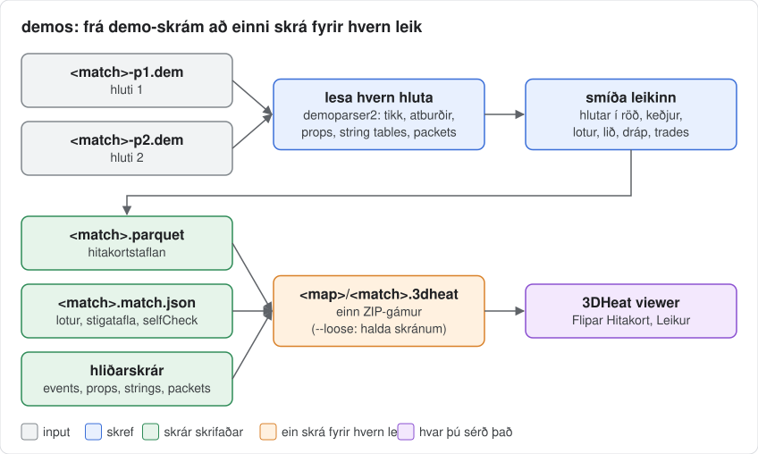

# 3DHeat CS2 {#3dheat-cs2}

**Hvað er þetta?** Counter-Strike 2 getur vistað upptöku af leik, kallaða
*demo*. Þetta verkfæri breytir demo í skrár sem 3DHeat-skoðarinn getur sýnt í 3D:
hvar allir stóðu, dóu, köstuðu og settu sprengju, lotu fyrir lotu. Það getur líka
breytt CS2-korti í þrívíddarlíkan til að sýna þetta á.

**Hvers vegna ætti ég að nota það?** Til að fara yfir eigin leiki, til að leggja marga leiki
á sama korti hvern yfir annan sem eitt hitakort, og fyrir tölfræði leikja eins og ADR
(meðalskaði í lotu) og KAST (hlutfall lota þar sem leikmaður felldi, aðstoðaði,
lifði af eða var hefnt fyrir).

**Dæmi:** `alpha-vs-bravo-m1.dem` inn, `out/de_x/alpha-vs-bravo-m1.3dheat`
út (`de_x` er uppdiktað kortaheiti).



Nánar: 3DHeat CS2 breytir **Counter-Strike 2 demo-skrám** í hitakortstöflu og
leikjaskjal fyrir hvern leik, og **CS2-korti** í borðsgeometríu. Úttakið er gert
fyrir [3DHeat](https://holdi601.github.io/3DHeat/) telemetry-skoðarann
([frumkóði](https://github.com/Holdi601/3DHeat)), en það
eru venjulegar skrár - Parquet, JSON og glTF binary - sem allt annað getur
líka lesið.

Þetta er lítill Python-pakki, `heat3d_cs2`, sem er keyrður úr skipanalínu. Hann les
demo-skrár af diski (hann sækir engar) með
[demoparser2](https://github.com/LaihoE/demoparser) og flytur út kort úr
uppsettum leiknum með skipanalínuútgáfu Source2Viewer
([ValveResourceFormat](https://github.com/ValveResourceFormat/ValveResourceFormat)).

## Fljótleg byrjun {#quick-start}

Hefurðu aldrei notað skipanalínu? Lestu fyrst [Áður en þú byrjar](before-you-start.md).

```bash
pip install -r requirements.txt
python -m heat3d_cs2 demos <demo files or folders> -o out   # every match in them
python -m heat3d_cs2 map <map> -o out/<map>/<map>.glb       # the map from the installed game
python -m heat3d_cs2 scoreboard out/<map>/<match>.3dheat    # a match's scoreboard as text
```

Þú ættir að sjá `1 match(es), 1 at a time ...` og síðan eina línu fyrir hvern leik
(sjá [Skipanir](commands.md#what-is-printed)).

`demos` skrifar fyrir hvern leik eina skrá í möppu sem heitir eftir kortinu:
`out/<map>/<match>.3dheat`, [`.3dheat`-gámur](output-container.md) - snið
skoðarans með eina skrá fyrir hvern leik ([skilgreining](https://holdi601.github.io/3DHeat/container.html)).
Hann geymir þessa hluta; `--loose` skrifar þá sem aðskildar skrár í staðinn:

| Hluti | Hvað hann geymir | Hlaðið í flipa skoðarans |
|---|---|---|
| `<match>.parquet` (hlutverk `table`) | hvern lifandi leikmann átta sinnum á sekúndu með stöðu hans (líf, peninga, blindu, sjónauka, svæði, búnað, ...), og hvern atburð þar sem hann gerðist (kill, death, hurt, shot, throw, sprengingar handsprengna, blind, plant, defuse, explode, og lok lotu fyrir hvern leikmann með því sem lotan gaf honum), ein röð hver | Hitakort |
| `<match>.match.json` (hlutverk `match`, leikjaskjalið) | lið, stöðu, hverja lotu (sigurvegara, hvernig, hagkerfi, sprengjusetningu, fellingar í réttri röð, clutch, eftirlifendur) og stigatöflulínu hvers leikmanns | Leikur |
| `<match>.events/props/strings/packets.parquet` | allt annað sem demo-skráin geymir, heilt (hliðarskrár) | geymt til að allt sé með |

`map` skrifar `<map>.glb`: árekstrarnet kortsins - gólf, veggi, kassa,
án skrauts - skipt í jörð og mannvirki, í sama hnitakerfi og með sömu
einingar og töflurnar, svo það liggur nákvæmlega undir hitakortinu (spjaldið „Bakgrunnur / borð“).

## Kort af þessum skjölum {#map-of-this-documentation}

| Síða | Um hvað hún er |
|---|---|
| [Áður en þú byrjar](before-you-start.md) | Python, skipanalína, staðgenglar, hvernig árangur og algengar villur líta út |
| [Uppsetning](installing.md) | Python, pakkarnir, CLI Source2Viewer, hvar CS2 þarf að vera |
| [Skipanir](commands.md) | `demos`, `map`, `scoreboard`: hver valkostur, hvað er prentað, útgöngukóðar |
| [Að lesa demo](reading-demos.md) | hvað er lesið úr demo-skrá: sýnatökutikk, eiginleikar leikmanna, leikreglur, atburðir |
| [Að smíða leik](building-matches.md) | hlutar og keðjur, leikklukkan, lotur, lið og hliðar, raðir, fellingar, hefndir, opnanir, skaði, blindur, hagkerfi |
| [Tölfræði](statistics.md) | stigataflan: K/D/A, ADR, KAST, HS%, opnanir, hefndir, margfaldar fellingar, clutch, hjálpartæki, blindur |
| [Hitakortstaflan](output-table.md) | Parquet-skráin: hver dálkur, tegund hans, hvaða atburðir fylla hann, `heat3d`-ábendingar í endanum, ásarnir |
| [Leikjaskjalið](output-match-json.md) | `.match.json`-skjalið, reit fyrir reit |
| [Ein skrá fyrir hvern leik](output-container.md) | `.3dheat`-gámurinn sem `demos` skrifar sjálfgefið, `--loose` |
| [Kortaútflutningur](map-export.md) | hvernig árekstrarnet korts er flutt út, hnitakerfið, nöfn hnúta, einingar |
| [Notkun með 3DHeat](using-with-3dheat.md) | að hlaða töflum, leikjaskjölum og kortum í Hitakorts- og Leiks-flipa skoðarans |
| [Takmarkanir](limits.md) | hvað er gert ráð fyrir, hvað er ekki meðhöndlað, hvað er óstaðfest |
| [Uppfærslur](updates.md) | útgáfuathugunin við ræsingu og `python -m heat3d_update` |
| [Þróun](development.md) | uppbygging kóðans, prófanir, gervi-demo-prófunarskráin |
| [Skipanayfirlit](../cli-reference.md) | `--help` hverrar skipunar, búið til úr kóðanum |
| [Viðhald](maintaining.md) | útgáfulistinn fyrir þessar síður |

## Gegn hverju það er prófað {#what-it-is-checked-against}

Demo-skrár úr daglegri notkun eru ekki ein hrein skrá fyrir hvern leik. Breytirinn
ræður við leik sem er skipt í margar skrár í hvaða röð sem er, þjón sem var endurræstur í miðjum leik,
tvo ólíka leiki geymda undir einu nafni, lotur sem voru endurheimtar úr öryggisafriti,
upptöku sem byrjar seint eða endar snemma, hlé og þjálfara á hlið liðs -
sjá [Að smíða leik](building-matches.md). Prófað á stóru safni
mótsdemoa: í hverjum leik
fylgir staðan sigurvegurum lotanna, fellingar hverrar hliðar eru dauðsföll hinnar,
og hver lota byrjar fimm gegn fimm.

## Á hvað á að beina því {#what-to-point-it-at}

Demo-skrár eigin leikja, demo-skrár sem þú sóttir sjálf(ur) af móts­vef, eða
demo-skrár úr API sem þú hefur aðgang að. Demo er upptaka sem efni hennar
tilheyrir útgefanda hennar og skipuleggjendum: notaðu það sem kemur út til
eigin greiningar og dreifðu ekki demo-skrám né gögnum unnum úr þeim. Vefir sem
bjóða demo-skrár banna oft sjálfvirkt niðurhal í skilmálum sínum, og þess vegna
les verkfærið demo-skrár af diski og sækir engar.

## Hluti af 3DHeat {#part-of-3dheat}

3DHeat CS2 er eitt af ókeypis verkfærunum í kringum 3DHeat-skoðarann, hvert með
eigin hugbúnaðarsafn, eigin útgáfur og eigið leyfi:

| Verkfæri | Hvað það gerir | Skjöl |
|---|---|---|
| [3DHeat](https://github.com/Holdi601/3DHeat) | skoðarinn: hitakort, kappakstursgreining og leikjayfirferð í 3D | [vefur](https://holdi601.github.io/3DHeat/) |
| [GameFiles](https://github.com/Holdi601/3DHeat-GameFiles) | brautir og borð úr skrám sem leikir fylgja með, sem þrívíddarlíkön | [vefur](https://holdi601.github.io/3DHeat-GameFiles/) |
| [GameCapture](https://github.com/Holdi601/3DHeat-GameCapture) | hringjamælingar úr kappakstursleikjum; borð endurbyggð úr leikmyndbandi | [vefur](https://holdi601.github.io/3DHeat-GameCapture/) |
| [Unreal Exporter](https://github.com/Holdi601/3DHeat-UnrealExporter) | Unreal Editor viðbót sem flytur borð út sem eitt þrívíddarlíkan | [vefur](https://holdi601.github.io/3DHeat-UnrealExporter/) |
| [CS2](https://github.com/Holdi601/3DHeat-CS2) | Counter-Strike 2 demo-skrár í töflur og leikjaskjöl; kort í þrívíddarlíkön | [vefur](https://holdi601.github.io/3DHeat-CS2/) |
| [Watcher](https://github.com/Holdi601/3DHeat-Watcher) | skráir í bakgrunni það sem leikir birta um spilun þína | [vefur](https://holdi601.github.io/3DHeat-Watcher/) |
| [Ext-WarThunder](https://github.com/Holdi601/3DHeat-Ext-WarThunder) | War Thunder upptökur í töflur og leikjaskjöl | [vefur](https://holdi601.github.io/3DHeat-Ext-WarThunder/) |
| [Ext-WoT](https://github.com/Holdi601/3DHeat-Ext-WoT) | World of Tanks upptökur í töflur og leikjaskjöl | [vefur](https://holdi601.github.io/3DHeat-Ext-WoT/) |
| [Ext-WoWs](https://github.com/Holdi601/3DHeat-Ext-WoWs) | World of Warships upptökur í töflur og leikjaskjöl | [vefur](https://holdi601.github.io/3DHeat-Ext-WoWs/) |
| [Ext-Squad](https://github.com/Holdi601/3DHeat-Ext-Squad) | Squad þjónasdemo í töflur og leikjaskjöl | [vefur](https://holdi601.github.io/3DHeat-Ext-Squad/) |
| [Ext-DCS](https://github.com/Holdi601/3DHeat-Ext-DCS) | DCS World kort í þrívíddarlíkön | [vefur](https://holdi601.github.io/3DHeat-Ext-DCS/) |
| [Ext-IL2](https://github.com/Holdi601/3DHeat-Ext-IL2) | IL-2 Sturmovik kort í þrívíddarlíkön | [vefur](https://holdi601.github.io/3DHeat-Ext-IL2/) |
| [Ext-Dota](https://github.com/Holdi601/3DHeat-Ext-Dota) | Dota 2 kortið úr þinni eigin uppsetningu sem þrívíddarborð | [vefur](https://holdi601.github.io/3DHeat-Ext-Dota/) |
| [Ext-DotaReplay](https://github.com/Holdi601/3DHeat-Ext-DotaReplay) | Dota 2 upptökur | [vefur](https://holdi601.github.io/3DHeat-Ext-DotaReplay/) |
| [Ext-Riot](https://github.com/Holdi601/3DHeat-Ext-Riot) | League of Legends og VALORANT upptökur (það sem þær geyma ódulritað) | [vefur](https://holdi601.github.io/3DHeat-Ext-Riot/) |
| [Ext-Forza](https://github.com/Holdi601/3DHeat-Ext-Forza) | Forza brautir, keppnir og bílar úr þinni eigin uppsetningu | [vefur](https://holdi601.github.io/3DHeat-Ext-Forza/) |
| [Ext-Battlefield](https://github.com/Holdi601/3DHeat-Ext-Battlefield) | Battlefield borð (Frostbite) sem þrívíddarborð | [vefur](https://holdi601.github.io/3DHeat-Ext-Battlefield/) |
| [Ext-BeamNG](https://github.com/Holdi601/3DHeat-Ext-BeamNG) | BeamNG.drive brautir | [vefur](https://holdi601.github.io/3DHeat-Ext-BeamNG/) |
| [Ext-ACRally](https://github.com/Holdi601/3DHeat-Ext-ACRally) | Assetto Corsa Rally leiðir sem brautir | [vefur](https://holdi601.github.io/3DHeat-Ext-ACRally/) |
| [Ext-Reforger](https://github.com/Holdi601/3DHeat-Ext-Reforger) | Arma Reforger heimar (Enfusion) sem þrívíddarborð | [vefur](https://holdi601.github.io/3DHeat-Ext-Reforger/) |
| [Ext-R6](https://github.com/Holdi601/3DHeat-Ext-R6) | Rainbow Six Siege leikjaupptökur | [vefur](https://holdi601.github.io/3DHeat-Ext-R6/) |

## Leyfi {#licence}

MIT - sjá [`LICENSE`](https://github.com/Holdi601/3DHeat-CS2/blob/main/LICENSE),
og [`LICENSES.md`](https://github.com/Holdi601/3DHeat-CS2/blob/main/LICENSES.md)
fyrir pakka frá þriðja aðila og það sem leikirnir sem það les skylda þig til.
