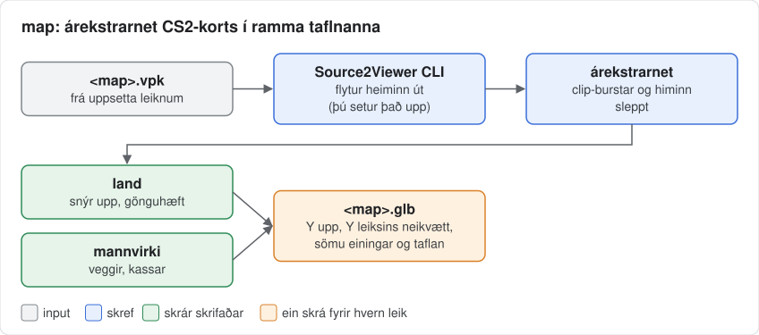

# Kortaútflutningur (`map`) {#map-export}

`python -m heat3d_cs2 map <map> -o <file.glb>` skrifar CS2-kort sem borðs-
geometríu: **árekstrarnet** heimsins, í sama hnitakerfi og með sömu einingar og
[hitakortstöflurnar](output-table.md) eru teiknaðar í. Kóði:
[`heat3d_cs2/mapexport.py`](https://github.com/Holdi601/3DHeat-CS2/blob/main/heat3d_cs2/mapexport.py),
[`heat3d_cs2/glb.py`](https://github.com/Holdi601/3DHeat-CS2/blob/main/heat3d_cs2/glb.py).
Valkostir og skilaboð: [Skipanir](commands.md#map---a-maps-geometry-as-glb).



## Hvers vegna árekstrarnetið {#why-the-collision-mesh}

Árekstrarnetið er það sem leikmenn standa á og fela sig bak við - gólf, veggir,
stigar, kassar - án skrautsins: engir hlutir sem líta bara út eins og
eitthvað, engar áferðir, miklu færri þríhyrningar en teikninetin. Það er
það sem hitakort þarf undir sér: eitthvað til að lesa staðsetningar gegn, ekki
mynd af kortinu.

## Hvernig það er fengið {#how-it-is-obtained}

1. **Finna kortið.** Slóð sem endar á `.vpk` og er til er notuð eins og hún er gefin.
   Annars er leitað að `<name>.vpk` í
   `<CS2 folder>\game\csgo\maps\`, þar sem CS2-mappan er `--game`, eða
   `steamapps\common\Counter-Strike Global Offensive` í hverju Steam-safni sem
   finnst (sjá [Uppsetning](installing.md#where-cs2-is-looked-for)).
2. **Finna CLI Source2Viewer**: `--source2viewer`, síðan
   `HEAT3D_SOURCE2VIEWER`, síðan `Source2Viewer-CLI` / `Source2Viewer-CLI.exe`
   á `PATH`.
3. **Flytja út eðlisfræði heimsins.** Source2Viewer er keyrður sem

   ```text
   Source2Viewer-CLI -i <map>.vpk -d -f maps/<map>/world_physics.vmdl_c --gltf_export_format glb -o <temporary folder>
   ```

   Hann afkóðar þýdda eðlisfræði Source 2 úr safnskrá kortsins sjálfs og
   skrifar líkanið (tómt: heimurinn hefur ekkert eigið teikninet) og eðlisfræði þess
   við hliðina. Stærsta `.glb`-skráin sem er skrifuð er eðlisfræðin. Ef
   Source2Viewer mistekst eða skrifar enga `.glb`, stöðvast skipunin og sýnir
   síðustu 800 stafi úttaks hans og villna.
4. **Lesa það.** Gengið er um hvern hnút senunnar með umbreytingu hans
   (fylki, eða tilfærsla-snúningur-kvarði), og sérhver þríhyrningsfrumstæða er
   tekin, með eða án vísabiðminnis, í heimsstöðum.
5. **Sleppa því sem er ekki veggur eða gólf.** Hnútur þar sem nafnið inniheldur
   `clip` - leikmannaclip, NPC-clip, handsprengjuclip: ósýnilegu veggirnir sem
   stöðva leikmenn og handsprengjur - eða `sky`, hver sem stafagerðin er, er felldur niður.
6. **Nefna yfirborðið.** Eðlisfræðihóparnir heita eftir yfirborði sínu; nafnið
   með litlum stöfum, þar sem upphafið `physics`, `physics_group` eða
   `physics_passbullets` (og undirstrikið á eftir því) er fjarlægt, er yfirborðið:
   `physics_group_concrete` er `concrete`, `physics_passbullets_chainlink` er `chainlink`, hrátt
   `physics_group` er `world`. Yfirborð sem byssukúlur fara í gegnum eru geymd.
7. **Aftur í hnitakerfi leiksins.** Source2Viewer skrifar glTF í metrum með Y
   upp: (Y, Z, X) leiksins margfaldað með 0,0254. Það er afturkallað - hver punktur
   verður (X, Y, Z) leiksins í tommum.
8. **Skipta jörð frá mannvirki**, þríhyrning fyrir þríhyrning: flötur þar sem normalinn
   vísar upp um að minnsta kosti 0,7 (Z-hluti hans, stöðlaður) - brekkur upp að
   um 45 gráðum, nokkurn veginn það bratta sem CS2-leikmaður gengur - er **jörð**;
   allt annað, veggir og loft meðtalin, er **mannvirki**.
9. **Inn í hnitakerfi skoðarans.** Hver punktur er skrifaður sem (X, Z, -Y): Y upp,
   Y leiksins neikvætt - hnitakerfið sem skoðarinn teiknar töflurnar í, þegar hann
   fylgir `heat3d`-ábendingum þeirra. Snúningur, ekki speglun.
10. **Skrifa `.glb`.** Ef ekkert er eftir (aðeins clip-burstar), stöðvast skipunin
    með villu. Annars prentar hún skrána, kortið, fjölda þríhyrninga,
    hve margir eru jörð, og fjölda hluta.

Ekkert hér les neitt nema `.vpk` kortsins sjálfs, og ekkert af
Source2Viewer er fylgt með eða afritað.

## Skráin {#the-file}

glTF 2.0 binary (`.glb`), einn biðminni, skrifuð af `heat3d_cs2` (það er
`asset.generator`):

| Þáttur | Hvað |
|---|---|
| Hnútar | einn fyrir hvern hluta, allir í rótinni, engar umbreytingar, hver með eigið net með sama nafni |
| Hnútaheiti | `ground:<surface>` eða `structure:<surface>` (`ground:concrete`, `structure:metal`, `structure:world`), raðað eftir nafni |
| Frumstæður | ein fyrir hvert net, þríhyrningar, `POSITION` (float32, með min/max) og `NORMAL` (float32), `uint32`-vísar |
| Skygging | flöt: eitt hornpunktur fyrir hvert þríhyrningshorn, hver með normal þríhyrnings síns |
| Efni, áferðir, UV, litir | ekkert |
| Einingar | leikeiningar (**tommur**), ekki metrar - ólíkt því sem glTF gerir ráð fyrir |
| Hnitakerfi | (X, Z, -Y) leiksins: Y í glTF er hæð leiksins, Z í glTF er -Y leiksins |

Forskeytið `ground:` / `structure:` er venja allra 3DHeat borðs-
útflytjenda: skoðarinn tekur hluta sem heitir svo á orðinu í stað þess að
giska út frá geometríunni, svo gólfin fá jarðarskyggingu og
veggirnir mannvirkjateikningu án nokkurs flokkunarskrefs.

Þar sem einingarnar eru tommur sýnir annar glTF-skoðari kortið um það bil 39
sinnum of stórt (hann les þær sem metra); kvarðaðu með 0,0254 þar ef
það skiptir máli. Í 3DHeat liggur það nákvæmlega undir töflunni, sem er í sömu
einingum með kvarða 1.

## Athugunin á því að hnitakerfið sé rétt {#the-check-that-the-frame-is-right}

Prófunin `test_players_stand_on_the_exported_floor` (keyrð aðeins þegar demo-skrá og
Source2Viewer eru gefin, sjá [Þróun](development.md#tests)) flytur út
kortið sem demo-skrá var spiluð á, tekur 300 tilviljanakennd staðarsýni úr leiknum, og
leitar fyrir hvert beint niður að hæsta jarðarþríhyrningi í mesta lagi 4 einingum
fyrir ofan fætur leikmannsins. Hún krefst þess að að minnsta kosti 98 % sýnanna finni
jörð, og að miðgildi hæðar fyrir ofan hana sé undir 5 einingum. Speglað kort
fellur á henni: á korti speglað um ranga ás stendur stór hluti leikmanna
yfir engu. README segir tölur þessarar athugunar yfir
kortin í núverandi keppnisúrtaki.

## Hvað það gerir ekki {#what-it-does-not-do}

- Engin teiknigeometría, áferðir eða skraut - sjá *hvers vegna* hér að ofan.
- Aðeins það sem er í `world_physics`-líkani kortsins er flutt út. Hvort
  hreyfanlegir hlutar (hurðir) eða brjótanlegir hlutir eru í því hefur ekki verið athugað.
- Engin einföldun: 3DHeat-skoðarinn einfaldar við innflutning með stillingunni
  **Markmið einföldunar**.
- Kort sem eru ekki í uppsetta leiknum (workshop-kort annars staðar á diski) virka þegar
  `.vpk` þeirra er gefin sem slóð og geymir `maps/<name>/world_physics.vmdl_c`;
  ekki staðfest.
