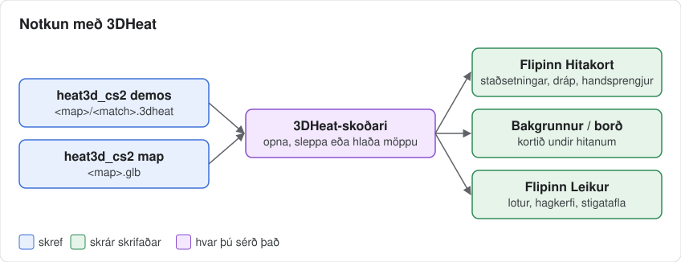

# Notkun með 3DHeat {#using-it-with-3dheat}

Úttakið fer á þessa staði í
[3DHeat-skoðaranum](https://holdi601.github.io/3DHeat):

| Skrá | Hvar | Hvað hún gefur |
|---|---|---|
| `<match>.3dheat` (sjálfgefið) | flipinn **Hitakort**, spjaldið **Uppruni**, eða flipinn **Leikur** | töfluna og leikjaskjalið saman, ein skrá fyrir hvern leik ([gámur](https://holdi601.github.io/3DHeat/container.html)) |
| `<match>.parquet` | flipinn **Hitakort**, spjaldið **Uppruni** | staðsetningar og atburði sem hitakort, kassaendurspilun, leiðir |
| `<match>.match.json` | flipinn **Leikur**, **Hlaða leikjaskrám…** | stigatöfluna, loturnar, fellingalistann, tölfræði yfir leiki, tengla inn í hitakortið |
| `<map>.glb` | spjaldið **Bakgrunnur / borð**, **Þrívíddarlíkan…** | kortið undir hitakortinu |

Eigin skjöl skoðarans lýsa hverjum flipa til fulls: síðurnar
[Match analysis](https://holdi601.github.io/3DHeat/match-analysis.html),
[Loading files](https://holdi601.github.io/3DHeat/loading-files.html),
[Column mapping](https://holdi601.github.io/3DHeat/column-mapping.html)
og [Box replay](https://holdi601.github.io/3DHeat/box-replay.html).
Þessi síða er CS2-hliðin á því.



Skoðarinn: [github.com/Holdi601/3DHeat](https://github.com/Holdi601/3DHeat),
skjöl [holdi601.github.io/3DHeat](https://holdi601.github.io/3DHeat/).

## Dæmigerð lota {#a-typical-session}

```bash
python -m heat3d_cs2 demos D:\Demos\event -o out
python -m heat3d_cs2 map <map> -o out/<map>/<map>.glb
```

1. **Flipinn Hitakort -> Uppruni:** veldu möppuna `out/<map>` (eða slepptu henni inn).
   Hver `.parquet` í henni verður eitt gagnasafn; `.json`- og `.glb`-skrárnar í
   sömu möppu er sleppt sem „not a csv/parquet file“. Hladdu því.
2. **Bakgrunnur / borð -> Þrívíddarlíkan…:** veldu `out/<map>/<map>.glb`.
   **Vista í safn** geymir það í vafranum fyrir næsta skipti.
3. **Flipinn Leikur -> Hlaða leikjaskrám…:** veldu `.match.json`-skrárnar úr
   sömu möppu (nokkrar í einu), eða slepptu þeim á sýnina á meðan Leiks-flipinn
   er opinn.

Hladdu aðeins töflum eins korts í einu: hnit ólíkra korta
skarast, og hitakort af tveimur kortum í einu þýðir ekkert. Mappa fyrir hvert kort
er til þess.

## Taflan opnast án þess að nokkuð þurfi að stilla {#the-table-opens-with-nothing-to-set}

Skoðarinn les `heat3d`-færslu í enda fyrstu völdu skrárinnar
([Hitakortstaflan](output-table.md#the-heat3d-footer-hints)) og leggur hana
yfir eigin ágiskanir:

| Stilling skoðarans | Stillt á |
|---|---|
| Staðsetning | `x`, `y`, `z` |
| Upp-ás í uppruna | Z er upp |
| Snúa Y við | kveikt - svo kortið snúi rétt, ekki speglað |
| Einingakvarði | 1 - fjarlægðir í leikeiningum (merktar „m“; 1 eining = 1 tomma) |
| Tími | `time`, sekúndur |
| Persónuauðkenni | `player` |
| Lið / hópur | `side` (T / CT) |
| Seta / leikur | `roundId` - hver lota er seta, `<match> #NN` |
| Horfstefna | vigur, `dirX` / `dirY` / `dirZ` |
| Dálkar til síunar | `event`, `match`, `round`, `roundTime`, `phase`, `weapon`, `place`, `won`, `buy`, `opening`, `team` |
| Stærð einingar | 32 - kassaendurspilunin teiknar leikmann 32 einingar á breidd, með sjónargeisla 4 x 32 |

Hvert ábendingargildi sést enn í dálkavörpuninni og má breyta. Hina
dálkana (`headshot`, `traded`, `other`, `steamid`, `health`, `money`,
`damage`, `duration`, ...) má bæta við sem síum þar í höndunum.

Haltu einingakvarðanum í 1 þegar kort er hlaðið: `.glb` er í sömu
leikeiningum, og borðið er ekki endurkvarðað með töflunni.

### Gagnlegar síur {#useful-filters}

- `event` = `position` fyrir hvar leikmenn voru; `kill` / `death` fyrir hvar
  einvígi unnust og töpuðust; `smoke`, `flash`, `molotov`, `he` fyrir hvar
  hjálpartæki lentu; `throw` fyrir hvaðan því var kastað; `plant` fyrir staði
  sprengjusetninga.
- `side` (hópurinn) = `T` eða `CT`, `phase` = `live` til að sleppa after-
  fasanum, `buy` = `eco` / `force` / `full` fyrir lotur með sama hagkerfi,
  `won` = 1 fyrir lotur sem hlið raðarinnar vann.
- `opening` = 1 með `kill` og `death` fyrir opnunareinvígin.
- `roundTime` sem bil fyrir augnablik í lotunni: fyrstu 20 sekúndurnar,
  tímann eftir sprengjusetningu.

## Leiks-flipinn {#the-match-tab}

Leiks-flipinn tekur við JSON-skrá þar sem `format` er `heat3d-cs2-match` og
sem hefur `rounds`-, `players`- og `teams`-fylki
([Leikjaskjalið](output-match-json.md)). Hann sýnir stöðuna og hálfleikana,
rönd af lotum litaðri eftir sigurhlið með merki fyrir hvernig hver endaði,
hagkerfi hverrar lotu, sprengjusetningu, fellingalista, clutch og eftirlifendur, stigatöfluna,
og tölfræði yfir alla hlaðna leiki.

Tenglarnir **Sýna á hitakortinu** hlaða engu: þeir stilla síur á
töfluna sem þegar er hlaðin í Hitakorts-flipanum - `match`, `round` (og
setu lotunnar `<match> #NN`), `event`, leikmanninn, hliðina. Það virkar
vegna þess að leikjaskjalið og taflan bera sömu leikjanöfn, lotunúmer,
leikmannanöfn og hliðar. **Endurspila lotu** skiptir hitakortinu yfir í kassaendurspilun
og spilar setu lotunnar frá byrjun hennar.

Hladdu því báðu: töflum korts í Hitakorts-flipann, leikjaskjölum þeirra í
Leiks-flipann. Leikjaskjal án töflu sinnar sýnir samt stigatöfluna og loturnar,
og tenglarnir segja að engin hitakortsgögn séu hlaðin.

## Án 3DHeat {#without-3dheat}

- Taflan er venjulegt Parquet: pandas, Polars, DuckDB, Spark, `arrow` í R lesa
  það allt, `heat3d`-færslan er hunsuð, og textadálkarnir lesast sem strengir
  eða flokkar.
- Leikjaskjalið er venjulegt JSON.
- Kortið er gilt glTF binary, í tommum frekar en metrum: kvarðaðu með
  0,0254 fyrir verkfæri sem gera ráð fyrir metrum. Hnitakerfi þess er glTF sjálfs (Y upp), svo til að
  leggja töfluna yfir annars staðar skaltu teikna (x, y, z) hverrar raðar sem (x, z, -y), eins og
  3DHeat gerir.
