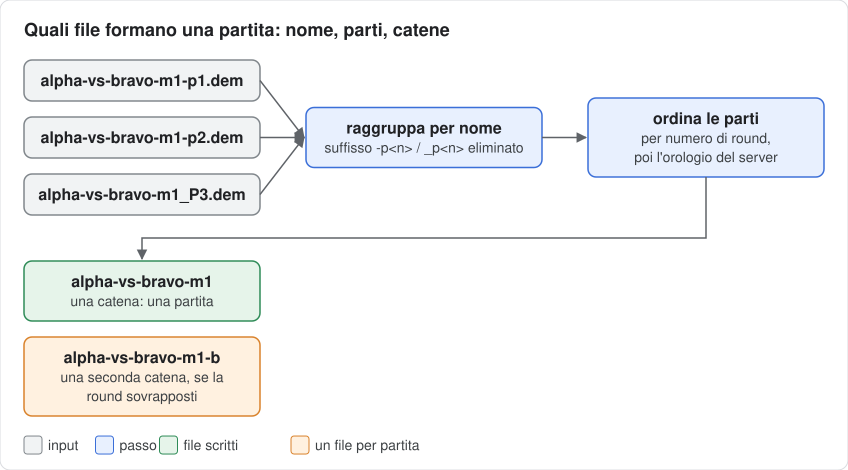

# Costruire una partita {#building-a-match}

Come si costruisce una partita dalle sue parti di demo: quali file appartengono insieme, un solo orologio
per tutti, i round e come ciascuno è stato vinto, le squadre e i loro lati, e ogni riga della tabella della
mappa di calore con uccisioni, scambi, aperture, danni, flash ed economia. Codice:
[`heat3d_cs2/match.py`](https://github.com/Holdi601/3DHeat-CS2/blob/main/heat3d_cs2/match.py).
Il tabellone calcolato da qui si trova in [Statistiche](statistics.md).

## Panoramica {#overview}

1. Viene letto ogni file del nome di una partita ([Leggere un demo](reading-demos.md)).
2. Le righe giocatore duplicate di ogni file (round ripristinati) vengono risolte.
3. I file vengono ordinati in **catene** - partite - e ogni catena viene messa in ordine.
4. Ogni parte viene collocata sul **cronometro della partita**.
5. I **round** vengono trovati in ogni parte; il resoconto di un round in una parte successiva sostituisce
   quello di una parte precedente.
6. I **giocatori** e le **squadre** vengono nominati, e i lati e il punteggio di ogni round vengono indicati
   con il nome della squadra. Una volta noti i lati, si ricavano la durata del tempo, i round pistola e il
   **buy** di ogni lato.
7. Le **righe** vengono costruite: posizioni, colpi, lanci, esplosioni di granate, piazzamenti, disinneschi,
   uccisioni, morti, danni, accecamenti, esplosioni.
8. Ogni riga viene etichettata con il suo round, la fase, il tempo di round, se il suo lato ha vinto e il buy
   del suo lato; le righe fuori da ogni round vengono scartate.

## Round ripristinati: una riga per giocatore per tick {#restored-rounds-one-row-per-player-per-tick}

Quando un round viene ripristinato da un backup all'interno di un solo file, il demo porta per alcuni secondi
anche i vecchi corpi dei giocatori accanto a quelli nuovi: due righe per un giocatore nello stesso tick, una
dove il round annullato li aveva lasciati, una allo spawn del round ripristinato. Per ogni giocatore di questo
tipo, i tick duplicati vengono percorsi **all'indietro** a partire dalla prima riga singola che segue. A ogni
tick viene tenuto il candidato più vicino alla posizione successiva, e questo diventa il riferimento per il
tick precedente. Se non c'è nessuna riga singola dopo di loro, viene tenuto l'ultimo candidato. Così ogni
giocatore conserva la riga che porta verso dove va dopo.

## La parte live di un file {#the-live-part-of-a-file}

L'**inizio live** di un file è il tick del suo ultimo evento `round_announce_match_start`, oppure il tick 0 se
non ne ha (una parte successiva di una partita divisa di solito non ne ha). Tutto ciò che viene prima
dell'inizio live viene escluso, e così tutto ciò che è segnato `is_warmup_period`. Un round di coltello o un
riavvio prima dell'annuncio vengono quindi esclusi; un round di coltello *non* seguito da un annuncio di
inizio partita non viene riconosciuto come tale (vedi [Limiti](limits.md)).

I **round** di un file sono gli eventi `round_freeze_end` dall'inizio live in poi, fuori dal riscaldamento,
identificati dal loro `total_rounds_played` (l'indice del gioco, a partire da 0, del round che sta per essere
giocato). Un file senza round non ha round e non appartiene ad alcuna partita.

## Il cronometro {#the-clock}

I tempi sono in secondi. All'interno di un file, il tempo si conta in **tick**: il `game_time` del server al
primo tick campionato, più i tick trascorsi da allora diviso 64. L'orologio del server si ferma durante una
pausa mentre i tick continuano; letto dall'orologio, due momenti di una partita in pausa avrebbero lo stesso
tempo.

Ogni file ha un *primo orologio* (il tempo al suo inizio live) e un *ultimo orologio* (al suo ultimo tick
campionato).

### Parti e catene {#parts-and-chains}

I file indicati come una stessa partita ([Comandi](commands.md#which-files-are-one-match)) vengono prima
ordinati per indice del loro primo round, poi per il loro primo orologio. Poi ciascuno, in quell'ordine, si
aggancia alla prima catena che continua, oppure inizia una catena nuova. Una parte continua una catena quando
il suo primo indice di round è almeno pari all'indice dell'ultimo round dell'ultima parte della catena, **e**
vale una delle due condizioni:

- l'orologio del server prosegue: il suo primo orologio non è precedente all'ultimo orologio della catena
  meno 5 s; oppure
- il conteggio dei round prosegue: il suo primo indice di round è l'ultimo indice della catena oppure quello
  successivo.

Decide il conteggio, e l'orologio risolve i casi dubbi, perché un server riavviato per ripristinare un round
fa ripartire il suo orologio, mentre due partite diverse con lo stesso nome (le stesse squadre sulla stessa
mappa in due eventi) hanno conteggi di round sovrapposti. Le catene sono ordinate per numero di round che
coprono, prima la più lunga; la prima conserva il nome della partita, le altre vengono scritte come `<nome>-b`,
`<nome>-c`, ...

### Il cronometro della partita {#the-match-clock}

Lo zero della partita è il primo orologio della prima parte: **il tempo partita 0 è l'inizio live del primo
file**. Ogni parte successiva viene collocata su di esso:

- dove l'orologio del server prosegue (il suo primo orologio non è precedente all'ultimo orologio della parte
  precedente meno 5 s), si usa l'orologio del server così com'è;
- dove è stato riavviato, la parte viene collocata in modo da seguire **un secondo** dopo la fine della parte
  precedente.

## Round {#rounds}

Per ogni `round_freeze_end` di una parte (in ordine di tick), la finestra del round arriva fino al successivo
freeze end di quella parte, oppure alla fine del file. Al suo interno il round è **deciso** al primo tick
campionato in cui lo stato di gioco mostra `total_rounds_played` = l'indice del round + 1 e `round_win_status`
1 (un pareggio), 2 (vince la T) o 3 (vince la CT). Un round senza un campione del genere nella sua finestra è
stato interrotto dalla fine del file; il suo numero finisce nell'elenco **incompleti** della partita (a meno
che un'altra parte abbia il round completo).

| Campo del round | Da |
|---|---|
| `number` | l'indice + 1 (a partire da 1, come conta il gioco) |
| `start` | tempo della partita alla fine del freeze time - i giocatori possono muoversi |
| `end` | tempo della partita del primo campione che mostra il round deciso |
| `until` | tempo della partita del successivo `round_prestart` dopo `end`, se cade nella finestra; altrimenti la fine della finestra o l'ultimo tick del file, a seconda di quale viene prima (e mai prima di `end`) |
| `winner` | `T` per lo stato di vittoria 2, `CT` per 3, vuoto per 1: un pareggio è deciso, senza vincitore |
| `reason` | `round_win_reason` in quel campione, con il nome indicato sotto |
| `score` | nome della squadra -> round vinti dopo questo: il `team_rounds_total` di ciascun lato nel campione che decide; dove il demo non ne ha, il punteggio del round precedente più uno per il vincitore |
| `sides` | nome della squadra -> `T` / `CT` in questo round |
| `equipment` | lato -> somma di `current_equip_value` dei giocatori **vivi** di quel lato al primo campione alla fine del freeze time o dopo |
| `buy` | lato -> `pistol`, `eco`, `force` o `full` ([Economia](#economy-and-buy-types)) |
| `plant` | il primo `bomb_planted` dopo la fine del freeze time e fino a `end`, oppure nessuno |
| `exploded` | tempo della partita del primo `bomb_exploded` dopo quel piazzamento e prima del successivo freeze end, se c'è (non nel documento della partita; serve a datare la riga `explode`) |

`reason`, dal `CSRoundEndReason` del gioco:

| Codice | `reason` |
|---|---|
| 1 | `bomb` (obiettivo esploso) |
| 7 | `defuse` (disinnescata) |
| 8, 9 | `elimination` (vincono le CT / vincono le T per eliminazione) |
| 10 | `draw` (pareggio) |
| 12 | `time` (obiettivo salvato) |
| 17, 18 | `surrender` (resa) |
| qualunque altro | `other` |

Quando più parti contengono lo stesso round (per indice), viene tenuta la versione della parte successiva. I
round vengono poi elencati per indice. Una partita il cui primo round non è il round 1 registra i numeri
mancanti (`missing` nel documento della partita); la riga di comando dice *registrata dal round N*.

### Il piazzamento {#the-plant}

| Campo | Da |
|---|---|
| `site` | `A` o `B`: la zona della bomba in cui il gioco dice che stava il piazzatore (`which_bomb_zone`, 1 A, 2 B); senza di essa, il nome del luogo del piazzatore (`BombsiteA`, `BombsiteB`); senza anche quello, la lettera che un altro piazzamento dello stesso file nella stessa zona ha dato (il numero di entità dell'evento è quello della zona). Vuoto quando nulla lo dice - mai il numero. |
| `time` | secondi **dentro il round** (dalla sua fine del freeze time), come il tempo di un'uccisione |
| `player`, `steamid` | il piazzatore |
| `x`, `y`, `z` | la posizione del piazzatore, in unità di gioco: dove giace la bomba |
| `place` | il nome del luogo del piazzatore al momento del piazzamento |

### Le fasi {#the-phases}

Il tempo da `start` a `end` è la fase **live** del round; da `end` a `until` la sua fase **after**, dove chi
vince va a caccia e chi perde risparmia. Una riga appartiene al round il cui intervallo `[start, until)`
contiene il suo tempo, ed è `after` quando il suo tempo è successivo a `end`. Il freeze time sta tra i round
e non appartiene a nessuno.

## Giocatori e squadre {#players-and-teams}

Un **giocatore** è chiunque sia stato vivo almeno una volta da un lato (squadra 2 o 3), fuori dal freeze time e
dal riscaldamento, dopo l'inizio live. Un allenatore o un telecronista dal lato di una squadra non è mai vivo
e non è un giocatore. Ogni giocatore è identificato dal suo Steam ID; il nome è l'ultimo visto.

La **squadra** di un giocatore è il nome di clan che il gioco ha dato al suo lato (`team_clan_name`), quello
visto più spesso per lui - il demo cancella il dato alla sua fine. Una partita giocata senza nomi di clan
chiama le squadre in base al lato su cui hanno iniziato: `Started T` e `Started CT`.

I **lati** di ogni round derivano da chi era su quale lato tra la fine del freeze time e la fine del round: a
ogni lato viene assegnata l'etichetta di squadra che porta la maggior parte dei suoi giocatori. La lista
`teams` della partita è in ordine di comparsa, round per round, prima il lato T poi il lato CT; di solito la
squadra partita sul lato T è la prima.

## Le righe {#the-rows}

Ogni campione di posizione e ogni evento diventa una riga della [tabella della mappa di calore](output-table.md).
I giocatori sono su un lato solo quando il loro `team_num` è 2 o 3.

### Posizioni {#positions}

Dalle righe campionate dei giocatori vivi di un lato, fuori dal freeze time e dal riscaldamento, dopo l'inizio
live: posizione, direzione dello sguardo, salute, armatura, denaro, valore dell'equipaggiamento, arma in mano,
luogo.

La direzione dello sguardo è un vettore unitario nel sistema del gioco:
`(cos pitch * cos yaw, cos pitch * sin yaw, -sin pitch)` - il pitch del gioco è positivo guardando in basso,
quindi guardando in basso la Z è negativa.

L'arma in mano è `active_weapon_name` come la dà il gioco, tranne che ogni nome contenente `Knife`, `Bayonet`,
`Karambit` o `Daggers` diventa `Knife`.

### Colpi e lanci {#shots-and-throws}

Da `weapon_fire`, nella posizione di chi spara. I coltelli (`knife`, `bayonet` nell'id dell'arma) e il C4 sono
esclusi. Le granate (`smokegrenade`, `flashbang`, `hegrenade`, `molotov`, `incgrenade`, `decoy`) sono righe di
**lancio**, tutto il resto righe di **colpo**. L'arma è indicata come la mostra il gioco (sotto).

### Esplosioni di granate {#grenade-detonations}

| Evento | Riga | `weapon` |
|---|---|---|
| `smokegrenade_detonate` | `smoke` | Smoke Grenade |
| `flashbang_detonate` | `flash` | Flashbang |
| `hegrenade_detonate` | `he` | High Explosive Grenade |
| `inferno_startburn` (molotov e incendiarie) | `molotov` | Molotov |
| `decoy_detonate` | `decoy` | Decoy Grenade |

La posizione è **dove la granata è esplosa** (i valori `x`, `y`, `z` dell'evento); il giocatore e il lato sono
quelli di chi l'ha lanciata. Il demo non indica un luogo per una granata, solo per i giocatori, quindi `place`
resta vuoto: una riga non rivendica un luogo in cui non si trovava. Il luogo di chi ha lanciato in quel momento
viene conservato come `throwerPlace`.

### Piazzamenti e disinneschi {#plants-and-defuses}

Righe `plant` e `defuse` nella posizione del giocatore, con arma `C4 Explosive`. Una bomba piazzata che è
esplosa ottiene una riga **explode**: nella posizione del piazzamento, al tempo di `bomb_exploded`, con il
piazzatore come giocatore (con il suo Steam ID), lato `T`, la squadra T del round come `team`, e il luogo del
piazzamento. Vale anche per una bomba che esplode dopo che le T hanno già vinto per eliminazione. Dove il demo
non ha `bomb_exploded`, un round vinto dalla bomba (`reason` = `bomb`) con un piazzamento riceve la riga alla
`end` del round.

### Uccisioni e morti {#kills-and-deaths}

Ogni `player_death` in un round dà un **record di uccisione** (la tabella `kills` della partita) con:

| Campo | È |
|---|---|
| attacker, victim, assister | nomi, Steam ID, lati; l'attaccante è vuoto per il mondo (danno da caduta, la bomba) |
| `weapon` | l'arma dell'evento, indicata come la mostra il gioco |
| `headshot` | il flag dell'evento |
| `wallbang` | `penetrated` > 0 |
| `throughSmoke` | `thrusmoke` |
| `flashAssist` | `assistedflash` |
| `noscope`, `attackerBlind` | i flag dell'evento (`noscope`, `attackerblind`); colonne delle righe `kill` e `death`, e nelle uccisioni del documento della partita |
| `suicide` | attaccante e vittima sono lo stesso giocatore: una granata propria, per esempio |
| `teamkill` | attaccante e vittima sullo stesso lato, con un attaccante, e non un suicidio |
| `opening` | la prima uccisione di un nemico nel round (sotto) |
| `traded`, `trade` | sotto |
| posizioni | la posizione e il luogo dell'attaccante e della vittima |

Da ogni record la tabella ottiene una riga **death** nella posizione della vittima (ogni morte, anche quelle
dovute al mondo, ai compagni uccisi e ai suicidi) e - per le uccisioni da parte di un nemico (un attaccante, non
un compagno, non un suicidio) - una riga **kill** nella posizione dell'assassino.

**Apertura.** La prima uccisione di un nemico in ogni round, mentre il round è live, è il suo duello di apertura.
Un compagno ucciso, un suicidio o una morte causata dal mondo prima di essa vengono saltati, quindi l'apertura è
ancora il primo duello del round; un round senza uccisioni di nemici mentre è live non ha apertura.

**Scambiata** e **scambio.** Una morte per mano di un nemico è **scambiata** quando il suo assassino viene ucciso
da un compagno della vittima entro **5 secondi** (più di 0 e al massimo 5 s dopo, nello stesso round); la prima di
queste uccisioni è un'uccisione **di scambio**. Nella tabella, la colonna `traded` di una riga `kill` è 1 per
un'uccisione di scambio; quella di una riga `death` è 1 per una morte vendicata. Contano anche le uccisioni della
fase after.

### Danni {#damage}

Da `player_hurt`, solo tra **nemici** (entrambi su un lato, lati diversi). Il danno è la salute realmente
**persa**: per ogni vittima in ogni round, la salute parte da 100; ogni colpo conta `min(dmg_health, salute prima)`,
e il valore `health` dell'evento (quella che resta) diventa la salute "prima" del colpo successivo. Un colpo alla
testa da 137 danni su un giocatore con 40 di salute conta 40, come lo conta il tabellone del gioco. I colpi di
`hegrenade`, `inferno`, `molotov` e `incgrenade` sono danni da **utility**. Ogni colpo è una riga **hurt** nella
posizione della vittima, con l'attaccante come `other`. I danni tra compagni e quelli a sé stessi non sono né nella
tabella né nelle statistiche.

### Flash {#flashes}

Da `player_blind`, solo **nemici** (non i compagni, e non un allenatore o un telecronista che guarda): una riga
**blind** per ogni giocatore accecato, nella posizione del giocatore colpito dal flash, con chi ha lanciato il flash
come `other`, e la durata dell'accecamento in secondi come `duration`. Ogni durata viene conservata; le statistiche
contano solo gli accecamenti di almeno un secondo.

## Nomi delle armi {#weapon-names}

Un id di arma da un evento (`ak47`, `weapon_ak47`, `knife_karambit`) viene mostrato come lo indica il gioco nel
campo `active_weapon_name` dei giocatori, così l'arma di un'uccisione e l'arma in mano si leggono allo stesso modo:
`ak47` -> `AK-47`, `m4a1` -> `M4A4`, `m4a1_silencer` -> `M4A1-S`, `hkp2000` -> `P2000`, `taser` -> `Zeus x27`,
`inferno` e `molotov` -> `Molotov`, `incgrenade` -> `Incendiary Grenade`, `c4` e `planted_c4` -> `C4 Explosive`,
`world` -> `World`, e così via per ogni arma e granata (la tabella `WEAPONS` in `match.py`). Qualunque cosa con
`knife` o `bayonet` nel suo id è `Knife`. Un id che non è nella tabella viene mantenuto così com'è.

## Economia e tipi di buy {#economy-and-buy-types}

Alla fine del freeze time, il valore dell'equipaggiamento di ogni lato viene sommato sui suoi giocatori vivi al
primo campione da quel momento in poi, e diviso per il loro numero:

| Round | Equipaggiamento medio per giocatore | `buy` |
|---|---|---|
| un round pistola (il primo di ogni metà regolamentare) | qualunque | `pistol` |
| altri | sotto $1.500 | `eco` |
| altri | da $1.500 a meno di $4.000 | `force` |
| altri | $4.000 o più | `full` |

I round pistola seguono la metà con cui la partita è stata giocata, non un formato fisso. La metà finisce dove i
lati si scambiano per la prima volta tra due round consecutivi, entrambi in regolamentare: la sua durata
(`halfLength` nel documento della partita) è il round prima dello scambio - 12 nel formato a 24 round, 15 in quello a
30. Il round 1 e il round dopo la metà sono i round pistola. Un round è di overtime quando il conteggio degli
overtime del gioco (`m_nOvertimePlaying`) è sopra 0 al suo freeze end; dove un demo non ha tale conteggio, lo è ogni
round dopo due metà. Le metà di overtime iniziano con il denaro che imposta il server e non hanno un round pistola,
anche se anche in esse i lati si scambiano. Una registrazione che non mostra mai lo scambio a metà partita - inizia
dopo o finisce prima - lascia la metà sconosciuta, e solo il round 1 è un round pistola.

## Etichette e ordine {#labelling-and-order}

Infine ogni riga riceve:

- `match` - il nome della partita; `map` - la mappa dell'intestazione del demo;
- `round` e `roundId` (`<match> #NN`, due cifre);
- `phase` - `live` o `after`;
- `roundTime` - secondi dalla fine del freeze time del round;
- `won` - 1 se il lato della riga ha vinto il round, 0 se no, vuoto per una riga senza lato;
- `buy` - il buy del lato della riga in quel round;
- `team` - la squadra del giocatore della riga, tramite Steam ID.

Le righe il cui tempo non cade in nessun round - prima della fine del freeze time del primo round, durante il
freeze time, dopo l'ultimo round - vengono scartate. Le righe sono ordinate per tempo, e a parità di tempo per
nome dell'evento.
