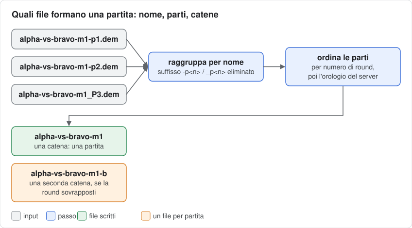

# Comandi {#commands}

Nuovo alla riga di comando? Leggi prima [Prima di iniziare](before-you-start.md).
Digita questi comandi in un terminale aperto nella cartella in cui hai decompresso o clonato il progetto;
`<...>` sono segnaposto, e un percorso con spazi va tra virgolette.

```text
python -m heat3d_cs2 demos <file demo o cartelle> -o <cartella> [--every 8] [--jobs N] [--map TEXT] [--force] [--no-bulk] [--loose]
python -m heat3d_cs2 map <nome della mappa o percorso del suo .vpk> -o <file.glb> [--game CARTELLA] [--source2viewer EXE]
python -m heat3d_cs2 scoreboard <match.3dheat | match.json>
```

`python -m heat3d_cs2 --help` e `python -m heat3d_cs2 <verbo> --help` elencano le stesse opzioni; la
[Guida ai comandi](../cli-reference.md) le mostra tutte. Ogni avvio esegue prima il controllo della versione
descritto in [Aggiornamenti](updates.md) (disattivabile con `HEAT3D_NO_UPDATE=1`).

Codice: [`heat3d_cs2/cli.py`](https://github.com/Holdi601/3DHeat-CS2/blob/main/heat3d_cs2/cli.py).

## `demos` - demo in tabelle e documenti partita {#demos---demos-into-tables-and-match-documents}

```powershell
python -m heat3d_cs2 demos D:\Demos\evento -o out
python -m heat3d_cs2 demos alpha-vs-bravo-m1-p1.dem alpha-vs-bravo-m1-p2.dem -o out
python -m heat3d_cs2 demos D:\Demos -o out --map final --jobs 4
```

| Argomento | Predefinito | Fa |
|---|---|---|
| `paths` (uno o più) | - | file di demo e cartelle. Un file viene preso quando la sua estensione è `.dem` (in qualunque maiuscolo o minuscolo). Una cartella viene cercata **ricorsivamente** per i file che terminano con `.dem`, in qualunque maiuscolo o minuscolo, in ordine alfabetico. I demo compressi (`.dem.zst`, `.dem.bz2`, archivi) non vengono letti: decomprimili prima. |
| `-o`, `--out` | obbligatorio | la cartella in cui scrivere; viene creata se serve |
| `--every N` | `8` | campiona ogni giocatore ogni *N* tick. I demo di CS2 girano a 64 tick al secondo, quindi 8 sono otto campioni al secondo, 4 sedici, 64 uno. Gli eventi vengono letti sempre al loro tick, qualunque sia *N*. |
| `--jobs N` | `0` = metà dei core della CPU | quante partite vengono convertite contemporaneamente, ognuna nel suo processo. Mai meno di 1, mai più delle partite da fare. |
| `--map TEXT` | - | solo le partite il cui **nome** contiene *TEXT*, senza distinguere maiuscole e minuscole (`--map final`). Filtra sul nome del file, non sulla mappa che il demo risulta contenere. |
| `--force` | disattivato | converte anche le partite già scritte, sovrascrivendole |
| `--loose` | disattivato | tiene ogni partita come file separati - tabella, `.match.json`, file accessori - invece di impacchettarli in un unico contenitore `.3dheat`. Vedi [Un file per partita](output-container.md). |
| `--container` | attivo | impacchetta ogni partita in un unico file `.3dheat`; è il predefinito, quindi c'è solo per esplicitarlo |
| `--no-bulk` | disattivato | lascia fuori dal file accessorio dei pacchetti il flusso delle entità, i comandi dei giocatori e il flusso delle animazioni - oltre metà della dimensione di un demo anche compresso. L'autocontrollo del documento partita li conta allora come `lost`, per nome. |


### Quali file sono una partita {#which-files-are-one-match}



Il nome della partita è il nome del file del demo senza estensione e senza il suffisso di parte: `-p<cifre>` o
`_p<cifre>` alla fine, in qualunque maiuscolo o minuscolo. Quindi `alpha-vs-bravo-m1-p1.dem`,
`alpha-vs-bravo-m1-p2.dem` e `alpha-vs-bravo-m1_P3.dem` sono le parti di una stessa partita,
`alpha-vs-bravo-m1`. I file vengono raggruppati solo per questo nome - due file con lo stesso nome in cartelle
diverse vengono raggruppati insieme.

Il suffisso non dice nulla sull'ordine: un `-p2` può essere la metà precedente. Le parti vengono messe in ordine per
il numero di round che contengono, e poi per l'orologio del server; un gruppo che risulta contenere due partite
diverse (per esempio le stesse squadre sulla stessa mappa in due eventi) viene diviso in **catene**: la catena con
più round viene scritta con il nome stesso, la successiva come `<nome>-b`, poi `<nome>-c`, e così via. Un file senza
alcun round (solo riscaldamento, una pausa) non appartiene ad alcuna catena. Come si trovano le catene è descritto in
[Costruire una partita](building-matches.md#parts-and-chains).

### Cosa viene scritto {#what-is-written}

Per ogni partita, in una cartella che porta il nome della mappa indicata nell'intestazione del demo (`unknown` se
non ne indica nessuna), un file `.3dheat`:

```text
out/
  de_x/
    alpha-vs-bravo-m1.3dheat
    alpha-vs-bravo-m2.3dheat
  de_y/
    ...
```

Sul demo sintetico di due round dei test:


Con `--loose` ogni partita è la tabella, il suo documento partita e quattro file accessori, affiancati
([Un file per partita](output-container.md)):


Una mappa di calore riguarda una sola mappa, quindi caricare una cartella nel visualizzatore significa caricare le
partite di una mappa. Vedi [La tabella della mappa di calore](output-table.md) e
[Il documento partita](output-match-json.md).

### Cosa viene saltato {#what-is-skipped}

Prima di leggere qualunque cosa, vengono elencati tutti i `*.3dheat` presenti ovunque sotto `--out` (un contenitore
viene scritto per intero o per niente) e tutti i `*.parquet` che hanno accanto il loro documento partita
(`<nome>.match.json`). Una partita il cui nome coincide con il nome di uno di questi file (senza estensione) viene
saltata, a meno di `--force`. Una tabella senza il suo documento partita - una corsa interrotta tra la scrittura
dei due - non conta, quindi quella partita viene convertita di nuovo. Il controllo avviene solo per nome: una partita
convertita in una cartella di mappa diversa, o con un `--every` diverso, conta comunque come fatta. Se non resta nulla
da fare:

```text
niente da fare: nessun demo trovato, o tutte le partite già scritte (--force le rifà)
```

### Cosa viene stampato {#what-is-printed}

Prima la quantità di lavoro, poi una riga per partita man mano che ciascuna finisce (nell'ordine in cui finiscono, non
nell'ordine dei file):

```text
3 partita/e, 3 alla volta
alpha-vs-bravo-m1: de_x, 21 round (Alpha 13 Bravo 8), 412.377 righe, lost 0
alpha-vs-bravo-m2: de_y, 30 round (Bravo 16 Alpha 14), 598.104 righe, 1 round incompleto/i escluso/i, lost 0
alpha-vs-bravo-m3: de_y, 18 round (Alpha 13 Bravo 5), 330.981 righe, registrata dal round 3, lost 1.204.331 (svc_PacketEntities, svc_UserCmds, DEM_AnimationData)
```

(I numeri sono indicativi.) Il punteggio è quello dell'ultimo round, squadra per squadra nell'ordine in cui il documento
partita le elenca. *round incompleto/i esclusi* conta i round che il demo ha interrotto prima che fossero decisi;
*registrata dal round N* dice che la registrazione inizia tardi; *lost* è l'autocontrollo del documento partita - quanti
elementi del demo non sono finiti da nessuna parte, e di quali tipi (`--no-bulk` rende lost i dati bulk). Una partita che
non produce nulla lo spiega:

```text
alpha-vs-bravo-m4: nessun round in 1 file - non scritto nulla
alpha-vs-bravo-m4-b: nessun round completo in 1 file - non scritto nulla
```

Un errore in una partita non ferma le altre; viene stampato come `<nome>: failed - <errore>`.

### Codice di uscita {#exit-code}

`0` quando ogni partita è stata convertita (o non c'era nulla da fare), `1` quando almeno una è fallita.

### Quanto tempo richiede {#how-long-it-takes}

Ogni partita viene letta e costruita in un processo di lavoro. Una cartella di alcune centinaia di demo richiede
minuti con il valore predefinito di `--jobs`. La memoria per ogni lavoro cresce con la durata della partita e con un
`--every` più piccolo: ogni lavoro tiene tutte le righe dei giocatori campionate della sua partita (circa dieci
giocatori per 64 / *N* righe al secondo di registrazione) prima di scrivere.

I file accessori richiedono più tempo della tabella: ogni proprietà letta dal parser viene letta a ogni tick, una
finestra di tick alla volta (circa due minuti per un demo di 40 minuti, al massimo circa 3 GB di memoria per lavoro),
poi il demo viene percorso un'altra volta per i suoi frame e messaggi.

## `map` - la geometria di una mappa come `.glb` {#map---a-maps-geometry-as-glb}


```powershell
python -m heat3d_cs2 map <mappa> -o out/<mappa>/<mappa>.glb
python -m heat3d_cs2 map <mappa> -o <mappa>.glb --game "D:\Games\Steam\steamapps\common\Counter-Strike Global Offensive"
python -m heat3d_cs2 map "D:\maps\<mappa>.vpk" -o <mappa>.glb --source2viewer C:\Tools\Source2Viewer-CLI.exe
```

| Argomento | Predefinito | Fa |
|---|---|---|
| `name` | - | il nome della mappa (come `de_x`), oppure il percorso del suo `.vpk`. Un percorso che termina con `.vpk` ed esiste viene usato così com'è; qualunque altra cosa viene cercata per nome file nel gioco installato. |
| `-o`, `--out` | obbligatorio | il `.glb` da scrivere; la sua cartella viene creata se serve |
| `--game CARTELLA` | le librerie di Steam | la cartella di installazione di CS2 (quella che contiene `game\csgo`), quando Steam non la conosce. Con `--game` viene cercata solo quella cartella. |
| `--source2viewer EXE` | `HEAT3D_SOURCE2VIEWER`, poi `PATH` | l'eseguibile CLI di Source2Viewer |

Stampato in caso di successo:

```text
out/de_x/de_x.glb: de_x, 412.880 triangoli (151.204 di terreno) in 14 parti
```

(numeri indicativi). Scrivere il `.glb` accanto alle tabelle della mappa (`out/<mappa>/<mappa>.glb`) tiene i dati e la
geometria di una mappa in un'unica cartella. Come funziona l'esportazione: [Esportazione della mappa](map-export.md).

Errori, ognuno stampato come `error: ...` con codice di uscita `2`:

| Messaggio | Significa |
|---|---|
| `no de_x.vpk found in an installed CS2 - pass --game <CS2 folder> or the .vpk path` | la mappa non è in nessuna libreria Steam trovata, oppure il nome è sbagliato |
| `Source2Viewer-CLI not found: ...` | nessuno tra `--source2viewer`, `HEAT3D_SOURCE2VIEWER` e `PATH` ha dato un file esistente |
| `Source2Viewer did not export de_x's collision mesh:` seguito dalla coda del suo output | è fallito, oppure non ha scritto alcun `.glb` |
| `de_x's collision mesh has nothing but clip brushes` | dopo aver escluso clip e cielo non è rimasto nulla |

## `scoreboard` - una partita come testo {#scoreboard---a-match-as-text}

```bash
python -m heat3d_cs2 scoreboard out/de_x/alpha-vs-bravo-m1.3dheat
python -m heat3d_cs2 scoreboard out/de_x/alpha-vs-bravo-m1.match.json   # dopo demos --loose
```

Stampa il tabellone della partita dal suo [documento partita](output-match-json.md), senza aprire il visualizzatore.
Legge il documento dentro un contenitore `.3dheat`, oppure un `<partita>.match.json` separato.
Sul demo sintetico di due round dei test:


```text
alpha-vs-bravo-m1 - de_test  Alpha 2  Bravo 0

Alpha
giocatore              K   D   A  +/-    ADR   KAST   HS%  OK-OD  clutch
ash                    1   0   0   +1   50.0 100.0%    0%   0-0     1/1
ace                    1   1   0   +0   50.0 100.0%  100%   1-0     0/0

Bravo
giocatore              K   D   A  +/-    ADR   KAST   HS%  OK-OD  clutch
ben                    1   1   0   +0   50.0 100.0%    0%   0-0     0/1
bob                    0   1   0   -1    0.0 100.0%    0%   0-1     0/0

rounds  1:TK 2:TB
```

- La prima riga: nome della partita, mappa e punteggio finale per squadra.
- Una tabella per squadra, nell'ordine di `teams` del documento partita; i giocatori nell'ordine del documento partita
  (per uccisioni meno morti, poi uccisioni, il migliore per primo). I nomi vengono tagliati a 19 caratteri.
- Colonne: **K** uccisioni, **D** morti, **A** assist *comprese* le assistenze ai flash, **+/-** uccisioni meno morti,
  **ADR**, **KAST** (%), **HS%** (arrotondata al percento intero), **OK-OD** aperture vinte - aperture perse, **clutch**
  clutch vinti / clutch giocati. Definizioni: [Statistiche](statistics.md).
- La striscia dei round: `<round>:<lato vincitore><come>`, con **B** bomba esplosa, **D** disinnescata, **K**
  eliminazione, **T** tempo scaduto, e **?** per qualunque altro caso (pareggio, resa, altro). Un pareggio non ha un lato
  vincitore: `<round>:?`.

Un file che non è JSON valido, o che non viene trovato, si ferma con un errore; un documento JSON senza i campi del
documento partita fallisce con un errore Python (non viene validato oltre).
