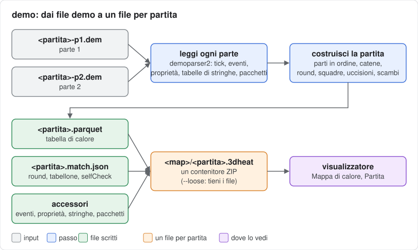

# 3DHeat CS2 {#dheat-cs2}

**Che cos'è?** Counter-Strike 2 può salvare una registrazione di una partita, chiamata
*demo*. Questo strumento trasforma una demo in file che il visualizzatore 3DHeat può mostrare in 3D: dove
si trovava ciascuno, chi è morto, chi ha lanciato granate e chi ha piazzato la bomba, round per round. Può
anche trasformare una mappa di CS2 in un modello 3D su cui mostrarli.

**A cosa serve?** Per rivedere le tue partite, per sovrapporre molte partite della stessa mappa come una
sola mappa di calore, e per le statistiche di partita come l'ADR (danno medio per round) e il KAST (la
quota di round in cui un giocatore ha ucciso, assistito, sopravvissuto o è stato vendicato).

**Esempio:** `alpha-vs-bravo-m1.dem` in ingresso, `out/de_x/alpha-vs-bravo-m1.3dheat` in uscita (`de_x` è un
nome di mappa inventato).



Più in dettaglio: 3DHeat CS2 trasforma le **demo di Counter-Strike 2** in una tabella per la mappa di calore
e in un documento partita per ogni partita, e una **mappa di CS2** in geometria di livello. I risultati
sono fatti per il visualizzatore di telemetria [3DHeat](https://holdi601.github.io/3DHeat/)
([sorgente](https://github.com/Holdi601/3DHeat)), ma sono file normali - Parquet, JSON e glTF binario - che
anche altri programmi possono leggere.

È un piccolo pacchetto Python, `heat3d_cs2`, eseguito dalla riga di comando. Legge le demo dal disco (non
ne scarica nessuna) con [demoparser2](https://github.com/LaihoE/demoparser), ed esporta le mappe dal gioco
installato con la versione a riga di comando di Source2Viewer
([ValveResourceFormat](https://github.com/ValveResourceFormat/ValveResourceFormat)).

## Avvio rapido {#quick-start}

Non hai mai usato la riga di comando? Leggi prima [Prima di iniziare](before-you-start.md).

```bash
pip install -r requirements.txt
python -m heat3d_cs2 demos <file demo o cartelle> -o out   # ogni partita contenuta
python -m heat3d_cs2 map <mappa> -o out/<mappa>/<mappa>.glb # la mappa dal gioco installato
python -m heat3d_cs2 scoreboard out/<mappa>/<partita>.3dheat # il tabellone di una partita, come testo
```

Dovresti vedere `1 match(es), 1 at a time ...` e poi una riga per partita (vedi
[Comandi](commands.md#what-is-printed)).

`demos` scrive, per ogni partita, un file in una cartella con il nome della mappa:
`out/<mappa>/<partita>.3dheat`, un [contenitore `.3dheat`](output-container.md) - il formato del
visualizzatore con un file per partita ([specifica](https://holdi601.github.io/3DHeat/container.html)).
Contiene questi elementi; `--loose` li scrive invece come file separati:

| Elemento | Cosa contiene | Caricato nella |
|---|---|---|
| `<partita>.parquet` (ruolo `table`) | ogni giocatore vivo otto volte al secondo con il suo stato (salute, denaro, accecamento, mirino, zona, inventario, ...), e ogni evento dove è accaduto (uccisione, morte, danno, colpo, lancio, esplosione di granate, accecamento, piazzamento, disinnesco, esplosione, e la fine di un round per giocatore con ciò che il round gli ha fruttato), una riga ciascuno | scheda Mappa di calore |
| `<partita>.match.json` (ruolo `match`, il documento partita) | squadre, punteggio, ogni round (vincitore, come, economia, piazzamento, uccisioni in ordine, clutch, sopravvissuti) e la riga del tabellone di ogni giocatore | scheda Partita |
| `<partita>.events/props/strings/packets.parquet` | tutto il resto che la demo contiene, per intero (file accessori) | conservato per completezza |

`map` scrive `<mappa>.glb`: la mesh di collisione della mappa - pavimenti, muri, scatole, senza decorazioni -
divisa in terreno e struttura, nello stesso sistema di riferimento e nelle stesse unità delle tabelle, così
cade esattamente sotto la mappa di calore (pannello Sfondo / livello).

## Mappa di questa documentazione {#map-of-this-documentation}

| Pagina | Cosa contiene |
|---|---|
| [Prima di iniziare](before-you-start.md) | Python, un terminale, i segnaposto, come sono il successo e gli errori comuni |
| [Installazione](installing.md) | Python, i pacchetti, la CLI di Source2Viewer, dove deve trovarsi CS2 |
| [Comandi](commands.md) | `demos`, `map`, `scoreboard`: ogni opzione, cosa viene stampato, i codici di uscita |
| [Leggere una demo](reading-demos.md) | cosa si legge da un file demo: tick campionati, proprietà dei giocatori, regole di gioco, eventi |
| [Costruire una partita](building-matches.md) | parti e catene, l'orologio della partita, i round, le squadre e i lati, le righe, le uccisioni, gli scambi, le aperture, i danni, gli accecamenti, l'economia |
| [Statistiche](statistics.md) | il tabellone: K/D/A, ADR, KAST, HS%, aperture, scambi, multi-uccisioni, clutch, utility, accecamenti |
| [La tabella della mappa di calore](output-table.md) | il file Parquet: ogni colonna, il suo tipo, quali eventi la riempiono, i suggerimenti del footer `heat3d`, gli assi |
| [Il documento partita](output-match-json.md) | il documento `.match.json`, campo per campo |
| [Un file per partita](output-container.md) | il contenitore `.3dheat` che `demos` scrive per impostazione predefinita, `--loose` |
| [Esportazione della mappa](map-export.md) | come viene esportata la mesh di collisione di una mappa, il sistema di riferimento, la denominazione dei nodi, le unità |
| [Uso con 3DHeat](using-with-3dheat.md) | caricare tabelle, documenti di partita e mappe nelle schede Mappa di calore e Partita del visualizzatore |
| [Limiti](limits.md) | cosa si assume, cosa non viene gestito, cosa non è verificato |
| [Aggiornamenti](updates.md) | il controllo della release all'avvio e `python -m heat3d_update` |
| [Sviluppo](development.md) | struttura del codice, test, la demo sintetica di prova |
| [Riferimento dei comandi](../cli-reference.md) | il `--help` di ogni comando, generato dal codice |
| [Manutenzione](maintaining.md) | la lista di controllo del rilascio per queste pagine |

## Verificato su {#what-it-is-checked-against}

Le demo trovate in giro non sono un file pulito per partita. Il convertitore gestisce una partita divisa su
più file in qualsiasi ordine, un server riavviato a metà partita, due partite diverse salvate con lo stesso
nome, round ripristinati da un backup, una registrazione che inizia tardi o finisce presto, le pause, e gli
allenatori dalla parte di una squadra - vedi [Costruire una partita](building-matches.md). Verificato su una
grande raccolta di demo di tornei: in ogni partita il punteggio segue i vincitori dei round, le uccisioni di
ciascun lato sono le morti dell'altro lato, e ogni round inizia con cinque contro cinque.

## Su cosa usarlo {#what-to-point-it-at}

Le demo delle tue partite, le demo che hai scaricato a mano da un sito di tornei, oppure le demo di un'API a
cui hai accesso. Una demo è una registrazione il cui contenuto appartiene al suo editore e agli organizzatori:
usa ciò che ne esce per la tua analisi personale, e non ridistribuire le demo né i dati da esse derivati. I
siti che offrono demo spesso vietano nei loro termini il download automatico, ed è per questo che lo strumento
legge le demo dal disco e non ne scarica nessuna.

## Parte di 3DHeat {#part-of-3dheat}

3DHeat CS2 è uno degli strumenti gratuiti intorno al visualizzatore 3DHeat, ciascuno con il proprio
repository, le proprie release e la propria licenza:

| Strumento | Cosa fa | Documentazione |
|---|---|---|
| [3DHeat](https://github.com/Holdi601/3DHeat) | il visualizzatore: mappe di calore, analisi di gara e revisione delle partite in 3D | [sito](https://holdi601.github.io/3DHeat/) |
| [GameFiles](https://github.com/Holdi601/3DHeat-GameFiles) | percorsi e livelli dai file che i giochi distribuiscono, come modelli 3D | [sito](https://holdi601.github.io/3DHeat-GameFiles/) |
| [GameCapture](https://github.com/Holdi601/3DHeat-GameCapture) | telemetria dei giri dai giochi di corsa; livelli ricostruiti dal video di gioco | [sito](https://holdi601.github.io/3DHeat-GameCapture/) |
| [Unreal Exporter](https://github.com/Holdi601/3DHeat-UnrealExporter) | un plugin dell'editor Unreal che esporta un livello come un unico modello 3D | [sito](https://holdi601.github.io/3DHeat-UnrealExporter/) |
| [CS2](https://github.com/Holdi601/3DHeat-CS2) | demo di Counter-Strike 2 in tabelle e documenti di partita; mappe in modelli 3D | [sito](https://holdi601.github.io/3DHeat-CS2/) |
| [Watcher](https://github.com/Holdi601/3DHeat-Watcher) | registra ciò che i giochi pubblicano sul tuo gioco, in background | [sito](https://holdi601.github.io/3DHeat-Watcher/) |
| [Ext-WarThunder](https://github.com/Holdi601/3DHeat-Ext-WarThunder) | replay di War Thunder in tabelle e documenti di partita | [sito](https://holdi601.github.io/3DHeat-Ext-WarThunder/) |
| [Ext-WoT](https://github.com/Holdi601/3DHeat-Ext-WoT) | replay di World of Tanks in tabelle e documenti di partita | [sito](https://holdi601.github.io/3DHeat-Ext-WoT/) |
| [Ext-WoWs](https://github.com/Holdi601/3DHeat-Ext-WoWs) | replay di World of Warships in tabelle e documenti di partita | [sito](https://holdi601.github.io/3DHeat-Ext-WoWs/) |
| [Ext-Squad](https://github.com/Holdi601/3DHeat-Ext-Squad) | demo dei server di Squad in tabelle e documenti di partita | [sito](https://holdi601.github.io/3DHeat-Ext-Squad/) |
| [Ext-DCS](https://github.com/Holdi601/3DHeat-Ext-DCS) | mappe di DCS World in modelli 3D | [sito](https://holdi601.github.io/3DHeat-Ext-DCS/) |
| [Ext-IL2](https://github.com/Holdi601/3DHeat-Ext-IL2) | mappe di IL-2 Sturmovik in modelli 3D | [sito](https://holdi601.github.io/3DHeat-Ext-IL2/) |
| [Ext-Dota](https://github.com/Holdi601/3DHeat-Ext-Dota) | la mappa di Dota 2 dalla tua installazione, come livello 3D | [sito](https://holdi601.github.io/3DHeat-Ext-Dota/) |
| [Ext-DotaReplay](https://github.com/Holdi601/3DHeat-Ext-DotaReplay) | replay di Dota 2 | [sito](https://holdi601.github.io/3DHeat-Ext-DotaReplay/) |
| [Ext-Riot](https://github.com/Holdi601/3DHeat-Ext-Riot) | replay di League of Legends e VALORANT (ciò che contengono non cifrato) | [sito](https://holdi601.github.io/3DHeat-Ext-Riot/) |
| [Ext-Forza](https://github.com/Holdi601/3DHeat-Ext-Forza) | percorsi, gare e auto di Forza dalla tua installazione | [sito](https://holdi601.github.io/3DHeat-Ext-Forza/) |
| [Ext-Battlefield](https://github.com/Holdi601/3DHeat-Ext-Battlefield) | livelli di Battlefield (Frostbite) come livelli 3D | [sito](https://holdi601.github.io/3DHeat-Ext-Battlefield/) |
| [Ext-BeamNG](https://github.com/Holdi601/3DHeat-Ext-BeamNG) | percorsi di BeamNG.drive | [sito](https://holdi601.github.io/3DHeat-Ext-BeamNG/) |
| [Ext-ACRally](https://github.com/Holdi601/3DHeat-Ext-ACRally) | tappe di Assetto Corsa Rally come percorsi | [sito](https://holdi601.github.io/3DHeat-Ext-ACRally/) |
| [Ext-Reforger](https://github.com/Holdi601/3DHeat-Ext-Reforger) | mondi di Arma Reforger (Enfusion) come livelli 3D | [sito](https://holdi601.github.io/3DHeat-Ext-Reforger/) |
| [Ext-R6](https://github.com/Holdi601/3DHeat-Ext-R6) | replay di partite di Rainbow Six Siege | [sito](https://holdi601.github.io/3DHeat-Ext-R6/) |

## Licenza {#licence}

MIT - vedi [`LICENSE`](https://github.com/Holdi601/3DHeat-CS2/blob/main/LICENSE),
e [`LICENSES.md`](https://github.com/Holdi601/3DHeat-CS2/blob/main/LICENSES.md)
per i pacchetti di terze parti e ciò che richiedono i giochi che legge.
