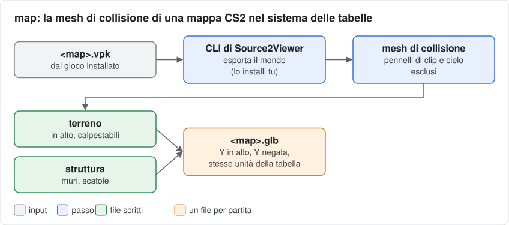

# Esportazione della mappa (`map`) {#map-export-map}

`python -m heat3d_cs2 map <mappa> -o <file.glb>` scrive una mappa CS2 come geometria del livello: la **mesh di collisione**
del mondo, nel sistema e nelle unità in cui sono disegnate le [tabelle della mappa di calore](output-table.md). Codice:
[`heat3d_cs2/mapexport.py`](https://github.com/Holdi601/3DHeat-CS2/blob/main/heat3d_cs2/mapexport.py),
[`heat3d_cs2/glb.py`](https://github.com/Holdi601/3DHeat-CS2/blob/main/heat3d_cs2/glb.py).
Opzioni e messaggi: [Comandi](commands.md#map---a-maps-geometry-as-glb).



## Perché la mesh di collisione {#why-the-collision-mesh}

La mesh di collisione è ciò su cui stanno i giocatori e dietro cui si nascondono - pavimenti, muri, scale, casse - senza la
decorazione: nessun oggetto di scena che sembra soltanto qualcosa, nessuna texture, molti meno triangoli delle mesh di
rendering. È ciò che una mappa di calore richiede sotto di sé: qualcosa su cui leggere le posizioni, non un rendering della
mappa.

## Come viene ottenuta {#how-it-is-obtained}

1. **Trovare la mappa.** Un percorso che termina con `.vpk` ed esiste viene usato così com'è. Altrimenti viene cercato
   `<nome>.vpk` in `<cartella CS2>\game\csgo\maps\`, dove la cartella CS2 è `--game`, oppure
   `steamapps\common\Counter-Strike Global Offensive` in ogni libreria Steam trovata (vedi
   [Installazione](installing.md#where-cs2-is-looked-for)).
2. **Trovare la CLI di Source2Viewer**: `--source2viewer`, poi `HEAT3D_SOURCE2VIEWER`, poi `Source2Viewer-CLI` /
   `Source2Viewer-CLI.exe` nel `PATH`.
3. **Esportare la fisica del mondo.** Source2Viewer viene eseguito così:

   ```text
   Source2Viewer-CLI -i <mappa>.vpk -d -f maps/<mappa>/world_physics.vmdl_c --gltf_export_format glb -o <cartella temporanea>
   ```

   Decodifica la fisica compilata di Source 2 dall'archivio della mappa stessa e scrive il modello (vuoto: il mondo non ha
   una propria mesh di rendering) e la sua fisica accanto. Il `.glb` più grande scritto è la fisica. Se Source2Viewer fallisce
   o non scrive alcun `.glb`, il comando si ferma e mostra gli ultimi 800 caratteri del suo output e dei suoi errori.
4. **Leggerlo.** Ogni nodo della scena viene percorso con la sua trasformazione (matrice, oppure traslazione-rotazione-scala),
   e viene preso ogni primitivo di triangoli, con o senza buffer di indici, in posizioni del mondo.
5. **Escludere ciò che non è né muro né pavimento.** Un nodo il cui nome contiene `clip` - clip per giocatori, clip per NPC,
   clip per granate: i muri invisibili che fermano giocatori e granate - o `sky`, in qualunque maiuscolo o minuscolo, viene
   scartato.
6. **Dare un nome alla superficie.** I gruppi di fisica sono chiamati con la loro superficie; il nome in minuscolo, senza il
   prefisso `physics`, `physics_group` o `physics_passbullets` (e il trattino basso che lo segue), è la superficie:
   `physics_group_concrete` è `concrete`, `physics_passbullets_chainlink` è `chainlink`, un semplice `physics_group` è
   `world`. Le superfici attraversate dai proiettili vengono mantenute.
7. **Tornare al sistema del gioco.** Source2Viewer scrive glTF in metri con Y verso l'alto: la (Y, Z, X) del gioco moltiplicata
   per 0,0254. Questo viene annullato - ogni punto diventa la (X, Y, Z) del gioco in pollici.
8. **Dividere terreno e struttura**, triangolo per triangolo: una faccia la cui normale punta verso l'alto di almeno 0,7 (la
   sua componente Z, normalizzata) - pendii fino a circa 45 gradi, all'incirca la salita più ripida che un giocatore di CS2
   percorre - è **terreno**; tutto il resto, muri e soffitti compresi, è **struttura**.
9. **Nel sistema del visualizzatore.** Ogni punto viene scritto come (X, Z, -Y): Y verso l'alto, la Y del gioco con il segno
   cambiato - il sistema in cui il visualizzatore disegna le tabelle, quando segue i loro suggerimenti `heat3d`. Una rotazione,
   non uno specchio.
10. **Scrivere il `.glb`.** Se non resta nulla (solo clip brush), il comando si ferma con un errore. Altrimenti stampa il file,
    la mappa, il numero di triangoli, quanti sono terreno, e il numero di parti.

Qui non si legge nulla oltre al `.vpk` della mappa stessa, e nulla di Source2Viewer viene incluso o copiato.

## Il file {#the-file}

Un glTF 2.0 binario (`.glb`), un solo buffer, scritto da `heat3d_cs2` (l'`asset.generator`):

| Aspetto | Cosa |
|---|---|
| Nodi | uno per parte, tutti alla radice, senza trasformazioni, ciascuno con la sua mesh dello stesso nome |
| Nomi dei nodi | `ground:<superficie>` o `structure:<superficie>` (`ground:concrete`, `structure:metal`, `structure:world`), ordinati per nome |
| Primitivi | uno per mesh, triangoli, `POSITION` (float32, con min/max) e `NORMAL` (float32), indici `uint32` |
| Ombreggiatura | piatta: un vertice per angolo di triangolo, ciascuno con la normale del suo triangolo |
| Materiali, texture, UV, colori | nessuno |
| Unità | unità di gioco (**pollici**), non metri - diversamente da ciò che assume glTF |
| Sistema | (X, Z, -Y) del gioco: la Y di glTF è l'altezza del gioco, la Z di glTF è la -Y del gioco |

Il prefisso `ground:` / `structure:` è la convenzione di tutti gli esportatori di livelli di 3DHeat: il visualizzatore prende
una parte così denominata sulla parola invece di indovinare dalla geometria, così i pavimenti ricevono l'ombreggiatura del
terreno e i muri il disegno della struttura senza alcun passo di classificazione.

Poiché le unità sono pollici, un altro visualizzatore glTF mostra la mappa circa 39 volte più grande (la legge in metri);
se conta, moltiplica per 0,0254 lì. In 3DHeat sta esattamente sotto la tabella, che è nelle stesse unità con scala 1.

## Il controllo che il sistema sia giusto {#the-check-that-the-frame-is-right}

Il test `test_players_stand_on_the_exported_floor` (eseguito solo quando sono dati un demo e Source2Viewer, vedi
[Sviluppo](development.md#tests)) esporta la mappa su cui è stato giocato un demo, prende 300 campioni casuali di posizione
della partita, e per ciascuno guarda dritto in basso alla ricerca del triangolo di terreno più alto al massimo 4 unità sopra i
piedi del giocatore. Richiede che almeno il 98% dei campioni trovi terreno, e che l'altezza mediana sopra di esso sia inferiore
a 5 unità. Una mappa specchiata fallisce: su una mappa specchiata con l'asse sbagliato, una grande quota di giocatori sta sopra
il nulla. Il README riporta i valori di questo controllo sulle mappe del pool competitivo attuale.

## Cosa non fa {#what-it-does-not-do}

- Nessuna geometria di rendering, texture o decorazione - vedi il *perché* sopra.
- Viene esportato solo ciò che è nel modello `world_physics` della mappa. Non è stato verificato se le parti mobili (porte) o
  quelle distruttibili vi siano incluse.
- Nessuna semplificazione: il visualizzatore di 3DHeat semplifica all'importazione con la sua impostazione **Obiettivo di
  semplificazione**.
- Le mappe non presenti nel gioco installato (mappe del workshop altrove sul disco) funzionano quando il loro `.vpk` viene
  passato come percorso e contiene `maps/<nome>/world_physics.vmdl_c`; non verificato.
