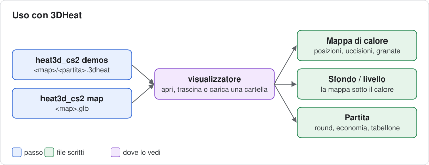

# Uso con 3DHeat {#using-it-with-3dheat}

Gli output finiscono in questi punti del [visualizzatore 3DHeat](https://holdi601.github.io/3DHeat):

| File | Dove | Cosa dà |
|---|---|---|
| `<partita>.3dheat` (il predefinito) | scheda **Mappa di calore**, pannello **Sorgente**, oppure la scheda **Partita** | la tabella e il documento partita insieme, un file per partita ([contenitore](https://holdi601.github.io/3DHeat/container.html)) |
| `<partita>.parquet` | scheda **Mappa di calore**, pannello **Sorgente** | posizioni ed eventi come mappa di calore, replay a scatola, percorsi |
| `<partita>.match.json` | scheda **Partita**, **Carica file partita…** | il tabellone, i round, il flusso delle uccisioni, statistiche tra partite, collegamenti alla mappa di calore |
| `<mappa>.glb` | pannello **Sfondo / livello**, **Modello 3D…** | la mappa sotto la mappa di calore |

La documentazione del visualizzatore descrive ogni scheda per intero: le sue pagine
[Analisi della partita](https://holdi601.github.io/3DHeat/match-analysis.html),
[Caricare i file](https://holdi601.github.io/3DHeat/loading-files.html),
[Mappatura delle colonne](https://holdi601.github.io/3DHeat/column-mapping.html) e
[Replay a scatola](https://holdi601.github.io/3DHeat/box-replay.html). Questa pagina è la parte CS2 di tutto ciò.



Il visualizzatore: [github.com/Holdi601/3DHeat](https://github.com/Holdi601/3DHeat),
documentazione [holdi601.github.io/3DHeat](https://holdi601.github.io/3DHeat/).

## Una sessione tipica {#a-typical-session}

```bash
python -m heat3d_cs2 demos D:\Demos\evento -o out
python -m heat3d_cs2 map <mappa> -o out/<mappa>/<mappa>.glb
```

1. **Mappa di calore -> Sorgente:** scegli la cartella `out/<mappa>` (oppure trascinala lì).
   Ogni `.parquet` al suo interno diventa un dataset; i file `.json` e `.glb` nella stessa cartella vengono saltati come
   "non è un file CSV/Parquet". Caricala.
2. **Sfondo / livello -> Modello 3D…:** scegli `out/<mappa>/<mappa>.glb`.
   **Salva nella libreria** lo conserva nel browser per la prossima volta.
3. **Partita -> Carica file partita…:** scegli i file `.match.json` della stessa cartella (più di uno alla volta), oppure trascinali
   sulla vista mentre la scheda Partita è aperta.

Carica le tabelle di una sola mappa alla volta: le coordinate di mappe diverse si sovrappongono, e una mappa di calore di due mappe
insieme non significa nulla. La cartella per mappa serve proprio a questo.

## La tabella si apre senza impostare nulla {#the-table-opens-with-nothing-to-set}

Il visualizzatore legge la voce `heat3d` del footer del primo file selezionato
([La tabella della mappa di calore](output-table.md#the-heat3d-footer-hints)) e la sovrappone alle sue ipotesi:

| Impostazione del visualizzatore | Impostare su |
|---|---|
| Posizione | `x`, `y`, `z` |
| Asse verticale nella sorgente | Z verso l'alto |
| Inverti Y | attivo - così la mappa è dal verso giusto, non specchiata |
| Scala delle unità | 1 - distanze in unità di gioco (indicate in "m"; 1 unità = 1 pollice) |
| Tempo | `time`, secondi |
| ID persona | `player` |
| Squadra / gruppo | `side` (T / CT) |
| Sessione / partita | `roundId` - ogni round è una sessione, `<partita> #NN` |
| Direzione dello sguardo | vettore, `dirX` / `dirY` / `dirZ` |
| Colonne filtro | `event`, `match`, `round`, `roundTime`, `phase`, `weapon`, `place`, `won`, `buy`, `opening`, `team` |
| Dimensione entità | 32 - il replay a scatola disegna un giocatore largo 32 unità, con un raggio di sguardo di 4 x 32 |

Ogni valore suggerito è ancora visibile nella mappatura delle colonne e può essere cambiato. Le altre colonne (`headshot`, `traded`,
`other`, `steamid`, `health`, `money`, `damage`, `duration`, ...) possono essere aggiunte a mano lì come filtri.

Tieni la scala delle unità a 1 quando si carica una mappa: il `.glb` è nelle stesse unità di gioco, e il livello non viene riscalato
insieme alla tabella.

### Filtri utili {#useful-filters}

- `event` = `position` per dove si trovavano i giocatori; `kill` / `death` per dove sono stati vinti e persi i duelli; `smoke`,
  `flash`, `molotov`, `he` per dove è atterrata l'utility; `throw` per da dove è stata lanciata; `plant` per i punti di piazzamento.
- `side` (il gruppo) = `T` o `CT`, `phase` = `live` per escludere la fase after, `buy` = `eco` / `force` / `full` per i round di
  un'economia, `won` = 1 per i round vinti dal lato della riga.
- `opening` = 1 con `kill` e `death` per i duelli di apertura.
- `roundTime` come intervallo per un momento del round: i primi 20 secondi, il post-piazzamento.

## La scheda Partita {#the-match-tab}

La scheda Partita accetta un file JSON il cui `format` è `heat3d-cs2-match` e che ha gli array `rounds`, `players` e `teams`
([Il documento partita](output-match-json.md)). Mostra il punteggio e le metà, una striscia di round colorata dal lato vincitore con un
segno per come è finito ciascuno, l'economia di ogni round, il piazzamento, il flusso delle uccisioni, i clutch e i sopravvissuti, il
tabellone, e le statistiche su tutte le partite caricate.

I suoi collegamenti **Mostra nella mappa di calore** non caricano nulla: impostano filtri sulla tabella già caricata nella scheda Mappa
di calore - `match`, `round` (e la sessione del round `<partita> #NN`), `event`, il giocatore, il lato. Funziona perché il documento
partita e la tabella hanno gli stessi nomi di partita, numeri di round, nomi di giocatori e lati. **Replay del round** passa la mappa di
calore al replay a scatola e riproduce la sessione del round dal suo inizio.

Quindi carica entrambi: le tabelle di una mappa nella scheda Mappa di calore, i loro documenti partita nella scheda Partita. Un documento
partita senza la sua tabella mostra comunque tabellone e round, e i collegamenti dicono che non ci sono dati di mappa di calore caricati.

## Senza 3DHeat {#without-3dheat}

- La tabella è un Parquet semplice: pandas, Polars, DuckDB, Spark, `arrow` di R leggono tutti; la voce `heat3d` viene ignorata, e le
  colonne di testo vengono lette come stringhe o categorie.
- Il documento partita è un JSON semplice.
- La mappa è un glTF binario valido, in pollici invece che in metri: moltiplica per 0,0254 per gli strumenti che assumono i metri. Il suo
  sistema è quello proprio di glTF (Y verso l'alto), quindi per sovrapporre la tabella altrove disegna la (x, y, z) di ogni riga come
  (x, z, -y), come fa 3DHeat.
