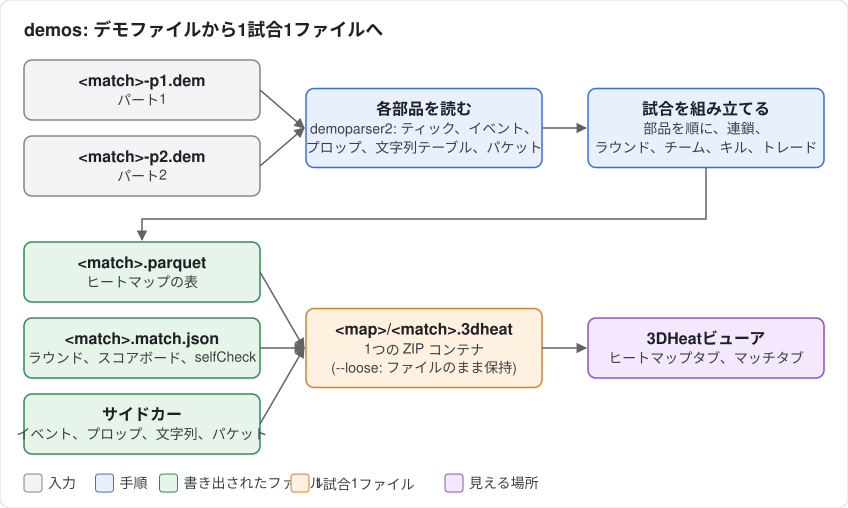

# 3DHeat CS2 {#dheat-cs2}

**これは何？** Counter-Strike 2 は、試合の録画を *デモ* として保存できます。このツールは、デモを3DHeatビューアで3D表示できるファイルに変えます。誰がどこに立ち、倒れ、投げ、設置したかを、ラウンドごとに示します。CS2 のマップを3Dモデルに変えて、その上に表示することもできます。

**何に使うの？** 自分の試合を振り返るため。同じマップの多くの試合を1つのヒートマップに重ねるため。そして、ADR（ラウンドあたりの平均ダメージ）や KAST（キル、アシスト、生存、トレードのいずれかがあったラウンドの割合）などの試合の統計のためです。

**例:** `alpha-vs-bravo-m1.dem` を入れると、`out/de_x/alpha-vs-bravo-m1.3dheat` が出てきます（`de_x` は作られたマップ名です）。



もう少し詳しく言うと、3DHeat CS2 は **Counter-Strike 2 のデモ** を、ヒートマップ用のテーブルと、マッチごとのマッチドキュメントに、そして **CS2 のマップ** をレベルのジオメトリに変えます。出力は [3DHeat](https://holdi601.github.io/3DHeat/) のテレメトリ・ビューア（[ソース](https://github.com/Holdi601/3DHeat)）向けに作られていますが、普通のファイル（Parquet、JSON、glTFのバイナリ）なので、ほかのものも読めます。

これは小さな Python のパッケージ `heat3d_cs2` で、コマンドラインから実行します。デモはディスクから読みます（何もダウンロードしません）。[demoparser2](https://github.com/LaihoE/demoparser) を使います。マップは、インストール済みのゲームから、Source2Viewer のコマンドライン版（[ValveResourceFormat](https://github.com/ValveResourceFormat/ValveResourceFormat)）で書き出します。

## クイックスタート {#quick-start}

コマンドラインは初めてですか？ まず [始める前に](before-you-start.md) を読んでください。

```bash
pip install -r requirements.txt
python -m heat3d_cs2 demos <demo files or folders> -o out   # その中のすべての試合
python -m heat3d_cs2 map <map> -o out/<map>/<map>.glb       # インストール済みのゲームからマップ
python -m heat3d_cs2 scoreboard out/<map>/<match>.3dheat    # 試合のスコアボードをテキストで
```

`1 match(es), 1 at a time ...` と表示され、その後に試合ごとに1行が出るはずです（[コマンド](../commands.md#what-is-printed) を参照）。

`demos` は、試合ごとに、マップ名のフォルダーの中に1つのファイルを書きます: `out/<map>/<match>.3dheat`。これは [`.3dheat` コンテナ](../output-container.md)、つまりビューアの1 マッチを 1 ファイルにの形式です（[仕様](https://holdi601.github.io/3DHeat/container.html)）。中には次のメンバーが入ります。`--loose` を付けると、代わりに別々のファイルとして書き出します:

| メンバー | 中身 | ビューアでの読み込み先 |
|---|---|---|
| `<match>.parquet`（役割 `table`） | 生存しているすべてのプレイヤーを毎秒8回、その状態（体力、お金、フラッシュ、スコープ、ゾーン、インベントリなど）とともに。さらに、出来事が起きた各場所（キル、デス、ダメージ、発砲、投擲、グレネードの爆発、ブラインド、設置、解除、爆発、そしてプレイヤーごとのラウンド終了と、そのラウンドで得た額）。1行ずつ | ヒートマップ タブ |
| `<match>.match.json`（役割 `match`、マッチドキュメント） | チーム、スコア、すべてのラウンド（勝者、方法、経済、設置、順番どおりのキル、クラッチ、生存者）、そしてプレイヤーごとのスコアボードの1行 | マッチ タブ |
| `<match>.events/props/strings/packets.parquet` | デモが持つそのほかのすべて、全体（サイドカー） | 完全性のため保持 |

`map` は `<map>.glb` を書きます。これはマップの衝突メッシュです（床、壁、箱。装飾なし）。地面と構造物に分けられ、テーブルと同じ座標系と単位で、そのためヒートマップの真下にぴったり重なります（背景/レベルパネル）。

## ドキュメントの見取り図 {#map-of-this-documentation}

| ページ | 内容 |
|---|---|
| [始める前に](before-you-start.md) | Python、ターミナル、置き換え用の場所、成功時とよくあるエラーの見え方 |
| [インストール](../installing.md) | Python、パッケージ、Source2Viewer の CLI、CS2 がある場所 |
| [コマンド](../commands.md) | `demos`、`map`、`scoreboard`: すべてのオプション、表示内容、終了コード |
| [デモの読み取り](../reading-demos.md) | デモファイルから読むもの: サンプルされたティック、プレイヤーのプロパティ、ゲームルール、出来事 |
| [マッチの組み立て](../building-matches.md) | 部品と連鎖、試合の時計、ラウンド、チームと陣営、行、キル、トレード、オープニング、ダメージ、フラッシュ、経済 |
| [統計](../statistics.md) | スコアボード: K/D/A、ADR、KAST、HS%、オープニング、トレード、マルチキル、クラッチ、ユーティリティ、フラッシュ |
| [ヒートマップのテーブル](../output-table.md) | Parquet ファイル: 各列、その型、どの出来事がそれを埋めるか、`heat3d` フッターのヒント、軸 |
| [マッチドキュメント](../output-match-json.md) | `.match.json` ドキュメントの、項目ごとの説明 |
| [1 マッチを 1 ファイルに](../output-container.md) | `demos` が既定で書く `.3dheat` コンテナ、`--loose` |
| [マップの書き出し](../map-export.md) | マップの衝突メッシュの書き出し方、座標系、ノードの名前、単位 |
| [3DHeat で使う](../using-with-3dheat.md) | テーブル、マッチドキュメント、マップをビューアのヒートマップ タブとマッチ タブに読み込む |
| [制限](../limits.md) | 何を前提にしているか、何を扱わないか、何が未検証か |
| [アップデート](../updates.md) | 起動時のリリース確認と `python -m heat3d_update` |
| [開発](../development.md) | コードの構成、テスト、合成デモのフィクスチャ |
| [コマンドリファレンス](../cli-reference.md) | すべてのコマンドの `--help`。コードから生成 |
| [保守](../maintaining.md) | これらのページのリリースチェックリスト |

## 検証の対象 {#what-it-is-checked-against}

ネットで見つかるデモは、試合ごとにきれいな1ファイルになっているとは限りません。この変換ツールは、順不同で複数ファイルに分かれた試合、試合の途中で再起動されたサーバー、同じ名前で保存された2つの別の試合、バックアップから復元されたラウンド、遅く始まったり早く終わった録画、一時停止、チームの陣営側にいるコーチを扱います（[マッチの組み立て](../building-matches.md) を参照）。大量のトーナメントのデモで確認しました。どの試合でも、スコアはラウンドの勝者に従い、各陣営のキルは相手陣営のデスと一致し、どのラウンドも5対5で始まります。

## 何に向けて使うか {#what-to-point-it-at}

自分の試合のデモ、トーナメントのサイトから手で取得したデモ、アクセス権のあるAPIのデモ。デモは、その内容が発行元と主催者に属する録画です。出てきたものは自分の分析に使い、デモや、そこから導いたデータを再配布しないでください。デモを提供するサイトは、自動ダウンロードを利用規約で禁じていることが多いため、このツールはディスクからデモを読み、何も取得しません。

## 3DHeatの一部 {#part-of-3dheat}

3DHeat CS2 は、3DHeat ビューアの周りにある無料のツールの一つです。それぞれ独自のリポジトリ、リリース、ライセンスを持ちます:

| ツール | 内容 | ドキュメント |
|---|---|---|
| [3DHeat](https://github.com/Holdi601/3DHeat) | ビューア: 3Dでのヒートマップ、レース分析、マッチの振り返り | [サイト](https://holdi601.github.io/3DHeat/) |
| [GameFiles](https://github.com/Holdi601/3DHeat-GameFiles) | ゲームが同梱するファイルから、コースとレベルを3Dモデルとして | [サイト](https://holdi601.github.io/3DHeat-GameFiles/) |
| [GameCapture](https://github.com/Holdi601/3DHeat-GameCapture) | レースゲームの周回テレメトリ。ゲーム映像から再構築したレベル | [サイト](https://holdi601.github.io/3DHeat-GameCapture/) |
| [Unreal Exporter](https://github.com/Holdi601/3DHeat-UnrealExporter) | レベルを1つの3Dモデルとして書き出す Unreal Editor のプラグイン | [サイト](https://holdi601.github.io/3DHeat-UnrealExporter/) |
| [CS2](https://github.com/Holdi601/3DHeat-CS2) | Counter-Strike 2 のデモをテーブルとマッチドキュメントに。マップを3Dモデルに | [サイト](https://holdi601.github.io/3DHeat-CS2/) |
| [Watcher](https://github.com/Holdi601/3DHeat-Watcher) | ゲームが公開する情報から、あなたのプレイについて、バックグラウンドで記録 | [サイト](https://holdi601.github.io/3DHeat-Watcher/) |
| [Ext-WarThunder](https://github.com/Holdi601/3DHeat-Ext-WarThunder) | War Thunder のリプレイをテーブルとマッチドキュメントに | [サイト](https://holdi601.github.io/3DHeat-Ext-WarThunder/) |
| [Ext-WoT](https://github.com/Holdi601/3DHeat-Ext-WoT) | World of Tanks のリプレイをテーブルとマッチドキュメントに | [サイト](https://holdi601.github.io/3DHeat-Ext-WoT/) |
| [Ext-WoWs](https://github.com/Holdi601/3DHeat-Ext-WoWs) | World of Warships のリプレイをテーブルとマッチドキュメントに | [サイト](https://holdi601.github.io/3DHeat-Ext-WoWs/) |
| [Ext-Squad](https://github.com/Holdi601/3DHeat-Ext-Squad) | Squad のサーバーのデモをテーブルとマッチドキュメントに | [サイト](https://holdi601.github.io/3DHeat-Ext-Squad/) |
| [Ext-DCS](https://github.com/Holdi601/3DHeat-Ext-DCS) | DCS World のマップを3Dモデルに | [サイト](https://holdi601.github.io/3DHeat-Ext-DCS/) |
| [Ext-IL2](https://github.com/Holdi601/3DHeat-Ext-IL2) | IL-2 Sturmovik のマップを3Dモデルに | [サイト](https://holdi601.github.io/3DHeat-Ext-IL2/) |

## ライセンス {#licence}

MIT。[`LICENSE`](https://github.com/Holdi601/3DHeat-CS2/blob/main/LICENSE) を参照してください。サードパーティのパッケージと、読み取るゲームが求めることについては、[`LICENSES.md`](https://github.com/Holdi601/3DHeat-CS2/blob/main/LICENSES.md) を参照してください。
