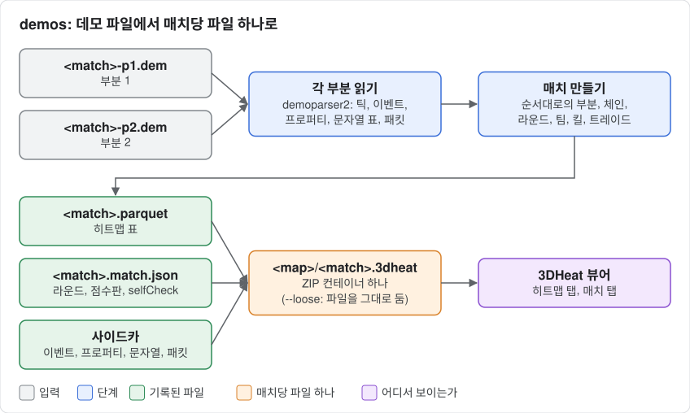

# 3DHeat CS2 {#dheat-cs2}

**무엇인가요?** Counter-Strike 2는 경기의 녹화본, 즉 *데모*를 저장할 수 있습니다. 이 도구는 데모를 3DHeat 뷰어가 3D로 보여 줄 수 있는 파일로 바꿉니다. 라운드마다 모두가 어디에 서 있었는지, 누가 죽고, 던지고, 폭탄을 설치했는지를 보여 줍니다. 또한 CS2 맵을 3D 모델로 바꿔, 그 위에 이것을 표시할 수 있습니다.

**왜 쓰나요?** 여러분 자신의 경기를 돌아보기 위해서, 같은 맵의 많은 경기를 하나의 히트맵으로 겹쳐 보기 위해서, 그리고 ADR(라운드당 평균 피해)과 KAST(플레이어가 킬, 어시스트, 생존, 또는 보복당하지 않은 라운드의 비율) 같은 경기 통계를 얻기 위해서입니다.

**예시:** `alpha-vs-bravo-m1.dem`을 넣으면 `out/de_x/alpha-vs-bravo-m1.3dheat`가 나옵니다(`de_x`는 지어낸 맵 이름입니다).



조금 더 자세히 말하면, 3DHeat CS2는 **Counter-Strike 2 데모**를 경기마다 히트맵 표와 경기 문서로, **CS2 맵**을 레벨 기하로 바꿉니다. 결과물은 [3DHeat](https://holdi601.github.io/3DHeat/) 텔레메트리 뷰어([소스](https://github.com/Holdi601/3DHeat))를 위해 만들어졌지만, 일반 파일입니다. Parquet, JSON, glTF 이진 파일이므로 다른 프로그램도 읽을 수 있습니다.

이것은 `heat3d_cs2`라는 작은 Python 패키지이며 명령줄에서 실행합니다. 데모는 디스크에서 읽습니다(내려받지 않습니다). [demoparser2](https://github.com/LaihoE/demoparser)를 쓰며, 설치된 게임에서 맵을 내보낼 때는 명령줄 버전의 Source2Viewer([ValveResourceFormat](https://github.com/ValveResourceFormat/ValveResourceFormat))를 씁니다.

## 빠른 시작 {#quick-start}

명령줄이 처음이신가요? 먼저 [시작하기 전에](before-you-start.md)를 읽으세요.

```bash
pip install -r requirements.txt
python -m heat3d_cs2 demos <demo files or folders> -o out   # 그 안의 모든 경기
python -m heat3d_cs2 map <map> -o out/<map>/<map>.glb       # 설치된 게임의 맵
python -m heat3d_cs2 scoreboard out/<map>/<match>.3dheat    # 경기의 점수표를 글자로
```

`1 match(es), 1 at a time ...`이 보이고, 그다음 경기마다 한 줄씩 나와야 합니다([명령](../commands.md#what-is-printed)을 보세요).

`demos`는 경기마다 맵 이름의 폴더 안에 파일 하나를 씁니다: `out/<map>/<match>.3dheat`, 즉 [`.3dheat` 컨테이너](../output-container.md)입니다. 뷰어의 경기 하나당 파일 한 개 형식입니다([명세](https://holdi601.github.io/3DHeat/container.html)). 다음 항목들을 담습니다. `--loose`를 쓰면 대신 각각을 따로 된 파일로 씁니다:

| 항목 | 담고 있는 것 | 뷰어의 어디에서 불러오나 |
|---|---|---|
| `<match>.parquet` (역할 `table`) | 살아 있는 모든 플레이어를 초당 여덟 번, 그 상태(체력, 돈, 섬광, 조준, 구역, 인벤토리 ...)와 함께, 그리고 일어난 곳의 모든 이벤트(킬, 사망, 피격, 발사, 투척, 수류탄 폭발, 실명, 설치, 해체, 폭발, 플레이어마다 라운드 종료와 그 라운드가 준 보상), 한 줄에 하나씩 | 히트맵 탭 |
| `<match>.match.json` (역할 `match`, 경기 문서) | 팀, 점수, 모든 라운드(승자, 결과 방식, 경제, 설치, 순서대로의 킬, 클러치, 생존자)와 모든 플레이어의 점수표 한 줄 | 매치 탭 |
| `<match>.events/props/strings/packets.parquet` | 데모가 담은 나머지 모든 것, 통째로 (보조 파일) | 완전성을 위해 보관 |

`map`은 `<map>.glb`를 씁니다. 맵의 충돌 메시입니다. 바닥, 벽, 상자이며 장식은 없습니다. 지면과 구조물로 나뉘어 있고, 표와 같은 좌표계와 단위로 되어 있어서 히트맵 바로 아래에 정확히 놓입니다(배경 / 레벨 패널).

## 이 문서의 지도 {#map-of-this-documentation}

| 페이지 | 내용 |
|---|---|
| [시작하기 전에](before-you-start.md) | Python, 터미널, 자리 표시자, 성공과 흔한 오류의 모습 |
| [설치](../installing.md) | Python, 패키지, Source2Viewer의 CLI, CS2가 있어야 하는 곳 |
| [명령](../commands.md) | `demos`, `map`, `scoreboard`: 모든 옵션, 출력되는 것, 종료 코드 |
| [데모 읽기](../reading-demos.md) | 데모 파일에서 읽는 것: 샘플링한 틱, 플레이어 속성, 게임 규칙, 이벤트 |
| [경기 만들기](../building-matches.md) | 파트와 체인, 경기 시계, 라운드, 팀과 진영, 행, 킬, 보복, 오프닝, 피해, 섬광, 경제 |
| [통계](../statistics.md) | 점수표: K/D/A, ADR, KAST, HS%, 오프닝, 보복, 연속 킬, 클러치, 유틸리티, 섬광 |
| [히트맵 표](../output-table.md) | Parquet 파일: 모든 열, 그 타입, 어떤 이벤트가 채우는지, `heat3d` 바닥글 힌트, 축 |
| [경기 문서](../output-match-json.md) | `.match.json` 문서, 필드별로 |
| [경기 하나를 파일 하나로](../output-container.md) | `demos`가 기본으로 쓰는 `.3dheat` 컨테이너, `--loose` |
| [맵 내보내기](../map-export.md) | 맵의 충돌 메시를 어떻게 내보내는지, 좌표계, 노드 이름 짓기, 단위 |
| [3DHeat과 함께 쓰기](../using-with-3dheat.md) | 표, 경기 문서, 맵을 뷰어의 히트맵 탭과 매치 탭에 불러오기 |
| [한계](../limits.md) | 가정한 것, 다루지 않는 것, 검증하지 않은 것 |
| [업데이트](../updates.md) | 시작할 때의 릴리스 확인과 `python -m heat3d_update` |
| [개발](../development.md) | 코드 구조, 테스트, 가상 데모 픽스처 |
| [명령 참조](../cli-reference.md) | 모든 명령의 `--help`, 코드에서 생성 |
| [문서 관리](../maintaining.md) | 이 페이지들의 릴리스 체크리스트 |

## 무엇으로 검증했나 {#what-it-is-checked-against}

세상에 있는 데모는 경기마다 깨끗한 파일 하나가 아닙니다. 이 변환기는 경기가 여러 파일에 나뉘어 어떤 순서로 있든, 경기 중에 서버가 재시작되든, 같은 이름 아래 서로 다른 두 경기가 저장되어 있든, 백업에서 복원된 라운드든, 녹화가 늦게 시작하거나 일찍 끝나든, 일시 정지든, 코치가 팀 편에 있든 처리합니다. 자세한 내용은 [경기 만들기](../building-matches.md)를 보세요. 많은 토너먼트 데모 모음으로 확인했으며, 모든 경기에서 점수는 라운드 승자를 따라가고, 각 편의 킬은 상대편의 사망과 같으며, 모든 라운드는 5 대 5로 시작했습니다.

## 어떤 데모를 가리키면 되나 {#what-to-point-it-at}

여러분 자신의 경기 데모, 토너먼트 사이트에서 손으로 내려받은 데모, 또는 여러분이 접근할 수 있는 API의 데모입니다. 데모는 그 내용이 게시자와 주최자에게 속한 기록입니다. 나온 결과는 여러분 자신의 분석에만 쓰고, 데모나 그로부터 얻은 데이터를 재배포하지 마세요. 데모를 제공하는 사이트 중에는 약관으로 자동 내려받기를 금지하는 곳이 많습니다. 그래서 이 도구는 디스크에서 데모를 읽을 뿐, 어떤 것도 내려받지 않습니다.

## 3DHeat의 일부 {#part-of-3dheat}

3DHeat CS2는 3DHeat 뷰어 주변의 무료 도구 중 하나입니다. 각각 자기 저장소, 릴리스, 라이선스를 가집니다:

| 도구 | 하는 일 | 문서 |
|---|---|---|
| [3DHeat](https://github.com/Holdi601/3DHeat) | 뷰어: 3D 히트맵, 레이스 분석, 경기 리뷰 | [사이트](https://holdi601.github.io/3DHeat/) |
| [GameFiles](https://github.com/Holdi601/3DHeat-GameFiles) | 게임이 배포하는 파일에서 코스와 레벨을 3D 모델로 | [사이트](https://holdi601.github.io/3DHeat-GameFiles/) |
| [GameCapture](https://github.com/Holdi601/3DHeat-GameCapture) | 레이싱 게임의 랩 텔레메트리. 게임플레이 영상에서 다시 만든 레벨 | [사이트](https://holdi601.github.io/3DHeat-GameCapture/) |
| [Unreal Exporter](https://github.com/Holdi601/3DHeat-UnrealExporter) | 레벨을 3D 모델 하나로 내보내는 Unreal 에디터 플러그인 | [사이트](https://holdi601.github.io/3DHeat-UnrealExporter/) |
| [CS2](https://github.com/Holdi601/3DHeat-CS2) | Counter-Strike 2 데모를 표와 경기 문서로, 맵을 3D 모델로 | [사이트](https://holdi601.github.io/3DHeat-CS2/) |
| [Watcher](https://github.com/Holdi601/3DHeat-Watcher) | 게임이 여러분의 플레이에 대해 공개하는 것을 백그라운드에서 기록 | [사이트](https://holdi601.github.io/3DHeat-Watcher/) |
| [Ext-WarThunder](https://github.com/Holdi601/3DHeat-Ext-WarThunder) | War Thunder 리플레이를 표와 경기 문서로 | [사이트](https://holdi601.github.io/3DHeat-Ext-WarThunder/) |
| [Ext-WoT](https://github.com/Holdi601/3DHeat-Ext-WoT) | World of Tanks 리플레이를 표와 경기 문서로 | [사이트](https://holdi601.github.io/3DHeat-Ext-WoT/) |
| [Ext-WoWs](https://github.com/Holdi601/3DHeat-Ext-WoWs) | World of Warships 리플레이를 표와 경기 문서로 | [사이트](https://holdi601.github.io/3DHeat-Ext-WoWs/) |
| [Ext-Squad](https://github.com/Holdi601/3DHeat-Ext-Squad) | Squad 서버 데모를 표와 경기 문서로 | [사이트](https://holdi601.github.io/3DHeat-Ext-Squad/) |
| [Ext-DCS](https://github.com/Holdi601/3DHeat-Ext-DCS) | DCS World 맵을 3D 모델로 | [사이트](https://holdi601.github.io/3DHeat-Ext-DCS/) |
| [Ext-IL2](https://github.com/Holdi601/3DHeat-Ext-IL2) | IL-2 Sturmovik 맵을 3D 모델로 | [사이트](https://holdi601.github.io/3DHeat-Ext-IL2/) |

## 라이선스 {#licence}

MIT입니다. [`LICENSE`](https://github.com/Holdi601/3DHeat-CS2/blob/main/LICENSE)를 보세요. 제3자 패키지와, 이 도구가 읽는 게임들이 요구하는 것은 [`LICENSES.md`](https://github.com/Holdi601/3DHeat-CS2/blob/main/LICENSES.md)에 있습니다.
