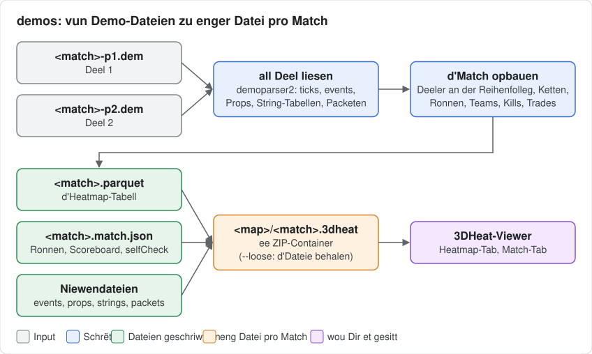

# 3DHeat CS2 {#dheat-cs2}

**Wat ass et?** Counter-Strike 2 ka vun engem Match eng Opnam späicheren, eng *Demo* genannt.
Dëst Tool verwandelt eng Demo an Dateien, déi den 3DHeat-Viewer an 3D weise kann:
wou jidderee gestan huet, gestuerwen ass, geheit an de Bomm geluecht huet, Ronn fir Ronn. Et kann och
eng CS2-Map an en 3D-Modell verwandelen, fir se drop ze weisen.

**Firwat sollt ech et benotzen?** Fir Är eege Matcher nozekucken, fir vill Matcher vun
enger Map als eng Heatmap iwwereneen ze leeën, a fir Match-Statistiken wéi ADR
(duerchschnëttleche Schued pro Ronn) a KAST (de Undeel vun de Ronnen, an deenen e Spiller ëmbruecht,
assistéiert, iwwerlieft huet oder getradet gouf).

**Beispill:** `alpha-vs-bravo-m1.dem` eran, `out/de_x/alpha-vs-bravo-m1.3dheat`
erauswäert (`de_x` ass en erfonnte Mappenumm).



Méi genau: 3DHeat CS2 verwandelt **Counter-Strike-2-Demoen** an eng Heatmap-Tabell an en Match-
Dokument pro Match, an eng **CS2-Map** a Level-Geometrie. D'Ausgabe si fir
den [3DHeat](https://holdi601.github.io/3DHeat/)-Telemetrie-Viewer gemaach
([Quell](https://github.com/Holdi601/3DHeat)), awer si
sinn ganz normal Dateien - Parquet, JSON a glTF-Binär - déi alles anescht och
liese kann.

Et ass e klenge Python-Package, `heat3d_cs2`, vun der Kommandozeil aus gefouert. Et liest
Demoen vun der Plack (et lued keng erof) mat
[demoparser2](https://github.com/LaihoE/demoparser), an exportéiert Mappen aus dem
installéierte Spill mat dem Kommandozeil-Build vu Source2Viewer
([ValveResourceFormat](https://github.com/ValveResourceFormat/ValveResourceFormat)).

## Séier Start {#quick-start}

Nei op der Kommandozeil? Liest fir d'éischt [Ier Dir ufänkt](before-you-start.md).

```bash
pip install -r requirements.txt
python -m heat3d_cs2 demos <demo files or folders> -o out   # every match in them
python -m heat3d_cs2 map <map> -o out/<map>/<map>.glb       # the map from the installed game
python -m heat3d_cs2 scoreboard out/<map>/<match>.3dheat    # a match's scoreboard as text
```

Dir sollt `1 match(es), 1 at a time ...` gesinn an dann eng Zeil pro Match
(kuckt [Kommandoen](../commands.md#what-is-printed)).

`demos` schreift pro Match eng Datei an en Dossier, deen no der Map benannt ass:
`out/<map>/<match>.3dheat`, e [`.3dheat`-Container](../output-container.md) - dem
Viewer säi Format mat enger Datei pro Match ([Spezifikatioun](https://holdi601.github.io/3DHeat/container.html)).
Hien hält dës Memberen; `--loose` schreift se amplaz als getrennt Dateien:

| Member | Wat et hält | Gelueden am Viewer säin |
|---|---|---|
| `<match>.parquet` (Roll `table`) | all lieweg Spiller aacht Mol d'Sekonn mat sengem State (Gesondheet, Suen, Flash, scoped, Zon, Inventar, ...), an all Evenement, wou et geschitt ass (Kill, Doud, Hurt, Schoss, Wuerf, Grenade-Detonatiounen, Blend, Plant, Defuse, Explosioun, an en Ronn-Enn pro Spiller mat deem, wat d'Ronn him bruecht huet), eng Zeil pro Stéck | Heatmap-Tab |
| `<match>.match.json` (Roll `match`, d'Match-Dokument) | Teams, Score, all Ronn (Gewënner, wéi, Wirtschaft, Plant, Kills an der Reihenfolleg, Clutches, Iwwerliewenden) an d'Scoreboard-Zeil vun all Spiller | Match-Tab |
| `<match>.events/props/strings/packets.parquet` | alles anescht, wat d'Demo hält, komplett (Niewendateien) | fir d'Vollstännegkeet gehalen |

`map` schreift `<map>.glb`: dem Map seng Kollisiouns-Mesh - Buedem, Maueren, Këschten,
ouni Dekoratioun - opgedeelt a Buedem a Struktur, am selwechte Frame a mat de selwechten
Eenheeten wéi d'Tabellen, sou datt se genau ënner der Heatmap läit (Panel „Hannergrond / Level“).

## Kaart vun dëser Dokumentatioun {#map-of-this-documentation}

| Säit | Wat se ofdeckt |
|---|---|
| [Ier Dir ufänkt](before-you-start.md) | Python, e Terminal, Platzhalter, wéi Erfolleg an heefeg Feeler ausgesinn |
| [Installéieren](../installing.md) | Python, d'Packagen, dem Source2Viewer seng CLI, wou CS2 muss sinn |
| [Kommandoen](../commands.md) | `demos`, `map`, `scoreboard`: all Optioun, wat ausgi gëtt, Exit-Coden |
| [Eng Demo liesen](../reading-demos.md) | wat aus enger Demo-Datei gelies gëtt: gesampelt Ticks, Spiller-Properties, Spillreegelen, Evenementer |
| [E Match opbauen](../building-matches.md) | Deeler a Ketten, d'Match-Auer, Ronnen, Teams a Säiten, Zeilen, Kills, Trades, Openings, Schued, Flashes, Wirtschaft |
| [Statistiken](../statistics.md) | d'Scoreboard: K/D/A, ADR, KAST, HS%, Openings, Trades, Multi-Kills, Clutches, Utility, Flashes |
| [D'Heatmap-Tabell](../output-table.md) | d'Parquet-Datei: all Kolonn, hiren Typ, wéi eng Evenementer se fëllen, d'`heat3d`-Footer-Hiweiser, d'Achsen |
| [D'Match-Dokument](../output-match-json.md) | d'`.match.json`-Dokument, Feld fir Feld |
| [Eng Datei pro Match](../output-container.md) | den `.3dheat`-Container, deen `demos` standardméisseg schreift, `--loose` |
| [Map-Export](../map-export.md) | wéi dem Map seng Kollisiouns-Mesh exportéiert gëtt, de Frame, Node-Nimm, Eenheeten |
| [Mat 3DHeat benotzen](../using-with-3dheat.md) | Tabellen, Match-Dokumenter a Mappen an dem Viewer säi Heatmap- a Match-Tab lueden |
| [Grenzen](../limits.md) | wat ugeholl gëtt, wat net behandelt gëtt, wat net gepréift ass |
| [Updates](../updates.md) | de Release-Check beim Start an `python -m heat3d_update` |
| [Entwécklung](../development.md) | Code-Layout, Tester, d'syntheteschen Demo-Fixture |
| [Kommando-Referenz](../cli-reference.md) | den `--help` vun all Kommando, aus dem Code generéiert |
| [Ënnerhalen](../maintaining.md) | d'Release-Checklëscht fir dës Säiten |

## Géint wat et gepréift ass {#what-it-is-checked-against}

Demoen aus der Wild sinn net eng propper Datei pro Match. De Konverter behandelt e
Match, deen iwwer Dateien opgedeelt ass, a ganz egal wéi enger Reihenfolleg, e Server, deen am Match nei gestart gouf, zwee
verschidde Matcher ënner engem Numm, Ronnen, déi aus engem Backup restauréiert goufen, eng
Opnam, déi spéit ufänkt oder fréi ophält, Paus, a Coaches op der Säit vun engem Team -
kuckt [E Match opbauen](../building-matches.md). Iwwer eng grouss Kollektioun
vun Tournoi-Demoen gepréift: bei all Match
follegt de Score de Ronn-Gewënner, d'Kills vun enger Säit sinn d'Doudesfäll vun der anerer,
a all Ronn fänkt fënnef géint fënnef un.

## Op wat et ze riichten ass {#what-to-point-it-at}

Op d'Demoe vun Äre eegene Matcher, Demoen, déi Dir vun Hand vun enger Tournoi-Säit erofgelueden hutt,
oder Demoen aus enger API, op déi Dir Zougrëff hutt. Eng Demo ass eng Opnam, a säin Inhalt gehéiert
hirem Verleeër an hiren Organisateure: benotzt, wat erauskënnt, fir Är eege Analys, a verdeelt keng
Demoen an Daten, déi doraus ofgeleet sinn, weider. D'Tool liest Demoe vun der Festplack a luet keng
erof, an näischt aus dem Spill gëtt matgeliwwert: keng Spilldateien, kee Spillcode, keng DLLen.

3DHeat CS2 ass net mat Valve verbonnen a gëtt net vu Valve ënnerstëtzt. Counter-Strike 2 an déi dozou
gehéierend Nimm a Marken gehéieren hiren Eegentümer. Rechteinhaber: maacht w.e.g. en Issue op
[github.com/Holdi601/3DHeat-CS2/issues](https://github.com/Holdi601/3DHeat-CS2/issues) op - mir
äntweren séier an huelen op Ufro alles erof.

## Deel vun 3DHeat {#part-of-3dheat}

3DHeat CS2 ass ee vun de fräien Tools ronderëm den 3DHeat-Viewer, jiddwereen säin eegene
Repository mat eegene Releases a Lizenz:

| Tool | Wat et mécht | Docs |
|---|---|---|
| [3DHeat](https://github.com/Holdi601/3DHeat) | de Viewer: Heatmaps, Course-Analys a Match-Iwwerpréiwung an 3D | [Site](https://holdi601.github.io/3DHeat/) |
| [GameFiles](https://github.com/Holdi601/3DHeat-GameFiles) | Course a Levelen aus de Dateie vu Spiller, als 3D-Modeller | [Site](https://holdi601.github.io/3DHeat-GameFiles/) |
| [GameCapture](https://github.com/Holdi601/3DHeat-GameCapture) | Ronn-Telemetrie vu Rennspiller; Levelen aus Gameplay-Video nei opgebaut | [Site](https://holdi601.github.io/3DHeat-GameCapture/) |
| [Unreal Exporter](https://github.com/Holdi601/3DHeat-UnrealExporter) | en Unreal-Editor-Plugin, dat e Level als een 3D-Modell exportéiert | [Site](https://holdi601.github.io/3DHeat-UnrealExporter/) |
| [CS2](https://github.com/Holdi601/3DHeat-CS2) | Counter-Strike-2-Demoen a Tabellen a Match-Dokumenter; Mappen a 3D-Modeller | [Site](https://holdi601.github.io/3DHeat-CS2/) |
| [Watcher](https://github.com/Holdi601/3DHeat-Watcher) | hält am Hannergrond fest, wat Spiller iwwer Äert Spill publizéieren | [Site](https://holdi601.github.io/3DHeat-Watcher/) |
| [Ext-WarThunder](https://github.com/Holdi601/3DHeat-Ext-WarThunder) | War-Thunder-Replays a Tabellen a Match-Dokumenter | [Site](https://holdi601.github.io/3DHeat-Ext-WarThunder/) |
| [Ext-WoT](https://github.com/Holdi601/3DHeat-Ext-WoT) | World-of-Tanks-Replays a Tabellen a Match-Dokumenter | [Site](https://holdi601.github.io/3DHeat-Ext-WoT/) |
| [Ext-WoWs](https://github.com/Holdi601/3DHeat-Ext-WoWs) | World-of-Warships-Replays a Tabellen a Match-Dokumenter | [Site](https://holdi601.github.io/3DHeat-Ext-WoWs/) |
| [Ext-Squad](https://github.com/Holdi601/3DHeat-Ext-Squad) | Squad-Server-Demoen a Tabellen a Match-Dokumenter | [Site](https://holdi601.github.io/3DHeat-Ext-Squad/) |
| [Ext-DCS](https://github.com/Holdi601/3DHeat-Ext-DCS) | DCS-World-Mappen a 3D-Modeller | [Site](https://holdi601.github.io/3DHeat-Ext-DCS/) |
| [Ext-IL2](https://github.com/Holdi601/3DHeat-Ext-IL2) | IL-2-Sturmovik-Mappen a 3D-Modeller | [Site](https://holdi601.github.io/3DHeat-Ext-IL2/) |

## Lizenz {#licence}

MIT - kuckt [`LICENSE`](https://github.com/Holdi601/3DHeat-CS2/blob/main/LICENSE)
an [`LICENSES.md`](https://github.com/Holdi601/3DHeat-CS2/blob/main/LICENSES.md)
fir d'Drëtt-Packagen.
