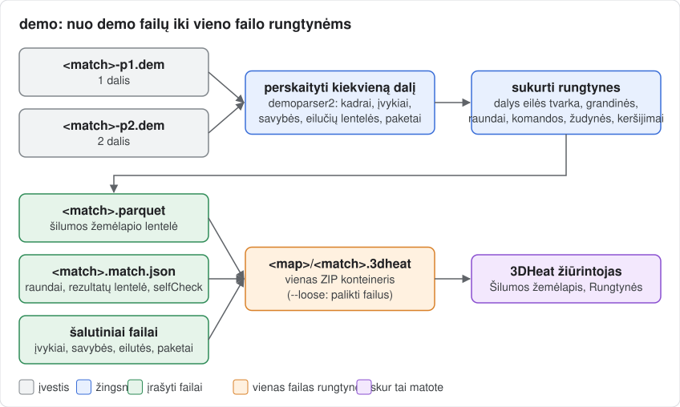

# 3DHeat CS2 {#dheat-cs2}

**Kas tai?** Counter-Strike 2 gali įrašyti rungtynių įrašą, vadinamą *demo*. Šis įrankis paverčia demo failais, kuriuos
3DHeat žiūryklė gali rodyti 3D: kur kiekvienas stovėjo, žuvo, metė ir sprogdino, raundas po raundo. Jis taip pat gali
paversti CS2 žemėlapį 3D modeliu, ant kurio tai parodyti.

**Kam tai naudoti?** Peržiūrėti savo rungtynes, sudėti kelias to paties žemėlapio rungtynes viena ant kitos kaip vieną šilumos žemėlapį
ir rungtynių statistikai, pavyzdžiui, ADR (vidutinė žala per raundą) ir KAST (raundų dalis, kuriuose žaidėjas nužudė, padėjo,
išgyveno ar buvo keršytas).

**Pavyzdys:** `alpha-vs-bravo-m1.dem` įeina, `out/de_x/alpha-vs-bravo-m1.3dheat` išeina (`de_x` – išgalvotas žemėlapio pavadinimas).



Išsamiau: 3DHeat CS2 paverčia **Counter-Strike 2 demo** į šilumos žemėlapio lentelę ir rungtynių dokumentą kiekvienoms rungtynėms, o **CS2 žemėlapį** – į lygio geometriją.
Išvestys skirtos [3DHeat](https://holdi601.github.io/3DHeat/) telemetrijos žiūryklei
([šaltinis](https://github.com/Holdi601/3DHeat)), bet jos yra įprasti failai – Parquet, JSON ir glTF dvejetainis –
kuriuos gali skaityti ir kiti įrankiai.

Tai nedidelis Python paketas `heat3d_cs2`, paleidžiamas iš komandinės eilutės. Jis skaito demo iš disko (nieko neatsisiunčia)
su [demoparser2](https://github.com/LaihoE/demoparser), o žemėlapius eksportuoja iš įdiegto žaidimo naudodamas Source2Viewer
komandinės eilutės versiją ([ValveResourceFormat](https://github.com/ValveResourceFormat/ValveResourceFormat)).

## Greita pradžia {#quick-start}

Nesate įpratę prie komandinės eilutės? Pirmiausia perskaitykite [Prieš pradedant](before-you-start.md).

```bash
pip install -r requirements.txt
python -m heat3d_cs2 demos <demo files or folders> -o out   # kiekvienos juose esančios rungtynės
python -m heat3d_cs2 map <map> -o out/<map>/<map>.glb       # žemėlapis iš įdiegto žaidimo
python -m heat3d_cs2 scoreboard out/<map>/<match>.3dheat    # rungtynių rezultatų lentelė tekstu
```

Turėtumėte matyti `1 match(es), 1 at a time ...`, o tada po eilutę kiekvienoms rungtynėms
(žr. [Komandos](../commands.md#what-is-printed)).

`demos` kiekvienoms rungtynėms įrašo po vieną failą į aplanką, pavadintą pagal žemėlapį:
`out/<map>/<match>.3dheat`, [`.3dheat` konteineris](../output-container.md) – žiūryklės formatas vienas failas rungtynėms
([specifikacija](https://holdi601.github.io/3DHeat/container.html)). Jame yra šie elementai; `--loose` parašo juos kaip atskirus failus:

| Elementas | Ką jis turi | Įkeliamas žiūryklės |
|---|---|---|
| `<match>.parquet` (vaidmuo `table`) | kiekvienas gyvas žaidėjas aštuonis kartus per sekundę su savo būsena (sveikata, pinigai, akinimas, taikymas, zona, inventorius ir t. t.) ir kiekvienas įvykis, kur jis įvyko (žudynė, mirtis, sužeidimas, šūvis, metimas, granatų sprogimai, akinimas, sprogdinimas, nuėmimas, sprogimas, ir raundo pabaiga kiekvienam žaidėjui su tuo, ką raundas jam atnešė), po vieną eilutę | Šilumos žemėlapio skirtukas |
| `<match>.match.json` (vaidmuo `match`, rungtynių dokumentas) | komandos, rezultatas, kiekvienas raundas (laimėtojas, kaip, ekonomika, sprogdinimas, žudynės eilės tvarka, kliučiai, išgyvenusieji) ir kiekvieno žaidėjo rezultatų eilutė | Rungtynės skirtukas |
| `<match>.events/props/strings/packets.parquet` | viskas kita, ką turi demo, visa (papildomi failai) | saugoma pilnumui |

`map` įrašo `<map>.glb`: žemėlapio susidūrimų tinklą – grindis, sienas, dėžes, be dekoracijų – padalintą į žemę ir statinius, tuo pačiu
koordinačių rėmu ir vienetais kaip lentelės, todėl jis tiksliai guli po šilumos žemėlapiu (Lygio skydelis).

## Dokumentacijos žemėlapis {#map-of-this-documentation}

| Puslapis | Ką jame rasite |
|---|---|
| [Prieš pradedant](before-you-start.md) | Python, terminalas, žymekliai, kaip atrodo sėkmė ir dažnos klaidos |
| [Įdiegimas](../installing.md) | Python, paketai, Source2Viewer CLI, kur turi būti CS2 |
| [Komandos](../commands.md) | `demos`, `map`, `scoreboard`: kiekviena parinktis, kas išvedama, išėjimo kodai |
| [Demo skaitymas](../reading-demos.md) | kas skaitoma iš demo failo: imami kadrai, žaidėjų savybės, žaidimo taisyklės, įvykiai |
| [Rungtynių kūrimas](../building-matches.md) | dalys ir grandinės, rungtynių laikas, raundai, komandos ir pusės, eilutės, žudynės, keršijimai, pradžios, žala, akinimai, ekonomika |
| [Statistika](../statistics.md) | rezultatų lentelė: K/D/A, ADR, KAST, HS%, pradžios, keršijimai, daugybinės žudynės, kliučiai, pagalbinės priemonės, akinimai |
| [Šilumos žemėlapio lentelė](../output-table.md) | Parquet failas: kiekvienas stulpelis, jo tipas, kurie įvykiai jį užpildo, `heat3d` poraštės užuominos, ašys |
| [Rungtynių dokumentas](../output-match-json.md) | `.match.json` dokumentas, lauką po lauko |
| [Vienas failas rungtynėms](../output-container.md) | `.3dheat` konteineris, kurį `demos` rašo pagal numatymą; `--loose` |
| [Žemėlapio eksportas](../map-export.md) | kaip eksportuojamas žemėlapio susidūrimų tinklas, rėmas, mazgų pavadinimai, vienetai |
| [Naudojimas su 3DHeat](../using-with-3dheat.md) | lentelių, rungtynių dokumentų ir žemėlapių įkėlimas į žiūryklės Šilumos žemėlapio ir Rungtynės skirtukus |
| [Apribojimai](../limits.md) | kas daroma prielaidų, kas nėra tvarkoma, kas nepatikrinta |
| [Atnaujinimai](../updates.md) | išleidimo patikra paleidimo metu ir `python -m heat3d_update` |
| [Kūrimas](../development.md) | kodo struktūra, testai, sintetinio demo pavyzdys |
| [Komandų nuoroda](../cli-reference.md) | kiekvienos komandos `--help`, sugeneruotas iš kodo |
| [Šių dokumentų priežiūra](../maintaining.md) | šių puslapių išleidimo kontrolinis sąrašas |

## Ką tai patikrinta {#what-it-is-checked-against}

Demo iš tikrovės nėra vienas švarus failas kiekvienoms rungtynėms. Konverteris tvarko rungtynes, išskaidytas į kelis failus bet kokia tvarka,
serverį, paleistą iš naujo rungtynių viduryje, dvejas skirtingas rungtynes, saugomas vienu vardu, raundus, atkurtus iš atsarginės kopijos,
įrašą, kuris prasideda vėlai arba baigiasi anksti, pauzes ir trenerius komandos pusėje –
žr. [Rungtynių kūrimas](../building-matches.md). Patikrinta didelėje turnyrų demo kolekcijoje: visose rungtynėse
rezultatas seka raundų laimėtojus, kiekvienos pusės žudynės yra kitos pusės mirtys, ir kiekvienas raundas prasideda penki prieš penkis.

## Ką nurodyti {#what-to-point-it-at}

Jūsų pačių rungtynių demo, demo, kuriuos parsisiuntėte rankiniu būdu iš turnyrų svetainės, arba demo iš API, prie kurios turite prieigą.
Demo turinys priklauso jo leidėjui ir organizatoriams: naudokite gautus rezultatus savo analizei ir neplatinkite demo ar iš jų išvestų duomenų.
Svetainės, siūlančios demo, dažnai savo sąlygose draudžia automatinį atsisiuntimą, todėl įrankis skaito demo iš disko ir nieko neatsisiunčia.

## Dalis 3DHeat {#part-of-3dheat}

3DHeat CS2 yra vienas iš nemokamų įrankių aplink 3DHeat žiūryklę; kiekvienas – atskira saugykla su savais išleidimais ir licencija:

| Įrankis | Ką daro | Dokumentacija |
|---|---|---|
| [3DHeat](https://github.com/Holdi601/3DHeat) | žiūryklė: šilumos žemėlapiai, lenktynių analizė ir rungtynių apžvalga 3D | [svetainė](https://holdi601.github.io/3DHeat/) |
| [GameFiles](https://github.com/Holdi601/3DHeat-GameFiles) | trasos ir lygiai iš žaidimų pristatomų failų kaip 3D modeliai | [svetainė](https://holdi601.github.io/3DHeat-GameFiles/) |
| [GameCapture](https://github.com/Holdi601/3DHeat-GameCapture) | ratų telemetrija iš lenktynių žaidimų; lygiai, atkurti iš žaidimo vaizdo | [svetainė](https://holdi601.github.io/3DHeat-GameCapture/) |
| [Unreal Exporter](https://github.com/Holdi601/3DHeat-UnrealExporter) | Unreal Editor papildinys, eksportuojantis lygį kaip vieną 3D modelį | [svetainė](https://holdi601.github.io/3DHeat-UnrealExporter/) |
| [CS2](https://github.com/Holdi601/3DHeat-CS2) | Counter-Strike 2 demo į lenteles ir rungtynių dokumentus; žemėlapiai į 3D modelius | [svetainė](https://holdi601.github.io/3DHeat-CS2/) |
| [Watcher](https://github.com/Holdi601/3DHeat-Watcher) | fone įrašo jūsų žaidimą iš to, ką skelbia žaidimai | [svetainė](https://holdi601.github.io/3DHeat-Watcher/) |
| [Ext-WarThunder](https://github.com/Holdi601/3DHeat-Ext-WarThunder) | War Thunder įrašai į lenteles ir rungtynių dokumentus | [svetainė](https://holdi601.github.io/3DHeat-Ext-WarThunder/) |
| [Ext-WoT](https://github.com/Holdi601/3DHeat-Ext-WoT) | World of Tanks įrašai į lenteles ir rungtynių dokumentus | [svetainė](https://holdi601.github.io/3DHeat-Ext-WoT/) |
| [Ext-WoWs](https://github.com/Holdi601/3DHeat-Ext-WoWs) | World of Warships įrašai į lenteles ir rungtynių dokumentus | [svetainė](https://holdi601.github.io/3DHeat-Ext-WoWs/) |
| [Ext-Squad](https://github.com/Holdi601/3DHeat-Ext-Squad) | Squad serverių demo į lenteles ir rungtynių dokumentus | [svetainė](https://holdi601.github.io/3DHeat-Ext-Squad/) |
| [Ext-DCS](https://github.com/Holdi601/3DHeat-Ext-DCS) | DCS World žemėlapiai į 3D modelius | [svetainė](https://holdi601.github.io/3DHeat-Ext-DCS/) |
| [Ext-IL2](https://github.com/Holdi601/3DHeat-Ext-IL2) | IL-2 Sturmovik žemėlapiai į 3D modelius | [svetainė](https://holdi601.github.io/3DHeat-Ext-IL2/) |

## Licencija {#licence}

MIT – žr. [`LICENSE`](https://github.com/Holdi601/3DHeat-CS2/blob/main/LICENSE),
ir [`LICENSES.md`](https://github.com/Holdi601/3DHeat-CS2/blob/main/LICENSES.md)
dėl trečiųjų šalių paketų ir to, ko reikalauja žaidimai, kuriuos jis skaito.
