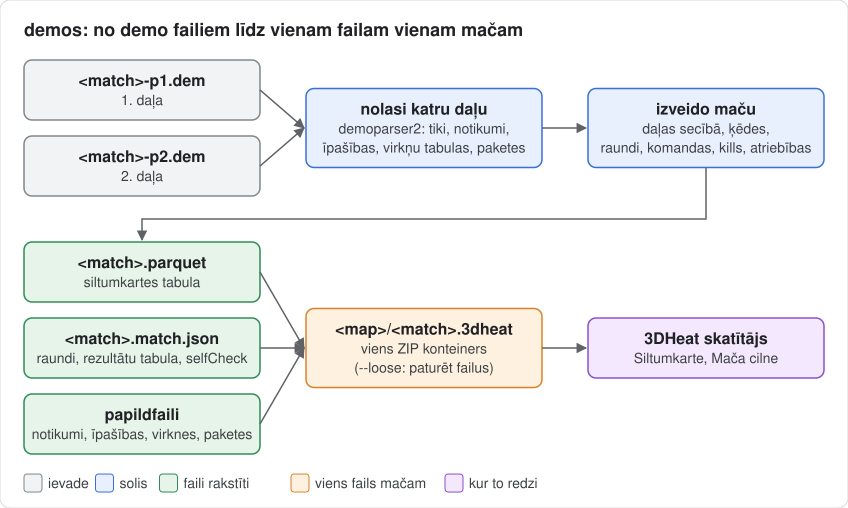

# 3DHeat CS2 {#dheat-cs2}

**Kas tas ir?** Counter-Strike 2 var saglabāt mača ierakstu, ko sauc par *demo*. Šis rīks pārvērš demo
failos, ko 3DHeat skatītājs var rādīt 3D: kur katrs stāvēja, nomira, meta granātas un iestādīja bumbu, raunds pa raundam.
Tas var arī pārvērst CS2 karti par 3D modeli, uz kura tos parādīt.

**Kāpēc to lietot?** Lai pārskatītu savus mačus, lai uzliktu vienas kartes daudzus mačus vienu virs otra kā vienu
siltumkarti un lai iegūtu maču statistiku, piemēram, ADR (vidējais bojājums raundā) un KAST (to raundu daļa,
kuros spēlētājs nogalināja, palīdzēja, izdzīvoja vai tika atriebts).

**Piemērs:** `alpha-vs-bravo-m1.dem` ieiet, `out/de_x/alpha-vs-bravo-m1.3dheat` iznāk (`de_x` ir izdomāts kartes nosaukums).



Sīkāk: 3DHeat CS2 pārvērš **Counter-Strike 2 demo** par siltumkartes tabulu un mača dokumentu katram
mačam, un **CS2 karti** par līmeņa ģeometriju. Izvade ir paredzēta
[3DHeat](https://holdi601.github.io/3DHeat/) telemetrijas skatītājam
([avots](https://github.com/Holdi601/3DHeat)), bet tie ir parasti faili - Parquet, JSON un glTF binārs -, ko var nolasīt arī cits rīks.

Tā ir neliela Python pakotne `heat3d_cs2`, ko palaiž no komandrindas. Tā nolasa demo no diska (lejupielādē
nevienu) ar [demoparser2](https://github.com/LaihoE/demoparser), un eksportē kartes no uzstādītās spēles ar
Source2Viewer komandrindas versiju ([ValveResourceFormat](https://github.com/ValveResourceFormat/ValveResourceFormat)).

## Ātrais sākums {#quick-start}

Nekad neesat strādājis ar komandrindu? Vispirms izlasiet [Pirms sākat](before-you-start.md).

```bash
pip install -r requirements.txt
python -m heat3d_cs2 demos <demo files or folders> -o out   # katrs mačs tajos
python -m heat3d_cs2 map <map> -o out/<map>/<map>.glb       # karte no uzstādītās spēles
python -m heat3d_cs2 scoreboard out/<map>/<match>.3dheat    # mača rezultātu tabula kā teksts
```

Jums vajadzētu redzēt `1 match(es), 1 at a time ...` un tad pa vienai rindai katram mačam
(skat. [Komandas](../commands.md#what-is-printed)).

`demos` katram mačam raksta vienu failu mapē, kas nosaukta pēc kartes:
`out/<map>/<match>.3dheat`, [`.3dheat` konteineris](../output-container.md) - skatītāja formāts vienam
mačam vienā failā ([specifikācija](https://holdi601.github.io/3DHeat/container.html)).
Tajā ir šie elementi; `--loose` tos raksta kā atsevišķus failus:

| Elements | Ko tas satur | Ielādē skatītāja |
|---|---|---|
| `<match>.parquet` (loma `table`) | katrs dzīvais spēlētājs astoņas reizes sekundē ar savu stāvokli (veselība, nauda, mirgošana, mērķēšana, zona, inventārs...), un katrs notikums, kur tas notika (nogalināšana, nāve, ievainojums, šāviens, metiens, granātu sprādzieni, aklums, bumbas iestādīšana, atcelšana, sprādziens, un raunda beigas katram spēlētājam ar to, ko raunds viņam atnesa), pa vienai rindai | Siltumkartes cilne |
| `<match>.match.json` (loma `match`, mača dokuments) | komandas, rezultāts, katrs raunds (uzvarētājs, kā, ekonomika, iestādīšana, nogalināšanas secībā, izšķirošie momenti, izdzīvojušie) un katra spēlētāja rezultātu tabulas rinda | Mača cilne |
| `<match>.events/props/strings/packets.parquet` | viss pārējais, ko demo satur, pilnībā (papildfaili) | paturēts pilnībā |

`map` raksta `<map>.glb`: kartes sadursmju tīklu - grīdas, sienas, kastes, bez dekorācijām -, sadalītu zemē
un struktūrā, tajā pašā sistēmā un vienībās kā tabulas, tāpēc tas guļ tieši zem siltumkartes (Līmeņa panelis).

## Dokumentācijas karte {#map-of-this-documentation}

| Lapa | Ko tā aptver |
|---|---|
| [Pirms sākat](before-you-start.md) | Python, termināls, vietturi, kā izskatās veiksme un biežākās kļūdas |
| [Uzstādīšana](../installing.md) | Python, pakotnes, Source2Viewer CLI, kur jābūt CS2 |
| [Komandas](../commands.md) | `demos`, `map`, `scoreboard`: katra iespēja, kas tiek izdrukāts, izejas kodi |
| [Demo lasīšana](../reading-demos.md) | kas tiek nolasīts no demo faila: izlasītie tiki, spēlētāju īpašības, spēles noteikumi, notikumi |
| [Mača veidošana](../building-matches.md) | daļas un ķēdes, mača pulkstenis, raundi, komandas un puses, rindas, nogalināšanas, atriebības, sākumi, bojājums, mirgošana, ekonomika |
| [Statistika](../statistics.md) | rezultātu tabula: K/D/A, ADR, KAST, HS%, sākumi, atriebības, daudznogalināšanas, izšķirošie momenti, palīgrīki, mirgošana |
| [Siltumkartes tabula](../output-table.md) | Parquet fails: katra kolonna, tās tips, kuri notikumi to aizpilda, `heat3d` kājenes norādes, asis |
| [Mača dokuments](../output-match-json.md) | `.match.json` dokuments, lauks pa laukam |
| [Viens fails vienam mačam](../output-container.md) | `.3dheat` konteiners, ko `demos` raksta pēc noklusējuma, `--loose` |
| [Kartes eksports](../map-export.md) | kā kartes sadursmju tīkls tiek eksportēts, sistēma, mezglu nosaukumi, vienības |
| [Lietošana ar 3DHeat](../using-with-3dheat.md) | tabulu, mača dokumentu un karšu ielāde skatītāja Siltumkartes un Mača cilnēs |
| [Ierobežojumi](../limits.md) | kas tiek pieņemts, kas nav apstrādāts, kas nav pārbaudīts |
| [Atjauninājumi](../updates.md) | izlaides pārbaude startējot un `python -m heat3d_update` |
| [Izstrāde](../development.md) | koda izkārtojums, testi, sintētiskā demo paraugs |
| [Komandu atsauce](../cli-reference.md) | katras komandas `--help`, ģenerēts no koda |
| [Uzturēšana](../maintaining.md) | izlaides kontrolsaraksts šīm lapām |

## Ko tas ir pārbaudīts {#what-it-is-checked-against}

Demo no reālās pasaules nav viens tīrs fails katram mačam. Pārveidotājs apstrādā mače, kas sadalīts pa failiem jebkurā
secībā, serveri, kas restartēts mača vidū, divus dažādus mačus, kas saglabāti zem viena nosaukuma, raundus, atjaunotus no
dublējuma, ierakstu, kas sācies vēlu vai beidzies agri, pauzes un treneri vienas komandas pusē -
skat. [Mača veidošana](../building-matches.md). Pārbaudīts pār lielu turnīru demo kolekciju: katrā mačā
rezultāts seko raundu uzvarētājiem, katras puses nogalināšanas ir otras puses nāves, un katrs raunds sākas ar pieciem pret pieciem.

## Ko tam norādīt {#what-to-point-it-at}

Savu maču demo, demo, ko pats lejupielādējāt no turnīru vietnes, vai demo no API, kam jums ir piekļuve. Demo ir ieraksts, kura saturs
pieder tā izdevējam un organizatoriem: izmanto to, kas iznāk, savai analīzei, un nepārdaliet demo vai no tiem atvasinātus datus. Vietnes, kas
piedāvā demo, bieži aizliedz automātisku lejupielādi savos noteikumos, tāpēc rīks nolasa demo no diska un nelejupielādē nevienu.

## Daļa no 3DHeat {#part-of-3dheat}

3DHeat CS2 ir viens no bezmaksas rīkiem ap 3DHeat skatītāju; katram ir savs repozitorijs, izlaides un licence:

| Rīks | Ko tas dara | Dokumentācija |
|---|---|---|
| [3DHeat](https://github.com/Holdi601/3DHeat) | skatītājs: 3D siltumkartes, sacensību analīze un maču pārskats | [vietne](https://holdi601.github.io/3DHeat/) |
| [GameFiles](https://github.com/Holdi601/3DHeat-GameFiles) | trases un līmeņi no spēļu piegādātajiem failiem kā 3D modeļi | [vietne](https://holdi601.github.io/3DHeat-GameFiles/) |
| [GameCapture](https://github.com/Holdi601/3DHeat-GameCapture) | braucienu telemetrija no sacensību spēlēm; līmeņi, atjaunoti no spēles video | [vietne](https://holdi601.github.io/3DHeat-GameCapture/) |
| [Unreal Exporter](https://github.com/Holdi601/3DHeat-UnrealExporter) | Unreal Editor spraudnis, kas eksportē līmeni kā vienu 3D modeli | [vietne](https://holdi601.github.io/3DHeat-UnrealExporter/) |
| [CS2](https://github.com/Holdi601/3DHeat-CS2) | Counter-Strike 2 demo tabulās un mača dokumentos; kartes 3D modeļos | [vietne](https://holdi601.github.io/3DHeat-CS2/) |
| [Watcher](https://github.com/Holdi601/3DHeat-Watcher) | ieraksta to, ko spēles publicē par jūsu spēli, fona režīmā | [vietne](https://holdi601.github.io/3DHeat-Watcher/) |
| [Ext-WarThunder](https://github.com/Holdi601/3DHeat-Ext-WarThunder) | War Thunder ieraksti tabulās un mača dokumentos | [vietne](https://holdi601.github.io/3DHeat-Ext-WarThunder/) |
| [Ext-WoT](https://github.com/Holdi601/3DHeat-Ext-WoT) | World of Tanks ieraksti tabulās un mača dokumentos | [vietne](https://holdi601.github.io/3DHeat-Ext-WoT/) |
| [Ext-WoWs](https://github.com/Holdi601/3DHeat-Ext-WoWs) | World of Warships ieraksti tabulās un mača dokumentos | [vietne](https://holdi601.github.io/3DHeat-Ext-WoWs/) |
| [Ext-Squad](https://github.com/Holdi601/3DHeat-Ext-Squad) | Squad servera demo tabulās un mača dokumentos | [vietne](https://holdi601.github.io/3DHeat-Ext-Squad/) |
| [Ext-DCS](https://github.com/Holdi601/3DHeat-Ext-DCS) | DCS World kartes 3D modeļos | [vietne](https://holdi601.github.io/3DHeat-Ext-DCS/) |
| [Ext-IL2](https://github.com/Holdi601/3DHeat-Ext-IL2) | IL-2 Sturmovik kartes 3D modeļos | [vietne](https://holdi601.github.io/3DHeat-Ext-IL2/) |

## Licence {#licence}

MIT - skat. [`LICENSE`](https://github.com/Holdi601/3DHeat-CS2/blob/main/LICENSE),
un [`LICENSES.md`](https://github.com/Holdi601/3DHeat-CS2/blob/main/LICENSES.md)
trešo pušu pakotnēm un to, ko prasa spēles, ko tas nolasa.
