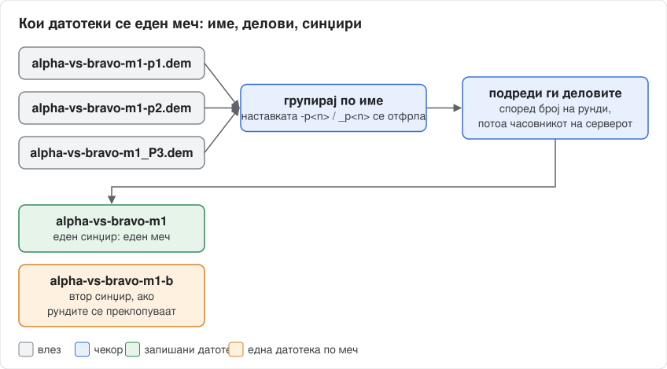

# Составување на натпревар {#building-a-match}

Како се составува натпреварот од деловите на демото: кои датотеки си припаѓаат,
еден часовник за сите, рундите и како е добиена секоја, тимовите и нивните
страни, и секој ред од табелата за топлинска мапа со убиства, размени,
отворања, штета, заслепувања и економија. Код:
[`heat3d_cs2/match.py`](https://github.com/Holdi601/3DHeat-CS2/blob/main/heat3d_cs2/match.py).
Табелата со резултати што се пресметува од него е на [Статистика](statistics.md).

## Преглед {#overview}

1. Се чита секоја датотека со името на натпреварот ([Читање демо](reading-demos.md)).
2. Во секоја датотека се решаваат дуплираните редови на играчи (вратени рунди).
3. Датотеките се редат во **синџири** - натпревари - и секој синџир се подредува.
4. Секој дел се става на **часовникот на натпреварот**.
5. Во секој дел се наоѓаат **рундите**; описот на рундата во подоцнежен дел
   го заменува оној од претходниот.
6. **Играчите** и **тимовите** се именуваат, а страните и резултатот на
   секоја рунда се даваат по име на тим. Кога страните се знаат, следуваат
   должината на полувремето, пиштолските рунди и **набавката** (buy) на
   секоја страна.
7. Се градат **редовите**: позиции, истрели, фрлања, детонации, поставувања,
   деактивирања, убиства, смртни случаи, повреди, заслепувања, експлозии.
8. Секој ред се означува со својата рунда, фаза, време во рундата, дали
   неговата страна победила и каква била набавката на страната; редовите
   надвор од сите рунди се отфрлаат.

## Вратени рунди: еден ред по играч по такт {#restored-rounds-one-row-per-player-per-tick}

Кога рунда се враќа од резервна копија во една датотека, демото неколку
секунди ги носи старите тела на играчите покрај новите: два реда за еден
играч во еден такт, едниот таму каде што го оставила поништената рунда,
другиот на местото на појавување на вратената рунда. За секој таков играч
дуплираните тактови се поминуваат **наназад**, почнувајќи од првиот единечен
ред по нив: во секој такт се задржува кандидатот најблизок до позицијата што
следува, и тој станува мерило за претходниот такт. Ако по нив нема единечен
ред, се задржува последниот кандидат. Така секој играч го задржува редот што
води до местото каде оди потоа.

## Живиот дел од датотеката {#the-live-part-of-a-file}

**Живиот почеток** на датотеката е тактот на нејзиниот последен настан
`round_announce_match_start`, или такт 0 ако нема таков (подоцнежен дел од
поделен натпревар обично нема). Сè пред живиот почеток се изоставува, исто како и
сè означено со `is_warmup_period`. Рундата со ножеви или рестартот пред
објавата затоа се изоставуваат; рунда со ножеви на која *не* следува објава
за почеток на натпреварот не се препознава како таква (видете [Ограничувања](limits.md)).

**Рундите** на датотеката се настаните `round_freeze_end` од живиот почеток
натаму, надвор од загревањето, препознаени по нивниот `total_rounds_played`
(играта го брои од 0 индексот на рундата што тукушто ќе се игра). Датотека
без такви настани нема рунди и не припаѓа на ниту еден натпревар.

## Часовникот {#the-clock}

Времињата се во секунди. Во рамките на една датотека времето се брои во
**тактови**: `game_time` на серверот во првиот семплиран такт плус тактовите
од тогаш / 64. Часовникот на серверот стои за време на пауза, додека
тактовите продолжуваат; ако се чита преку часовникот, два момента од
паузиран натпревар би го делеле истото време.

Секоја датотека има *прв часовник* (времето на живиот почеток) и *последен
часовник* (во последниот семплиран такт).

### Делови и синџири {#parts-and-chains}

Датотеките именувани како еден натпревар ([Команди](commands.md#which-files-are-one-match))
најпрво се подредуваат по индексот на нивната прва рунда, потоа по нивниот
прв часовник. Потоа секоја, по тој редослед, се приклучува кон првиот синџир
што го продолжува, или започнува нов синџир. Делот го продолжува синџирот
кога индексот на неговата прва рунда е барем колку последниот индекс на
последниот дел од синџирот, **и** важи едно од двете:

- часовникот на серверот тече натаму: неговиот прв часовник не е порано од
  последниот часовник на синџирот минус 5 s; или
- бројот на рунди тече натаму: индексот на неговата прва рунда е последниот
  индекс на синџирот или следниот.

Одлучува бројот, а часовникот ги раздвојува изедначените случаи, бидејќи
серверот рестартиран за враќање на рунда го почнува часовникот одново, додека
два различни натпревара под исто име (истите тимови на истата мапа на два настани)
имаат преклопени броеви на рунди. Синџирите се редат по бројот на рунди што
ги опфаќаат, најпрво најголемиот; првиот го задржува името на натпреварот, другите
се запишуваат како `<name>-b`, `<name>-c`, ...

### Часовникот на натпреварот {#the-match-clock}

Нулата на натпреварот е првиот часовник на првиот дел: **времето 0 на натпреварот е живиот
почеток на првата датотека**. Секој подоцнежен дел се става на него:

- таму каде што часовникот на серверот тече натаму (неговиот прв часовник не
  е порано од последниот часовник на претходниот дел минус 5 s), се користи
  часовникот на серверот како што е;
- таму каде што бил рестартиран, делот се става да следува **една секунда**
  по крајот на претходниот.

## Рунди {#rounds}

За секој `round_freeze_end` на еден дел (по редослед на тактови), прозорецот
на рундата трае до следниот крај на замрзнатото време во тој дел, или до
крајот на датотеката. Во него рундата е **одлучена** во првиот семплиран
такт каде состојбата на играта покажува `total_rounds_played` = индексот на
рундата + 1 и `round_win_status` 1 (нерешено), 2 (победиле T) или 3
(победиле CT). Рунда без таков примерок во својот прозорец била прекината од
крајот на датотеката; нејзиниот број оди во листата **incomplete** (нецелосни)
на натпреварот (освен ако друг дел ја има рундата целосна).

| Поле на рундата | Од |
|---|---|
| `number` | индексот + 1 (од 1, како што брои играта) |
| `start` | време на натпреварот на крајот на замрзнатото време - играчите можат да се движат |
| `end` | време на натпреварот на првиот примерок што ја покажува рундата како одлучена |
| `until` | време на натпреварот на следниот `round_prestart` по `end`, ако е внатре во прозорецот; инаку крајот на прозорецот или последниот такт на датотеката, што е порано (и никогаш пред `end`) |
| `winner` | `T` за статус на победа 2, `CT` за 3, празно за 1: нерешеното е одлучено, без победник |
| `reason` | `round_win_reason` во тој примерок, именуван подолу |
| `score` | име на тим -> рунди добиени по оваа: `team_rounds_total` на секоја страна во одлучувачкиот примерок; каде што демото нема, резултатот од претходната рунда плус еден за победникот |
| `sides` | име на тим -> `T` / `CT` во оваа рунда |
| `equipment` | страна -> збирот на `current_equip_value` на **живите** играчи на таа страна во првиот примерок на или по крајот на замрзнатото време |
| `buy` | страна -> `pistol`, `eco`, `force` или `full` ([Економија](#economy-and-buy-types)) |
| `plant` | првиот `bomb_planted` по крајот на замрзнатото време и до `end`, или ништо |
| `exploded` | време на натпреварот на првиот `bomb_exploded` по тоа поставување и пред следниот крај на замрзнатото време, ако има (не е во документот на натпреварот; го определува времето на редот `explode`) |

`reason`, од `CSRoundEndReason` на играта:

| Код | `reason` |
|---|---|
| 1 | `bomb` (целта е бомбардирана) |
| 7 | `defuse` |
| 8, 9 | `elimination` (CT победиле / T победиле со елиминација) |
| 10 | `draw` |
| 12 | `time` (целта е спасена) |
| 17, 18 | `surrender` |
| сè друго | `other` |

Кога повеќе делови ја содржат истата рунда (по индекс), се задржува верзијата
од подоцнежниот дел. Потоа рундите се листаат по индекс. Натпреварот чија прва
рунда не е рунда 1 ги запишува недостасувачките броеви (`missing` во
документот на натпреварот); командната линија вели *recorded from round N*.

### Поставувањето {#the-plant}

| Поле | Од |
|---|---|
| `site` | `A` или `B`: зоната за бомба во која играта вели дека стоел поставувачот (`which_bomb_zone`, 1 A, 2 B); без тоа, името на местото на поставувачот (`BombsiteA`, `BombsiteB`); без тоа, буквата што ја дало друго поставување на истата зона во истата датотека (`site` на настанот е бројот на ентитетот на зоната). Празно кога ништо не кажува - никогаш бројот. |
| `time` | секунди **во рундата** (од крајот на нејзиното замрзнато време), како времето на убиство |
| `player`, `steamid` | поставувачот |
| `x`, `y`, `z` | позицијата на поставувачот, во единици на играта: каде лежи бомбата |
| `place` | името на местото на поставувачот при поставувањето |

### Фазите {#the-phases}

Времето од `start` до `end` е **живата** (live) фаза на рундата; од `end` до
`until` е нејзината **after** фаза, во која победниците ловат, а губитниците
спасуваат. Редот и припаѓа на рундата чиј `[start, until)` го содржи неговото
време, и е `after` кога неговото време е подоцна од `end`. Замрзнатото време
лежи меѓу рундите и не е во ниту една.

## Играчи и тимови {#players-and-teams}

**Играч** е секој што бил жив барем еднаш на една страна (тим 2 или 3), надвор
од замрзнатото време и загревањето, по живиот почеток. Тренер или коментатор
на страна на тим никогаш не е жив и не е играч. Секој играч се води по Steam
ID; името е последното виденото.

**Тимот** на играчот е името на кланот што играта му го дала на неговата
страна (`team_clan_name`), она што најчесто е виденото за него - демото го
брише на самиот свој крај. Натпреварот одигран без имиња на кланови ги именува
тимовите според страната на која започнале: `Started T` и `Started CT`.

**Страните** на секоја рунда доаѓаат од тоа кој бил на која страна меѓу
крајот на замрзнатото време и крајот на рундата: на секоја страна ѝ се
дава ознаката на тимот што ја носат повеќето нејзини играчи. Листата `teams`
на натпреварот е по редослед на појавување, рунда по рунда, страната T пред CT;
обично тимот што започнал како T е прв.

## Редовите {#the-rows}

Секој примерок на позиција и секој настан станува еден ред од
[табелата за топлинска мапа](output-table.md). Играчите се на страна само
кога нивниот `team_num` е 2 или 3.

### Позиции {#positions}

Од семплираните редови на живи играчи на страна, надвор од замрзнатото време
и загревањето, по живиот почеток: позиција, насока на гледање, здравје,
оклоп, пари, вредност на опремата, држено оружје, место.

Насоката на гледање е единечен вектор во координатниот систем на играта:
`(cos pitch * cos yaw, cos pitch * sin yaw, -sin pitch)` - наклонот (pitch)
во играта е позитивен кога се гледа надолу, па гледањето надолу дава
негативно Z.

Држеното оружје е `active_weapon_name` како што го именува играта, освен што
секое име што содржи `Knife`, `Bayonet`, `Karambit` или `Daggers` станува
`Knife`.

### Истрели и фрлања {#shots-and-throws}

Од `weapon_fire`, на позицијата на стрелецот. Ножевите (`knife`, `bayonet` во
идентификаторот на оружјето) и C4 се изоставени. Гранатите (`smokegrenade`,
`flashbang`, `hegrenade`, `molotov`, `incgrenade`, `decoy`) се редови
**throw** (фрлање), сè друго се редови **shot** (истрел). Оружјето е именувано
како што го прикажува играта (подолу).

### Детонации на гранати {#grenade-detonations}

| Настан | Ред | `weapon` |
|---|---|---|
| `smokegrenade_detonate` | `smoke` | Smoke Grenade |
| `flashbang_detonate` | `flash` | Flashbang |
| `hegrenade_detonate` | `he` | High Explosive Grenade |
| `inferno_startburn` (молотов и запалива) | `molotov` | Molotov |
| `decoy_detonate` | `decoy` | Decoy Grenade |

Позицијата е **каде гранатата експлодирала** (`x`, `y`, `z` на настанот);
играчот и страната се на фрлачот. Демото не именува место за граната, само
за играчи, па `place` останува празно: редот не тврди место на кое не бил.
Местото на фрлачот во тој момент се чува како `throwerPlace`.

### Поставувања и деактивирања {#plants-and-defuses}

Редови `plant` и `defuse` на позицијата на играчот, оружје `C4 Explosive`.
Поставена бомба што експлодирала добива ред **explode**: на позицијата на
поставувањето, во времето на `bomb_exploded`, со поставувачот како играч (со
неговиот Steam ID), страна `T`, T тимот на рундата како `team` и местото на
поставувањето. Тоа вклучува и бомба што експлодира откако T веќе победиле со
елиминација. Каде демото нема `bomb_exploded`, рунда добиена со бомбата
(`reason` = `bomb`) со поставување го добива редот на `end` на рундата.

### Убиства и смртни случаи {#kills-and-deaths}

Секој `player_death` во рунда дава еден **запис за убиство** (табелата
`kills` на натпреварот) со:

| Поле | Значи |
|---|---|
| attacker, victim, assister | имиња, Steam ID-ја, страни; напаѓачот е празен за светот (штета од пад, бомбата) |
| `weapon` | оружјето од настанот, именувано како што го прикажува играта |
| `headshot` | знамето од настанот |
| `wallbang` | `penetrated` > 0 |
| `throughSmoke` | `thrusmoke` |
| `flashAssist` | `assistedflash` |
| `noscope`, `attackerBlind` | знамињата од настанот (`noscope`, `attackerblind`); колони на редовите `kill` и `death`, и во убиствата на документот на натпреварот |
| `suicide` | напаѓачот и жртвата се ист играч: на пример, своја граната |
| `teamkill` | напаѓачот и жртвата на иста страна, со напаѓач, и не самоубиство |
| `opening` | првото убиство на непријател во рундата (подолу) |
| `traded`, `trade` | подолу |
| positions | позицијата и местото на напаѓачот и на жртвата |

Од секој запис табелата добива ред **death** на позицијата на жртвата
(секоја смрт, вклучително на светот, убиства на свои и самоубиства) и - за
убиства од непријател (напаѓач, не убиство на свој, не самоубиство) - ред
**kill** на позицијата на убиецот.

**Отворање (Opening).** Првото убиство на непријател во секоја рунда додека
е жива е нејзиниот отворачки дуел. Убиство на свој, самоубиство или смрт од
светот пред него се прескокнуваат, така што отворањето останува првиот дуел
на рундата; рунда без убиство на непријател додека е жива го нема.

**Разменето (Traded)** и **размена (trade).** Смрт од непријател е
**разменета** кога нејзиниот убиец е убиен од некого од страната на жртвата
во рок од **5 секунди** по неа (повеќе од 0 и најмногу 5 s подоцна, во истата
рунда); првото такво убиство е **размена**. Во табелата, колоната `traded` на
редот `kill` е 1 за убиство-размена; онаа на редот `death` е 1 за смрт што
била осветена. Се броат и убиствата од after фазата.

### Штета {#damage}

Од `player_hurt`, само меѓу **непријатели** (двајцата на страна, различни
страни). Штетата е здравје што навистина е **изгубено**: за секоја жртва во
секоја рунда здравјето почнува од 100; секој удар брои `min(dmg_health,
здравје пред тоа)`, а `health` на настанот (што останало) станува „пред тоа“
за следниот удар. Удар во глава со штета 137 на играч со 40 здравје брои 40,
како што брои табелата со резултати на играта. Ударите од `hegrenade`,
`inferno`, `molotov` и `incgrenade` се **utility** штета. Секој удар е ред
**hurt** на позицијата на жртвата, со напаѓачот како `other`. Штетата на свои
и штетата на себе не се ниту во табелата ниту во статистиката.

### Заслепувања {#flashes}

Од `player_blind`, само **непријатели** (не соиграчи, и не тренер или
коментатор што гледа): еден ред **blind** по заслепен играч, на позицијата на
заслепениот играч, со оној што фрлил како `other`, со времето на заслепување
во секунди како `duration`. Секое времетраење се чува; статистиката брои
само заслепувања од најмалку една секунда.

## Имиња на оружја {#weapon-names}

Идентификаторот на оружје од настан (`ak47`, `weapon_ak47`, `knife_karambit`)
се прикажува како што го именува играта во `active_weapon_name` на самите
играчи, така што оружјето на убиството и држеното оружје се читаат исто:
`ak47` -> `AK-47`, `m4a1` -> `M4A4`, `m4a1_silencer` -> `M4A1-S`,
`hkp2000` -> `P2000`, `taser` -> `Zeus x27`, `inferno` и `molotov` ->
`Molotov`, `incgrenade` -> `Incendiary Grenade`, `c4` и `planted_c4` ->
`C4 Explosive`, `world` -> `World`, и така за секој пиштол и граната
(табелата `WEAPONS` во `match.py`). Сè со `knife` или `bayonet` во
идентификаторот е `Knife`. Идентификатор што не е во табелата се чува како
што е.

## Економија и видови набавка {#economy-and-buy-types}

На крајот на замрзнатото време, вредноста на опремата на секоја страна се
собира преку нејзините живи играчи во првиот примерок од тогаш натаму и се
дели со нивниот број:

| Рунда | Просечна опрема по играч | `buy` |
|---|---|---|
| пиштолска рунда (првата од секое регуларно полувреме) | било која | `pistol` |
| друга | под $1,500 | `eco` |
| друга | од $1,500 до под $4,000 | `force` |
| друга | $4,000 или повеќе | `full` |

Пиштолските рунди го следат полувремето со кое се играл натпреварот, не фиксен
формат. Полувремето завршува таму каде што страните првпат се менуваат меѓу
две рунди што следуваат една по друга, и двете регуларни: неговата должина
(`halfLength` во документот на натпреварот) е рундата пред менувањето - 12 во
форматот од 24 рунди, 15 во оној од 30. Рундата 1 и рундата по полувремето
се пиштолските рунди. Рунда е продолжение (overtime) кога бројачот на
продолженија на играта (`m_nOvertimePlaying`) е над 0 на крајот на нејзиното
замрзнато време; каде демото нема таков бројач, секоја рунда по две
полувремиња е. Полувремињата во продолжението почнуваат со пари што ги
определува серверот и немаат пиштолска рунда, иако и нивните страни се
менуваат. Снимка што никогаш не го покажува менувањето на полувремето - почнува
по него или завршува пред него - го остава полувремето непознато, и само
рундата 1 е пиштолска.

## Означување и редослед {#labelling-and-order}

На крај секој ред добива:

- `match` - името на натпреварот; `map` - мапата од заглавието на демото;
- `round` и `roundId` (`<match> #NN`, две цифри);
- `phase` - `live` или `after`;
- `roundTime` - секунди од крајот на замрзнатото време на рундата;
- `won` - 1 ако страната на редот ја добила рундата, 0 ако не, празно за ред
  без страна;
- `buy` - набавката на страната на редот во таа рунда;
- `team` - тимот на играчот на редот, по Steam ID.

Редовите чие време е во ниту една рунда - пред крајот на замрзнатото време на
првата рунда, за време на замрзнатото време, по последната рунда - се
отфрлаат. Редовите се подредуваат по време, а во рамките на едно време по
име на настан.
