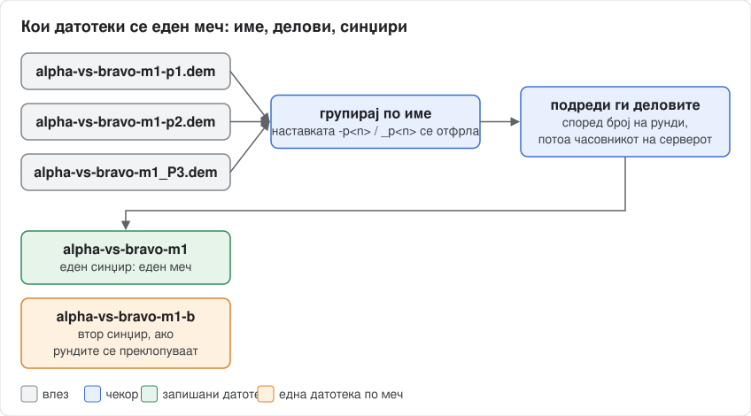
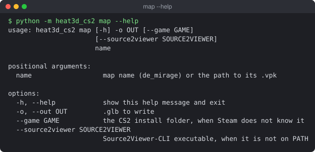

# Команди {#commands}

Нови сте со командната линија? Прво прочитајте [Пред да започнете](before-you-start.md).
Впишете ги овие во терминал отворен во папката што сте ја распакувале или
клонирале; `<...>` се места за пополнување, а патека со празни места оди во
наводници.

```text
python -m heat3d_cs2 demos <demo files or folders> -o <folder> [--every 8] [--jobs N] [--map TEXT] [--force] [--no-bulk] [--loose]
python -m heat3d_cs2 map <map name | path to its .vpk> -o <file.glb> [--game FOLDER] [--source2viewer EXE]
python -m heat3d_cs2 scoreboard <match.3dheat | match.json>
```

`python -m heat3d_cs2 --help` и `python -m heat3d_cs2 <verb> --help` ги наведуваат
истите опции; [Референцата за команди](../cli-reference.md) ги покажува сите.
Секое стартување најпрво ја врши проверката за изданија опишана во
[Ажурирања](updates.md) (се исклучува со `HEAT3D_NO_UPDATE=1`).

Код: [`heat3d_cs2/cli.py`](https://github.com/Holdi601/3DHeat-CS2/blob/main/heat3d_cs2/cli.py).

## `demos` - демоа во табели и документи за натпревари {#demos---demos-into-tables-and-match-documents}

```powershell
python -m heat3d_cs2 demos D:\Demos\event -o out
python -m heat3d_cs2 demos alpha-vs-bravo-m1-p1.dem alpha-vs-bravo-m1-p2.dem -o out
python -m heat3d_cs2 demos D:\Demos -o out --map final --jobs 4
```

| Аргумент | Стандардно | Што прави |
|---|---|---|
| `paths` (еден или повеќе) | - | датотеки и папки со демоа. Датотеката се зема кога нејзината наставка е `.dem` (со било кои букви). Папката се пребарува **рекурзивно** за датотеки што завршуваат на `.dem`, со било кои букви, по азбучен ред. Компресираните демоа (`.dem.zst`, `.dem.bz2`, архиви) не се читаат: прво распакувајте ги. |
| `-o`, `--out` | задолжително | папката во која се пишува; се создава по потреба |
| `--every N` | `8` | семплира секој играч на секои *N* тактови. Демоата на CS2 одат со 64 тактови во секунда, па 8 е осум примероци во секунда, 4 е шеснаесет, 64 е еден. Настаните секогаш се читаат на својот такт, без оглед на *N*. |
| `--jobs N` | `0` = половина од јадрата на процесорот | колку натпревари се претвораат истовремено, секој во свој процес. Никогаш помалку од 1, никогаш повеќе отколку што има натпревари за обработка. |
| `--map TEXT` | - | само натпревари чие **име** го содржи *TEXT*, без разлика на големина на букви (`--map final`). Филтрира по името на датотеката, не по мапата што демото всушност ја содржи. |
| `--force` | исклучено | претвора и натпревари што се веќе запишани, пребришувајќи ги |
| `--loose` | исклучено | го чува секој натпревар како одделни датотеки - табела, `.match.json`, придружни датотеки - наместо да се спакуваат во еден контејнер `.3dheat`. Видете [Една датотека по натпревар](output-container.md). |
| `--container` | вклучено | го пакува секој натпревар во една датотека `.3dheat`; стандардно е така, па постои само за да биде изрично |
| `--no-bulk` | исклучено | го изоставува потокот на ентитети, командите на играчите и потокот на анимации од придружната датотека со пакети - над половина од големината на демото дури и компресирано. Самопроверката на документот на натпреварот потоа ги брои како `lost`, по име. |


### Кои датотеки се еден натпревар {#which-files-are-one-match}



Името на натпреварот е името на датотеката со демо без наставката и без наставка
за дел: `-p<цифри>` или `_p<цифри>` на крајот, со било кои букви. Значи
`alpha-vs-bravo-m1-p1.dem`, `alpha-vs-bravo-m1-p2.dem` и
`alpha-vs-bravo-m1_P3.dem` се делови од еден натпревар, `alpha-vs-bravo-m1`.
Датотеките се групираат само по тоа име - две датотеки со исто име во
различни папки исто така се групираат.

Наставката ништо не кажува за редоследот: `-p2` може да е ран дел. Деловите
се редат според бројот на рунди што ги содржат, а потоа според часовникот на
серверот, а група што излегува дека содржи два различни натпревара (на пример,
истите тимови на истата мапа на два настани) се дели на **синџири**: синџирот
со најмногу рунди се запишува под самото име, следниот како `<name>-b`, потоа
`<name>-c`, и така натаму. Датотека без ниту една рунда (само загревање,
пауза) не припаѓа на ниту еден синџир. Како се наоѓаат синџирите е опишано во
[Составување на натпревар](building-matches.md#parts-and-chains).

### Што се запишува {#what-is-written}

За секој натпревар, во папка именувана по мапата што ја именува заглавието на
демото (`unknown` кога не именува ниедна), една датотека `.3dheat`:

```text
out/
  de_x/
    alpha-vs-bravo-m1.3dheat
    alpha-vs-bravo-m2.3dheat
  de_y/
    ...
```

На синтетичкото демо од две рунди од тестовите:


Со `--loose` секој натпревар е табелата, неговиот документ за натпревар и четири
придружни датотеки една покрај друга
([Една датотека по натпревар](output-container.md)):


Топлинската мапа е за една мапа, па вчитувањето на една папка во прегледувачот
е вчитување на натпреварите на една мапа. Видете [Табелата за топлинска мапа](output-table.md) и
[Документот на натпреварот](output-match-json.md).

### Што се прескокнува {#what-is-skipped}

Пред да се прочита што било, се набројува секој `*.3dheat` каде било под `--out`
(контејнерот се пишува цел или воопшто не), и секој `*.parquet` покрај кој
стои неговиот документ за натпревар (`<name>.match.json`), а натпревар чие име е еднакво
на името на една од тие датотеки (без наставка) се прескокнува, освен со
`--force`. Табела без нејзиниот документ за натпревар - пишувањето на двете
прекинато на половина - не се брои, па тој натпревар се претвора повторно.
Проверката е само по име: натпревар претворен во друга папка за мапа, или со друг
`--every`, сепак се смета за завршен. Кога нема што да се работи:

```text
nothing to do: no demos found, or every match already written (--force redoes them)
```

### Што се печати {#what-is-printed}

Најпрво количината на работа, потоа по една линија за секој натпревар кога ќе
заврши (по редоследот на завршување, не по редоследот на датотеките):

```text
3 match(es), 3 at a time
alpha-vs-bravo-m1: de_x, 21 rounds (Alpha 13 Bravo 8), 412,377 rows, lost 0
alpha-vs-bravo-m2: de_y, 30 rounds (Bravo 16 Alpha 14), 598,104 rows, 1 incomplete round(s) left out, lost 0
alpha-vs-bravo-m3: de_y, 18 rounds (Alpha 13 Bravo 5), 330,981 rows, recorded from round 3, lost 1,204,331 (svc_PacketEntities, svc_UserCmds, DEM_AnimationData)
```

(Броевите се илустративни.) Резултатот е на последната рунда, тим по тим по
редоследот во кој ги наведува документот на натпреварот. *incomplete round(s) left out*
ги брои рундите што демото ги прекинало пред да бидат одлучени; *recorded from
round N* вели дека снимањето почнува доцна; *lost* е самопроверката на
документот на натпреварот - колку ставки од демото отишле никаде, и од кои видови
(`--no-bulk` го прави најголемиот дел изгубен). Натпревар што не дава ништо кажува
зошто:

```text
alpha-vs-bravo-m4: no round in 1 file(s) - nothing written
alpha-vs-bravo-m4-b: no complete round in 1 file(s) - nothing written
```

Грешка во еден натпревар не ги запира другите; се печати како
`<name>: failed - <error>`.

### Излезен код {#exit-code}

`0` кога секој натпревар е претворен (или немало што да се работи), `1` кога барем
еден не успеал.

### Колку трае {#how-long-it-takes}

Секој натпревар се чита и гради во работнички процес. Папка со неколкусто демоа
трае неколку минути со стандардниот `--jobs`. Меморијата по задача расте со
должината на натпреварот и со помал `--every`: секој работник го држи секој
семплиран ред на играч од својот натпревар (приближно десет играчи пати 64 / *N*
реда во секунда снимка) пред пишувањето.

Придружните датотеки траат подолго од табелата: секое својство што го чита
парсерот се чита на секој такт, по прозорец од тактови, (околу две минути за
демо од 40 минути, најмногу близу 3 GB меморија по задача), а потоа демото се
поминува уште еднаш за неговите рамки и пораки.

## `map` - геометријата на мапата како `.glb` {#map---a-maps-geometry-as-glb}



```powershell
python -m heat3d_cs2 map <map> -o out/<map>/<map>.glb
python -m heat3d_cs2 map <map> -o <map>.glb --game "D:\Games\Steam\steamapps\common\Counter-Strike Global Offensive"
python -m heat3d_cs2 map "D:\maps\<map>.vpk" -o <map>.glb --source2viewer C:\Tools\Source2Viewer-CLI.exe
```

| Аргумент | Стандардно | Што прави |
|---|---|---|
| `name` | - | името на мапата (како `de_x`), или патеката до нејзиниот `.vpk`. Патека што завршува на `.vpk` и постои се користи како што е; сè друго се бара по името на датотеката во инсталираната игра. |
| `-o`, `--out` | задолжително | `.glb` што се пишува; неговата папка се создава по потреба |
| `--game FOLDER` | библиотеките на Steam | инсталационата папка на CS2 (онаа што содржи `game\csgo`), кога Steam не ја знае. Со `--game` се пребарува само таа папка. |
| `--source2viewer EXE` | `HEAT3D_SOURCE2VIEWER`, потоа `PATH` | извршната датотека на Source2Viewer CLI |

Се печати при успех:

```text
out/de_x/de_x.glb: de_x, 412,880 triangles (151,204 ground) in 14 parts
```

(броевите се илустративни). Пишувањето на `.glb` до табелите на мапата
(`out/<map>/<map>.glb`) ги држи податоците и геометријата на мапата во една
папка. Како функционира извозот: [Извоз на мапа](map-export.md).

Грешки, секоја се печати како `error: ...` со излезен код `2`:

| Порака | Значи |
|---|---|
| `no de_x.vpk found in an installed CS2 - pass --game <CS2 folder> or the .vpk path` | мапата не е во ниту една најдена библиотека на Steam, или името е погрешно |
| `Source2Viewer-CLI not found: ...` | ниту `--source2viewer`, `HEAT3D_SOURCE2VIEWER`, `PATH` не дале постоечка датотека |
| `Source2Viewer did not export de_x's collision mesh:` проследено со крајот на неговиот излез | не успеал, или не запишал `.glb` |
| `de_x's collision mesh has nothing but clip brushes` | по изоставувањето на клиповите и небото не останало ништо |

## `scoreboard` - натпревар како текст {#scoreboard---a-match-as-text}

```bash
python -m heat3d_cs2 scoreboard out/de_x/alpha-vs-bravo-m1.3dheat
python -m heat3d_cs2 scoreboard out/de_x/alpha-vs-bravo-m1.match.json   # after demos --loose
```

Ја печати табелата со резултати на натпреварот од неговиот
[документ за натпревар](output-match-json.md), без отворање на прегледувачот. Го
чита документот внатре во контејнер `.3dheat`, или одделен `<match>.match.json`.
На синтетичкото демо од две рунди од тестовите:


```text
alpha-vs-bravo-m1 - de_test  Alpha 2  Bravo 0

Alpha
player                 K   D   A  +/-    ADR   KAST   HS%  OK-OD  clutch
ash                    1   0   0   +1   50.0 100.0%    0%   0-0     1/1
ace                    1   1   0   +0   50.0 100.0%  100%   1-0     0/0

Bravo
player                 K   D   A  +/-    ADR   KAST   HS%  OK-OD  clutch
ben                    1   1   0   +0   50.0 100.0%    0%   0-0     0/1
bob                    0   1   0   -1    0.0 100.0%    0%   0-1     0/0

rounds  1:TK 2:TB
```

- Првата линија: име на натпреварот, мапа и конечниот резултат по тим.
- Една табела по тим, по редоследот на `teams` во документот на натпреварот;
  играчите по редоследот во документот на натпреварот (убиства минус смрти, потоа
  убиства, најдобриот први). Имињата се скратени на 19 знаци.
- Колони: **K** убиства, **D** смрти, **A** асистенции *вклучувајќи* асистенции
  со блесок, **+/-** убиства минус смрти, **ADR**, **KAST** (%), **HS%**
  (заокружено на цел процент), **OK-OD** отворачки убиства - отворачки смрти,
  **clutch** добиени клачеви / одиграни клачеви. Дефиниции: [Статистика](statistics.md).
- Лентата на рунди: `<рунда>:<победничка страна><како>`, каде **B** бомбата
  експлодирала, **D** деактивирана, **K** елиминација, **T** истечено време, и
  **?** за сè друго (нерешено, предавање, друго). Нерешеното нема победничка
  страна: `<рунда>:?`.

Датотека што не е валиден JSON, или не е пронајдена, запира со грешка; JSON
документ без полињата на документот на натпреварот пропаѓа со грешка на Python (не
се валидира понатаму).
