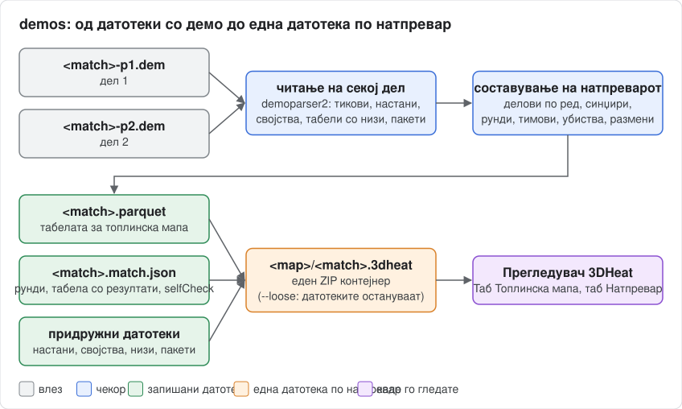

# 3DHeat CS2 {#dheat-cs2}

**Што е тоа?** Counter-Strike 2 може да зачува снимка од натпревар, наречена
*демо*. Оваа алатка го претвора демото во датотеки што прегледувачот 3DHeat може да ги прикаже во 3D:
каде стоел, загинувал, фрлал и поставувал секој, рунда по рунда. Може и да
претвори мапа од CS2 во 3D модел врз кој ќе се прикажува.

**Зошто би ја користел?** За да ги прегледате вашите сопствени натпревари, да наредите многу натпревари на
една мапа еден врз друг како една топлинска мапа, и за статистики на натпреварот како ADR
(просечна штета по рунда) и KAST (уделот на рунди во кои играчот убил,
асистирал, преживеал или бил разменет).

**Пример:** `alpha-vs-bravo-m1.dem` влегува, `out/de_x/alpha-vs-bravo-m1.3dheat`
излегува (`de_x` е измислено име на мапа).



Подетално: 3DHeat CS2 претвора **демоа од Counter-Strike 2** во табела за топлинска мапа и документ за натпревар
по натпревар, и **мапа од CS2** во геометрија на ниво. Излезите се направени
за прегледувачот за телеметрија [3DHeat](https://holdi601.github.io/3DHeat/)
([изворен код](https://github.com/Holdi601/3DHeat)), но тие
се обични датотеки - Parquet, JSON и glTF бинарна - што може да ги чита и
сè друго.

Тоа е мал пакет на Python, `heat3d_cs2`, што се пушта од командната линија. Чита
демоа од диск (не презема ниту едно) со
[demoparser2](https://github.com/LaihoE/demoparser), а ги извезува мапите од
инсталираната игра со командно-линиската верзија на Source2Viewer
([ValveResourceFormat](https://github.com/ValveResourceFormat/ValveResourceFormat)).

## Брз почеток {#quick-start}

Нови сте со командната линија? Прво прочитајте [Пред да започнете](before-you-start.md).

```bash
pip install -r requirements.txt
python -m heat3d_cs2 demos <demo files or folders> -o out   # every match in them
python -m heat3d_cs2 map <map> -o out/<map>/<map>.glb       # the map from the installed game
python -m heat3d_cs2 scoreboard out/<map>/<match>.3dheat    # a match's scoreboard as text
```

Треба да видите `1 match(es), 1 at a time ...` и потоа по една линија за секој натпревар
(видете [Команди](commands.md#what-is-printed)).

`demos` пишува, за секој натпревар, една датотека во папка именувана по мапата:
`out/<map>/<match>.3dheat`, [контејнер `.3dheat`](output-container.md) - форматот
на прегледувачот со една датотека по натпревар ([спецификација](https://holdi601.github.io/3DHeat/container.html)).
Ги содржи овие членови; `--loose` ги пишува како одделни датотеки наместо тоа:

| Член | Што содржи | Се вчитува во |
|---|---|---|
| `<match>.parquet` (улога `table`) | секој жив играч осум пати во секунда со неговата состојба (здравје, пари, блесок, зумирање, зона, инвентар, ...), и секој настан таму каде што се случил (убиство, смрт, повреда, истрел, фрлање, детонации на гранати, заслепување, поставување, расклопување, експлозија, и крај на рунда по играч со тоа што рундата му го платила), по еден ред | табот Топлинска мапа |
| `<match>.match.json` (улога `match`, документот за натпреварот) | тимови, резултат, секоја рунда (победник, како, економија, поставување, убиства по редослед, clutches, преживеани) и линијата на секој играч од табелата со резултати | табот Натпревар |
| `<match>.events/props/strings/packets.parquet` | сè друго што демото го содржи, целосно (придружни датотеки) | чувано за комплетност |

`map` пишува `<map>.glb`: мрежата за колизија на мапата - подови, ѕидови, кутии,
без декорација - поделена на терен и структура, во истата рамка и
единици како табелите, па лежи точно под топлинската мапа (панел Позадина / ниво).

## Карта на оваа документација {#map-of-this-documentation}

| Страница | Што опфаќа |
|---|---|
| [Пред да започнете](before-you-start.md) | Python, терминал, места за пополнување, како изгледаат успехот и честите грешки |
| [Инсталирање](installing.md) | Python, пакетите, CLI на Source2Viewer, каде мора да биде CS2 |
| [Команди](commands.md) | `demos`, `map`, `scoreboard`: секоја опција, што се печати, излезни кодови |
| [Читање демо](reading-demos.md) | што се чита од датотека со демо: семплирани тикови, својства на играчи, правила на играта, настани |
| [Составување на натпревар](building-matches.md) | делови и синџири, часовникот на натпреварот, рунди, тимови и страни, редови, убиства, размени (trades), отворања, штета, блесоци, економија |
| [Статистики](statistics.md) | табелата со резултати: K/D/A, ADR, KAST, HS%, отворања, размени, повеќекратни убиства, clutches, помошни средства (utility), блесоци |
| [Табелата за топлинска мапа](output-table.md) | датотеката Parquet: секоја колона, нејзиниот тип, кои настани ја пополнуваат, навестувањата `heat3d` во подножјето, оските |
| [Документот на натпреварот](output-match-json.md) | документот `.match.json`, поле по поле |
| [Една датотека по натпревар](output-container.md) | контејнерот `.3dheat` што `demos` го пишува стандардно, `--loose` |
| [Извоз на мапа](map-export.md) | како се извезува мрежата за колизија на мапата, рамката, именувањето на јазлите, единиците |
| [Користење со 3DHeat](using-with-3dheat.md) | вчитување табели, документи за натпревари и мапи во табовите Топлинска мапа и Натпревар на прегледувачот |
| [Ограничувања](limits.md) | што се претпоставува, што не се обработува, што не е проверено |
| [Ажурирања](updates.md) | проверката за издание при стартување и `python -m heat3d_update` |
| [Развој](development.md) | распоред на кодот, тестови, синтетичкото демо |
| [Упатство за команди](../cli-reference.md) | `--help` на секоја команда, генерирано од кодот |
| [Одржување](maintaining.md) | списокот за проверка при издание за овие страници |

## Со што е проверено {#what-it-is-checked-against}

Демоата од природа не се една чиста датотека по натпревар. Конверторот обработува
натпревар поделен во датотеки по кој било редослед, сервер рестартиран среде натпревар, два
различни натпревара зачувани под едно име, рунди вратени од резервна копија, снимка
што почнува доцна или завршува рано, паузи и тренери на страната на тим -
видете [Составување на натпревар](building-matches.md). Проверено врз голема збирка
турнирски демоа: во секој натпревар
резултатот го следи победникот на рундите, убиствата на секоја страна се смртите на другата
и секоја рунда почнува пет против пет.

## Врз што да го насочите {#what-to-point-it-at}

Демоата од вашите сопствени натпревари, демоа што сте ги презеле рачно од сајт за турнири,
или демоа од API до кој имате пристап. Демото е снимка чија содржина
им припаѓа на нејзиниот издавач и организатори: користете го она што излегува за вашата сопствена
анализа, и не редистрибуирајте демоа или податоци изведени од нив. Сајтовите што
нудат демоа често го забрануваат автоматското преземање во своите услови, поради што
алатката чита демоа од диск и не презема ниту едно.

## Дел од 3DHeat {#part-of-3dheat}

3DHeat CS2 е една од бесплатните алатки околу прегледувачот 3DHeat, секоја со свое
складиште, свои изданија и лиценца:

| Алатка | Што прави | Документација |
|---|---|---|
| [3DHeat](https://github.com/Holdi601/3DHeat) | прегледувачот: топлински мапи, анализа на трки и преглед на натпревари во 3D | [сајт](https://holdi601.github.io/3DHeat/) |
| [GameFiles](https://github.com/Holdi601/3DHeat-GameFiles) | патеки и нивоа од датотеките што ги испорачуваат игрите, како 3D модели | [сајт](https://holdi601.github.io/3DHeat-GameFiles/) |
| [GameCapture](https://github.com/Holdi601/3DHeat-GameCapture) | телеметрија на кругови од тркачки игри; нивоа обновени од видео од игра | [сајт](https://holdi601.github.io/3DHeat-GameCapture/) |
| [Unreal Exporter](https://github.com/Holdi601/3DHeat-UnrealExporter) | приклучок за Unreal Editor што извезува ниво како еден 3D модел | [сајт](https://holdi601.github.io/3DHeat-UnrealExporter/) |
| [CS2](https://github.com/Holdi601/3DHeat-CS2) | демоа од Counter-Strike 2 во табели и документи за натпревари; мапи во 3D модели | [сајт](https://holdi601.github.io/3DHeat-CS2/) |
| [Watcher](https://github.com/Holdi601/3DHeat-Watcher) | снима што играта објавува за вашата игра, во заднина | [сајт](https://holdi601.github.io/3DHeat-Watcher/) |
| [Ext-WarThunder](https://github.com/Holdi601/3DHeat-Ext-WarThunder) | снимки од War Thunder во табели и документи за натпревари | [сајт](https://holdi601.github.io/3DHeat-Ext-WarThunder/) |
| [Ext-WoT](https://github.com/Holdi601/3DHeat-Ext-WoT) | снимки од World of Tanks во табели и документи за натпревари | [сајт](https://holdi601.github.io/3DHeat-Ext-WoT/) |
| [Ext-WoWs](https://github.com/Holdi601/3DHeat-Ext-WoWs) | снимки од World of Warships во табели и документи за натпревари | [сајт](https://holdi601.github.io/3DHeat-Ext-WoWs/) |
| [Ext-Squad](https://github.com/Holdi601/3DHeat-Ext-Squad) | демоа од Squad сервери во табели и документи за натпревари | [сајт](https://holdi601.github.io/3DHeat-Ext-Squad/) |
| [Ext-DCS](https://github.com/Holdi601/3DHeat-Ext-DCS) | мапи од DCS World во 3D модели | [сајт](https://holdi601.github.io/3DHeat-Ext-DCS/) |
| [Ext-IL2](https://github.com/Holdi601/3DHeat-Ext-IL2) | мапи од IL-2 Sturmovik во 3D модели | [сајт](https://holdi601.github.io/3DHeat-Ext-IL2/) |

## Лиценца {#licence}

MIT - видете [`LICENSE`](https://github.com/Holdi601/3DHeat-CS2/blob/main/LICENSE),
и [`LICENSES.md`](https://github.com/Holdi601/3DHeat-CS2/blob/main/LICENSES.md)
за пакетите од трети страни и што обврзуваат играта што ја чита.
