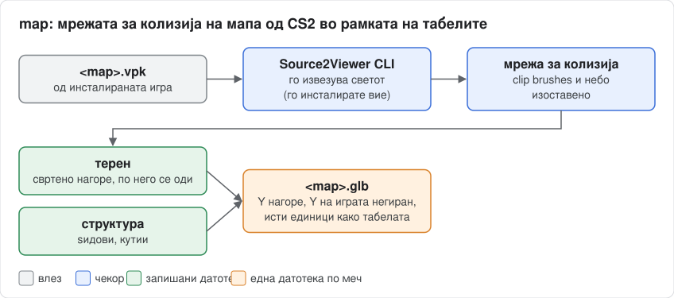

# Извоз на мапа (`map`) {#map-export-map}

`python -m heat3d_cs2 map <map> -o <file.glb>` пишува мапа од CS2 како
геометрија на ниво: **колизионата мрежа** на светот, во координатниот систем и
единиците во кои се цртаат [табелите за топлинска мапа](output-table.md).
Код:
[`heat3d_cs2/mapexport.py`](https://github.com/Holdi601/3DHeat-CS2/blob/main/heat3d_cs2/mapexport.py),
[`heat3d_cs2/glb.py`](https://github.com/Holdi601/3DHeat-CS2/blob/main/heat3d_cs2/glb.py).
Опции и пораки: [Команди](commands.md#map---a-maps-geometry-as-glb).



## Зошто колизионата мрежа {#why-the-collision-mesh}

Колизионата мрежа е она врз што стојат играчите и зад што се кријат - подови,
ѕидови, скали, кутии - без украсите: без реквизити што само изгледаат како
нешто, без текстури, со многу помалку триаголници од мрежите за приказ. Тоа
му треба на топлинската мапа под себе: нешто спрема што ќе се читаат
позициите, а не приказ на мапата.

## Како се добива {#how-it-is-obtained}

1. **Најдете ја мапата.** Патека што завршува на `.vpk` и постои се користи како
   што е дадена. Инаку `<name>.vpk` се бара во
   `<CS2 folder>\game\csgo\maps\`, каде што папката на CS2 е `--game`, или
   `steamapps\common\Counter-Strike Global Offensive` во секоја најдена
   библиотека на Steam (видете [Инсталирање](installing.md#where-cs2-is-looked-for)).
2. **Најдете го CLI на Source2Viewer**: `--source2viewer`, потоа
   `HEAT3D_SOURCE2VIEWER`, потоа `Source2Viewer-CLI` / `Source2Viewer-CLI.exe`
   на `PATH`.
3. **Извезете ја физиката на светот.** Source2Viewer се извршува како

   ```text
   Source2Viewer-CLI -i <map>.vpk -d -f maps/<map>/world_physics.vmdl_c --gltf_export_format glb -o <temporary folder>
   ```

   Ја декодира компилираната физика на Source 2 од сопствената архива на
   мапата и го пишува моделот (празен: светот нема своја мрежа за приказ) и
   неговата физика покрај него. Најголемиот запишан `.glb` е физиката. Ако
   Source2Viewer не успее или не запише `.glb`, командата запира и ги
   покажува последните 800 знаци од својот излез и од своите грешки.
4. **Прочитајте го.** Секој јазол на сцената се поминува со својата
   трансформација (матрица, или преместување-ротација-размер), и се зема
   секој примитив од триаголници, со или без бафер на индекси, во светски
   позиции.
5. **Изоставете го она што не е ѕид или под.** Јазол чие име содржи `clip` -
   клипови за играчи, клипови за NPC, клипови за гранати: невидливите ѕидови
   што ги запираат играчите и гранатите - или `sky`, со било кои букви, се
   отфрла.
6. **Именувајте ја површината.** Физичките групи се именувани по својата
   површина; името со мали букви, со отстранет почетен `physics`,
   `physics_group` или `physics_passbullets` (и долната црта по него) е
   површината: `physics_group_concrete` е `concrete`,
   `physics_passbullets_chainlink` е `chainlink`, самиот `physics_group` е
   `world`. Површините низ кои поминуваат куршумите се задржуваат.
7. **Назад во координатниот систем на играта.** Source2Viewer пишува glTF во
   метри со Y нагоре: (Y, Z, X) на играта помножено со 0,0254. Тоа се
   поништува - секоја точка станува (X, Y, Z) на играта во инчи.
8. **Разделете ја земјата од структурата**, триаголник по триаголник: страната
   чија нормала покажува нагоре најмалку 0,7 (нејзината Z компонента,
   нормализирана) - падини до околу 45 степени, приближно најстрмното по што
   оди играч на CS2 - е **земја (ground)**; сè друго, вклучително ѕидови и
   тавани, е **структура (structure)**.
9. **Во координатниот систем на прегледувачот.** Секоја точка се пишува како
   (X, Z, -Y): Y нагоре, Y на играта негирано - системот во кој прегледувачот
   ги црта табелите, кога ги следи нивните `heat3d` навестувања. Ротација, не
   огледало.
10. **Запишете го `.glb`.** Ако не остане ништо (само клип-бруштата), командата
    запира со грешка. Инаку ги печати датотеката, мапата, бројот на
    триаголници, колку се земја и бројот на делови.

Овде ништо не чита друго освен сопствениот `.vpk` на мапата, и ништо од
Source2Viewer не е вградено ниту копирано.

## Датотеката {#the-file}

Бинарен glTF 2.0 (`.glb`), еден бафер, запишан од `heat3d_cs2` (полето
`asset.generator`):

| Аспект | Што |
|---|---|
| Јазли | по еден на дел, сите на коренот, без трансформации, секој со своја мрежа со исто име |
| Имиња на јазли | `ground:<surface>` или `structure:<surface>` (`ground:concrete`, `structure:metal`, `structure:world`), подредени по име |
| Примитиви | еден по мрежа, триаголници, `POSITION` (float32, со min/max) и `NORMAL` (float32), индекси `uint32` |
| Сенчење | рамно: едно теме по агол на триаголник, секое го носи нормалата на својот триаголник |
| Материјали, текстури, UV, бои | нема |
| Единици | единици на играта (**инчи**), не метри - за разлика од она што го претпоставува glTF |
| Координатен систем | (X, Z, -Y) на играта: Y на glTF е висината на играта, Z на glTF е -Y на играта |

Префиксот `ground:` / `structure:` е конвенција на сите извозници на нивоа на
3DHeat: прегледувачот го зема делот именуван така на збор, наместо да погодува
од геометријата, па подовите добиваат сенчење на земја, а ѕидовите цртање на
структура без чекор на класификација.

Бидејќи единиците се инчи, друг glTF прегледувач ја покажува мапата околу 39
пати преголема (ги чита како метри); таму скалирајте со 0,0254 ако е важно. Во
3DHeat лежи точно под табелата, која е во истите единици со размер 1.

## Проверката дека координатниот систем е точен {#the-check-that-the-frame-is-right}

Тестот `test_players_stand_on_the_exported_floor` (се извршува само кога се
дадени демо и Source2Viewer, видете [Развој](development.md#tests)) ја извезува
мапата на која е играно демото, зема 300 случајни примероци на позиција од
натпреварот, и за секој гледа право надолу за највисокиот триаголник на земја најмногу
4 единици над стопалата на играчот. Бара најмалку 98 % од примероците да
најдат земја, и медијаната на висината над неа да е под 5 единици. Огледална
мапа го паѓа: на мапа огледана по погрешна оска, голем дел од играчите стојат
над ништо. README ги известува бројките од оваа проверка за мапите од
тековниот натпреварувачки базен.

## Што не прави {#what-it-does-not-do}

- Нема геометрија за приказ, текстури ниту украси - видете *зошто* погоре.
- Се извезува само она што е во моделот `world_physics` на мапата. Дали се
  во него подвижните делови (врати) или разбивливите работи не е проверено.
- Нема поедноставување: прегледувачот 3DHeat поедноставува при увоз со својата
  поставка **Цел на поедноставувањето**.
- Мапи што не се во инсталираната игра (мапи од работилница на друго место на
  дискот) работат кога нивниот `.vpk` се дава како патека и содржи
  `maps/<name>/world_physics.vmdl_c`; не е потврдено.
