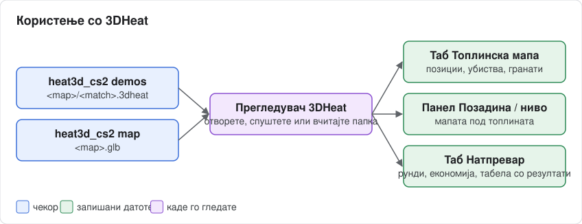

# Користење со 3DHeat {#using-it-with-3dheat}

Излезите одат на овие места во [прегледувачот 3DHeat](https://holdi601.github.io/3DHeat):

| Датотека | Каде | Што дава |
|---|---|---|
| `<match>.3dheat` (стандардно) | таб **Топлинска мапа**, панел **Извор**, или табот **Натпревар** | табелата и документот на натпреварот заедно, една датотека по натпревар ([контејнер](https://holdi601.github.io/3DHeat/container.html)) |
| `<match>.parquet` | таб **Топлинска мапа**, панел **Извор** | позиции и настани како топлинска мапа, реприза со кутии, рути |
| `<match>.match.json` | таб **Натпревар**, **Вчитај датотеки на натпревари…** | табелата со резултати, рундите, листата на убиства, статистика низ натпревари, врски во топлинската мапа |
| `<map>.glb` | панел **Позадина / ниво**, **3D-модел…** | мапата под топлинската мапа |

Документацијата на самиот прегледувач го опишува секој таб целосно: неговите
страници [Анализа на натпревар](https://holdi601.github.io/3DHeat/match-analysis.html),
[Вчитување датотеки](https://holdi601.github.io/3DHeat/loading-files.html),
[Мапирање колони](https://holdi601.github.io/3DHeat/column-mapping.html)
и [Реприза со кутии](https://holdi601.github.io/3DHeat/box-replay.html).
Оваа страница е страната на CS2.



Прегледувачот: [github.com/Holdi601/3DHeat](https://github.com/Holdi601/3DHeat),
документација [holdi601.github.io/3DHeat](https://holdi601.github.io/3DHeat/).

## Типична сесија {#a-typical-session}

```bash
python -m heat3d_cs2 demos D:\Demos\event -o out
python -m heat3d_cs2 map <map> -o out/<map>/<map>.glb
```

1. **Таб Топлинска мапа -> Извор:** изберете ја папката `out/<map>` (или
   пуштете ја врз прегледувачот). Секој `.parquet` во неа станува еден сет на
   податоци; датотеките `.json` и `.glb` од истата папка се прескокнуваат како
   „не е csv/parquet датотека“. Вчитајте го.
2. **Позадина / ниво -> 3D-модел…:** изберете `out/<map>/<map>.glb`.
   **Зачувај во библиотеката** го чува во прегледувачот за следниот пат.
3. **Таб Натпревар -> Вчитај датотеки на натпревари…:** изберете ги
   датотеките `.match.json` од истата папка (повеќе одеднаш), или пуштете ги
   врз прегледувачот додека табот Натпревар е отворен.

Вчитувајте табели само од една мапа одеднаш: координатите на различни мапи се
преклопуваат, а топлинска мапа од две мапи одеднаш не значи ништо. Папката по
мапа е за тоа.

## Табелата се отвора без ништо да се подесува {#the-table-opens-with-nothing-to-set}

Прегледувачот го чита записот `heat3d` во подножјето на првата избрана
датотека ([Табелата за топлинска мапа](output-table.md#the-heat3d-footer-hints))
и го става врз своите погодувања:

| Поставка на прегледувачот | Поставена на |
|---|---|
| Позиција | `x`, `y`, `z` |
| Оска нагоре во изворот | Z е нагоре |
| Преврти Y | вклучено - за мапата да е на вистинската страна, не огледална |
| Скала на единицата | 1 - растојанија во единици на играта (означени „m“; 1 единица = 1 инч) |
| Време | `time`, секунди |
| ID на личност | `player` |
| Тим / група | `side` (T / CT) |
| Сесија / натпревар | `roundId` - секоја рунда е сесија, `<match> #NN` |
| Насока на гледање | вектор, `dirX` / `dirY` / `dirZ` |
| Колони за филтрирање | `event`, `match`, `round`, `roundTime`, `phase`, `weapon`, `place`, `won`, `buy`, `opening`, `team` |
| Големина на ентитет | 32 - репризата со кутии црта играч широк 32 единици, со зрак на гледање од 4 x 32 |

Секоја навестена вредност сепак се гледа во мапирањето на колоните и може да
се смени. Другите колони (`headshot`, `traded`, `other`, `steamid`, `health`,
`money`, `damage`, `duration`, ...) таму можат да се додадат рачно како филтри.

Држете ја скалата на единицата на 1 кога е вчитана мапа: `.glb` е во истите
единици на играта, а нивото не се прескалира со табелата.

### Корисни филтри {#useful-filters}

- `event` = `position` за каде биле играчите; `kill` / `death` за каде
  дуелите биле добиени и изгубени; `smoke`, `flash`, `molotov`, `he` за каде
  паднале помагалата; `throw` за од каде биле фрлени; `plant` за места на
  поставување.
- `side` (групата) = `T` или `CT`, `phase` = `live` за да се изостави after
  фазата, `buy` = `eco` / `force` / `full` за рунди со една економија,
  `won` = 1 за рунди што ги добила страната на редот.
- `opening` = 1 со `kill` и `death` за отворачките дуели.
- `roundTime` како опсег за момент од рундата: првите 20 секунди, по
  поставувањето.

## Табот Натпревар {#the-match-tab}

Табот Натпревар прима JSON датотека чиј `format` е `heat3d-cs2-match` и која има
низи `rounds`, `players` и `teams`
([Документот на натпреварот](output-match-json.md)). Покажува резултат и полувремиња,
лента од рунди обоена по победничката страна со ознака како завршила секоја,
економија, поставување, листа на убиства, клачеви и преживеани на секоја рунда,
табелата со резултати, и статистика низ сите вчитани натпревари.

Неговите врски **Прикажи на топлинската мапа** не вчитуваат ништо: поставуваат
филтри на табелата што е веќе вчитана во табот Топлинска мапа - `match`,
`round` (и сесијата на рундата `<match> #NN`), `event`, играчот, страната. Тоа
работи затоа што документот на натпреварот и табелата носат исти имиња на натпревари,
броеви на рунди, имиња на играчи и страни. **Повтори рунда** ја префрла
топлинската мапа на реприза со кутии и ја пушта сесијата на рундата од
почетокот.

Затоа вчитајте ги и двете: табелите на мапата во табот Топлинска мапа, нивните
документи на натпревари во табот Натпревар. Документ на натпревар без неговата табела
сепак ги покажува табелата со резултати и рундите, а врските кажуваат дека
нема вчитани податоци за топлинска мапа.

## Без 3DHeat {#without-3dheat}

- Табелата е обичен Parquet: pandas, Polars, DuckDB, Spark, `arrow` на R сите
  ја читаат, записот `heat3d` се игнорира, а текстуалните колони се читаат како
  низи или категории.
- Документот на натпреварот е обичен JSON.
- Мапата е валиден бинарен glTF, во инчи а не во метри: скалирајте со 0,0254
  за алатки што претпоставуваат метри. Нејзиниот координатен систем е сопствениот
  на glTF (Y нагоре), па за да ја наслоите табелата на друго место, нацртајте
  го (x, y, z) на секој ред како (x, z, -y), како што прави 3DHeat.
