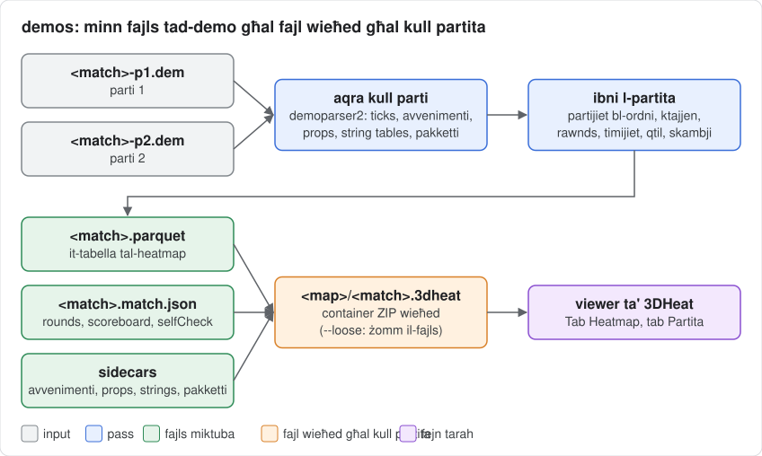

# 3DHeat CS2 {#dheat-cs2}

**X'inhi?** Counter-Strike 2 jista' jsalva reġistrazzjoni ta' partita, imsejħa
*demo*. Din l-għodda tibdel demo f'fajls li l-viewer ta' 3DHeat jista' juri f'3D:
fejn kulħadd kien, miet, xeħet u poġġa l-bomba, rawnd b'rawnd. Tista' wkoll
tibdel mappa ta' CS2 f'mudell 3D biex turihom fuqha.

**Għaliex nużaha?** Biex tirrevedi l-partiti tiegħek, biex tqiegħed ħafna partiti
ta' mappa waħda fuq xulxin bħala heatmap waħda, u għall-istatistika tal-partiti bħal ADR
(dannu medju għal kull rawnd) u KAST (is-sehem tar-rawnds li plejer qatel,
assista, baqa' ħaj jew ġie mibdul).

**Eżempju:** `alpha-vs-bravo-m1.dem` jidħol, `out/de_x/alpha-vs-bravo-m1.3dheat`
joħroġ (`de_x` huwa isem ta' mappa magħmul).



B'aktar dettall: 3DHeat CS2 jibdel **demos ta' Counter-Strike 2** f'tabella tal-heatmap u dokument
tal-partita għal kull partita, u **mappa ta' CS2** f'ġeometrija ta' livell. L-outputs huma magħmulin
għall-viewer tat-telemetrija ta' [3DHeat](https://holdi601.github.io/3DHeat/)
([sors](https://github.com/Holdi601/3DHeat)), imma huma
fajls ordinarji - Parquet, JSON u glTF binarju - li kull ħaġa oħra tista'
taqra wkoll.

Huwa pakkett żgħir ta' Python, `heat3d_cs2`, imħaddem mil-linja tal-kmandi. Jaqra
demos mid-disk (ma jniżżel xejn) b'
[demoparser2](https://github.com/LaihoE/demoparser), u jesporta mapep mil-
logħba installata bil-build tal-linja tal-kmandi ta' Source2Viewer
([ValveResourceFormat](https://github.com/ValveResourceFormat/ValveResourceFormat)).

## Bidu veloċi {#quick-start}

Ġdid mal-linja tal-kmandi? Aqra [Qabel ma tibda](before-you-start.md) l-ewwel.

```bash
pip install -r requirements.txt
python -m heat3d_cs2 demos <demo files or folders> -o out   # every match in them
python -m heat3d_cs2 map <map> -o out/<map>/<map>.glb       # the map from the installed game
python -m heat3d_cs2 scoreboard out/<map>/<match>.3dheat    # a match's scoreboard as text
```

Għandek tara `1 match(es), 1 at a time ...` u mbagħad linja waħda għal kull partita
(ara [Kmandi](../commands.md#what-is-printed)).

`demos` jikteb, għal kull partita, fajl wieħed f'folder imsemmi għall-mappa:
`out/<map>/<match>.3dheat`, [container `.3dheat`](../output-container.md) - il-
format tal-viewer ta' fajl wieħed għal kull partita ([speċifikazzjoni](https://holdi601.github.io/3DHeat/container.html)).
Iżomm dawn il-membri; `--loose` jiktibhom bħala fajls separati minflok:

| Membru | X'iżomm | Mgħabbi fil-viewer |
|---|---|---|
| `<match>.parquet` (rwol `table`) | kull plejer ħaj tmien darbiet fis-sekonda bl-istat tiegħu (saħħa, flus, flash, scoped, żona, inventarju, ...), u kull avveniment fejn seħħ (qtil, mewt, hurt, sparatura, tixrid, ibbumbardjar tal-granati, blind, plant, defuse, explode, u tmiem ta' rawnd għal kull plejer b'dak li r-rawnd ħallsu), ringiela waħda kull wieħed | tab Heatmap |
| `<match>.match.json` (rwol `match`, id-dokument tal-partita) | timijiet, punteġġ, kull rawnd (rebbieħ, kif, ekonomija, plant, qtil bl-ordni, clutches, superstiti) u l-linja tal-iscoreboard ta' kull plejer | tab Partita |
| `<match>.events/props/strings/packets.parquet` | kull ħaġa oħra li fiha d-demo, sħiħa (sidecars) | miżmuma għall-kompletezza |

`map` jikteb `<map>.glb`: il-mesh tal-kollużjoni tal-mappa - art, ħitan, kaxxi,
mingħajr dekorazzjoni - maqsum f'art u struttura, fl-istess frame u
unitajiet bħat-tabelli, allura jinsab eżatt taħt il-heatmap (pannell Sfond / livell).

## Mappa ta' din id-dokumentazzjoni {#map-of-this-documentation}

| Paġna | X'tkopri |
|---|---|
| [Qabel ma tibda](before-you-start.md) | Python, terminal, placeholders, kif jidhru s-suċċess u l-iżbalji komuni |
| [Installazzjoni](../installing.md) | Python, il-pakketti, is-CLI ta' Source2Viewer, fejn irid ikun CS2 |
| [Kmandi](../commands.md) | `demos`, `map`, `scoreboard`: kull għażla, x'jistampa, exit codes |
| [Qari ta' demo](../reading-demos.md) | x'jinqara minn fajl tad-demo: ticks kampjonati, proprjetajiet tal-plejers, regoli tal-logħba, avvenimenti |
| [Bini ta' partita](../building-matches.md) | partijiet u ktajjen, l-arloġġ tal-partita, rawnds, timijiet u nħat, ringieli, qtil, skambji, openings, dannu, flashes, ekonomija |
| [Statistika](../statistics.md) | l-iscoreboard: K/D/A, ADR, KAST, HS%, openings, trades, multi-kills, clutches, utility, flashes |
| [It-tabella tal-heatmap](../output-table.md) | il-fajl Parquet: kull kolonna, it-tip tagħha, liema avvenimenti jimlewha, il-hints tal-footer `heat3d`, l-assi |
| [Id-dokument tal-partita](../output-match-json.md) | id-dokument `.match.json`, qasam b'qasam |
| [Fajl wieħed għal kull partita](../output-container.md) | il-container `.3dheat` li `demos` jikteb b'mod awtomatiku, `--loose` |
| [Esportazzjoni tal-mappa](../map-export.md) | kif jiġi esportat il-mesh tal-kollużjoni ta' mappa, il-frame, l-ismijiet tan-nodes, unitajiet |
| [L-użu ma' 3DHeat](../using-with-3dheat.md) | tgħabbija ta' tabelli, dokumenti tal-partiti u mapep fit-tabs Heatmap u Partita tal-viewer |
| [Limiti](../limits.md) | x'hu assunt, x'ma jiġix ittrattat, x'mhux ivverifikat |
| [Aġġornamenti](../updates.md) | il-kontroll tar-rilaxx fil-bidu u `python -m heat3d_update` |
| [Żvilupp](../development.md) | layout tal-kodiċi, testijiet, il-fixture tad-demo sintetika |
| [Referenza tal-kmandi](../cli-reference.md) | il-`--help` ta' kull kmand, iġġenerat mill-kodiċi |
| [Manutenzjoni](../maintaining.md) | il-lista ta' kontroll tar-rilaxx għal dawn il-paġni |

## Kontra x'inhu ikkontrollat {#what-it-is-checked-against}

Id-demos tad-dinja vera mhumiex fajl nadif wieħed għal kull partita. Il-konvertitur jittratta
partita maqsuma f'diversi fajls fi kwalunkwe ordni, server li ġie rristartjat f'nofs partita, żewġ
partiti differenti maħżuna taħt isem wieħed, rawnds restawrati minn backup, reġistrazzjoni li tibda tard jew
tispiċċa kmieni, pawżi, u coaches fuq in-naħa ta' tim -
ara [Bini ta' partita](../building-matches.md). Ikkontrollat fuq kollezzjoni kbira
ta' demos ta' tournaments: f'kull partita l-punteġġ isegwi r-rebbieħa tar-rawnds, il-qtil ta' kull naħa huwa l-mwiet tan-naħa l-oħra,
u kull rawnd jibda ħamsa kontra ħamsa.

## Lejn xiex tindirizzah {#what-to-point-it-at}

Id-demos tal-partiti tiegħek stess, demos li niżżilt b'idejk minn sit ta' tournament, jew
demos minn API li għandek aċċess għalih. Demo hija reġistrazzjoni li l-kontenut tagħha
jappartjeni lill-pubblikatur u lill-organizzaturi tagħha: uża dak li joħroġ għall- analiżi
tiegħek stess, u tiddistribwixxix demos jew dejta derivata minnhom. L-għodda taqra d-demos
mid-diska u ma tniżżel l-ebda waħda, u xejn mil-logħba ma jitqassam magħha: l-ebda fajl
tal-logħba, l-ebda kodiċi tal-logħba, l-ebda DLL.

3DHeat CS2 mhuwiex affiljat ma' Valve u mhuwiex approvat minn Valve. Counter-Strike 2 u
l-ismijiet u t-trademarks relatati jappartjenu lis-sidien tagħhom. Detenturi tad-drittijiet:
iftħu issue fuq
[github.com/Holdi601/3DHeat-CS2/issues](https://github.com/Holdi601/3DHeat-CS2/issues) -
nwieġbu malajr u nneħħu kull ħaġa fuq talba.

## Parti minn 3DHeat {#part-of-3dheat}

3DHeat CS2 hija waħda mill-għodod b'xejn madwar il-viewer ta' 3DHeat, kull waħda
repożitorju tagħha bir-rilaxxi u l-liċenzja tagħha:

| Għodda | X'tagħmel | Dokumenti |
| --- | --- | --- |
| [3DHeat](https://github.com/Holdi601/3DHeat) | il-viewer: heatmaps, analiżi tat-tlielaq u reviżjoni tal-partiti f'3D | [sit](https://holdi601.github.io/3DHeat/) |
| [GameFiles](https://github.com/Holdi601/3DHeat-GameFiles) | korsijiet u livelli mill-fajls li jipprovdu l-logħob, bħala mudelli 3D | [sit](https://holdi601.github.io/3DHeat-GameFiles/) |
| [GameCapture](https://github.com/Holdi601/3DHeat-GameCapture) | telemetrija tal-laps minn logħob tat-tlielaq; livelli mibnija mill-ġdid minn vidjo tal-logħba | [sit](https://holdi601.github.io/3DHeat-GameCapture/) |
| [Unreal Exporter](https://github.com/Holdi601/3DHeat-UnrealExporter) | plugin ta' Unreal Editor li jesporta livell bħala mudell 3D wieħed | [sit](https://holdi601.github.io/3DHeat-UnrealExporter/) |
| [CS2](https://github.com/Holdi601/3DHeat-CS2) | demos ta' Counter-Strike 2 f'tabelli u dokumenti tal-partiti; mapep f'mudelli 3D | [sit](https://holdi601.github.io/3DHeat-CS2/) |
| [Watcher](https://github.com/Holdi601/3DHeat-Watcher) | jirrekordja fl-isfond dak li l-logħob jippubblikaw dwar il-logħob tiegħek | [sit](https://holdi601.github.io/3DHeat-Watcher/) |
| [Ext-WarThunder](https://github.com/Holdi601/3DHeat-Ext-WarThunder) | replays ta' War Thunder f'tabelli u dokumenti tal-partiti | [sit](https://holdi601.github.io/3DHeat-Ext-WarThunder/) |
| [Ext-WoT](https://github.com/Holdi601/3DHeat-Ext-WoT) | replays ta' World of Tanks f'tabelli u dokumenti tal-partiti | [sit](https://holdi601.github.io/3DHeat-Ext-WoT/) |
| [Ext-WoWs](https://github.com/Holdi601/3DHeat-Ext-WoWs) | replays ta' World of Warships f'tabelli u dokumenti tal-partiti | [sit](https://holdi601.github.io/3DHeat-Ext-WoWs/) |
| [Ext-Squad](https://github.com/Holdi601/3DHeat-Ext-Squad) | demos tas-server ta' Squad f'tabelli u dokumenti tal-partiti | [sit](https://holdi601.github.io/3DHeat-Ext-Squad/) |
| [Ext-DCS](https://github.com/Holdi601/3DHeat-Ext-DCS) | mapep ta' DCS World f'mudelli 3D | [sit](https://holdi601.github.io/3DHeat-Ext-DCS/) |
| [Ext-IL2](https://github.com/Holdi601/3DHeat-Ext-IL2) | mapep ta' IL-2 Sturmovik f'mudelli 3D | [sit](https://holdi601.github.io/3DHeat-Ext-IL2/) |

## Liċenzja {#licence}

MIT - ara [`LICENSE`](https://github.com/Holdi601/3DHeat-CS2/blob/main/LICENSE)
u [`LICENSES.md`](https://github.com/Holdi601/3DHeat-CS2/blob/main/LICENSES.md)
għall-pakketti ta' terzi.
