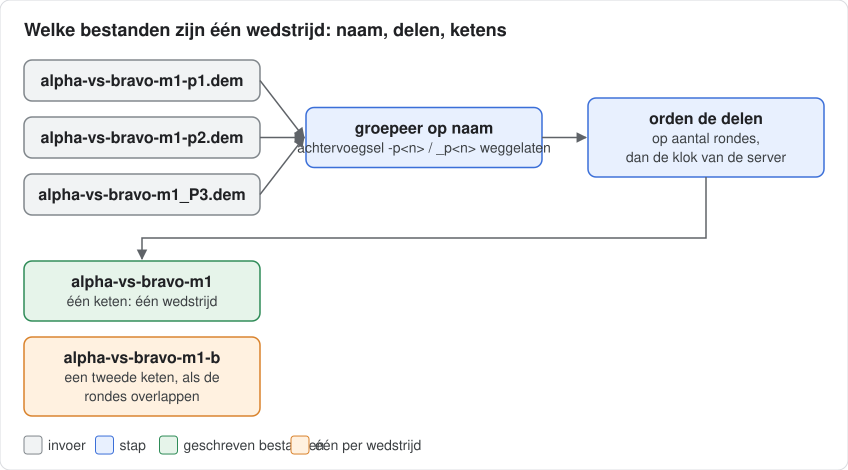

# Een wedstrijd opbouwen {#building-a-match}

Hoe een wedstrijd uit zijn demo-delen wordt gemaakt: welke bestanden bij elkaar horen, één klok over alle delen heen, de rondes en hoe elke ronde is gewonnen, de teams en hun kanten, en elke rij van de heatmaptabel met kills, trades, openingen, schade, flitsen en economie. Code:
[`heat3d_cs2/match.py`](https://github.com/Holdi601/3DHeat-CS2/blob/main/heat3d_cs2/match.py).
Het scorebord dat hieruit wordt berekend staat op [Statistieken](statistics.md).

## Overzicht {#overview}

1. Elk bestand van een matchnaam wordt gelezen ([Een demo lezen](reading-demos.md)).
2. De dubbele speler-rijen van elk bestand (herstelde rondes) worden opgelost.
3. De bestanden worden gesorteerd in **ketens** - matches - en elke keten wordt in de juiste volgorde gezet.
4. Elk deel wordt op de **matchklok** geplaatst.
5. De **rondes** worden in elk deel gevonden; het verslag van een latere deel over een ronde vervangt dat van een eerder deel.
6. De **spelers** en **teams** krijgen een naam, en de kanten en score van elke ronde worden per teamnaam gegeven. Als de kanten bekend zijn, volgen de lengte van de helft, de pistoolrondes en de **buy** van elke kant.
7. De **rijen** worden opgebouwd: posities, schoten, worpen, ontploffingen, plantingen, defusies, kills, doden, geraakt worden, verblindingen, explosies.
8. Elke rij krijgt een label met zijn ronde, fase, rondetijd, of zijn kant de ronde won, en de buy van zijn kant; rijen buiten elke ronde vallen weg.

## Herstelde rondes: één rij per speler per tick {#restored-rounds-one-row-per-player-per-tick}

Wanneer een ronde binnen één bestand uit een back-up is hersteld, bewaart de demo voor enkele seconden de oude lichamen van de spelers naast de nieuwe: twee rijen voor één speler op één tick, één waar de ongeldige ronde hen achterliet, en één op de spawn van de herstelde ronde. Voor elke zo'n speler worden de dubbele ticks **achteruit** doorlopen, vanaf de eerste enkele rij erna: op elke tick wordt de kandidaat behouden die het dichtst bij de positie ligt die volgt, en die wordt de referentie voor de tick ervoor. Is er geen enkele rij erna, dan wordt de laatste kandidaat behouden. Zo houdt elke speler de rij die vooruit leidt naar waar hij daarna naartoe gaat.

## Het live-deel van een bestand {#the-live-part-of-a-file}

Het **live-begin** van een bestand is de tick van de laatste `round_announce_match_start`-gebeurtenis, of tick 0 als die er niet is (een later deel van een gesplitste wedstrijd heeft er meestal geen). Alles vóór het live-begin valt weg, en ook alles wat is gemarkeerd als `is_warmup_period`. Een knife-ronde of een herstart vóór de aankondiging valt dus weg; een knife-ronde die *niet* gevolgd wordt door een aankondiging van de wedstrijdstart wordt niet herkend (zie [Beperkingen](limits.md)).

De **rondes** van een bestand zijn de `round_freeze_end`-gebeurtenissen vanaf het live-begin, buiten de warmup, herkenbaar aan hun `total_rounds_played` (de nul-gebaseerde index van de ronde die nog gespeeld moet worden van de game). Een bestand zonder die gebeurtenissen heeft geen rondes en hoort bij geen enkele match.

## De klok {#the-clock}

Tijden staan in seconden. Binnen een bestand wordt de tijd geteld in **ticks**: de `game_time` van de server bij het eerste bemonsterde tick, plus de ticks sindsdien / 64. De klok van de server zelf staat stil tijdens een pauze terwijl de ticks doorlopen; via die klok zouden twee momenten van een gepauzeerde wedstrijd dezelfde tijd krijgen.

Elk bestand heeft een *eerste klok* (de tijd bij zijn live-begin) en een *laatste klok* (bij zijn laatste bemonsterde tick).

### Delen en ketens {#parts-and-chains}

Bestanden die als één match zijn benoemd ([Commando's](commands.md#welke-bestanden-zijn-één-match)) worden eerst gesorteerd op de index van hun eerste ronde, en daarna op hun eerste klok. Dan voegt elk bestand, in die volgorde, toe aan de eerste keten waarop het aansluit, of het begint een nieuwe keten. Een deel sluit aan op een keten wanneer de index van zijn eerste ronde minstens de index is van de laatste ronde van het laatste deel van de keten, **en** één van de volgende geldt:

- de klok van de server loopt door: zijn eerste klok is niet eerder dan de laatste klok van de keten min 5 s; of
- het rondetal loopt door: de index van zijn eerste ronde is de index van de laatste ronde van de keten, of de ronde daarna.

Het rondetal beslist en de klok lost gelijkspel op, omdat een server die is herstart om een ronde te herstellen zijn klok opnieuw begint, terwijl twee verschillende wedstrijden onder één naam (dezelfde teams op dezelfde map op twee evenementen) overlappende rondetallen hebben. Ketens worden gesorteerd op het aantal rondes dat ze omvatten, het meeste eerst; de eerste houdt de matchnaam, de andere krijgen `<naam>-b`, `<naam>-c`, ...

### De matchklok {#the-match-clock}

Het nulpunt van de match is de eerste klok van het eerste deel: **matchtijd 0 is het live-begin van het eerste bestand**. Elk later deel wordt erop geplaatst:

- waar de klok van de server doorloopt (zijn eerste klok is niet eerder dan de laatste klok van het vorige deel min 5 s), wordt de klok van de server gebruikt zoals hij is;
- waar hij is herstart, wordt het deel geplaatst om **één seconde** na het einde van het vorige deel te volgen.

## Rondes {#rounds}

Voor elke `round_freeze_end` van een deel (in tickvolgorde) loopt het venster van de ronde tot de volgende freeze end in dat deel, of tot het einde van het bestand. Binnen dat venster wordt de ronde **beslist** op het eerste bemonsterde tick waar de spelstatus `total_rounds_played` = de index van de ronde + 1 toont en `round_win_status` 1 (gelijkspel), 2 (T won) of 3 (CT won). Een ronde zonder zo'n monster in zijn venster werd afgebroken door het einde van het bestand; haar nummer gaat naar de **incomplete**-lijst van de match (tenzij een ander deel de ronde compleet heeft).

| Rondeveld | Komt van |
|---|---|
| `number` | de index + 1 (1-gebaseerd, zoals de game telt) |
| `start` | matchtijd van het einde van de freeze time - spelers kunnen bewegen |
| `end` | matchtijd van het eerste monster dat de ronde beslist toont |
| `until` | matchtijd van de volgende `round_prestart` na `end`, als die binnen het venster ligt; anders het einde van het venster of het laatste tick van het bestand, wat eerder komt (en nooit vóór `end`) |
| `winner` | `T` voor winstatus 2, `CT` voor 3, leeg voor 1: een gelijkspel is beslist, zonder winnaar |
| `reason` | `round_win_reason` op dat monster, benoemd zoals hieronder |
| `score` | teamnaam -> rondes gewonnen na deze: de `team_rounds_total` van elke kant op het beslissende monster; waar de demo die niet heeft, de score van de vorige ronde plus één voor de winnaar |
| `sides` | teamnaam -> `T` / `CT` in deze ronde |
| `equipment` | kant -> de opgetelde `current_equip_value` van de **levende** spelers van die kant op het eerste monster op of na freeze end |
| `buy` | kant -> `pistol`, `eco`, `force` of `full` ([Economie](#economie-en-buy-typen)) |
| `plant` | de eerste `bomb_planted` na freeze end en tot `end`, of geen |
| `exploded` | matchtijd van de eerste `bomb_exploded` na die plant en vóór de volgende freeze end, als die er is (niet in het matchdocument; die bepaalt de tijd van de `explode`-rij) |

`reason`, uit de `CSRoundEndReason` van de game:

| Code | `reason` |
|---|---|
| 1 | `bomb` (doel gebombardeerd) |
| 7 | `defuse` |
| 8, 9 | `elimination` (CT's winnen / T's winnen door eliminatie) |
| 10 | `draw` |
| 12 | `time` (doel bewaard) |
| 17, 18 | `surrender` |
| al het andere | `other` |

Als meerdere delen dezelfde ronde bevatten (op index), wordt de versie van het latere deel bewaard. De rondes worden daarna op index gesorteerd. Een match waarvan de eerste ronde niet ronde 1 is, noteert de ontbrekende nummers (`missing` in het matchdocument); de opdrachtregel zegt *recorded from round N*.

### De plant {#the-plant}

| Veld | Komt van |
|---|---|
| `site` | `A` of `B`: de bomzone waarin de game zegt dat de planter stond (`which_bomb_zone`, 1 A, 2 B); zonder dat de plaatsnaam van de planter (`BombsiteA`, `BombsiteB`); zonder ook dat de letter die een andere plant van hetzelfde bestand in dezelfde zone kreeg (het `site`-veld van de gebeurtenis is het entiteitsnummer van de zone). Leeg als niets iets zegt - nooit het nummer. |
| `time` | seconden **in de ronde** (sinds de freeze end), zoals bij een kill |
| `player`, `steamid` | de planter |
| `x`, `y`, `z` | de positie van de planter, in game-eenheden: waar de bom ligt |
| `place` | de plaatsnaam van de planter bij de plant |

### De fasen {#the-phases}

De tijd van `start` tot `end` is de **live**-fase van de ronde; van `end` tot `until` is het de **after**-fase, waar de winnaars jagen en de verliezers sparen. Een rij hoort bij de ronde wier `[start, until)` haar tijd bevat, en is `after` wanneer haar tijd later is dan `end`. Freeze time ligt tussen de rondes in en hoort bij geen enkele.

## Spelers en teams {#players-and-teams}

Een **speler** is iedereen die minstens één keer levend was aan een kant (team 2 of 3), buiten freeze time en warmup, na het live-begin. Een coach of een caster aan de kant van een team is nooit levend en is geen speler. Elke speler wordt bepaald aan de hand van zijn Steam-ID; de naam is de laatste die is gezien.

Het **team** van een speler is de clannaam die de game aan zijn kant gaf (`team_clan_name`), de naam die het vaakst voor hem is gezien - de demo wist die aan het allerlaatste eind. Een match zonder clannamen noemt zijn teams naar de kant waarmee ze begonnen: `Started T` en `Started CT`.

De **kanten** van elke ronde komen van wie aan welke kant stond tussen freeze end en het einde van de ronde: elke kant krijgt het teamlabel dat de meeste van haar spelers dragen. De lijst `teams` van de match staat in volgorde van verschijnen, ronde voor ronde, T-kant voor CT-kant; meestal staat het team dat op T begon eerst.

## De rijen {#the-rows}

Elk positiemonster en elke gebeurtenis wordt één rij van de [heatmaptabel](output-table.md). Spelers staan alleen aan een kant wanneer hun `team_num` 2 of 3 is.

### Posities {#positions}

Uit de bemonsterde rijen van levende spelers aan een kant, buiten freeze time en warmup, na het live-begin: positie, kijkrichting, gezondheid, pantser, geld, waarde van de uitrusting, het wapen in de hand, plek.

De kijkrichting is een eenheidsvector in het assenstelsel van de game:
`(cos pitch * cos yaw, cos pitch * sin yaw, -sin pitch)` - de pitch van de game is positief als je naar beneden kijkt, dus kijken naar beneden geeft een negatieve Z.

Het wapen in de hand is `active_weapon_name` zoals de game het noemt, behalve dat elke naam met `Knife`, `Bayonet`, `Karambit` of `Daggers` `Knife` wordt.

### Schoten en worpen {#shots-and-throws}

Uit `weapon_fire`, op de positie van de schutter. Messen (`knife`, `bayonet` in de wapen-id) en de C4 vallen weg. Granaten (`smokegrenade`, `flashbang`, `hegrenade`, `molotov`, `incgrenade`, `decoy`) worden **throw**-rijen, al het andere **shot**-rijen. Het wapen wordt genoemd zoals de game het toont (hieronder).

### Ontploffingen van granaten {#grenade-detonations}

| Gebeurtenis | Rij | `weapon` |
|---|---|---|
| `smokegrenade_detonate` | `smoke` | Smoke Grenade |
| `flashbang_detonate` | `flash` | Flashbang |
| `hegrenade_detonate` | `he` | High Explosive Grenade |
| `inferno_startburn` (molotov en incendiary) | `molotov` | Molotov |
| `decoy_detonate` | `decoy` | Decoy Grenade |

De positie is **waar de granaat afging** (de `x`, `y`, `z` van de gebeurtenis); de speler en kant zijn die van de gooier. De demo noemt geen plek voor een granaat, alleen voor spelers, dus `place` blijft leeg: een rij beweert geen plek waar hij niet was. De plek van de gooier op dat moment wordt bewaard als `throwerPlace`.

### Planten en defusen {#plants-and-defuses}

`plant`- en `defuse`-rijen op de positie van de speler, wapen `C4 Explosive`. Een geplante bom die afging krijgt een **explode**-rij: op de positie van de plant, op het tijdstip van `bomb_exploded`, met de planter als speler (met zijn Steam-ID), kant `T`, het T-team van de ronde als `team`, en de plek van de plant. Dat omvat ook een bom die afgaat nadat de T's al door eliminatie hebben gewonnen. Waar de demo geen `bomb_exploded` heeft, krijgt een ronde die door de bom is gewonnen (`reason` = `bomb`) met een plant de rij op het `end` van de ronde.

### Kills en doden {#kills-and-deaths}

Elke `player_death` in een ronde levert één **killrecord** op (de tabel `kills` van de match) met:

| Veld | Is |
|---|---|
| attacker, victim, assister | namen, Steam-ID's, kanten; de aanvaller is leeg bij de wereld (valschade, de bom) |
| `weapon` | het wapen van de gebeurtenis, zoals de game het toont |
| `headshot` | de vlag van de gebeurtenis |
| `wallbang` | `penetrated` > 0 |
| `throughSmoke` | `thrusmoke` |
| `flashAssist` | `assistedflash` |
| `noscope`, `attackerBlind` | de vlaggen van de gebeurtenis (`noscope`, `attackerblind`); kolommen van de `kill`- en `death`-rijen, en in de kills van het matchdocument |
| `suicide` | aanvaller en slachtoffer zijn dezelfde speler: bijvoorbeeld een eigen granaat |
| `teamkill` | aanvaller en slachtoffer aan dezelfde kant, met een aanvaller, en geen suïcide |
| `opening` | de eerste kill van een vijand in de ronde (hieronder) |
| `traded`, `trade` | hieronder |
| posities | de positie en plek van de aanvaller en van het slachtoffer |

Uit elk record krijgt de tabel een **death**-rij op de positie van het slachtoffer (elke dood, ook die door de wereld, teamkills en suïcides) en - voor kills door een vijand (een aanvaller, geen teamkill, geen suïcide) - een **kill**-rij op de positie van de killer.

**Opening.** De eerste kill van een vijand in elke ronde terwijl die live is, is zijn openingsduel. Een teamkill, een suïcide of een dood door de wereld ervoor wordt overgeslagen, dus de opening is nog steeds het eerste duel van de ronde; een ronde zonder kill van een vijand terwijl ze live is, heeft geen opening.

**Traded** en **trade.** Een dood door een vijand is **traded** wanneer zijn killer binnen **5 seconden** daarna door iemand van de kant van het slachtoffer wordt gedood (meer dan 0 en hoogstens 5 s later, in dezelfde ronde); de eerste zo'n kill is een **trade**-kill. In de tabel is de kolom `traded` van een `kill`-rij 1 voor een trade-kill; die van een `death`-rij is 1 voor een dood dat gewroken is. Kills van de after-fase tellen ook mee.

### Schade {#damage}

Uit `player_hurt`, alleen tussen **vijanden** (beide aan een kant, verschillende kanten). De schade is gezondheid die daadwerkelijk **verloren** is: voor elk slachtoffer in elke ronde begint de gezondheid op 100; elke treffer telt `min(dmg_health, health voor de treffer)`, en de `health` van de gebeurtenis (wat er nog over is) wordt de "voor"-waarde van de volgende treffer. Een headshot van 137 schade op een speler met 40 gezondheid telt 40, zoals het scorebord van de game dat telt. Treffers van `hegrenade`, `inferno`, `molotov` en `incgrenade` zijn **utility**-schade. Elke treffer is een **hurt**-rij op de positie van het slachtoffer, de aanvaller als `other`. Teamschade en zelfschade staan niet in de tabel en niet in de statistieken.

### Flitsen {#flashes}

Uit `player_blind`, alleen **vijanden** (geen teamgenoten, en geen coach of caster die meekijkt): één **blind**-rij per verblinde speler, op de positie van de geflitste speler, de flitser als `other`, de duur van de verblinding in seconden als `duration`. Elke duur wordt bewaard; de statistieken tellen alleen verblindingen van minstens één seconde.

## Wapennamen {#weapon-names}

Een wapen-id uit een gebeurtenis (`ak47`, `weapon_ak47`, `knife_karambit`) wordt getoond zoals de game het noemt in de eigen `active_weapon_name` van de spelers, zodat de wapen van een kill en een wapen in de hand hetzelfde lezen: `ak47` -> `AK-47`, `m4a1` -> `M4A4`, `m4a1_silencer` -> `M4A1-S`, `hkp2000` -> `P2000`, `taser` -> `Zeus x27`, `inferno` en `molotov` -> `Molotov`, `incgrenade` -> `Incendiary Grenade`, `c4` en `planted_c4` -> `C4 Explosive`, `world` -> `World`, en zo voor elk wapen en elke granaat (de tabel `WEAPONS` in `match.py`). Alles met `knife` of `bayonet` in zijn id is `Knife`. Een id die niet in de tabel staat, blijft zoals hij is.

## Economie en buy-typen {#economy-and-buy-types}

Aan het einde van de freeze time wordt de waarde van de uitrusting van elke kant opgeteld over haar levende spelers bij het eerste monster vanaf dan, en gedeeld door hoeveel er waren:

| Ronde | Gemiddelde uitrusting per speler | `buy` |
|---|---|---|
| een pistoolronde (de eerste van elke reguliere helft) | maakt niet uit | `pistol` |
| overig | onder $1.500 | `eco` |
| overig | $1.500 tot onder $4.000 | `force` |
| overig | $4.000 of meer | `full` |

De pistoolrondes volgen de helft waarmee de match is gespeeld, niet een vast formaat. De helft eindigt waar de kanten voor het eerst wisselen tussen twee opeenvolgende rondes die beide regulier zijn: haar lengte (`halfLength` in het matchdocument) is de ronde vóór de wissel - 12 in het formaat van 24 rondes, 15 in dat van 30. Ronde 1 en de ronde na de helft zijn de pistoolrondes. Een ronde is overtime wanneer het overtime-aantal van de game (`m_nOvertimePlaying`) bij haar freeze end boven 0 ligt; waar een demo geen zo'n aantal heeft, is elke ronde na twee helften dat. Overtime-helften beginnen met het geld dat de server instelt en hebben geen pistoolronde, al wisselen de kanten er ook. Een opname die de wissel op de helft nooit toont - hij begint erna, of eindigt ervoor - laat de helft onbekend, en alleen ronde 1 is een pistoolronde.

## Labels en volgorde {#labelling-and-order}

Tot slot krijgt elke rij:

- `match` - de matchnaam; `map` - de map uit de header van de demo;
- `round` en `roundId` (`<match> #NN`, twee cijfers);
- `phase` - `live` of `after`;
- `roundTime` - seconden sinds de freeze time van de ronde eindigde;
- `won` - 1 als de kant van de rij de ronde won, 0 als niet, leeg voor een rij zonder kant;
- `buy` - de buy van de kant van de rij in die ronde;
- `team` - het team van de speler van de rij, via zijn Steam-ID.

Rijen waarvan de tijd in geen enkele ronde valt - vóór het freeze end van de eerste ronde, tijdens freeze time, na de laatste ronde - vallen weg. De rijen worden op tijd gesorteerd, en binnen één tijd op naam van de gebeurtenis.
