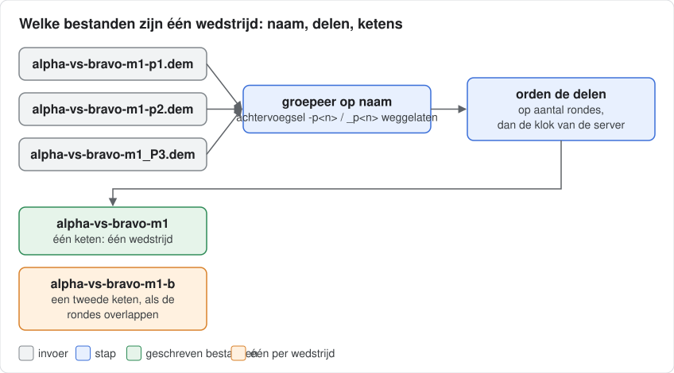

# Commando's {#commands}

Nieuw met de opdrachtregel? Lees eerst [Voordat je begint](before-you-start.md). Typ deze opdrachten in een terminal die geopend is in de map die je hebt uitgepakt of gekloond; `<...>` zijn plaatshouders, en een pad met spaties zet je tussen aanhalingstekens.

```text
python -m heat3d_cs2 demos <demobestanden of mappen> -o <map> [--every 8] [--jobs N] [--map TEKST] [--force] [--no-bulk] [--loose]
python -m heat3d_cs2 map <kaartnaam of pad naar zijn .vpk> -o <bestand.glb> [--game MAP] [--source2viewer EXE]
python -m heat3d_cs2 scoreboard <match.3dheat | match.json>
```

`python -m heat3d_cs2 --help` en `python -m heat3d_cs2 <verb> --help` tonen dezelfde opties; de [Opdrachtreferentie](../cli-reference.md) toont ze allemaal. Bij elke start wordt eerst de controle op nieuwe releases uitgevoerd die beschreven staat in [Updates](updates.md) (uitzetten met `HEAT3D_NO_UPDATE=1`).

Code: [`heat3d_cs2/cli.py`](https://github.com/Holdi601/3DHeat-CS2/blob/main/heat3d_cs2/cli.py).

## `demos` - demo's omzetten in tabellen en matchdocumenten {#demos---demos-into-tables-and-match-documents}

```powershell
python -m heat3d_cs2 demos D:\Demos\evenement -o out
python -m heat3d_cs2 demos alpha-vs-bravo-m1-p1.dem alpha-vs-bravo-m1-p2.dem -o out
python -m heat3d_cs2 demos D:\Demos -o out --map final --jobs 4
```

| Argument | Standaard | Doet |
|---|---|---|
| `paths` (een of meer) | - | demobestanden en mappen. Een bestand wordt gebruikt wanneer de extensie `.dem` is (elke schrijfwijze). Een map wordt **recursief** doorzocht op bestanden die eindigen op `.dem`, in elke schrijfwijze, in gesorteerde volgorde. Gecomprimeerde demo's (`.dem.zst`, `.dem.bz2`, archieven) worden niet gelezen: pak ze eerst uit. |
| `-o`, `--out` | verplicht | de map om in te schrijven; wordt zo nodig aangemaakt |
| `--every N` | `8` | bemonster elke speler elke *N* ticks. CS2-demo's lopen op 64 ticks per seconde, dus 8 is acht monsters per seconde, 4 is zestien, 64 is één. Gebeurtenissen worden altijd op hun eigen tick gelezen, wat *N* ook is. |
| `--jobs N` | `0` = de helft van de CPU-kernen | hoeveel wedstrijden tegelijk worden omgezet, elk in een eigen proces. Nooit minder dan 1, nooit meer dan er wedstrijden zijn. |
| `--map TEKST` | - | alleen wedstrijden waarvan de **naam** *TEKST* bevat, hoofdletterongevoelig (`--map final`). Het filtert op de bestandsnaam, niet op de map die de demo blijkt te bevatten. |
| `--force` | uit | zet wedstrijden die al zijn geschreven opnieuw om, en overschrijft ze |
| `--loose` | uit | bewaar elke wedstrijd als losse bestanden - tabel, `.match.json`, zijbestanden - in plaats van ze in één `.3dheat`-container te pakken. Zie [Eén bestand per match](output-container.md). |
| `--container` | aan | pak elke wedstrijd in één `.3dheat`-bestand; de standaard, dus alleen hier om het expliciet te maken |
| `--no-bulk` | uit | laat de entiteitenstroom, de commando's van de spelers en de animatiestroom weg uit het pakketten-zijbestand - meer dan de helft van de grootte van een demo, zelfs gecomprimeerd. De zelfcontrole van het matchdocument telt ze dan als `lost`, per naam. |


### Welke bestanden horen bij één match {#which-files-are-one-match}



De matchnaam is de naam van het demobestand zonder extensie en zonder deelachtervoegsel: `-p<cijfers>` of `_p<cijfers>` aan het eind, in elke schrijfwijze. Dus `alpha-vs-bravo-m1-p1.dem`, `alpha-vs-bravo-m1-p2.dem` en `alpha-vs-bravo-m1_P3.dem` zijn de delen van één match, `alpha-vs-bravo-m1`. Bestanden worden alleen op die naam gegroepeerd - twee bestanden met dezelfde naam in verschillende mappen worden ook gegroepeerd.

Het achtervoegsel zegt niets over de volgorde: een `-p2` kan de eerste helft zijn. De delen worden in volgorde gezet op het aantal rondes dat ze bevatten, en daarna op de klok van de server; en een groep die twee verschillende wedstrijden blijkt te bevatten (bijvoorbeeld dezelfde teams op dezelfde map op twee evenementen) wordt gesplitst in **ketens**: de keten met de meeste rondes krijgt de naam zelf, de volgende `<naam>-b`, dan `<naam>-c`, enzovoort. Een bestand zonder enige ronde erin (alleen warmup, een pauze) hoort bij geen enkele keten. Hoe ketens worden gevonden staat beschreven in [Een wedstrijd opbouwen](building-matches.md#delen-en-ketens).

### Wat er wordt geschreven {#what-is-written}

Voor elke wedstrijd, in een map die is genoemd naar de map die de header van de demo noemt (`unknown` als er geen staat), één `.3dheat`-bestand:

```text
out/
  de_x/
    alpha-vs-bravo-m1.3dheat
    alpha-vs-bravo-m2.3dheat
  de_y/
    ...
```

Op de synthetische demo met twee rondes uit de tests:


Met `--loose` is elke wedstrijd de tabel, haar matchdocument en vier zijbestanden naast elkaar ([Eén bestand per match](output-container.md)):


Een heatmap gaat over één map, dus één map in de viewer laden is de wedstrijden van één map laden. Zie [De heatmaptabel](output-table.md) en [Het matchdocument](output-match-json.md).

### Wat wordt overgeslagen {#what-is-skipped}

Voordat er iets wordt gelezen, wordt elk `*.3dheat` ergens onder `--out` opgezocht (een container wordt geheel of helemaal niet geschreven), en elk `*.parquet` dat zijn matchdocument (`<naam>.match.json`) naast zich heeft. Een wedstrijd waarvan de naam gelijk is aan een van die bestandsnamen (zonder extensie) wordt overgeslagen, tenzij `--force` is opgegeven. Een tabel zonder zijn matchdocument - een run die gestopt is tussen het schrijven van de twee - telt niet, dus die wedstrijd wordt opnieuw omgezet. De controle gaat alleen op naam: een wedstrijd die in een andere mapmap is omgezet, of met een ander `--every`, telt nog steeds als klaar. Als er niets meer te doen is:

```text
nothing to do: no demos found, or every match already written (--force redoes them)
```

### Wat er wordt afgedrukt {#what-is-printed}

Eerst de hoeveelheid werk, daarna één regel per wedstrijd zodra die klaar is (in de volgorde waarin ze klaarkomen, niet de volgorde van de bestanden):

```text
3 match(es), 3 at a time
alpha-vs-bravo-m1: de_x, 21 rounds (Alpha 13 Bravo 8), 412,377 rows, lost 0
alpha-vs-bravo-m2: de_y, 30 rounds (Bravo 16 Alpha 14), 598,104 rows, 1 incomplete round(s) left out, lost 0
alpha-vs-bravo-m3: de_y, 18 rounds (Alpha 13 Bravo 5), 330,981 rows, recorded from round 3, lost 1,204,331 (svc_PacketEntities, svc_UserCmds, DEM_AnimationData)
```

(De getallen zijn illustratief.) De score is die van de laatste ronde, team voor team in de volgorde die het matchdocument ze geeft. *incomplete round(s) left out* telt rondes die een demo afbrak voordat ze waren beslist; *recorded from round N* zegt dat de opname laat begint; *lost* is de zelfcontrole van het matchdocument - hoeveel items van de demo nergens heen zijn gegaan, en van welke soort (`--no-bulk` zorgt dat de bulk verloren gaat). Een wedstrijd die niets oplevert zegt waarom:

```text
alpha-vs-bravo-m4: no round in 1 file(s) - nothing written
alpha-vs-bravo-m4-b: no complete round in 1 file(s) - nothing written
```

Een fout in één wedstrijd stopt de andere niet; die wordt afgedrukt als `<naam>: failed - <fout>`.

### Afsluitcode {#exit-code}

`0` wanneer elke wedstrijd is omgezet (of er niets te doen was), `1` wanneer er minstens één is mislukt.

### Hoe lang het duurt {#how-long-it-takes}

Elke wedstrijd wordt gelezen en opgebouwd in een werkproces. Een map met een paar honderd demo's duurt minuten met de standaard `--jobs`. Het geheugen per taak groeit met de lengte van de wedstrijd en met een kleinere `--every`: elke werker houdt elke bemonsterde spelerrij van zijn wedstrijd vast voordat hij schrijft (ruwweg tien spelers maal 64 / *N* rijen per seconde opname).

De zijbestanden duren langer dan de tabel: elke eigenschap die de parser leest, wordt op elk tick gelezen, een venster van ticks tegelijk (ongeveer twee minuten voor een demo van 40 minuten, hooguit ongeveer 3 GB geheugen per taak), waarna de demo nog eens wordt doorlopen voor zijn frames en berichten.

## `map` - de geometrie van een map als `.glb` {#map---a-maps-geometry-as-glb}


```powershell
python -m heat3d_cs2 map <map> -o out/<map>/<map>.glb
python -m heat3d_cs2 map <map> -o <map>.glb --game "D:\Games\Steam\steamapps\common\Counter-Strike Global Offensive"
python -m heat3d_cs2 map "D:\maps\<map>.vpk" -o <map>.glb --source2viewer C:\Tools\Source2Viewer-CLI.exe
```

| Argument | Standaard | Doet |
|---|---|---|
| `name` | - | de naam van de map (zoals `de_x`), of het pad naar zijn `.vpk`. Een pad dat eindigt op `.vpk` en bestaat, wordt gebruikt zoals het is; al het andere wordt opgezocht op zijn bestandsnaam in het geïnstalleerde spel. |
| `-o`, `--out` | verplicht | de `.glb` om te schrijven; zijn map wordt zo nodig aangemaakt |
| `--game MAP` | de bibliotheken van Steam | de installatiemap van CS2 (die met `game\csgo`), als Steam die niet kent. Met `--game` wordt alleen die map doorzocht. |
| `--source2viewer EXE` | `HEAT3D_SOURCE2VIEWER`, dan `PATH` | het uitvoerbare bestand van de Source2Viewer-CLI |

Bij succes wordt afgedrukt:

```text
out/de_x/de_x.glb: de_x, 412,880 triangles (151,204 ground) in 14 parts
```

(getallen illustratief). De `.glb` schrijven naast de tabellen van de map (`out/<map>/<map>.glb`) houdt de gegevens en de geometrie van een map in één map. Hoe de export werkt: [Kaart exporteren](map-export.md).

Fouten, elk afgedrukt als `error: ...` met afsluitcode `2`:

| Melding | Betekent |
|---|---|
| `no de_x.vpk found in an installed CS2 - pass --game <CS2 folder> or the .vpk path` | de map staat niet in een gevonden Steam-bibliotheek, of de naam is fout |
| `Source2Viewer-CLI not found: ...` | geen van `--source2viewer`, `HEAT3D_SOURCE2VIEWER`, `PATH` gaf een bestaand bestand |
| `Source2Viewer did not export de_x's collision mesh:` gevolgd door het eind van zijn uitvoer | het is mislukt, of er is geen `.glb` geschreven |
| `de_x's collision mesh has nothing but clip brushes` | na het weglaten van clips en lucht bleef er niets over |

## `scoreboard` - een wedstrijd als tekst {#scoreboard---a-match-as-text}

```bash
python -m heat3d_cs2 scoreboard out/de_x/alpha-vs-bravo-m1.3dheat
python -m heat3d_cs2 scoreboard out/de_x/alpha-vs-bravo-m1.match.json   # na demos --loose
```

Drukt het scorebord van de wedstrijd af uit zijn [matchdocument](output-match-json.md), zonder de viewer te openen. Het leest het document in een `.3dheat`-container, of een losse `<match>.match.json`. Op de synthetische demo met twee rondes uit de tests:


```text
alpha-vs-bravo-m1 - de_test  Alpha 2  Bravo 0

Alpha
player                 K   D   A  +/-    ADR   KAST   HS%  OK-OD  clutch
ash                    1   0   0   +1   50.0 100.0%    0%   0-0     1/1
ace                    1   1   0   +0   50.0 100.0%  100%   1-0     0/0

Bravo
player                 K   D   A  +/-    ADR   KAST   HS%  OK-OD  clutch
ben                    1   1   0   +0   50.0 100.0%    0%   0-0     0/1
bob                    0   1   0   -1    0.0 100.0%    0%   0-1     0/0

rounds  1:TK 2:TB
```

- De eerste regel: de naam van de match, de map, en de eindscore per team.
- Een tabel per team, in de volgorde van de `teams` van het matchdocument; spelers in de volgorde van het matchdocument (op kills min deaths, dan kills, beste eerst). Namen worden afgekapt tot 19 tekens.
- Kolommen: **K** kills, **D** deaths (doden), **A** assists *inclusief* flitsassists, **+/-** kills min deaths, **ADR**, **KAST** (%), **HS%** (afgerond op hele procenten), **OK-OD** openingskills - openingsdoden, **clutch** clutches gewonnen / clutches gespeeld. Definities: [Statistieken](statistics.md).
- De rondestrip: `<ronde>:<winnende kant><hoe>`, met **B** bom ontploft, **D** gedefuseerd, **K** eliminatie, **T** tijd op, en **?** voor al het andere (gelijkspel, overgave, overig). Bij een gelijkspel is er geen winnende kant: `<ronde>:?`.

Een bestand dat geen geldige JSON is, of niet gevonden wordt, stopt met een fout; een JSON-document zonder de velden van het matchdocument geeft een Python-fout (het wordt niet verder gecontroleerd).
