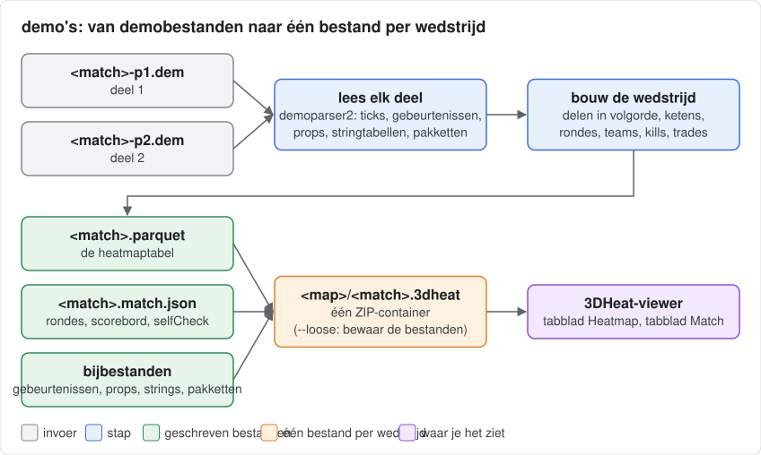

# 3DHeat CS2 {#dheat-cs2}

**Wat is het?** Counter-Strike 2 kan een opname van een wedstrijd bewaren, een
*demo* genoemd. Dit hulpmiddel zet een demo om in bestanden die de 3DHeat-viewer in 3D kan tonen:
waar iedereen stond, stierf, gooide en plantte, ronde na ronde. Het kan ook een
CS2-kaart omzetten in een 3D-model om ze op te tonen.

**Waarom zou ik het gebruiken?** Om je eigen wedstrijden te bekijken, om veel wedstrijden van één
kaart over elkaar te leggen als één heatmap, en voor wedstrijdstatistieken zoals ADR
(gemiddelde schade per ronde) en KAST (het deel van de rondes waarin een speler doodde, assisteerde, overleefde of
werd gewraakt).

**Voorbeeld:** `alpha-vs-bravo-m1.dem` erin, `out/de_x/alpha-vs-bravo-m1.3dheat`
eruit (`de_x` is een verzonnen kaartnaam).



Meer in detail: 3DHeat CS2 zet **Counter-Strike 2-demo's** om in een heatmaptabel en een wedstrijddocument
per wedstrijd, en een **CS2-kaart** in niveaugeometrie. De uitvoer is bedoeld voor de
[3DHeat](https://holdi601.github.io/3DHeat/)-telemetrieviewer
([bron](https://github.com/Holdi601/3DHeat)), maar het zijn gewone bestanden -
Parquet, JSON en binair glTF - die ook andere programma's kunnen lezen.

Het is een klein Python-pakket, `heat3d_cs2`, dat vanaf de opdrachtregel draait. Het leest
demo's van schijf (het downloadt er geen) met
[demoparser2](https://github.com/LaihoE/demoparser), en exporteert kaarten uit het
geïnstalleerde spel met de commandoregelversie van Source2Viewer
([ValveResourceFormat](https://github.com/ValveResourceFormat/ValveResourceFormat)).

## Snelstart {#quick-start}

Nog nooit met de opdrachtregel gewerkt? Lees eerst [Voordat je begint](before-you-start.md).

```bash
pip install -r requirements.txt
python -m heat3d_cs2 demos <demo files or folders> -o out   # elke wedstrijd erin
python -m heat3d_cs2 map <map> -o out/<map>/<map>.glb       # de kaart uit het geïnstalleerde spel
python -m heat3d_cs2 scoreboard out/<map>/<match>.3dheat    # het scorebord van een wedstrijd als tekst
```

Je ziet `1 match(es), 1 at a time ...` en daarna één regel per wedstrijd
(zie [Commando's](../commands.md#what-is-printed)).

`demos` schrijft per wedstrijd één bestand in een map die naar de kaart is genoemd:
`out/<map>/<match>.3dheat`, een [`.3dheat`-container](../output-container.md) - het
één-bestand-per-wedstrijdformaat van de viewer ([specificatie](https://holdi601.github.io/3DHeat/container.html)).
Het bevat deze onderdelen; `--loose` schrijft ze als afzonderlijke bestanden:

| Onderdeel | Wat het bevat | Geladen in het tabblad van de viewer |
|---|---|---|
| `<match>.parquet` (rol `table`) | elke levende speler acht keer per seconde met zijn status (gezondheid, geld, flits, gescoped, zone, inventaris, ...), en elke gebeurtenis waar die plaatsvond (kill, dood, verwonding, schot, worp, granaatexplosies, verblinding, plant, ontmanteling, explosie, en per speler een rondeeinde met wat de ronde hem opleverde), één rij per stuk | Heatmap-tabblad |
| `<match>.match.json` (rol `match`, het wedstrijddocument) | teams, score, elke ronde (winnaar, hoe, economie, plant, kills in volgorde, clutches, overlevenden) en de scorebordregel van elke speler | Match-tabblad |
| `<match>.events/props/strings/packets.parquet` | al het andere dat de demo bevat, volledig (bijbestanden) | bewaard voor de volledigheid |

`map` schrijft `<map>.glb`: het botsingsnetwerk van de kaart - vloeren, muren, dozen,
zonder decoratie - gesplitst in grond en constructie, in hetzelfde kader en dezelfde eenheden
als de tabellen, zodat het precies onder de heatmap ligt (paneel Achtergrond / level).

## Overzicht van deze documentatie {#map-of-this-documentation}

| Pagina | Wat die behandelt |
|---|---|
| [Voordat je begint](before-you-start.md) | Python, een terminal, plaatsaanduidingen, hoe succes en de veelvoorkomende fouten eruitzien |
| [Installeren](../installing.md) | Python, de pakketten, de CLI van Source2Viewer, waar CS2 moet staan |
| [Commando's](../commands.md) | `demos`, `map`, `scoreboard`: elke optie, wat er wordt afgedrukt, exitcodes |
| [Een demo lezen](../reading-demos.md) | wat er uit een demobestand wordt gelezen: bemonsterde ticks, spelereigenschappen, spelregels, gebeurtenissen |
| [Een wedstrijd opbouwen](../building-matches.md) | delen en ketens, de wedstrijdklok, rondes, teams en kanten, rijen, kills, trades, openingen, schade, flitsen, economie |
| [Statistieken](../statistics.md) | het scorebord: K/D/A, ADR, KAST, HS%, openingen, trades, multi-kills, clutches, utility, flitsen |
| [De heatmaptabel](../output-table.md) | het Parquet-bestand: elke kolom, het type, welke gebeurtenissen hem vullen, de leesinstructies in de `heat3d`-voettekst, de assen |
| [Het wedstrijddocument](../output-match-json.md) | het `.match.json`-document, veld voor veld |
| [Eén bestand per wedstrijd](../output-container.md) | de `.3dheat`-container die `demos` standaard schrijft, `--loose` |
| [Kaartexport](../map-export.md) | hoe het botsingsnetwerk van een kaart wordt geëxporteerd, het kader, knoopnaamgeving, eenheden |
| [Gebruik met 3DHeat](../using-with-3dheat.md) | tabellen, wedstrijddocumenten en kaarten laden in de tabbladen Heatmap en Match van de viewer |
| [Beperkingen](../limits.md) | wat wordt aangenomen, wat niet wordt afgehandeld, wat niet is gecontroleerd |
| [Updates](../updates.md) | de releasecontrole bij het opstarten en `python -m heat3d_update` |
| [Ontwikkeling](../development.md) | indeling van de code, tests, de synthetische demofixture |
| [Commandoreferentie](../cli-reference.md) | de `--help` van elk commando, gegenereerd uit de code |
| [Onderhoud](../maintaining.md) | de checklist per release voor deze pagina's |

## Waarmee het is gecontroleerd {#what-it-is-checked-against}

Demo's uit het wild zijn niet één schone bestand per wedstrijd. De converter kan een wedstrijd aan die
over meerdere bestanden is verdeeld, in elke volgorde; een server die midden in de wedstrijd is herstart; twee
verschillende wedstrijden onder één naam opgeslagen; rondes die uit een back-up zijn hersteld; een
opname die laat begint of vroeg eindigt; pauzes; en coaches aan de kant van een team -
zie [Een wedstrijd opbouwen](../building-matches.md). Gecontroleerd over een grote verzameling
toernooidemo's: in elke wedstrijd volgt de score de winnaars van de rondes, zijn de kills van elke kant
de doden van de andere kant, en begint elke ronde vijf tegen vijf.

## Waarvoor je het gebruikt {#what-to-point-it-at}

Demo's van je eigen wedstrijden, demo's die je met de hand van een toernooisite hebt gedownload,
of demo's uit een API waar je toegang toe hebt. Een demo is een opname waarvan de inhoud
toebehoort aan de uitgever en de organisatoren: gebruik wat eruit komt voor je eigen
analyse, en geef demo's of gegevens die ervan zijn afgeleid niet door. Sites die demo's aanbieden,
verbieden vaak geautomatiseerd downloaden in hun voorwaarden; daarom leest het hulpmiddel demo's van schijf
en haalt het er geen op.

## Onderdeel van 3DHeat {#part-of-3dheat}

3DHeat CS2 is een van de gratis hulpmiddelen rond de 3DHeat-viewer, elk met een eigen
repository, releases en licentie:

| Tool | Wat die doet | Documentatie |
|---|---|---|
| [3DHeat](https://github.com/Holdi601/3DHeat) | de viewer: heatmaps, Race-analyse en wedstrijdanalyse in 3D | [site](https://holdi601.github.io/3DHeat/) |
| [GameFiles](https://github.com/Holdi601/3DHeat-GameFiles) | banen en niveaus uit de bestanden die spellen meeleveren, als 3D-modellen | [site](https://holdi601.github.io/3DHeat-GameFiles/) |
| [GameCapture](https://github.com/Holdi601/3DHeat-GameCapture) | rondetelemetrie uit racespellen; niveaus opnieuw opgebouwd uit gameplayvideo | [site](https://holdi601.github.io/3DHeat-GameCapture/) |
| [Unreal Exporter](https://github.com/Holdi601/3DHeat-UnrealExporter) | een plug-in voor de Unreal Editor die een niveau als één 3D-model exporteert | [site](https://holdi601.github.io/3DHeat-UnrealExporter/) |
| [CS2](https://github.com/Holdi601/3DHeat-CS2) | Counter-Strike 2-demo's naar tabellen en wedstrijddocumenten; kaarten naar 3D-modellen | [site](https://holdi601.github.io/3DHeat-CS2/) |
| [Watcher](https://github.com/Holdi601/3DHeat-Watcher) | legt op de achtergrond vast wat spellen publiceren over je spel | [site](https://holdi601.github.io/3DHeat-Watcher/) |
| [Ext-WarThunder](https://github.com/Holdi601/3DHeat-Ext-WarThunder) | War Thunder-replays naar tabellen en wedstrijddocumenten | [site](https://holdi601.github.io/3DHeat-Ext-WarThunder/) |
| [Ext-WoT](https://github.com/Holdi601/3DHeat-Ext-WoT) | World of Tanks-replays naar tabellen en wedstrijddocumenten | [site](https://holdi601.github.io/3DHeat-Ext-WoT/) |
| [Ext-WoWs](https://github.com/Holdi601/3DHeat-Ext-WoWs) | World of Warships-replays naar tabellen en wedstrijddocumenten | [site](https://holdi601.github.io/3DHeat-Ext-WoWs/) |
| [Ext-Squad](https://github.com/Holdi601/3DHeat-Ext-Squad) | Squad-serverdemo's naar tabellen en wedstrijddocumenten | [site](https://holdi601.github.io/3DHeat-Ext-Squad/) |
| [Ext-DCS](https://github.com/Holdi601/3DHeat-Ext-DCS) | DCS World-kaarten naar 3D-modellen | [site](https://holdi601.github.io/3DHeat-Ext-DCS/) |
| [Ext-IL2](https://github.com/Holdi601/3DHeat-Ext-IL2) | IL-2 Sturmovik-kaarten naar 3D-modellen | [site](https://holdi601.github.io/3DHeat-Ext-IL2/) |

## Licentie {#licence}

MIT - zie [`LICENSE`](https://github.com/Holdi601/3DHeat-CS2/blob/main/LICENSE),
en [`LICENSES.md`](https://github.com/Holdi601/3DHeat-CS2/blob/main/LICENSES.md)
voor de pakketten van derden en wat de spellen die het leest vereisen.
