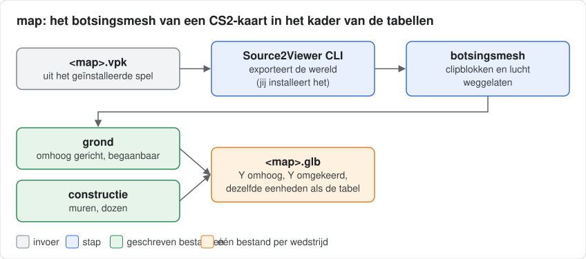

# Kaart exporteren (`map`) {#map-export-map}

`python -m heat3d_cs2 map <map> -o <bestand.glb>` schrijft een CS2-kaart als levelgeometrie: het **collision mesh** van de wereld, in het assenstelsel en de eenheden waarin de [heatmaptabellen](output-table.md) worden getekend. Code:
[`heat3d_cs2/mapexport.py`](https://github.com/Holdi601/3DHeat-CS2/blob/main/heat3d_cs2/mapexport.py),
[`heat3d_cs2/glb.py`](https://github.com/Holdi601/3DHeat-CS2/blob/main/heat3d_cs2/glb.py).
Opties en meldingen: [Commando's](commands.md#map---de-geometrie-van-een-map-als-glb).



## Waarom het collision mesh {#why-the-collision-mesh}

Het collision mesh is waar spelers op staan en achter zich verschuilen - vloeren, muren, trappen, dozen - zonder de decoratie: geen rekwisieten die alleen op iets lijken, geen texturen, veel minder driehoeken dan de render-meshes. Dat is wat een heatmap eronder nodig heeft: iets om posities tegen af te lezen, geen weergave van de map.

## Hoe het wordt verkregen {#how-it-is-obtained}

1. **De map vinden.** Een pad dat eindigt op `.vpk` en bestaat, wordt gebruikt zoals het is. Anders wordt `<naam>.vpk` gezocht in `<CS2-map>\game\csgo\maps\`, waarbij de CS2-map `--game` is, of `steamapps\common\Counter-Strike Global Offensive` in elke gevonden Steam-bibliotheek (zie [Installeren](installing.md#waar-naar-cs2-wordt-gezocht)).
2. **De Source2Viewer-CLI vinden**: `--source2viewer`, dan `HEAT3D_SOURCE2VIEWER`, dan `Source2Viewer-CLI` / `Source2Viewer-CLI.exe` op `PATH`.
3. **De fysica van de wereld exporteren.** Source2Viewer wordt als volgt uitgevoerd:

   ```text
   Source2Viewer-CLI -i <map>.vpk -d -f maps/<map>/world_physics.vmdl_c --gltf_export_format glb -o <tijdelijke map>
   ```

   Het decodeert de gecompileerde fysica van Source 2 uit het eigen archief van de map en schrijft het model (leeg: de wereld heeft geen eigen render-mesh) en zijn fysica ernaast. De grootste geschreven `.glb` is de fysica. Als Source2Viewer faalt of geen `.glb` schrijft, stopt de opdracht en toont de laatste 800 tekens van zijn uitvoer en fouten.
4. **Het lezen.** Elke node van de scène wordt doorlopen met zijn transformatie (matrix, of translatie-rotatie-schaal), en elke driehoeksprimitief wordt meegenomen, met of zonder indexbuffer, in wereldposities.
5. **Weglaten wat geen muur of vloer is.** Een node waarvan de naam `clip` bevat - spelersclips, NPC-clips, granaatclips: de onzichtbare muren die spelers en granaten tegenhouden - of `sky`, in elke schrijfwijze, valt weg.
6. **Het oppervlak benoemen.** De fysicagroepen krijgen de naam van hun oppervlak; de naam in kleine letters, met een voorvoegsel `physics`, `physics_group` of `physics_passbullets` (en het underscore erna) eraf, is het oppervlak: `physics_group_concrete` is `concrete`, `physics_passbullets_chainlink` is `chainlink`, en een kale `physics_group` is `world`. Oppervlakken waar kogels doorheen gaan, blijven bewaard.
7. **Terug naar het assenstelsel van de game.** Source2Viewer schrijft glTF in meters met Y omhoog: de (Y, Z, X) van de game maal 0,0254. Dat wordt ongedaan gemaakt - elk punt wordt de (X, Y, Z) van de game in inches.
8. **Grond van structuur scheiden**, driehoek voor driehoek: een vlak waarvan de normaal minstens 0,7 omhoog wijst (zijn Z-component, genormaliseerd) - hellingen tot ongeveer 45 graden, ongeveer het steilste wat een CS2-speler loopt - is **grond**; al het andere, muren en plafonds inbegrepen, is **structuur**.
9. **Naar het assenstelsel van de viewer.** Elk punt wordt geschreven als (X, Z, -Y): Y omhoog, de Y van de game omgekeerd - het assenstelsel waarin de viewer de tabellen tekent, als hij hun `heat3d`-hints volgt. Een rotatie, geen spiegeling.
10. **De `.glb` schrijven.** Als er niets overblijft (alleen clip brushes), stopt de opdracht met een fout. Anders drukt hij het bestand, de map, het aantal driehoeken, hoeveel ervan grond zijn, en het aantal delen af.

Hier wordt niets gelezen behalve het eigen `.vpk` van de map, en niets van Source2Viewer wordt meegeleverd of gekopieerd.

## Het bestand {#the-file}

Een glTF 2.0 binary (`.glb`), één buffer, geschreven door `heat3d_cs2` (de `asset.generator`):

| Aspect | Wat |
|---|---|
| Nodes | één per deel, allemaal op het hoogste niveau, zonder transformaties, elk met zijn eigen mesh van dezelfde naam |
| Nodenamen | `ground:<oppervlak>` of `structure:<oppervlak>` (`ground:concrete`, `structure:metal`, `structure:world`), gesorteerd op naam |
| Primitieven | één per mesh, driehoeken, `POSITION` (float32, met min/max) en `NORMAL` (float32), `uint32`-indices |
| Schaduw | vlak: één hoekpunt per hoek van de driehoek, elk met de normaal van zijn driehoek |
| Materialen, texturen, UV's, kleuren | geen |
| Eenheden | game-eenheden (**inches**), geen meters - anders dan glTF aanneemt |
| Assenstelsel | (X, Z, -Y) van de game: de Y van glTF is de hoogte van de game, de Z van glTF is de -Y van de game |

Het voorvoegsel `ground:` / `structure:` is de conventie van alle 3DHeat-levelexporters: de viewer neemt een deel dat zo is genoemd voor waar aan in plaats van uit de geometrie te raden, zodat de vloeren de grondschaduw krijgen en de muren de structuurtekening zonder een classificatiestap.

Omdat de eenheden inches zijn, toont een andere glTF-viewer de map ongeveer 39 keer te groot (hij leest ze als meters); schaal er dan met 0,0254 als dat uitmaakt. In 3DHeat ligt hij precies onder de tabel, die in dezelfde eenheden is met schaal 1.

## De controle dat het assenstelsel klopt {#the-check-that-the-frame-is-right}

De test `test_players_stand_on_the_exported_floor` (alleen uitgevoerd wanneer een demo en Source2Viewer zijn opgegeven, zie [Ontwikkeling](development.md#tests)) exporteert de map waarop een demo werd gespeeld, neemt 300 willekeurige positiemonsters van de wedstrijd, en kijkt voor elk recht naar beneden naar het hoogste grondvlak dat hooguit 4 eenheden boven de voeten van de speler ligt. Hij eist dat minstens 98 % van de monsters grond vindt, en dat de mediane hoogte erboven minder dan 5 eenheden is. Een gespiegelde map faalt hierbij: op een map die door de verkeerde as is gespiegeld, staat een groot deel van de spelers boven niets. De README rapporteert de cijfers van deze controle over de kaarten van de huidige competitieve pool.

## Wat het niet doet {#what-it-does-not-do}

- Geen weergavegeometrie, texturen of decoratie - zie *waarom* hierboven.
- Alleen wat in het `world_physics`-model van de map zit, wordt geëxporteerd. Of bewegende delen (deuren) of breekbare objecten erin zitten, is niet gecontroleerd.
- Geen vereenvoudiging: de 3DHeat-viewer vereenvoudigt bij het importeren met zijn instelling **Vereenvoudigingsdoel**.
- Kaarten die niet in het geïnstalleerde spel staan (workshopkaarten elders op schijf) werken wanneer hun `.vpk` als pad wordt meegegeven en `maps/<naam>/world_physics.vmdl_c` bevat; niet geverifieerd.
