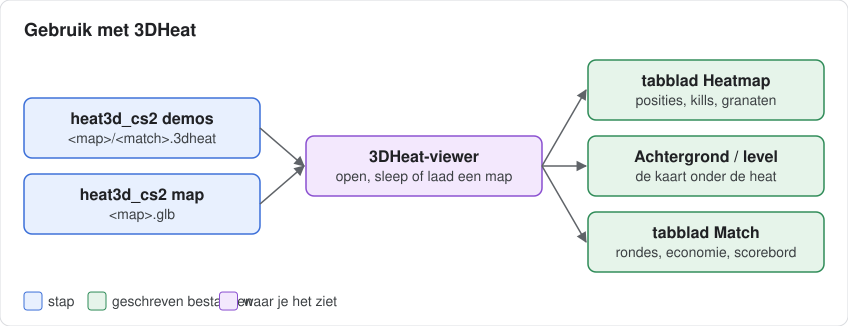

# Gebruik met 3DHeat {#using-it-with-3dheat}

De uitvoer gaat naar deze plekken van de [3DHeat-viewer](https://holdi601.github.io/3DHeat):

| Bestand | Waar | Wat het oplevert |
|---|---|---|
| `<match>.3dheat` (de standaard) | tabblad **Heatmap**, paneel **Bron**, of tabblad **Match** | de tabel en het matchdocument samen, één bestand per wedstrijd ([container](https://holdi601.github.io/3DHeat/container.html)) |
| `<match>.parquet` | tabblad **Heatmap**, paneel **Bron** | posities en gebeurtenissen als heatmap, boxreplay, routes |
| `<match>.match.json` | tabblad **Match**, **Matchbestanden laden…** | het scorebord, de rondes, de killfeed, statistieken over wedstrijden heen, links naar de heatmap |
| `<map>.glb` | paneel **Achtergrond / level**, **3D-model…** | de map onder de heatmap |

De eigen documentatie van de viewer beschrijft elk tabblad volledig: de pagina's [Matchanalyse](https://holdi601.github.io/3DHeat/match-analysis.html), [Bestanden laden](https://holdi601.github.io/3DHeat/loading-files.html), [Kolomtoewijzing](https://holdi601.github.io/3DHeat/column-mapping.html) en [Boxreplay](https://holdi601.github.io/3DHeat/box-replay.html). Deze pagina is de CS2-kant daarvan.



De viewer: [github.com/Holdi601/3DHeat](https://github.com/Holdi601/3DHeat), documentatie [holdi601.github.io/3DHeat](https://holdi601.github.io/3DHeat/).

## Een typische sessie {#a-typical-session}

```bash
python -m heat3d_cs2 demos D:\Demos\evenement -o out
python -m heat3d_cs2 map <map> -o out/<map>/<map>.glb
```

1. **Tabblad Heatmap -> Bron:** kies de map `out/<map>` (of sleep hem erheen). Elk `.parquet` erin wordt één dataset; de `.json`- en `.glb`-bestanden in dezelfde map worden overgeslagen als "geen csv/parquet-bestand". Laad hem.
2. **Achtergrond / level -> 3D-model…:** kies `out/<map>/<map>.glb`. **Opslaan in bibliotheek** bewaart hem in de browser voor de volgende keer.
3. **Tabblad Match -> Matchbestanden laden…:** kies de `.match.json`-bestanden uit dezelfde map (meerdere tegelijk), of sleep ze op de weergave terwijl het tabblad Match open is.

Laad maar de tabellen van één map tegelijk: de coördinaten van verschillende kaarten overlappen, en een heatmap van twee kaarten tegelijk betekent niets. De map per kaart is daarvoor.

## De tabel opent zonder iets in te stellen {#the-table-opens-with-nothing-to-set}

De viewer leest het `heat3d`-voetnootitem van het eerste geselecteerde bestand ([De heatmaptabel](output-table.md#de-heat3d-voetnoothints)) en legt dat over zijn eigen gissingen heen:

| Instelling van de viewer | Zet op |
|---|---|
| Positie | `x`, `y`, `z` |
| Omhoog-as in de bron | Z is omhoog |
| Y spiegelen | aan - zodat de map de goede kant op staat, niet gespiegeld |
| Eenheidsschaal | 1 - afstanden in game-eenheden (aangegeven met "m"; 1 eenheid = 1 inch) |
| Tijd | `time`, seconden |
| Persoon | `player` |
| Groep | `side` (T / CT) |
| Sessie | `roundId` - elke ronde is een sessie, `<match> #NN` |
| Kijkrichting | vector, `dirX` / `dirY` / `dirZ` |
| Filterkolommen | `event`, `match`, `round`, `roundTime`, `phase`, `weapon`, `place`, `won`, `buy`, `opening`, `team` |
| Entiteitsgrootte | 32 - de boxreplay tekent een speler 32 eenheden breed, met een kijkstraal van 4 x 32 |

Elke ingestelde waarde is nog steeds zichtbaar in de kolomtoewijzing en kan worden gewijzigd. De andere kolommen (`headshot`, `traded`, `other`, `steamid`, `health`, `money`, `damage`, `duration`, ...) kun je daar met de hand als filter toevoegen.

Houd de eenheidsschaal op 1 wanneer een map is geladen: de `.glb` staat in dezelfde game-eenheden, en het level wordt niet mee met de tabel geschaald.

### Nuttige filters {#useful-filters}

- `event` = `position` voor waar spelers waren; `kill` / `death` voor waar duels werden gewonnen en verloren; `smoke`, `flash`, `molotov`, `he` voor waar utility terechtkwam; `throw` voor waar die werd gegooid; `plant` voor plantplekken.
- `side` (de groep) = `T` of `CT`, `phase` = `live` om de after-fase weg te laten, `buy` = `eco` / `force` / `full` voor rondes van één economie, `won` = 1 voor rondes die de kant van de rij won.
- `opening` = 1 bij `kill` en `death` voor de openingsduels.
- `roundTime` als bereik voor een moment in de ronde: de eerste 20 seconden, en de tijd na de plant.

## Het tabblad Match {#the-match-tab}

Het tabblad Match accepteert een JSON-bestand waarvan `format` `heat3d-cs2-match` is en dat de arrays `rounds`, `players` en `teams` heeft ([Het matchdocument](output-match-json.md)). Het toont de score en de helften, een strip van rondes gekleurd naar de winnende kant met een teken voor hoe elke ronde eindigde, de economie van elke ronde, de plant, de killfeed, clutches en overlevenden, het scorebord, en statistieken over alle geladen wedstrijden.

De links **In de heatmap tonen** laden niets: ze zetten filters op de tabel die al in het tabblad Heatmap is geladen - `match`, `round` (en de sessie van de ronde `<match> #NN`), `event`, de speler, de kant. Dat werkt omdat het matchdocument en de tabel dezelfde matchnamen, rondenummers, spelernamen en kanten bevatten. **Ronde afspelen** schakelt de heatmap naar boxreplay en speelt de sessie van de ronde af vanaf het begin.

Laad dus beide: de tabellen van een map in het tabblad Heatmap, en hun matchdocumenten in het tabblad Match. Een matchdocument zonder zijn tabel toont nog steeds het scorebord en de rondes, en de links zeggen dat er geen heatmapgegevens geladen zijn.

## Zonder 3DHeat {#without-3dheat}

- De tabel is gewoon Parquet: pandas, Polars, DuckDB, Spark, R's `arrow` lezen hem allemaal; het `heat3d`-item wordt genegeerd, en de tekstkolommen worden gelezen als tekenreeksen of categorieën.
- Het matchdocument is gewone JSON.
- De map is een geldige glTF binary, in inches in plaats van meters: schaal met 0,0254 voor tools die meters aannemen. Het assenstelsel is dat van glTF zelf (Y omhoog), dus om de tabel elders eroverheen te leggen, teken je elke (x, y, z) van een rij als (x, z, -y), zoals 3DHeat dat doet.
