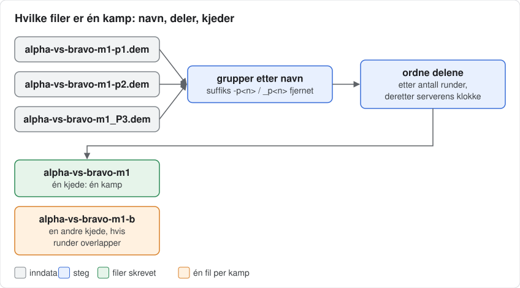

# Bygge en kamp {#building-a-match}

Slik lages en kamp av delene i demoen: hvilke filer som hører sammen, én klokke
på tvers av dem, rundene og hvordan hver ble vunnet, lagene og sidene deres, og
hver rad i varmekarttabellen med drap, trade, åpninger, skade, blendinger og
økonomi. Kode:
[`heat3d_cs2/match.py`](https://github.com/Holdi601/3DHeat-CS2/blob/main/heat3d_cs2/match.py).
Resultattavlen som beregnes fra den, står under [Statistikk](statistics.md).

## Oversikt {#overview}

1. Hver fil med et kampnavn leses ([Lese en demo](reading-demos.md)).
2. Dupliserte spillerrader i hver fil (gjenopprettede runder) løses.
3. Filene sorteres i **kjeder** - kamper - og hver kjede settes i rekkefølge.
4. Hver del settes inn på **kampklokken**.
5. **Rundene** finnes i hver del; en senere dels beskrivelse av en runde erstatter
   en tidligere dels.
6. **Spillerne** og **lagene** får navn, og hver rundes sider og score gis etter
   lagnavn. Når sidene er kjent, følger lengden på halvdelen, pistolrundene og
   hver sides **kjøp**.
7. **Radene** bygges: posisjoner, skudd, kast, detonasjoner, plantinger,
   desarmeringer, drap, dødsfall, treff, blendinger, eksplosjoner.
8. Hver rad merkes med sin runde, fase, rundetid, om dens side vant, og sidens
   kjøp; rader utenfor alle runder fjernes.

## Gjenopprettede runder: én rad per spiller per tick {#restored-rounds-one-row-per-player-per-tick}

Når en runde gjenopprettes fra en sikkerhetskopi i én fil, bærer demoen de
gamle kroppene til spillerne sammen med de nye i noen sekunder: to rader for én
spiller på ett tick, én der den ugyldige runden lot dem være, og én ved den
gjenopprettede rundens start. For hver slik spiller går man **baklengs** gjennom
de doble tickene, fra den første enkle raden etter dem: på hvert tick beholdes
kandidaten som er nærmest posisjonen som følger, og den blir referansen for
tick-et før. Finnes ingen enkel rad etter dem, beholdes den siste kandidaten.
Slik beholder hver spiller raden som fører videre dit de går neste gang.

## Den live delen av en fil {#the-live-part-of-a-file}

En fils **livestart** er ticket for dens siste `round_announce_match_start`-hendelse,
eller tick 0 hvis den ikke har en (en senere del av en delt kamp har vanligvis
ingen). Alt før livestarten utelates, og det samme gjelder alt som er merket
`is_warmup_period`. En knivrunde eller en omstart før kunngjøringen utelates
dermed; en knivrunde som *ikke* følges av en kunngjøring om kampstart, gjenkjennes
ikke som en slik (se [Begrensninger](limits.md)).

En fils **runder** er `round_freeze_end`-hendelsene fra livestarten og utover,
utenfor oppvarming, identifisert ved sin `total_rounds_played` (spillets 0-baserte
indeks for runden som skal spilles). En fil uten slike har ingen runder og hører
til ingen kamp.

## Klokken {#the-clock}

Tider er i sekunder. Innen en fil telles tiden i **tick**: serverens `game_time`
ved det første samplede ticket, pluss antall tick siden da delt på 64. Serverens
egen klokke står stille under en pause mens tickene løper videre; leser man tiden
fra klokken, ville to øyeblikk i en pauset kamp få samme tid.

Hver fil har en *første klokke* (tiden ved livestarten) og en *siste klokke*
(ved dens siste samplede tick).

### Deler og kjeder {#parts-and-chains}

Filer som har fått samme kampnavn ([Kommandoer](commands.md#which-files-are-one-match))
sorteres først etter indeksen til deres første runde, og deretter etter første
klokke. Så blir hver, i den rekkefølgen, med i den første kjeden den fortsetter,
eller starter en ny kjede. En del fortsetter en kjede når dens første rundeindeks
er minst den siste delens siste indeks i kjeden, **og** enten

- serverens klokke fortsetter: dens første klokke er ikke tidligere enn kjedens
  siste klokke minus 5 s; eller
- rundetellingen fortsetter: dens første rundeindeks er kjedens siste indeks eller
  det neste.

Det er rundetellingen som avgjør, og klokken som bryter uavgjorte tilfeller, fordi
en server som startes på nytt for å gjenopprette en runde, starter klokken sin
på nytt, mens to forskjellige kamper under samme navn (de samme lagene på samme
kart ved to arrangementer) har overlappende rundetellinger. Kjedene sorteres etter
hvor mange runder de spenner over, flest først; den første beholder kampnavnet, de
andre skrives som `<navn>-b`, `<navn>-c` og så videre.

### Kampklokken {#the-match-clock}

Kampens null er første delens første klokke: **kamptid 0 er livestarten i den
første filen**. Hver senere del settes inn på den:

- der serverens klokke fortsetter (dens første klokke er ikke tidligere enn den
  forrige delens siste klokke minus 5 s), brukes serverens klokke som den er;
- der den ble startet på nytt, settes delen til å følge **ett sekund** etter at den
  forrige delen var slutt.

## Runder {#rounds}

For hver `round_freeze_end` i en del (i tickrekkefølge) går rundens vindu til
neste freeze end i den delen, eller til filens slutt. Innenfor det avgjøres
runden ved det første samplede ticket der spilltilstanden viser
`total_rounds_played` = rundens indeks + 1 og `round_win_status` 1 (uavgjort), 2
(T vant) eller 3 (CT vant). En runde uten slik prøve i vinduet ble kuttet av
filens slutt; nummeret kommer på kampens liste over **ufullstendige** (med mindre
en annen del har runden komplett).

| Rundefelt | Fra |
|---|---|
| `number` | indeksen + 1 (1-basert, slik spillet teller) |
| `start` | kamptiden da freeze time tar slutt - spillerne kan bevege seg |
| `end` | kamptiden for den første prøven som viser runden avgjort |
| `until` | kamptiden for neste `round_prestart` etter `end`, hvis den ligger innenfor vinduet; ellers vinduets slutt eller filens siste tick, det som kommer først (og aldri før `end`) |
| `winner` | `T` for win status 2, `CT` for 3, tom for 1: en uavgjort runde er avgjort, uten vinner |
| `reason` | `round_win_reason` ved den prøven, navngitt som nedenfor |
| `score` | lagnavn -> runder vunnet etter denne: hver side sin `team_rounds_total` ved den avgjørende prøven; der demoen ikke har den, forrige rundes score pluss én for vinneren |
| `sides` | lagnavn -> `T` / `CT` denne runden |
| `equipment` | side -> summen av `current_equip_value` for sidens **levende** spillere ved den første prøven ved eller etter freeze end |
| `buy` | side -> `pistol`, `eco`, `force` eller `full` ([Økonomi og kjøpstyper](#economy-and-buy-types)) |
| `plant` | den første `bomb_planted` etter freeze end og opp til `end`, eller ingen |
| `exploded` | kamptiden for den første `bomb_exploded` etter den plantingen og før neste freeze end, hvis en finnes (ikke i kampdokumentet; den styrer `explode`-raden) |

`reason`, fra spillets `CSRoundEndReason`:

| Kode | `reason` |
|---|---|
| 1 | `bomb` (målet ble bombet) |
| 7 | `defuse` |
| 8, 9 | `elimination` (CT vinner / T vinner ved eliminering) |
| 10 | `draw` |
| 12 | `time` (målet ble reddet) |
| 17, 18 | `surrender` |
| annet | `other` |

Når flere deler har samme runde (etter indeks), beholdes den senere delens
versjon. Rundene listes så etter indeks. En kamp som ikke starter på runde 1,
noterer de manglende nummerne (`missing` i kampdokumentet); kommandolinjen sier
*recorded from round N*.

### Plantingen {#the-plant}

| Felt | Fra |
|---|---|
| `site` | `A` eller `B`: bombesonen spilleren sto i ifølge spillet (`which_bomb_zone`, 1 A, 2 B); uten den, plantens stedsnavn (`BombsiteA`, `BombsiteB`); uten det, bokstaven en annen plantering i samme fil i samme sone ga (hendelsens `site` er sonens entitetsnummer). Tom når ingenting sier det - aldri nummeret. |
| `time` | sekunder **inn i runden** (fra dens freeze end), slik som et drap |
| `player`, `steamid` | den som plantet |
| `x`, `y`, `z` | plantens posisjon, i spillenheter: der bomben ligger |
| `place` | stedsnavnet der plantingen skjedde |

### Fasene {#the-phases}

Tiden fra `start` til `end` er rundens **live**-fase; fra `end` til `until` er
dens **etter**-fase, der vinnerne jakter og taperne sparer. En rad hører til den
runden hvis `[start, until)` inneholder tiden hennes, og er `after` når tiden er
senere enn `end`. Freeze time ligger mellom rundene og hører til ingen.

## Spillere og lag {#players-and-teams}

En **spiller** er alle som var i live minst én gang på en side (lag 2 eller 3),
utenfor freeze time og oppvarming, etter livestarten. En coach eller caster på en
lagsside er aldri i live og er ingen spiller. Hver spiller nøkles på Steam-ID;
navnet er det sist sett.

En spillers **lag** er klannavnet spillet ga sidens lag (`team_clan_name`), det
som er sett oftest for dem - demoen tømmer det helt til slutt. En kamp spilt uten
klannavn gir lagene navn etter sidene de startet på: `Started T` og `Started CT`.

Hver rundes **sider** kommer fra hvem som var på hvilken side mellom freeze end og
rundens slutt: hver side får den lagetiketten de fleste av spillerne har. Kampens
`teams`-liste er i den rekkefølgen de først dukker opp, runde for runde, T-siden
før CT-siden; vanligvis står laget som startet på T først.

## Radene {#the-rows}

Hvert posisjonsutvalg og hver hendelse blir én rad i
[varmekarttabellen](output-table.md). Spillere står på en side bare når deres
`team_num` er 2 eller 3.

### Posisjoner {#positions}

Fra de samplede radene for levende spillere på en side, utenfor freeze time og
oppvarming, etter livestarten: posisjon, sikteretning, helse, rustning, penger,
utstyrsverdi, holdt våpen, sted.

Sikteretningen er en enhetsvektor i spillets koordinatsystem:
`(cos pitch * cos yaw, cos pitch * sin yaw, -sin pitch)` - spillets pitch er
positiv når man ser nedover, så det å se nedover gir en negativ Z.

Det holdte våpenet er `active_weapon_name` slik spillet kaller det, bortsett fra at
et navn som inneholder `Knife`, `Bayonet`, `Karambit` eller `Daggers` blir `Knife`.

### Skudd og kast {#shots-and-throws}

Fra `weapon_fire`, på skytterens posisjon. Kniver (`knife`, `bayonet` i
våpen-ID-en) og C4 utelates. Granater (`smokegrenade`, `flashbang`, `hegrenade`,
`molotov`, `incgrenade`, `decoy`) er **kast**-rader, alt annet er **skudd**-rader.
Våpenet navnes slik spillet viser det (under).

### Granatdetonasjoner {#grenade-detonations}

| Hendelse | Rad | `weapon` |
|---|---|---|
| `smokegrenade_detonate` | `smoke` | Smoke Grenade |
| `flashbang_detonate` | `flash` | Flashbang |
| `hegrenade_detonate` | `he` | High Explosive Grenade |
| `inferno_startburn` (molotov og brannbombe) | `molotov` | Molotov |
| `decoy_detonate` | `decoy` | Decoy Grenade |

Posisjonen er **der granaten gikk av** (hendelsens `x`, `y`, `z`); spilleren og
siden er kasterens. Demoen gir ingen sted for en granat, bare for spillere, så
`place` står tom: en rad påstår ikke et sted den ikke var på. Kasterens sted i
det øyeblikket beholdes som `throwerPlace`.

### Plantinger og desarmeringer {#plants-and-defuses}

`plant`- og `defuse`-rader står på spillerens posisjon, våpen `C4 Explosive`.
En plantet bombe som gikk av, får en **explode**-rad: på plantens posisjon, ved
tiden for `bomb_exploded`, med planteren som spiller (med sin Steam-ID), side `T`,
rundens T-lag som `team`, og plantens sted. Det gjelder også en bombe som går av
etter at T allerede har vunnet ved eliminering. Der demoen ikke har
`bomb_exploded`, får en runde vunnet av bomben (`reason` = `bomb`) med en plantering
raden ved rundens `end`.

### Drap og dødsfall {#kills-and-deaths}

Hver `player_death` i en runde gir én **drapsoppføring** (kampens `kills`-tabell) med:

| Felt | Er |
|---|---|
| angriper, offer, assistent | navn, Steam-ID-er, sider; angriperen er tom for verden (fallskade, bomben) |
| `weapon` | hendelsens våpen, navnet slik spillet viser det |
| `headshot` | hendelsens flagg |
| `wallbang` | `penetrated` > 0 |
| `throughSmoke` | `thrusmoke` |
| `flashAssist` | `assistedflash` |
| `noscope`, `attackerBlind` | hendelsens flagg (`noscope`, `attackerblind`); kolonner i `kill`- og `death`-radene, og i kampdokumentets kills |
| `suicide` | angriper og offer er samme spiller: en egen granat, for eksempel |
| `teamkill` | angriper og offer på samme side, med en angriper, og ikke et selvmord |
| `opening` | rundens første drap på en fiende (under) |
| `traded`, `trade` | under |
| posisjoner | angriperens og offerets posisjon og sted |

Fra hver oppføring får tabellen en **death**-rad på offerets posisjon (alle
dødsfall, også verdens, lagkameraddrap og selvmord) og - for drap av en fiende
(en angriper, ikke lagkameraddrap, ikke selvmord) - en **kill**-rad på drapsmannens
posisjon.

**Åpning.** Det første drapet på en fiende i hver runde mens den er live, er dens
åpningsduell. Et lagkameraddrap, et selvmord eller et dødsfall for verden før det
hoppes over, så åpningen fortsatt er rundens første duell; en runde uten noe
fiendedrap mens den er live har ingen åpning.

**Traded** og **trade.** Et dødsfall ved en fiende er **traded** når drapsmannen
blir drept av en fra offerets side innen **5 sekunder** etter det (mer enn 0 og
høyst 5 s senere, i samme runde); det første slike drapet er et **trade**-drap. I
tabellen er `traded` i en `kill`-rad 1 for et trade-drap; i en `death`-rad er den
1 for et dødsfall som ble hevnet. Drap i etter-fasen teller også.

### Skade {#damage}

Fra `player_hurt`, bare mellom **fiender** (begge på en side, ulike sider). Skaden
er helse som faktisk **gikk tapt**: for hvert offer i hver runde starter helsen på
100; hvert treff teller `min(dmg_health, helse før)`, og hendelsens `health` (det
som er igjen) blir neste treffs «før». Et hodeskudd på 137 skade mot en spiller
med 40 helse teller 40, slik spillets resultattavle teller. Treff fra `hegrenade`,
`inferno`, `molotov` og `incgrenade` er **utility**-skade. Hvert treff er en
**hurt**-rad på offerets posisjon, angriperen som `other`. Lagkameraters skade og
egenskade står verken i tabellen eller i statistikken.

### Blendinger {#flashes}

Fra `player_blind`, bare **fiender** (ikke lagkamerater, og ikke en coach eller
caster som ser på): én **blind**-rad per blendet spiller, på den blendede spillerens
posisjon, blenderen som `other`, blendingstiden i sekunder som `duration`. Hver
varighet beholdes; statistikken teller bare blendinger på minst ett sekund.

## Våpennavn {#weapon-names}

En våpen-ID fra en hendelse (`ak47`, `weapon_ak47`, `knife_karambit`) vises slik
spillet kaller det i spillernes egen `active_weapon_name`, så et drap og et holdt
våpen leses likt: `ak47` -> `AK-47`, `m4a1` -> `M4A4`, `m4a1_silencer` -> `M4A1-S`,
`hkp2000` -> `P2000`, `taser` -> `Zeus x27`, `inferno` og `molotov` -> `Molotov`,
`incgrenade` -> `Incendiary Grenade`, `c4` og `planted_c4` -> `C4 Explosive`,
`world` -> `World`, og så videre for hvert våpen og hver granat (tabellen `WEAPONS`
i `match.py`). Alt med `knife` eller `bayonet` i ID-en er `Knife`. En ID som ikke
står i tabellen beholdes som den er.

## Økonomi og kjøpstyper {#economy-and-buy-types}

Ved slutten av freeze time summeres hver sides utstyrsverdi over dens levende
spillere ved den første prøven fra da av, og deles på hvor mange det var:

| Runde | Gjennomsnittlig utstyr per spiller | `buy` |
|---|---|---|
| en pistolrunde (første i hver ordinære halvdel) | uansett | `pistol` |
| annet | under $1 500 | `eco` |
| annet | $1 500 til under $4 000 | `force` |
| annet | $4 000 eller mer | `full` |

Pistolrundene følger halvdelen kampen ble spilt med, ikke et fast format. Halvdelen
slutter der sidene først bytter mellom to runder som følger på hverandre, begge i
ordinær spilletid: lengden (`halfLength` i kampdokumentet) er runden før byttet - 12
i formatet med 24 runder, 15 i det med 30. Runde 1 og runden etter halvdelen er
pistolrundene. En runde er forlengelse når spillets antall forlengelser
(`m_nOvertimePlaying`) er over 0 ved dens freeze end; der en demo ikke har et slikt
antall, er hver runde etter to halvdeler det. Forlengelseshalvdeler starter med
penger serveren setter, og har ingen pistolrunde, selv om sidene også bytter der. En
opptak som aldri viser byttet i pausen - den starter etter det, eller slutter før -
lar halvdelen være ukjent, og bare runde 1 er en pistolrunde.

## Merking og rekkefølge {#labelling-and-order}

Til slutt får hver rad:

- `match` - kampnavnet; `map` - demoens kart fra headeren;
- `round` og `roundId` (`<kamp> #NN`, to siffer);
- `phase` - `live` eller `after`;
- `roundTime` - sekunder siden rundens freeze time tok slutt;
- `won` - 1 hvis radens side vant runden, 0 hvis ikke, tom for en rad uten side;
- `buy` - kjøpet til radens side den runden;
- `team` - radens spillers lag, etter Steam-ID.

Rader hvis tid ligger i ingen runde - før første rundes freeze end, under freeze
time, etter siste runde - fjernes. Radene sorteres etter tid, og etter
hendelsesnavn innen samme tid.
