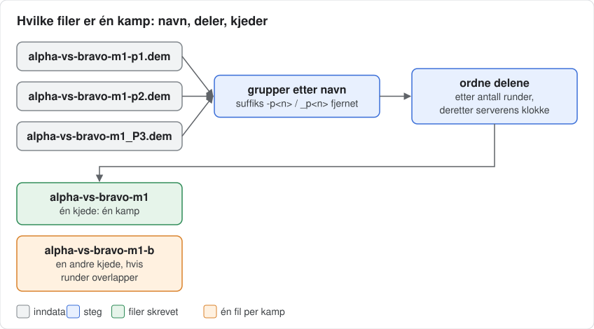

# Kommandoer {#commands}

Ny på kommandolinjen? Les [Før du begynner](before-you-start.md) først.
Skriv disse i en terminal som er åpnet i mappen du pakket ut eller klonet til;
`<...>` er plassholdere, og en sti med mellomrom settes i anførselstegn.

```text
python -m heat3d_cs2 demos <demofiler eller mapper> -o <mappe> [--every 8] [--jobs N] [--map TEKST] [--force] [--no-bulk] [--loose]
python -m heat3d_cs2 map <kartnavn | sti til dets .vpk> -o <fil.glb> [--game MAPPE] [--source2viewer EXE]
python -m heat3d_cs2 scoreboard <match.3dheat | match.json>
```

`python -m heat3d_cs2 --help` og `python -m heat3d_cs2 <verb> --help` lister de
samme valgene; [Kommandoreferansen](../cli-reference.md) viser alle. Hver start kjører
først sjekken for nye utgivelser som er beskrevet under [Oppdateringer](updates.md)
(av med `HEAT3D_NO_UPDATE=1`).

Kode: [`heat3d_cs2/cli.py`](https://github.com/Holdi601/3DHeat-CS2/blob/main/heat3d_cs2/cli.py).

## `demos` - demoer til tabeller og kampdokumenter {#demos---demos-into-tables-and-match-documents}

```powershell
python -m heat3d_cs2 demos D:\Demos\event -o out
python -m heat3d_cs2 demos alpha-vs-bravo-m1-p1.dem alpha-vs-bravo-m1-p2.dem -o out
python -m heat3d_cs2 demos D:\Demos -o out --map final --jobs 4
```

| Argument | Standard | Gjør |
|---|---|---|
| `paths` (én eller flere) | - | demofiler og mapper. En fil tas med når filendelsen er `.dem` (uansett store eller små bokstaver). En mappe søkes **rekursivt** etter filer som ender på `.dem`, uansett bokstavstørrelse, i sortert rekkefølge. Komprimerte demoer (`.dem.zst`, `.dem.bz2`, arkiver) leses ikke: pakk dem ut først. |
| `-o`, `--out` | påkrevd | mappen det skrives til; opprettes ved behov |
| `--every N` | `8` | samplet hver spiller hvert *N*. tick. CS2-demoer går med 64 tick per sekund, så 8 gir åtte prøver per sekund, 4 gir seksten, 64 gir én. Hendelser leses alltid på sitt eget tick, uansett *N*. |
| `--jobs N` | `0` = halvparten av CPU-kjernene | hvor mange kamper som konverteres samtidig, hver i sin egen prosess. Aldri færre enn 1, aldri flere enn det er kamper å gjøre. |
| `--map TEKST` | - | bare kamper der **navnet** inneholder *TEKST*, uten hensyn til store og små bokstaver (`--map final`). Det filtrerer på filnavnet, ikke på kartet demoen viser at den har. |
| `--force` | av | konverter kamper som allerede er skrevet, og overskriv dem |
| `--loose` | av | behold hver kamp som egne filer - tabell, `.match.json`, sidefiler - i stedet for å pakke dem i én `.3dheat`-beholder. Se [En fil per kamp](output-container.md). |
| `--container` | på | pakk hver kamp i én `.3dheat`-fil; standard, så bare der for å være eksplisitt |
| `--no-bulk` | av | la hendelsesstrømmen, spillernes kommandoer og animasjonsstrømmen stå utenfor pakkesidefilen - over halvparten av en demos størrelse selv komprimert. Kampdokumentets egenkontroll teller dem da som `lost`, etter navn. |


### Hvilke filer er en kamp {#which-files-are-one-match}



Kampnavnet er demofilens navn uten filendelse og uten et delsuffiks: `-p<siffer>`
eller `_p<siffer>` til slutt, uansett bokstavstørrelse. Så `alpha-vs-bravo-m1-p1.dem`,
`alpha-vs-bravo-m1-p2.dem` og `alpha-vs-bravo-m1_P3.dem` er delene av én kamp,
`alpha-vs-bravo-m1`. Filer grupperes på navnet alene - to filer med samme navn i
ulike mapper grupperes også.

Suffikset sier ingenting om rekkefølgen: en `-p2` kan være den tidligere halvdelen.
Delene settes i rekkefølge etter hvor mange runder de inneholder, og deretter etter
serverens klokke. En gruppe som viser seg å inneholde to forskjellige kamper (de
samme lagene på samme kart ved to arrangementer, for eksempel) deles i **kjeder**:
kjeden med flest runder skrives under navnet selv, den neste som `<navn>-b`, så
`<navn>-c`, og så videre. En fil uten noen runde (bare oppvarming, en pause) hører til
ingen kjede. Hvordan kjedene finnes, står i [Bygge en kamp](building-matches.md#parts-and-chains).

### Hva som skrives {#what-is-written}

For hver kamp, i en mappe med navnet på kartet demoens header oppgir (`unknown` når
den ikke oppgir noe), én `.3dheat`-fil:

```text
out/
  de_x/
    alpha-vs-bravo-m1.3dheat
    alpha-vs-bravo-m2.3dheat
  de_y/
    ...
```

På den syntetiske demoen med to runder fra testene:


Med `--loose` er hver kamp tabellen, kampdokumentet og fire sidefiler side om side
([En fil per kamp](output-container.md)):


Et varmekart er av ett kart, så å laste inn én mappe i visningen er å laste inn
ett karts kamper. Se [Varmekarttabellen](output-table.md) og
[Kampdokumentet](output-match-json.md).

### Hva som hoppes over {#what-is-skipped}

Før noe leses, listes hver `*.3dheat` hvor som helst under `--out` (en beholder skrives
enten helt eller ikke i det hele), og hver `*.parquet` som har sitt kampdokument
(`<navn>.match.json`) ved siden av seg. En kamp hvis navn er likt et av filnavnene
(uten filendelse), hoppes over, med mindre `--force` er satt. En tabell uten sitt
kampdokument - en kjøring som ble stoppet mellom de to skrivingene - teller ikke, så
den kampen konverteres på nytt. Sjekken gjøres bare på navn: en kamp konvertert til en
annen kartmappe, eller med et annet `--every`, teller likevel som ferdig. Når det ikke
er noe igjen å gjøre:

```text
nothing to do: no demos found, or every match already written (--force redoes them)
```

### Hva som skrives ut {#what-is-printed}

Først mengden arbeid, deretter én linje per kamp når den er ferdig (i den rekkefølgen
de blir ferdige, ikke filenes rekkefølge):

```text
3 match(es), 3 at a time
alpha-vs-bravo-m1: de_x, 21 rounds (Alpha 13 Bravo 8), 412,377 rows, lost 0
alpha-vs-bravo-m2: de_y, 30 rounds (Bravo 16 Alpha 14), 598,104 rows, 1 incomplete round(s) left out, lost 0
alpha-vs-bravo-m3: de_y, 18 rounds (Alpha 13 Bravo 5), 330,981 rows, recorded from round 3, lost 1,204,331 (svc_PacketEntities, svc_UserCmds, DEM_AnimationData)
```

(Tallene er illustrative.) Resultatet er den siste runden sin, lag for lag i
rekkefølgen kampdokumentet lister dem. *incomplete round(s) left out* teller runder
som en demo kuttet av før de var avgjort; *recorded from round N* sier at opptaket
starter sent; *lost* er kampdokumentets egenkontroll - hvor mange deler av demoen som
ikke gikk noe sted, og av hvilke slag (`--no-bulk` gjør bulken til `lost`). En kamp som
ikke gir noe, sier hvorfor:

```text
alpha-vs-bravo-m4: no round in 1 file(s) - nothing written
alpha-vs-bravo-m4-b: no complete round in 1 file(s) - nothing written
```

En feil i én kamp stopper ikke de andre; den skrives ut som
`<navn>: failed - <feil>`.

### Avslutningskode {#exit-code}

`0` når hver kamp ble konvertert (eller det ikke var noe å gjøre), `1` når minst én
mislyktes.

### Hvor lang tid det tar {#how-long-it-takes}

Hver kamp leses og bygges i en arbeidsprosess. En mappe med noen hundre demoer tar
minutter med standard `--jobs`. Minnet per jobb vokser med kampens lengde og med et
mindre `--every`: hver arbeider holder på hver samplet spillerrad i sin kamp (omtrent
ti spillere ganger 64 / *N* rader per sekund opptak) før den skriver.

Sidefilene tar lengre tid enn tabellen: hver egenskap parseren leser, leses på hvert
tick, et vindu av tick om gangen (omtrent to minutter for en demo på 40 minutter, nær
3 GB minne på det meste per jobb), og deretter gjennomgås demoen én gang til for rammene
og meldingene.

## `map` - et karts geometri som `.glb` {#map---a-maps-geometry-as-glb}


```powershell
python -m heat3d_cs2 map <map> -o out/<map>/<map>.glb
python -m heat3d_cs2 map <map> -o <map>.glb --game "D:\Games\Steam\steamapps\common\Counter-Strike Global Offensive"
python -m heat3d_cs2 map "D:\maps\<map>.vpk" -o <map>.glb --source2viewer C:\Tools\Source2Viewer-CLI.exe
```

| Argument | Standard | Gjør |
|---|---|---|
| `name` | - | kartets navn (som `de_x`), eller stien til dets `.vpk`. En sti som ender på `.vpk` og finnes, brukes som den er; alt annet slås opp på filstammen i det installerte spillet. |
| `-o`, `--out` | påkrevd | `.glb`-filen som skrives; mappen opprettes ved behov |
| `--game MAPPE` | Steams biblioteker | installasjonsmappen til CS2 (den som inneholder `game\csgo`), når Steam ikke kjenner den. Med `--game` søkes bare den mappen. |
| `--source2viewer EXE` | `HEAT3D_SOURCE2VIEWER`, deretter `PATH` | den kjørbare filen til Source2Viewer-CLI |

Utskrift ved suksess:

```text
out/de_x/de_x.glb: de_x, 412,880 triangles (151,204 ground) in 14 parts
```

(tall illustrative). Å skrive `.glb`-filen ved siden av kartets tabeller
(`out/<map>/<map>.glb`) holder et karts data og geometri i én mappe. Slik fungerer
eksporten: [Eksport av kart](map-export.md).

Feil, hver skrevet ut som `error: ...` med avslutningskode `2`:

| Melding | Betyr |
|---|---|
| `no de_x.vpk found in an installed CS2 - pass --game <CS2 folder> or the .vpk path` | kartet finnes ikke i noe Steam-bibliotek som ble funnet, eller navnet er feil |
| `Source2Viewer-CLI not found: ...` | ingen av `--source2viewer`, `HEAT3D_SOURCE2VIEWER` eller `PATH` ga en eksisterende fil |
| `Source2Viewer did not export de_x's collision mesh:` etterfulgt av slutten av utskriften |  den mislyktes, eller skrev ingen `.glb` |
| `de_x's collision mesh has nothing but clip brushes` | etter at clip og himmel er utelatt, var det ingenting igjen |

## `scoreboard` - en kamp som tekst {#scoreboard---a-match-as-text}

```bash
python -m heat3d_cs2 scoreboard out/de_x/alpha-vs-bravo-m1.3dheat
python -m heat3d_cs2 scoreboard out/de_x/alpha-vs-bravo-m1.match.json   # etter demos --loose
```

Skriver ut kampens resultattavle fra dens [kampdokument](output-match-json.md), uten
å åpne visningen. Den leser dokumentet i en `.3dheat`-beholder, eller en løs
`<kamp>.match.json`. På den syntetiske demoen med to runder fra testene:


```text
alpha-vs-bravo-m1 - de_test  Alpha 2  Bravo 0

Alpha
player                 K   D   A  +/-    ADR   KAST   HS%  OK-OD  clutch
ash                    1   0   0   +1   50.0 100.0%    0%   0-0     1/1
ace                    1   1   0   +0   50.0 100.0%  100%   1-0     0/0

Bravo
player                 K   D   A  +/-    ADR   KAST   HS%  OK-OD  clutch
ben                    1   1   0   +0   50.0 100.0%    0%   0-0     0/1
bob                    0   1   0   -1    0.0 100.0%    0%   0-1     0/0

rounds  1:TK 2:TB
```

- Den første linjen: kampnavn, kart, og sluttscoren per lag.
- En tabell per lag, i rekkefølgen kampdokumentets `teams` gir; spillere i kampdokumentets
  rekkefølge (etter drap minus dødsfall, deretter drap, best først). Navn kuttes til 19 tegn.
- Kolonner: **K** drap, **D** dødsfall, **A** assists *inkludert* blendingsassists,
  **+/-** drap minus dødsfall, **ADR**, **KAST** (%), **HS%** (avrundet til hele
  prosent), **OK-OD** åpningsdrap - åpningsdødsfall, **clutch** vunne clutcher /
  spilte clutcher. Definisjoner: [Statistikk](statistics.md).
- Rundestripen: `<runde>:<vinnende side><hvordan>`, med **B** bombe gikk av,
  **D** desarmert, **K** eliminering, **T** tiden løp ut, og **?** for alt annet
  (uavgjort, overgivelse, annet). En uavgjort runde har ingen vinnende side:
  `<runde>:?`.

En fil som ikke er gyldig JSON, eller ikke finnes, stopper med en feil; et JSON-dokument
uten kampdokumentets felter feiler med en Python-feil (det valideres ikke videre).
