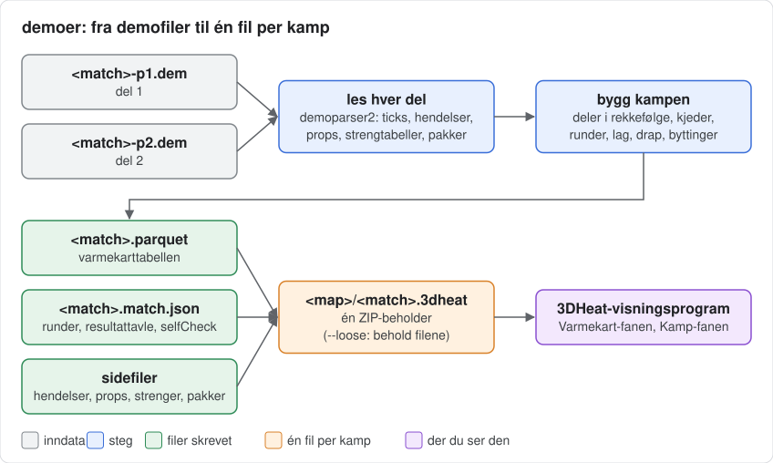

# 3DHeat CS2 {#dheat-cs2}

**Hva er det?** Counter-Strike 2 kan lagre et opptak av en kamp, kalt en
*demo*. Dette verktøyet gjør en demo om til filer 3DHeat-visningsprogrammet kan vise i 3D:
hvor alle sto, døde, kastet og plantet, runde for runde. Det kan også
gjøre et CS2-kart om til en 3D-modell å vise dem på.

**Hvorfor skulle jeg bruke det?** For å gå gjennom dine egne kamper, for å legge mange kamper på
ett kart oppå hverandre som ett varmekart, og for kampstatistikk som ADR
(gjennomsnittlig skade per runde) og KAST (andelen runder en spiller drepte, assisterte, overlevde eller ble byttet ut i).

**Eksempel:** `alpha-vs-bravo-m1.dem` inn, `out/de_x/alpha-vs-bravo-m1.3dheat`
ut (`de_x` er et oppdiktet kartnavn).



Mer i detalj: 3DHeat CS2 gjør **Counter-Strike 2-demoer** om til en varmekarttabell og et kampdokument per kamp, og et **CS2-kart** til nivågeometri. Utdataene er laget
for [3DHeat](https://holdi601.github.io/3DHeat/)-telemetri-visningsprogrammet
([kilde](https://github.com/Holdi601/3DHeat)), men de er vanlige filer - Parquet, JSON og
binær glTF - som alt annet også kan lese.

Det er en liten Python-pakke, `heat3d_cs2`, kjørt fra kommandolinjen. Den leser
demoer fra disk (den laster ned ingen) med
[demoparser2](https://github.com/LaihoE/demoparser), og eksporterer kart fra det installerte
spillet med kommandolinjebygget av Source2Viewer
([ValveResourceFormat](https://github.com/ValveResourceFormat/ValveResourceFormat)).

## Hurtigstart {#quick-start}

Ny til kommandolinjen? Les [Før du starter](before-you-start.md) først.

```bash
pip install -r requirements.txt
python -m heat3d_cs2 demos <demo files or folders> -o out   # hver kamp i dem
python -m heat3d_cs2 map <map> -o out/<map>/<map>.glb       # kartet fra det installerte spillet
python -m heat3d_cs2 scoreboard out/<map>/<match>.3dheat    # en kamps resultattavle som tekst
```

Du bør se `1 match(es), 1 at a time ...` og deretter én linje per kamp
(se [Kommandoer](../commands.md#what-is-printed)).

`demos` skriver, per kamp, én fil i en mappe oppkalt etter kartet:
`out/<map>/<match>.3dheat`, en [`.3dheat`-beholder](../output-container.md) - visningsprogrammets
format med én fil per kamp ([spesifikasjon](https://holdi601.github.io/3DHeat/container.html)).
Den holder disse delene; `--loose` skriver dem som separate filer i stedet:

| Del | Hva den holder | Lastes i visningsprogrammets |
|---|---|---|
| `<match>.parquet` (rolle `table`) | hver levende spiller åtte ganger i sekundet med deres tilstand (helse, penger, blending, sikte, sone, inventar, ...), og hver hendelse der den skjedde (drap, død, skade, skudd, kast, granateksplosjoner, blending, plantet, desarmert, eksplodert, og en rundeslutt per spiller med det runden betalte dem), én rad hver | Varmekart-fanen |
| `<match>.match.json` (rolle `match`, kampdokumentet) | lag, poengsum, hver runde (vinner, hvordan, økonomi, plantet, drap i rekkefølge, clutcher, overlevende) og hver spillers resultatlinje | Kamp-fanen |
| `<match>.events/props/strings/packets.parquet` | alt annet demoen holder, helt (sidefiler) | beholdt for fullstendighet |

`map` skriver `<map>.glb`: kartets kollisjonsnett - gulv, vegger, bokser,
uten dekor - delt i bakke og struktur, i samme ramme og enheter som tabellene, så det
ligger nøyaktig under varmekartet (Bakgrunn / nivå-panelet).

## Dokumentasjonens oversikt {#map-of-this-documentation}

| Side | Hva den dekker |
|---|---|
| [Før du starter](before-you-start.md) | Python, en terminal, plassholdere, hvordan suksess og de vanlige feilene ser ut |
| [Installasjon](../installing.md) | Python, pakkene, Source2Viewers CLI, hvor CS2 må ligge |
| [Kommandoer](../commands.md) | `demos`, `map`, `scoreboard`: hvert alternativ, hva som skrives ut, avslutningskoder |
| [Lese en demo](../reading-demos.md) | hva som leses fra en demofil: samplede ticks, spilleregenskaper, spillregler, hendelser |
| [Bygge en kamp](../building-matches.md) | deler og kjeder, kampklokken, runder, lag og sider, rader, drap, byttinger, åpninger, skade, blendinger, økonomi |
| [Statistikk](../statistics.md) | resultattavlen: K/D/A, ADR, KAST, HS%, åpninger, byttinger, multidrap, clutcher, utility, blendinger |
| [Varmekarttabellen](../output-table.md) | Parquet-filen: hver kolonne, dens type, hvilke hendelser som fyller den, `heat3d`-hintene i bunnteksten, aksene |
| [Kampdokumentet](../output-match-json.md) | `.match.json`-dokumentet, felt for felt |
| [Én fil per kamp](../output-container.md) | `.3dheat`-beholderen `demos` skriver som standard, `--loose` |
| [Karteksport](../map-export.md) | hvordan et karts kollisjonsnett eksporteres, rammen, nodenavngivning, enheter |
| [Bruke det med 3DHeat](../using-with-3dheat.md) | laste tabeller, kampdokumenter og kart inn i visningsprogrammets Varmekart- og Kamp-faner |
| [Begrensninger](../limits.md) | hva som antas, hva som ikke håndteres, hva som ikke er verifisert |
| [Oppdateringer](../updates.md) | utgivelsessjekken ved oppstart og `python -m heat3d_update` |
| [Utvikling](../development.md) | kodeoppsett, tester, den syntetiske demo-fiksturen |
| [Kommandoreferanse](../cli-reference.md) | hver kommandos `--help`, generert fra koden |
| [Vedlikeholde dokumentasjonen](../maintaining.md) | utgivelsessjekklisten for disse sidene |

## Hva det er kontrollert mot {#what-it-is-checked-against}

Demoer fra den virkelige verden er ikke én ren fil per kamp. Konverteren håndterer en kamp delt over filer i
hvilken som helst rekkefølge, en server startet på nytt midt i en kamp, to forskjellige kamper lagret under ett
navn, runder gjenopprettet fra en sikkerhetskopi, et opptak som starter sent eller slutter tidlig, pauser,
og trenere på et lags side - se [Bygge en kamp](../building-matches.md). Kontrollert over en stor samling
turneringsdemoer: i hver kamp følger poengsummen rundevinnerne, hver sides drap er den andre
sides dødsfall, og hver runde starter fem mot fem.

## Hva du skal peke den på {#what-to-point-it-at}

Dine egne kampers demoer, demoer du lastet ned for hånd fra en turneringsside,
eller demoer fra et API du har tilgang til. En demo er et opptak hvis innhold
tilhører utgiveren og arrangørene: bruk det som kommer ut til din egen
analyse, og ikke del demoer eller data avledet av dem. Sider som
tilbyr demoer forbyr ofte automatisert nedlasting i sine vilkår, som er grunnen til at
verktøyet leser demoer fra disk og ikke henter noen.

## Del av 3DHeat {#part-of-3dheat}

3DHeat CS2 er ett av de gratis verktøyene rundt 3DHeat-visningsprogrammet, hver med sitt eget
repositorium med egne utgivelser og lisens:

| Verktøy | Hva det gjør | Dokumentasjon |
|---|---|---|
| [3DHeat](https://github.com/Holdi601/3DHeat) | visningsprogrammet: varmekart, løpsanalyse og kampgjennomgang i 3D | [nettsted](https://holdi601.github.io/3DHeat/) |
| [GameFiles](https://github.com/Holdi601/3DHeat-GameFiles) | løyper og nivåer ut av filene spill leverer, som 3D-modeller | [nettsted](https://holdi601.github.io/3DHeat-GameFiles/) |
| [GameCapture](https://github.com/Holdi601/3DHeat-GameCapture) | rundetelemetri fra løpsspill; nivåer bygget opp fra spillvideo | [nettsted](https://holdi601.github.io/3DHeat-GameCapture/) |
| [Unreal Exporter](https://github.com/Holdi601/3DHeat-UnrealExporter) | en Unreal Editor-plugin som eksporterer et nivå som én 3D-modell | [nettsted](https://holdi601.github.io/3DHeat-UnrealExporter/) |
| [CS2](https://github.com/Holdi601/3DHeat-CS2) | Counter-Strike 2-demoer til tabeller og kampdokumenter; kart til 3D-modeller | [nettsted](https://holdi601.github.io/3DHeat-CS2/) |
| [Watcher](https://github.com/Holdi601/3DHeat-Watcher) | tar opp spillingen din i bakgrunnen fra det spill publiserer | [nettsted](https://holdi601.github.io/3DHeat-Watcher/) |
| [Ext-WarThunder](https://github.com/Holdi601/3DHeat-Ext-WarThunder) | War Thunder-replayer til tabeller og kampdokumenter | [nettsted](https://holdi601.github.io/3DHeat-Ext-WarThunder/) |
| [Ext-WoT](https://github.com/Holdi601/3DHeat-Ext-WoT) | World of Tanks-replayer til tabeller og kampdokumenter | [nettsted](https://holdi601.github.io/3DHeat-Ext-WoT/) |
| [Ext-WoWs](https://github.com/Holdi601/3DHeat-Ext-WoWs) | World of Warships-replayer til tabeller og kampdokumenter | [nettsted](https://holdi601.github.io/3DHeat-Ext-WoWs/) |
| [Ext-Squad](https://github.com/Holdi601/3DHeat-Ext-Squad) | Squad-serverdemoer til tabeller og kampdokumenter | [nettsted](https://holdi601.github.io/3DHeat-Ext-Squad/) |
| [Ext-DCS](https://github.com/Holdi601/3DHeat-Ext-DCS) | DCS World-kart til 3D-modeller | [nettsted](https://holdi601.github.io/3DHeat-Ext-DCS/) |
| [Ext-IL2](https://github.com/Holdi601/3DHeat-Ext-IL2) | IL-2 Great Battles-kart til 3D-modeller | [nettsted](https://holdi601.github.io/3DHeat-Ext-IL2/) |

## Lisens {#licence}

MIT - se [`LICENSE`](https://github.com/Holdi601/3DHeat-CS2/blob/main/LICENSE),
og [`LICENSES.md`](https://github.com/Holdi601/3DHeat-CS2/blob/main/LICENSES.md)
for tredjepartspakkene og hva spillene den leser krever.
