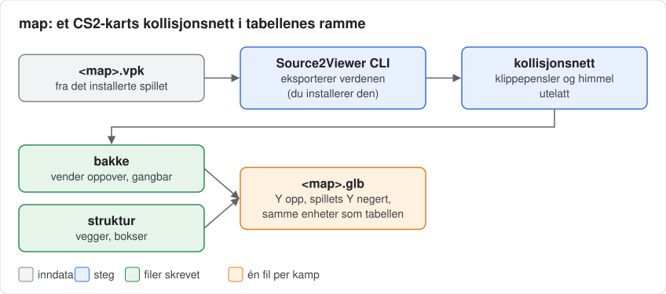

# Eksport av kart (`map`) {#map-export-map}

`python -m heat3d_cs2 map <kart> -o <fil.glb>` skriver et CS2-kart som nivågeometri: verdens
**kollisjonsnett**, i det koordinatsystemet og de enhetene
[varmekarttabellene](output-table.md) tegnes i. Kode:
[`heat3d_cs2/mapexport.py`](https://github.com/Holdi601/3DHeat-CS2/blob/main/heat3d_cs2/mapexport.py),
[`heat3d_cs2/glb.py`](https://github.com/Holdi601/3DHeat-CS2/blob/main/heat3d_cs2/glb.py).
Valg og meldinger: [Kommandoer](commands.md#map---a-maps-geometry-as-glb).



## Hvorfor kollisjonsnettet {#why-the-collision-mesh}

Kollisjonsnettet er det spillerne står på og gjemmer seg bak - gulv, vegger, trapper, kasser -
uten dekorasjonen: ingen rekvisitter som bare ser ut som noe, ingen teksturer, langt færre
trekanter enn gjengivelsesnettene. Det er det et varmekart trenger under seg: noe å lese
posisjoner mot, ikke en gjengivelse av kartet.

## Hvordan det hentes {#how-it-is-obtained}

1. **Finn kartet.** En sti som ender på `.vpk` og finnes, brukes som den er. Ellers letes det etter
   `<navn>.vpk` i `<CS2-mappen>\game\csgo\maps\`, der CS2-mappen er `--game`, eller
   `steamapps\common\Counter-Strike Global Offensive` i hvert Steam-bibliotek som finnes (se
   [Installasjon](installing.md#where-cs2-is-looked-for)).
2. **Finn Source2Viewers CLI**: `--source2viewer`, deretter `HEAT3D_SOURCE2VIEWER`, deretter
   `Source2Viewer-CLI` / `Source2Viewer-CLI.exe` på `PATH`.
3. **Eksporter verdens fysikk.** Source2Viewer kjøres slik:

   ```text
   Source2Viewer-CLI -i <map>.vpk -d -f maps/<map>/world_physics.vmdl_c --gltf_export_format glb -o <midlertidig mappe>
   ```

   Den dekoder Source 2s kompilerte fysikk fra kartets eget arkiv og skriver modellen (tom: verden
   har ingen gjengivelsesnett av egen) og dens fysikk ved siden av den. Den største `.glb`-filen som
   skrives, er fysikken. Hvis Source2Viewer mislykkes eller ikke skriver noen `.glb`, stopper
   kommandoen, og viser de siste 800 tegnene av dens utdata og feilmeldinger.
4. **Les den.** Hver node i scenen gjennomgås med sin transformasjon (matrise, eller translasjon-
   rotasjon-skala), og hver trekantprimitiv tas med, med eller uten indeksbuffer, i verdenskoordinater.
5. **Utelat det som ikke er en vegg eller et gulv.** En node der navnet inneholder `clip` - spillerclip,
   NPC-clip, granatclip: de usynlige veggene som stopper spillere og granater - eller `sky`, uansett
   bokstavstørrelse, fjernes.
6. **Navngi flaten.** Fysikkgruppene er navngitt etter sin flate; navnet med små bokstaver, uten et
   ledende `physics`, `physics_group` eller `physics_passbullets` (og understreken etter det), er
   flaten: `physics_group_concrete` er `concrete`, `physics_passbullets_chainlink` er `chainlink`, og
   en ren `physics_group` er `world`. Flater som kulene går gjennom, beholdes.
7. **Tilbake til spillets koordinatsystem.** Source2Viewer skriver glTF i meter med Y opp: spillets
   (Y, Z, X) multiplisert med 0,0254. Det angres - hvert punkt blir spillets (X, Y, Z) i tommer.
8. **Del gulv fra konstruksjon**, trekant for trekant: en flate hvis normal peker opp med minst 0,7
   (Z-komponenten, normalisert) - skråninger opptil omtrent 45 grader, omtrent det brattste en CS2-
   spiller går på - er **gulv**; alt annet, vegger og tak inkludert, er **konstruksjon**.
9. **Inn i visningens koordinatsystem.** Hvert punkt skrives som (X, Z, -Y): Y opp, spillets Y
   negert - koordinatsystemet visningen tegner tabellene i, når den følger deres `heat3d`-hint. En
   rotasjon, ikke en speiling.
10. **Skriv `.glb`-filen.** Hvis ingenting er igjen (bare clip-brett), stopper kommandoen med en feil.
    Ellers skrives filen, kartet, antall trekanter, hvor mange som er gulv, og antall deler ut.

Ingenting her leser noe annet enn kartets eget `.vpk`, og ingenting av Source2Viewer følger med
eller kopieres.

## Filen {#the-file}

En glTF 2.0 binær (`.glb`), én buffer, skrevet av `heat3d_cs2` (`asset.generator`):

| Aspekt | Hva |
|---|---|
| Noder | én per del, alle på rotnivå, uten transformasjoner, hver med sitt eget nett med samme navn |
| Nodenavn | `ground:<flate>` eller `structure:<flate>` (`ground:concrete`, `structure:metal`, `structure:world`), sortert etter navn |
| Primitiver | én per nett, trekanter, `POSITION` (float32, med min/maks) og `NORMAL` (float32), `uint32`-indekser |
| Skygge | flat: ett toppunkt per trekanthjørne, hver med sin trekants normal |
| Materialer, teksturer, UV-er, farger | ingen |
| Enheter | spillenheter (**tommer**), ikke meter - ulikt det glTF antar |
| Koordinatsystem | (X, Z, -Y) fra spillet: glTFs Y er spillets høyde, glTFs Z er spillets -Y |

Prefikset `ground:` / `structure:` er konvensjonen for alle 3DHeat-nivåeksportørene: visningen tar
en del navngitt slik for god fisk i stedet for å gjette fra geometrien, så gulvene får gulvskyggen
og veggene konstruksjonstegningen uten noe klassifiseringstrinn.

Fordi enhetene er tommer, viser en annen glTF-visning kartet omtrent 39 ganger for stort (den leser
dem som meter); skaler med 0,0254 der det betyr noe. I 3DHeat ligger det nøyaktig under tabellen,
som er i de samme enhetene med skala 1.

## Sjekken at koordinatsystemet er riktig {#the-check-that-the-frame-is-right}

Testen `test_players_stand_on_the_exported_floor` (kjøres bare når en demo og Source2Viewer er
oppgitt, se [Utvikling](development.md#tests)) eksporterer kartet en demo ble spilt på, tar 300
tilfeldige posisjonsprøver fra kampen, og for hver ser den rett ned etter det høyeste gulvtrekanten
høyst 4 enheter over spillerens føtter. Den krever at minst 98 % av prøvene finner gulv, og at
medianhøyden over det er under 5 enheter. Et speilvendt kart feiler: på et kart speilvendt om feil
akse står en stor andel av spillerne over ingenting. README-filen rapporterer tallene fra denne
sjekken over kartene i den nåværende konkurransepoolen.

## Hva den ikke gjør {#what-it-does-not-do}

- Ingen gjengivelsesgeometri, teksturer eller dekorasjon - se *hvorfor* over.
- Bare det som ligger i kartets `world_physics`-modell eksporteres. Om bevegelige deler (dører) eller
  knuselige deler er med, er ikke sjekket.
- Ingen forenkling: 3DHeat-visningen forenkler ved import med innstillingen **Forenklingsmål**.
- Kart som ikke finnes i det installerte spillet (verkstedkart andre steder på disken) virker når
  deres `.vpk` oppgis som sti og inneholder `maps/<navn>/world_physics.vmdl_c`; ikke verifisert.
