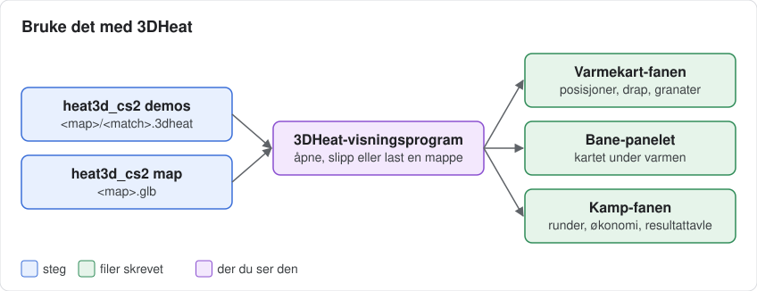

# Bruk med 3DHeat {#using-it-with-3dheat}

Utdataene går inn på disse stedene i [3DHeat-visningen](https://holdi601.github.io/3DHeat):

| Fil | Hvor | Hva den gir |
|---|---|---|
| `<kamp>.3dheat` (standard) | **Varmekart**-fanen, **Kilde**-panelet, eller **Kamp**-fanen | tabellen og kampdokumentet sammen, én fil per kamp ([beholder](https://holdi601.github.io/3DHeat/container.html)) |
| `<kamp>.parquet` | **Varmekart**-fanen, **Kilde**-panelet | posisjoner og hendelser som et varmekart, boksavspilling, ruter |
| `<kamp>.match.json` | **Kamp**-fanen, **Last inn kampfiler…** | resultattavlen, rundene, drapslisten, statistikk på tvers av kamper, lenker inn i varmekartet |
| `<map>.glb` | **Bakgrunn / nivå**-panelet, **3D-modell…** | kartet under varmekartet |

Visningens egen dokumentasjon beskriver hver fane fullt ut, på sidene
[Kampanalyse](https://holdi601.github.io/3DHeat/match-analysis.html),
[Laste inn filer](https://holdi601.github.io/3DHeat/loading-files.html),
[Kolonnetilordning](https://holdi601.github.io/3DHeat/column-mapping.html)
og [Boksavspilling](https://holdi601.github.io/3DHeat/box-replay.html). Denne siden er CS2-siden av det.



Visningen: [github.com/Holdi601/3DHeat](https://github.com/Holdi601/3DHeat), dokumentasjonen
[holdi601.github.io/3DHeat](https://holdi601.github.io/3DHeat/).

## En typisk økt {#a-typical-session}

```bash
python -m heat3d_cs2 demos D:\Demos\event -o out
python -m heat3d_cs2 map <map> -o out/<map>/<map>.glb
```

1. **Varmekart-fanen -> Kilde:** velg mappen `out/<map>` (eller slipp den inn).
   Hver `.parquet` i den blir ett datasett; `.json`- og `.glb`-filene i samme mappe hoppes over som
   «not a csv/parquet file». Last den inn.
2. **Bakgrunn / nivå -> 3D-modell…:** velg `out/<map>/<map>.glb`. **Lagre i biblioteket** beholder den i
   nettleseren til neste gang.
3. **Kamp-fanen -> Last inn kampfiler…:** velg `.match.json`-filene i samme mappe (flere samtidig), eller
   slipp dem på visningen mens Kamp-fanen er åpen.

Last bare inn ett karts tabeller om gangen: koordinatene til ulike kart overlapper, og et varmekart av to
kart samtidig betyr ingenting. Mappen per kart finnes for nettopp det.

## Tabellen åpner uten at du må sette noe {#the-table-opens-with-nothing-to-set}

Visningen leser den første valgte filens `heat3d`-oppføring i fotsporet
([Varmekarttabellen](output-table.md#the-heat3d-footer-hints)) og legger den over sine egne gjetninger:

| Visningsinnstilling | Sett til |
|---|---|
| Posisjon | `x`, `y`, `z` |
| Opp-akse i kilden | Z er opp |
| Speilvend Y | på - så kartet står riktig vei, ikke speilvendt |
| Enhetsskala | 1 - avstander i spillenheter (merket «m»; 1 enhet = 1 tomme) |
| Tid | `time`, sekunder |
| Person | `player` |
| Gruppe | `side` (T / CT) |
| Økt | `roundId` - hver runde er en økt, `<kamp> #NN` |
| Blikkretning | vektor, `dirX` / `dirY` / `dirZ` |
| Filterkolonner | `event`, `match`, `round`, `roundTime`, `phase`, `weapon`, `place`, `won`, `buy`, `opening`, `team` |
| Enhetsstørrelse | 32 - boksavspillingen tegner en spiller 32 enheter på tvers, med en siktestråle på 4 x 32 |

Hver hintet verdi vises fortsatt i kolonnetilordningen og kan endres. De andre kolonnene (`headshot`,
`traded`, `other`, `steamid`, `health`, `money`, `damage`, `duration`, ...) kan legges til som filtre der
for hånd.

Hold enhetsskalaen på 1 når et kart er lastet: `.glb`-filen er i de samme spillenhetene, og nivået skaleres
ikke med tabellen.

### Nyttige filtre {#useful-filters}

- `event` = `position` for hvor spillerne var; `kill` / `death` for hvor duellene ble vunnet og tapt;
  `smoke`, `flash`, `molotov`, `he` for hvor utility landet; `throw` for hvor det ble kastet fra; `plant`
  for plantingsstedene.
- `side` (gruppen) = `T` eller `CT`, `phase` = `live` for å utelate etter-fasen, `buy` = `eco` / `force` /
  `full` for runder med én økonomi, `won` = 1 for runder radens side vant.
- `opening` = 1 med `kill` og `death` for åpningsduellene.
- `roundTime` som et intervall for et øyeblikk i runden: de første 20 sekundene, etter plantingen.

## Kamp-fanen {#the-match-tab}

Kamp-fanen tar imot en JSON-fil der `format` er `heat3d-cs2-match` og som har `rounds`-, `players`- og
`teams`-lister ([Kampdokumentet](output-match-json.md)). Den viser score og halvdeler, en stripe av runder
farget etter den vinnende siden med et merke for hvordan hver endte, hver rundes økonomi, plantingen,
drapslisten, clutcher og overlevende, resultattavlen, og statistikk på tvers av alle lastede kamper.

Dens **Vis i varmekartet**-lenker laster ikke inn noe. De setter filtre på tabellen som allerede er lastet i
Varmekart-fanen - `match`, `round` (og rundens økt `<kamp> #NN`), `event`, spilleren, siden. Det virker
fordi kampdokumentet og tabellen bærer de samme kampnavnene, rundenumrene, spillernavnene og sidene.
**Spill av runde** bytter varmekartet til boksavspilling og spiller rundens økt fra starten.

Så last inn begge: tabellene til et kart i Varmekart-fanen, og kampdokumentene deres i Kamp-fanen. Et
kampdokument uten sin tabell viser fortsatt resultattavlen og rundene, og lenkene sier at det ikke er lastet
noen varmekartdata.

## Uten 3DHeat {#without-3dheat}

- Tabellen er vanlig Parquet: pandas, Polars, DuckDB, Spark og R sin `arrow` leser den alle, `heat3d`-oppføringen
  ignoreres, og tekstkolonnene leses som strenger eller kategorier.
- Kampdokumentet er vanlig JSON.
- Kartet er en gyldig glTF-binær, i tommer og ikke meter: skaler med 0,0254 for verktøy som antar meter. Dens
  koordinatsystem er glTFs eget (Y opp), så for å legge tabellen over i andre verktøy tegnes hver rads
  (x, y, z) som (x, z, -y), slik 3DHeat gjør.
