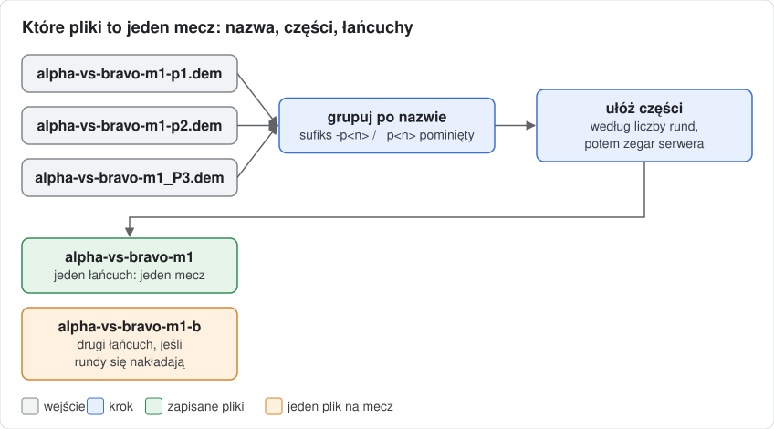

# Budowanie meczu {#building-a-match}

Jak z części dema powstaje mecz: które pliki należą do siebie, wspólny zegar dla wszystkich, rundy i to, jak każda się skończyła, drużyny i ich strony oraz każdy wiersz tabeli mapy cieplnej: zabójstwa, wymiany (trade), otwarcia, obrażenia, oślepienia i ekonomię. Kod:
[`heat3d_cs2/match.py`](https://github.com/Holdi601/3DHeat-CS2/blob/main/heat3d_cs2/match.py).
Wynik obliczony z tego znajduje się na stronie [Statystyki](statistics.md).

## Przegląd {#overview}

1. Wczytywany jest każdy plik o nazwie meczu ([Odczyt dema](reading-demos.md)).
2. Zdublowane wiersze graczy w każdym pliku (przywrócone rundy) zostają rozstrzygnięte.
3. Pliki są sortowane w **łańcuchy** - mecze - i każdy łańcuch jest ustawiany w kolejności.
4. Każda część zostaje umieszczona na **zegarze meczu**.
5. **Rundy** są znajdowane w każdej części; relacja z późniejszej części o danej rundzie zastępuje relację z wcześniejszej.
6. **Gracze** i **drużyny** zostają nazwani, a strony i wynik każdej rundy podane według nazwy drużyny. Gdy strony są znane, wynikają z nich długość połowy, rundy pistoletowe i **zakup** każdej strony.
7. Budowane są **wiersze**: pozycje, strzały, rzuty, detonacje, podłożenia, rozbrojenia, zabójstwa, śmierci, obrażenia, oślepienia, eksplozje.
8. Każdy wiersz dostaje etykietę: numer rundy, fazę, czas rundy, to, czy jego strona wygrała, oraz zakup jego strony. Wiersze poza każdą rundą są odrzucane.

## Przywrócone rundy: jeden wiersz na gracza na tick {#restored-rounds-one-row-per-player-per-tick}

Gdy runda zostaje przywrócona z kopii zapasowej w obrębie jednego pliku, dema przez kilka sekund zawierają stare ciała graczy obok nowych: dwa wiersze dla jednego gracza w jednym ticku, jeden tam, gdzie unieważniona runda go zostawiła, i jeden przy odrodzeniu w przywróconej rundzie. Dla każdego takiego gracza zduplikowane ticki są przechodzone **wstecz**, zaczynając od pierwszego pojedynczego wiersza po nich. W każdym ticku zachowywany jest kandydat najbliższy pozycji, która następuje, i to staje się punktem odniesienia dla poprzedniego ticku. Gdy po nich nie ma pojedynczego wiersza, zachowywany jest ostatni kandydat. Dzięki temu każdy gracz zachowuje wiersz, który prowadzi dalej, tam dokąd idzie.

## Żywa część pliku {#the-live-part-of-a-file}

**Żywy start** pliku to tick jego ostatniego zdarzenia `round_announce_match_start`, albo tick 0, gdy go nie ma (późniejsza część podzielonego meczu zwykle go nie ma). Wszystko przed żywym startem jest pomijane, tak samo wszystko oznaczone `is_warmup_period`. Runda na noże albo restart przed ogłoszeniem są więc pomijane. Runda na noże, po której *nie* następuje ogłoszenie startu meczu, nie zostaje rozpoznana jako taka (zob. [Ograniczenia](limits.md)).

**Rundy** pliku to zdarzenia `round_freeze_end` od żywego startu dalej, poza rozgrzewką. Są rozpoznawane po ich `total_rounds_played` (indeksie rundy, która ma się zacząć, liczonym od 0 przez grę). Plik bez nich nie ma rund i nie należy do żadnego meczu.

## Zegar {#the-clock}

Czasy są w sekundach. W obrębie pliku czas liczy się w **tickach**: `game_time` serwera w pierwszym próbkowanym ticku plus liczba ticków od tamtej chwili, podzielona przez 64. Zegar serwera stoi w czasie pauzy, podczas gdy ticki lecą dalej. Odczytany z zegara serwera, dwa momenty spauzowanego meczu miałyby ten sam czas.

Każdy plik ma *pierwszy zegar* (czas na żywym starcie) i *ostatni zegar* (na ostatnim próbkowanym ticku).

### Części i łańcuchy {#parts-and-chains}

Pliki nazwane jak jeden mecz ([Polecenia](commands.md#which-files-are-one-match)) są najpierw sortowane według indeksu ich pierwszej rundy, a potem według pierwszego zegara. Następnie każdy, w tej kolejności, dołącza do pierwszego łańcucha, który kontynuuje, albo zaczyna nowy łańcuch. Część kontynuuje łańcuch, gdy jej indeks pierwszej rundy jest co najmniej równy indeksowi ostatniej rundy ostatniej części łańcucha, **oraz** spełniony jest jeden z warunków:

- zegar serwera biegnie dalej: jego pierwszy zegar nie jest wcześniejszy niż ostatni zegar łańcucha minus 5 s; albo
- liczba rund biegnie dalej: jej indeks pierwszej rundy to indeks ostatniej rundy łańcucha albo następny po nim.

Decyduje liczba rund, a zegar rozstrzyga remisy. Serwer zrestartowany, żeby przywrócić rundę, zaczyna zegar od nowa, a dwa różne mecze o tej samej nazwie (te same drużyny na tej samej mapie na dwóch turniejach) mają nakładające się numery rund. Łańcuchy są uporządkowane według liczby rund, które obejmują, od największej. Pierwszy zachowuje nazwę meczu, pozostałe są zapisywane jako `<nazwa>-b`, `<nazwa>-c` itd.

### Zegar meczu {#the-match-clock}

Zero meczu to pierwszy zegar pierwszej części: **czas meczu 0 to żywy start pierwszego pliku**. Każda późniejsza część zostaje na nim umieszczona:

- tam, gdzie zegar serwera biegnie dalej (jego pierwszy zegar nie jest wcześniejszy niż ostatni zegar poprzedniej części minus 5 s), używany jest zegar serwera taki, jaki jest;
- tam, gdzie został zrestartowany, część zostaje umieszczona tak, by następowała **jedną sekundę** po zakończeniu poprzedniej części.

## Rundy {#rounds}

Dla każdego `round_freeze_end` części (w kolejności ticków) okno rundy sięga do następnego końca czasu zamrożenia w tej samej części albo do końca pliku. W jego obrębie runda jest **rozstrzygnięta** w pierwszym próbkowanym ticku, w którym stan gry pokazuje `total_rounds_played` równe indeksowi rundy + 1 oraz `round_win_status` równe 1 (remis), 2 (wygrali T) albo 3 (wygrali CT). Runda bez takiej próbki w swoim oknie została przerwana końcem pliku. Jej numer trafia na listę **niekompletnych** rund meczu, chyba że inna część ma tę rundę kompletną.

| Pole rundy | Skąd pochodzi |
|---|---|
| `number` | indeks + 1 (liczone od 1, tak jak liczy gra) |
| `start` | czas meczu zakończenia czasu zamrożenia - gracze mogą się ruszać |
| `end` | czas meczu pierwszej próbki pokazującej rundę jako rozstrzygniętą |
| `until` | czas meczu następnego `round_prestart` po `end`, jeśli mieści się w oknie; w przeciwnym razie koniec okna albo ostatni tick pliku, co nastąpi pierwsze (i nigdy przed `end`) |
| `winner` | `T` dla statusu 2, `CT` dla 3, pusty dla 1: remis jest rozstrzygnięty, ale bez zwycięzcy |
| `reason` | `round_win_reason` w tej próbce, nazwany jak niżej |
| `score` | nazwa drużyny -> rundy wygrane po tej rundzie: `team_rounds_total` każdej strony w próbce rozstrzygającej; gdy dema tego nie ma, wynik poprzedniej rundy plus jeden dla zwycięzcy |
| `sides` | nazwa drużyny -> `T` / `CT` w tej rundzie |
| `equipment` | strona -> zsumowana `current_equip_value` **żyjących** graczy tej strony w pierwszej próbce od końca czasu zamrożenia |
| `buy` | strona -> `pistol`, `eco`, `force` albo `full` ([Ekonomia i typy zakupu](#economy-and-buy-types)) |
| `plant` | pierwsze `bomb_planted` po końcu czasu zamrożenia i do `end`, albo brak |
| `exploded` | czas meczu pierwszego `bomb_exploded` po tym podłożeniu i przed następnym końcem czasu zamrożenia, jeśli jest (nie ma go w dokumencie meczu; określa czas wiersza `explode`) |

`reason`, z `CSRoundEndReason` gry:

| Kod | `reason` |
|---|---|
| 1 | `bomb` (cel wysadzony) |
| 7 | `defuse` (rozbrojona bomba) |
| 8, 9 | `elimination` (CT wygrali / T wygrali przez eliminację) |
| 10 | `draw` (remis) |
| 12 | `time` (cel uratowany) |
| 17, 18 | `surrender` (poddanie) |
| cokolwiek innego | `other` |

Gdy kilka części ma tę samą rundę (wg indeksu), zachowywana jest wersja z późniejszej części. Rundy są potem wymienione według indeksu. Mecz, którego pierwsza runda nie jest rundą 1, zapisuje brakujące numery (`missing` w dokumencie meczu); w linii poleceń pojawia się napis *recorded from round N* (nagranie od rundy N).

### Podłożenie {#the-plant}

| Pole | Skąd pochodzi |
|---|---|
| `site` | `A` albo `B`: strefa bomby, w której według gry stał podkładający (`which_bomb_zone`, 1 to A, 2 to B). Bez tego nazwa miejsca podkładającego (`BombsiteA`, `BombsiteB`). Bez niej litera, którą dało inne podłożenie w tym samym pliku w tej samej strefie (numer encji strefy to `site` zdarzenia). Puste, gdy nic nie wskazuje; nigdy numer. |
| `time` | sekundy **od początku rundy** (od jej końca czasu zamrożenia), jak czas zabójstwa |
| `player`, `steamid` | podkładający |
| `x`, `y`, `z` | pozycja podkładającego w jednostkach gry: tam, gdzie leży bomba |
| `place` | nazwa miejsca podkładającego w chwili podłożenia |

### Fazy {#the-phases}

Czas od `start` do `end` to **żywa** faza rundy. Od `end` do `until` to jej faza **po**, kiedy zwycięzcy polują, a przegrani oszczędzają. Wiersz należy do rundy, której przedział `[start, until)` zawiera jego czas, i jest w fazie `after`, gdy jego czas jest późniejszy niż `end`. Czas zamrożenia leży między rundami i nie należy do żadnej.

## Gracze i drużyny {#players-and-teams}

**Gracz** to każdy, kto był żywy choć raz po stronie (drużyna 2 lub 3), poza czasem zamrożenia i rozgrzewką, po żywym starcie. Trener albo komentator po stronie drużyny nigdy nie jest żywy i nie jest graczem. Każdy gracz jest kluczowany przez Steam ID; nazwa to ostatnia zobaczona.

**Drużyna** gracza to nazwa klanu, jaką gra nadała jego stronie (`team_clan_name`), ta widziana najczęściej dla niego. Dema czyszczą ją na samym końcu. Mecz rozegrany bez nazw klanów nazywa drużyny według strony, na której zaczęły: `Started T` i `Started CT`.

**Strony** każdej rundy wynikają z tego, kto był po której stronie między końcem czasu zamrożenia a końcem rundy: każda strona dostaje etykietę drużyny, którą nosi większość jej graczy. Lista `teams` meczu jest w kolejności pojawiania się, runda po rundzie, strona T przed CT; zwykle drużyna, która zaczynała na T, jest pierwsza.

## Wiersze {#the-rows}

Każda próbka pozycji i każde zdarzenie staje się jednym wierszem [tabeli mapy cieplnej](output-table.md). Gracze są po stronie tylko wtedy, gdy ich `team_num` wynosi 2 lub 3.

### Pozycje {#positions}

Z próbkowanych wierszy żywych graczy po jednej stronie, poza czasem zamrożenia i rozgrzewką, po żywym starcie: pozycja, kierunek patrzenia, zdrowie, pancerz, pieniądze, wartość wyposażenia, trzymana broń, miejsce.

Kierunek patrzenia to wektor jednostkowy w układzie gry: `(cos pitch * cos yaw, cos pitch * sin yaw, -sin pitch)`. Pitch w grze jest dodatni, gdy gracz patrzy w dół, więc patrzenie w dół daje ujemne Z.

Trzymana broń to `active_weapon_name` tak, jak nazywa ją gra, z tym wyjątkiem, że każda nazwa zawierająca `Knife`, `Bayonet`, `Karambit` albo `Daggers` staje się `Knife`.

### Strzały i rzuty {#shots-and-throws}

Z `weapon_fire`, w pozycji strzelającego. Noże (`knife`, `bayonet` w identyfikatorze broni) i C4 są pomijane. Granaty (`smokegrenade`, `flashbang`, `hegrenade`, `molotov`, `incgrenade`, `decoy`) to wiersze **throw** (rzut), wszystko inne to wiersze **shot** (strzał). Broń jest nazwana tak, jak pokazuje ją gra (poniżej).

### Detonacje granatów {#grenade-detonations}

| Zdarzenie | Wiersz | `weapon` |
|---|---|---|
| `smokegrenade_detonate` | `smoke` | Smoke Grenade |
| `flashbang_detonate` | `flash` | Flashbang |
| `hegrenade_detonate` | `he` | High Explosive Grenade |
| `inferno_startburn` (molotov i zapalający) | `molotov` | Molotov |
| `decoy_detonate` | `decoy` | Decoy Grenade |

Pozycja to **miejsce, w którym granat wybuchł** (`x`, `y`, `z` zdarzenia). Gracz i strona to rzucający. Dema nie podają miejsca dla granatu, tylko dla graczy, więc `place` jest puste: wiersz nie przypisuje sobie miejsca, w którym nie był. Miejsce rzucającego w tym momencie zachowywane jest jako `throwerPlace`.

### Podłożenia i rozbrojenia {#plants-and-defuses}

Wiersze `plant` i `defuse` w pozycji gracza, z bronią `C4 Explosive`. Podłożona bomba, która wybuchła, dostaje wiersz **explode**: w pozycji podłożenia, w czasie `bomb_exploded`, z podkładającym jako graczem (wraz z jego Steam ID), stroną `T`, drużyną T rundy jako `team` i miejscem podłożenia. Obejmuje to bombę wybuchającą po tym, jak T już wygrali przez eliminację. Gdy dema nie mają `bomb_exploded`, runda wygrana przez bombę (`reason` = `bomb`) z podłożeniem dostaje wiersz na końcu `end` rundy.

### Zabójstwa i śmierci {#kills-and-deaths}

Każde `player_death` w rundzie daje jeden **rekord zabójstwa** (tabela `kills` meczu) z:

| Pole | Co to jest |
|---|---|
| attacker, victim, assister | nazwy, Steam ID, strony; zabójca jest pusty dla świata (obrażenia od upadku, bomba) |
| `weapon` | broń zdarzenia, nazwana tak, jak pokazuje ją gra |
| `headshot` | flaga zdarzenia |
| `wallbang` | `penetrated` > 0 |
| `throughSmoke` | `thrusmoke` |
| `flashAssist` | `assistedflash` |
| `noscope`, `attackerBlind` | flagi zdarzenia (`noscope`, `attackerblind`); kolumny wierszy `kill` i `death` oraz zabójstw w dokumencie meczu |
| `suicide` | atakujący i ofiara to ten sam gracz, np. własny granat |
| `teamkill` | atakujący i ofiara po tej samej stronie, z atakującym i nie samobójstwo |
| `opening` | pierwsze zabójstwo wroga w rundzie (poniżej) |
| `traded`, `trade` | poniżej |
| pozycje | pozycja i miejsce atakującego oraz ofiary |

Z każdego rekordu tabela dostaje wiersz **death** w pozycji ofiary (każda śmierć, także od świata, teamkille i samobójstwa) oraz, przy zabójstwach przez wroga (atakujący, bez teamkilla, bez samobójstwa), wiersz **kill** w pozycji zabójcy.

**Otwarcie.** Pierwsze zabójstwo wroga w każdej rundzie, gdy jest ona żywa, to jej pojedynek otwierający. Teamkill, samobójstwo albo śmierć od świata przed nim są pomijane, więc otwarcie to wciąż pierwszy pojedynek rundy. Runda bez zabójstwa wroga, gdy jest żywa, nie ma otwarcia.

**Traded** i **trade.** Śmierć od wroga jest **traded** (wymieniona), gdy jej zabójca zostaje zabity przez kogoś ze strony ofiary w ciągu **5 sekund** po niej (więcej niż 0 i najwyżej 5 s później, w tej samej rundzie). Pierwsze takie zabójstwo to **trade** (wymiana). W tabeli kolumna `traded` wiersza `kill` wynosi 1 dla zabójstwa wymiany, a wiersza `death` 1 dla śmierci, która została pomszczona. Zabójstwa z fazy po też się liczą.

### Obrażenia {#damage}

Z `player_hurt`, tylko między **wrogami** (obaj po stronie, różne strony). Obrażenia to zdrowie faktycznie **stracone**: dla każdej ofiary w każdej rundzie zdrowie zaczyna się od 100; każde trafienie liczy się jako `min(dmg_health, zdrowie przed)`, a `health` zdarzenia (to, co zostało) staje się „przed” następnego trafienia. Strzał w głowę za 137 obrażeń w graczu z 40 zdrowia liczy się jako 40, tak jak liczy go tablica wyników gry. Trafienia od `hegrenade`, `inferno`, `molotov` i `incgrenade` to obrażenia **z granatów** (utility). Każde trafienie to wiersz **hurt** w pozycji ofiary, z atakującym jako `other`. Obrażenia od drużyny i własne nie są ani w tabeli, ani w statystykach.

### Błyski {#flashes}

Z `player_blind`, tylko **wrogów** (nie kolegów z drużyny, nie trenera ani komentatora, który patrzy): po jednym wierszu **blind** na oślepionego gracza, w pozycji oślepionego, z oślepiającym jako `other`, a czas oślepienia w sekundach jako `duration`. Każdy czas jest zachowywany; statystyki liczą tylko oślepienia trwające co najmniej jedną sekundę.

## Nazwy broni {#weapon-names}

Identyfikator broni ze zdarzenia (`ak47`, `weapon_ak47`, `knife_karambit`) jest pokazywany tak, jak nazywa go gra w `active_weapon_name` graczy. Dzięki temu broń zabójstwa i trzymana broń czytają się tak samo: `ak47` -> `AK-47`, `m4a1` -> `M4A4`, `m4a1_silencer` -> `M4A1-S`, `hkp2000` -> `P2000`, `taser` -> `Zeus x27`, `inferno` i `molotov` -> `Molotov`, `incgrenade` -> `Incendiary Grenade`, `c4` i `planted_c4` -> `C4 Explosive`, `world` -> `World`, i tak dalej dla każdej broni i granatu (tabela `WEAPONS` w `match.py`). Wszystko, co ma w identyfikatorze `knife` albo `bayonet`, to `Knife`. Identyfikator spoza tabeli zostaje taki, jaki jest.

## Ekonomia i typy zakupu {#economy-and-buy-types}

Na końcu czasu zamrożenia wartość wyposażenia każdej strony jest sumowana po jej żywych graczach, w pierwszej próbce od tego momentu, i dzielona przez ich liczbę:

| Runda | Średnie wyposażenie na gracza | `buy` |
|---|---|---|
| runda pistoletowa (pierwsza w każdej regulaminowej połowie) | dowolne | `pistol` |
| inne | poniżej 1500 $ | `eco` |
| inne | od 1500 $ do poniżej 4000 $ | `force` |
| inne | 4000 $ lub więcej | `full` |

Rundy pistoletowe zależą od tego, jak rozegrano połowy w meczu, a nie od stałego formatu. Połowa kończy się tam, gdzie strony po raz pierwszy zamieniają się miejscami między dwiema kolejnymi rundami, obie regulaminowe. Jej długość (`halfLength` w dokumencie meczu) to runda przed zamianą: 12 w formacie 24 rund, 15 w formacie 30 rund. Runda 1 i runda po połowie to rundy pistoletowe. Runda jest dogrywką, gdy licznik dogrywek gry (`m_nOvertimePlaying`) jest większy niż 0 na końcu jej czasu zamrożenia. Gdy dema nie mają takiego licznika, dogrywką jest każda runda po dwóch połowach. Połowy dogrywki zaczynają z pieniędzmi ustawionymi przez serwer i nie mają rundy pistoletowej, choć strony też się zamieniają. Nagranie, które nigdy nie pokazuje zamiany w przerwie (zaczyna się po niej albo kończy przed nią), zostawia połowę nieznaną i tylko runda 1 jest rundą pistoletową.

## Etykiety i kolejność {#labelling-and-order}

Na koniec każdy wiersz dostaje:

- `match`: nazwę meczu; `map`: mapę z nagłówka dema;
- `round` i `roundId` (`<match> #NN`, dwie cyfry);
- `phase`: `live` albo `after`;
- `roundTime`: sekundy od końca czasu zamrożenia rundy;
- `won`: 1, jeśli strona wiersza wygrała rundę, 0, jeśli nie, puste dla wiersza bez strony;
- `buy`: zakup strony wiersza w tej rundzie;
- `team`: drużynę gracza wiersza, według Steam ID.

Wiersze, których czas nie należy do żadnej rundy (przed końcem czasu zamrożenia pierwszej rundy, w czasie zamrożenia, po ostatniej rundzie), są odrzucane. Wiersze są sortowane według czasu, a przy tym samym czasie według nazwy zdarzenia.
