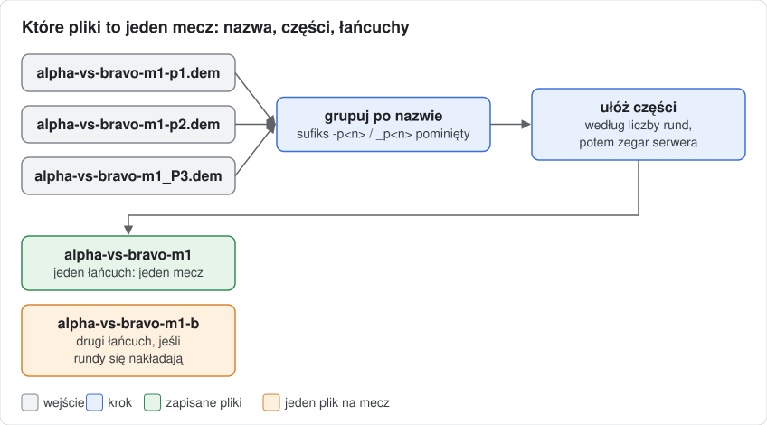

# Polecenia {#commands}

Nie znasz wiersza poleceń? Najpierw przeczytaj [Zanim zaczniesz](before-you-start.md).
Wpisuj te polecenia w terminalu otwartym w folderze, do którego rozpakowałeś lub sklonowałeś projekt.
`<...>` to miejsca na wartości, a ścieżkę ze spacjami wpisz w cudzysłowie.

```text
python -m heat3d_cs2 demos <pliki dem lub foldery> -o <folder> [--every 8] [--jobs N] [--map TEKST] [--force] [--no-bulk] [--loose]
python -m heat3d_cs2 map <nazwa mapy albo ścieżka do jej .vpk> -o <plik.glb> [--game FOLDER] [--source2viewer EXE]
python -m heat3d_cs2 scoreboard <mecz.3dheat | mecz.json>
```

`python -m heat3d_cs2 --help` i `python -m heat3d_cs2 <polecenie> --help` pokazują te same opcje;
[Dokumentacja poleceń](../cli-reference.md) pokazuje je wszystkie. Każde uruchomienie najpierw sprawdza wydanie opisane na stronie
[Aktualizacje](updates.md) (wyłączane przez `HEAT3D_NO_UPDATE=1`).

Kod: [`heat3d_cs2/cli.py`](https://github.com/Holdi601/3DHeat-CS2/blob/main/heat3d_cs2/cli.py).

## `demos` - dema w tabele i dokumenty meczów {#demos---demos-into-tables-and-match-documents}

```powershell
python -m heat3d_cs2 demos D:\Demos\event -o out
python -m heat3d_cs2 demos alpha-vs-bravo-m1-p1.dem alpha-vs-bravo-m1-p2.dem -o out
python -m heat3d_cs2 demos D:\Demos -o out --map final --jobs 4
```

| Argument | Domyślnie | Co robi |
|---|---|---|
| `paths` (jeden lub więcej) | - | pliki dem i foldery. Plik jest brany, gdy jego rozszerzenie to `.dem` (dowolna wielkość liter). Folder jest przeszukiwany **rekurencyjnie** w poszukiwaniu plików kończących się na `.dem`, w dowolnej wielkości liter, w posortowanej kolejności. Skompresowane dema (`.dem.zst`, `.dem.bz2`, archiwa) nie są czytane: najpierw je rozpakuj. |
| `-o`, `--out` | wymagane | folder, do którego zapisywać; w razie potrzeby zostaje utworzony |
| `--every N` | `8` | próbkuj każdego gracza co *N* ticków. Dema CS2 działają w 64 tickach na sekundę, więc 8 to osiem próbek na sekundę, 4 to szesnaście, 64 to jedna. Zdarzenia są zawsze odczytywane w ich własnym ticku, niezależnie od *N*. |
| `--jobs N` | `0` = połowa rdzeni procesora | ile meczów konwertować naraz, każdy we własnym procesie. Nigdy mniej niż 1 i nigdy więcej niż jest meczów do zrobienia. |
| `--map TEKST` | - | tylko mecze, których **nazwa** zawiera *TEKST*, bez względu na wielkość liter (`--map final`). Filtruje po nazwie pliku, a nie po mapie, którą dema faktycznie zawierają. |
| `--force` | wyłączone | konwertuj mecze, które już są zapisane, nadpisując je |
| `--loose` | wyłączone | zachowaj każdy mecz jako osobne pliki - tabelę, `.match.json`, pliki pomocnicze - zamiast pakować je w jeden kontener `.3dheat`. Zobacz [Jeden plik na mecz](output-container.md). |
| `--container` | włączone | pakuj każdy mecz w jeden plik `.3dheat`; to domyślne, więc ta opcja jest tu tylko dla jasności |
| `--no-bulk` | wyłączone | pomiń strumień encji, komendy graczy i strumień animacji w pliku pomocniczym pakietów - ponad połowa rozmiaru dema, nawet po kompresji. Samokontrola dokumentu meczu liczy je wtedy jako `lost`, po nazwie. |


### Które pliki są jednym meczem {#which-files-are-one-match}



Nazwa meczu to nazwa pliku dema bez rozszerzenia i bez sufiksu części: `-p<cyfry>` albo `_p<cyfry>` na końcu, w dowolnej wielkości liter. Zatem `alpha-vs-bravo-m1-p1.dem`, `alpha-vs-bravo-m1-p2.dem` i `alpha-vs-bravo-m1_P3.dem` to części jednego meczu, `alpha-vs-bravo-m1`.
Pliki są grupowane wyłącznie po tej nazwie: dwa pliki o tej samej nazwie w różnych folderach też zostaną zgrupowane.

Sufiks nic nie mówi o kolejności: `-p2` może być wcześniejszą połową. Części są ustawiane w kolejności według liczby rund, jaką zawierają, a potem według zegara serwera. Grupa, która okazuje się zawierać dwa różne mecze (te same drużyny na tej samej mapie na dwóch turniejach, na przykład), zostaje podzielona na **łańcuchy**. Łańcuch z największą liczbą rund jest zapisany pod samą nazwą, następny jako `<nazwa>-b`, potem `<nazwa>-c` i tak dalej. Plik bez żadnej rundy (sama rozgrzewka, pauza) nie należy do żadnego łańcucha. Jak znajdowane są łańcuchy, opisano w [Budowanie meczu](building-matches.md#parts-and-chains).

### Co jest zapisywane {#what-is-written}

Dla każdego meczu, w folderze nazwanym według mapy z nagłówka dema (`unknown`, gdy nagłówek jej nie podaje), jeden plik `.3dheat`:

```text
out/
  de_x/
    alpha-vs-bravo-m1.3dheat
    alpha-vs-bravo-m2.3dheat
  de_y/
    ...
```

Na syntetycznym dwurundowym demie z testów:


Z `--loose` każdy mecz to tabela, jego dokument meczu i cztery pliki pomocnicze obok siebie
([Jeden plik na mecz](output-container.md)):


Mapa cieplna dotyczy jednej mapy, więc wczytanie jednego folderu w przeglądarce to wczytanie meczów jednej mapy. Zobacz [Tabela mapy cieplnej](output-table.md) i [Dokument meczu](output-match-json.md).

### Co jest pomijane {#what-is-skipped}

Zanim cokolwiek zostanie odczytane, zbierana jest lista każdego `*.3dheat` gdziekolwiek pod `--out` (kontener jest zapisywany w całości albo wcale) oraz każdego `*.parquet`, obok którego leży jego dokument meczu (`<nazwa>.match.json`). Mecz, którego nazwa równa się jednej z tych nazw plików (bez rozszerzenia), jest pomijany, chyba że podano `--force`. Tabela bez swojego dokumentu meczu, czyli przebieg przerwany między zapisaniem tych dwóch, się nie liczy, więc taki mecz zostaje skonwertowany ponownie. Sprawdzenie odbywa się tylko po nazwie: mecz skonwertowany do innego folderu mapy albo z innym `--every` wciąż liczy się jako gotowy. Gdy nie ma nic do zrobienia:

```text
nothing to do: no demos found, or every match already written (--force redoes them)
```

### Co jest wypisywane {#what-is-printed}

Najpierw ilość pracy, potem jedna linia na mecz, gdy każdy się kończy (w kolejności kończenia, a nie kolejności plików):

```text
3 match(es), 3 at a time
alpha-vs-bravo-m1: de_x, 21 rounds (Alpha 13 Bravo 8), 412,377 rows, lost 0
alpha-vs-bravo-m2: de_y, 30 rounds (Bravo 16 Alpha 14), 598,104 rows, 1 incomplete round(s) left out, lost 0
alpha-vs-bravo-m3: de_y, 18 rounds (Alpha 13 Bravo 5), 330,981 rows, recorded from round 3, lost 1,204,331 (svc_PacketEntities, svc_UserCmds, DEM_AnimationData)
```

(Liczby są przykładowe.) Wynik to wynik z ostatniej rundy, drużyna po drużynie, w kolejności, w jakiej dokument meczu je wymienia. *incomplete round(s) left out* liczy rundy, które dema przerwały, zanim zostały rozstrzygnięte; *recorded from round N* mówi, że nagranie zaczyna się późno; *lost* to samokontrola dokumentu meczu - ile elementów dema nigdzie nie trafiło i jakiego były rodzaju (`--no-bulk` powoduje, że dane masowe są `lost`).
Mecz, który nic nie daje, mówi, dlaczego:

```text
alpha-vs-bravo-m4: no round in 1 file(s) - nothing written
alpha-vs-bravo-m4-b: no complete round in 1 file(s) - nothing written
```

Błąd w jednym meczu nie zatrzymuje pozostałych; jest wypisywany jako `<nazwa>: failed - <błąd>`.

### Kod wyjścia {#exit-code}

`0`, gdy każdy mecz został skonwertowany (albo nie było nic do zrobienia), `1`, gdy co najmniej jeden się nie udał.

### Ile to trwa {#how-long-it-takes}

Każdy mecz jest czytany i budowany w osobnym procesie roboczym. Folder z kilkuset demami zajmuje kilka minut przy domyślnym `--jobs`. Pamięć na zadanie rośnie wraz z długością meczu i wraz z mniejszym `--every`: każdy proces roboczy trzyma każdy próbkowany wiersz gracza swojego meczu (mniej więcej dziesięciu graczy razy 64 / *N* wierszy na sekundę nagrania), zanim zapisze.

Pliki pomocnicze zajmują więcej czasu niż tabela: każda właściwość, którą czyta parser, jest czytana w każdym ticku, w oknie ticków naraz (około dwóch minut dla 40-minutowego dema, najwyżej około 3 GB pamięci na zadanie), a potem dema jest przeglądane jeszcze raz w poszukiwaniu klatek i wiadomości.

## `map` - geometria mapy jako `.glb` {#map---a-maps-geometry-as-glb}


```powershell
python -m heat3d_cs2 map <mapa> -o out/<mapa>/<mapa>.glb
python -m heat3d_cs2 map <mapa> -o <mapa>.glb --game "D:\Games\Steam\steamapps\common\Counter-Strike Global Offensive"
python -m heat3d_cs2 map "D:\maps\<mapa>.vpk" -o <mapa>.glb --source2viewer C:\Tools\Source2Viewer-CLI.exe
```

| Argument | Domyślnie | Co robi |
|---|---|---|
| `name` | - | nazwa mapy (jak `de_x`) albo ścieżka do jej `.vpk`. Ścieżka kończąca się na `.vpk`, która istnieje, jest używana tak, jak jest; cokolwiek innego jest szukane po nazwie pliku w zainstalowanej grze. |
| `-o`, `--out` | wymagane | plik `.glb` do zapisania; jego folder zostaje w razie potrzeby utworzony |
| `--game FOLDER` | biblioteki Steam | folder instalacji CS2 (ten zawierający `game\csgo`), gdy Steam go nie zna. Z `--game` przeszukiwany jest tylko ten folder. |
| `--source2viewer EXE` | `HEAT3D_SOURCE2VIEWER`, potem `PATH` | plik wykonywalny Source2Viewer CLI |

Wypisywane po sukcesie:

```text
out/de_x/de_x.glb: de_x, 412,880 triangles (151,204 ground) in 14 parts
```

(liczby przykładowe). Zapisanie `.glb` obok tabel mapy (`out/<mapa>/<mapa>.glb`) trzyma dane i geometrię mapy w jednym folderze. Jak działa eksport: [Eksport mapy](map-export.md).

Błędy, każdy wypisywany jako `error: ...` z kodem wyjścia `2`:

| Komunikat | Znaczy |
|---|---|
| `no de_x.vpk found in an installed CS2 - pass --game <CS2 folder> or the .vpk path` | mapy nie ma w żadnej znalezionej bibliotece Steam albo nazwa jest błędna |
| `Source2Viewer-CLI not found: ...` | żadna z opcji `--source2viewer`, `HEAT3D_SOURCE2VIEWER`, `PATH` nie wskazała istniejącego pliku |
| `Source2Viewer did not export de_x's collision mesh:` i koniec jego wyjścia | nie udało się, albo nie zapisał pliku `.glb` |
| `de_x's collision mesh has nothing but clip brushes` | po usunięciu clipów i nieba nic nie zostało |

## `scoreboard` - mecz jako tekst {#scoreboard---a-match-as-text}

```bash
python -m heat3d_cs2 scoreboard out/de_x/alpha-vs-bravo-m1.3dheat
python -m heat3d_cs2 scoreboard out/de_x/alpha-vs-bravo-m1.match.json   # po demos --loose
```

Wypisuje tablicę wyników meczu z jego [dokumentu meczu](output-match-json.md), bez otwierania przeglądarki. Czyta dokument znajdujący się w kontenerze `.3dheat` albo luźny plik `<mecz>.match.json`.
Na syntetycznym dwurundowym demie z testów:


```text
alpha-vs-bravo-m1 - de_test  Alpha 2  Bravo 0

Alpha
player                 K   D   A  +/-    ADR   KAST   HS%  OK-OD  clutch
ash                    1   0   0   +1   50.0 100.0%    0%   0-0     1/1
ace                    1   1   0   +0   50.0 100.0%  100%   1-0     0/0

Bravo
player                 K   D   A  +/-    ADR   KAST   HS%  OK-OD  clutch
ben                    1   1   0   +0   50.0 100.0%    0%   0-0     0/1
bob                    0   1   0   -1    0.0 100.0%    0%   0-1     0/0

rounds  1:TK 2:TB
```

- Pierwsza linia: nazwa meczu, mapa i wynik końcowy dla każdej drużyny.
- Tabela dla każdej drużyny, w kolejności `teams` dokumentu meczu; gracze w kolejności dokumentu meczu (według zabójstw minus śmierci, potem zabójstw, od najlepszego). Nazwy są ucinane do 19 znaków.
- Kolumny: **K** zabójstwa, **D** śmierci, **A** asysty *wliczając* asysty z błysku, **+/-** zabójstwa minus śmierci, **ADR**, **KAST** (%), **HS%** (zaokrąglone do pełnych procent), **OK-OD** zabójstwa z otwarcia - śmierci z otwarcia, **clutch** wygrane clutche / rozegrane clutche. Definicje: [Statystyki](statistics.md).
- Pasek rund: `<runda><strona zwycięzcy><jak>`, gdzie **B** to wysadzenie bomby, **D** rozbrojenie, **K** eliminacja, **T** czas minął, a **?** to wszystko inne (remis, poddanie, inne). Remis nie ma strony zwycięzcy: `<runda>:?`.

Plik, który nie jest poprawnym JSON-em albo nie został znaleziony, kończy działanie błędem; dokument JSON bez pól dokumentu meczu kończy się błędem Pythona (nie jest sprawdzany dalej).
