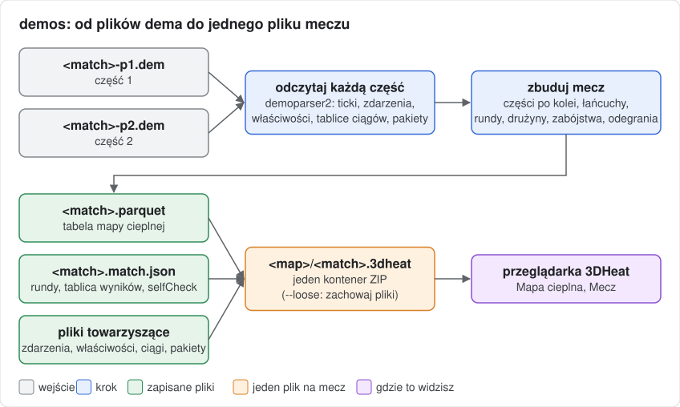

# 3DHeat CS2 {#dheat-cs2}

**Czym jest?** Counter-Strike 2 potrafi zapisać nagranie meczu, zwane *demem*. To narzędzie zamienia
dema w pliki, które przeglądarka 3DHeat pokaże w 3D: gdzie stał każdy, gdzie ginął, rzucał granaty
i zakładał lub rozbrajał bombę, runda po rundzie. Potrafi też zamienić mapę CS2 w model 3D, na którym
te zdarzenia się pokażą.

**Po co go używać?** Żeby przejrzeć własne mecze, nałożyć wiele meczów jednej mapy na siebie jako jedną
mapę cieplną i zobaczyć statystyki meczów, takie jak ADR (średnie obrażenia na rundę) i KAST (udział rund,
w których gracz zabił, asystował, przeżył albo został odegrany).

**Przykład:** `alpha-vs-bravo-m1.dem` na wejściu, `out/de_x/alpha-vs-bravo-m1.3dheat` na wyjściu
(`de_x` to zmyślona nazwa mapy).



Szczegółowo: 3DHeat CS2 zamienia **dema Counter-Strike 2** na tabelę mapy cieplnej i dokument meczu
dla każdego meczu, a **mapę CS2** na geometrię poziomu. Wyniki są przygotowane dla
przeglądarki telemetrii [3DHeat](https://holdi601.github.io/3DHeat/)
([źródła](https://github.com/Holdi601/3DHeat)), ale są zwykłymi plikami - Parquet, JSON
i binarnym glTF - które może odczytać każde inne narzędzie.

To mały pakiet Pythona, `heat3d_cs2`, uruchamiany z wiersza poleceń. Czyta dema z dysku
(niczego nie pobiera) przy pomocy [demoparser2](https://github.com/LaihoE/demoparser),
a mapy eksportuje z zainstalowanej gry wersją wiersza poleceń Source2Viewer
([ValveResourceFormat](https://github.com/ValveResourceFormat/ValveResourceFormat)).

## Szybki start {#quick-start}

Nigdy nie używałeś wiersza poleceń? Najpierw przeczytaj [Zanim zaczniesz](before-you-start.md).

```bash
pip install -r requirements.txt
python -m heat3d_cs2 demos <demo files or folders> -o out   # każdy mecz w nich
python -m heat3d_cs2 map <map> -o out/<map>/<map>.glb       # mapa z zainstalowanej gry
python -m heat3d_cs2 scoreboard out/<map>/<match>.3dheat    # tablica wyników meczu jako tekst
```

Powinieneś zobaczyć `1 match(es), 1 at a time ...`, a potem jedną linię na mecz
(zobacz [Polecenia](commands.md#what-is-printed)).

`demos` zapisuje dla każdego meczu jeden plik w folderze nazwanym od mapy:
`out/<map>/<match>.3dheat`, [kontener `.3dheat`](output-container.md) - format przeglądarki
na jeden plik na mecz ([specyfikacja](https://holdi601.github.io/3DHeat/container.html)).
Zawiera te elementy; `--loose` zapisuje je jako osobne pliki:

| Element | Co zawiera | Wczytywany w |
|---|---|---|
| `<match>.parquet` (rola `table`) | każdego żywego gracza osiem razy na sekundę wraz z jego stanem (zdrowie, pieniądze, oślepienie, celowanie, strefa, ekwipunek...) oraz każde zdarzenie w miejscu, w którym się zdarzyło (zabójstwo, zgon, obrażenia, strzał, rzut, wybuch granatu, oślepienie, podłożenie, rozbrojenie, wybuch, a na gracza koniec rundy z tym, ile runda mu dała), po jednym wierszu każde | zakładka Mapa cieplna |
| `<match>.match.json` (rola `match`, dokument meczu) | drużyny, wynik, każda runda (zwycięzca, jak, ekonomia, podłożenie, zabójstwa po kolei, clutche, ocaleni) i wiersz tablicy wyników każdego gracza | zakładka Mecz |
| `<match>.events/props/strings/packets.parquet` | wszystko inne, co zawiera demo, w całości (pliki pomocnicze) | zachowane dla kompletności |

`map` zapisuje `<map>.glb`: siatkę kolizji mapy - podłogi, ściany, pudła, bez dekoracji - podzieloną na
teren i konstrukcję, w tym samym układzie i jednostkach co tabele, więc leży dokładnie pod mapą cieplną
(panel **Tło / poziom**).

## Mapa dokumentacji {#map-of-this-documentation}

| Strona | Czego dotyczy |
|---|---|
| [Zanim zaczniesz](before-you-start.md) | Python, terminal, symbole zastępcze, jak wyglądają sukces i typowe błędy |
| [Instalacja](installing.md) | Python, pakiety, CLI Source2Viewer, gdzie musi być CS2 |
| [Polecenia](commands.md) | `demos`, `map`, `scoreboard`: każda opcja, co jest wypisywane, kody wyjścia |
| [Czytanie dema](reading-demos.md) | co jest odczytywane z pliku dema: próbkowane ticki, właściwości graczy, zasady gry, zdarzenia |
| [Budowanie meczu](building-matches.md) | części i łańcuchy, zegar meczu, rundy, drużyny i strony, wiersze, zabójstwa, odegrania, otwarcia, obrażenia, oślepienia, ekonomia |
| [Statystyki](statistics.md) | tablica wyników: K/D/A, ADR, KAST, HS%, otwarcia, odegrania, multi-killi, clutche, użycie granatów, oślepienia |
| [Tabela mapy cieplnej](output-table.md) | plik Parquet: każda kolumna, jej typ, które zdarzenia ją wypełniają, wskazówki stopki `heat3d`, osie |
| [Dokument meczu](output-match-json.md) | dokument `.match.json`, pole po polu |
| [Jeden plik na mecz](output-container.md) | kontener `.3dheat`, który domyślnie zapisuje `demos`; `--loose` |
| [Eksport mapy](map-export.md) | jak eksportowana jest siatka kolizji mapy, układ, nazewnictwo węzłów, jednostki |
| [Użycie z 3DHeat](using-with-3dheat.md) | wczytywanie tabel, dokumentów meczów i map do zakładek Mapa cieplna i Mecz przeglądarki |
| [Ograniczenia](limits.md) | co jest zakładane, czego nie obsługuje, co nie zostało sprawdzone |
| [Aktualizacje](updates.md) | sprawdzenie wydania przy starcie i `python -m heat3d_update` |
| [Rozwój](development.md) | układ kodu, testy, syntetyczny przykład dema |
| [Opis poleceń](../cli-reference.md) | `--help` każdego polecenia, generowane z kodu |
| [Utrzymanie](maintaining.md) | lista kontrolna wydania dla tych stron |

## Wobec czego to sprawdzono {#what-it-is-checked-against}

Dema z natury nie są jednym czystym plikiem na mecz. Konwerter radzi sobie z meczem rozbitym na pliki
w dowolnej kolejności, serwerem zrestartowanym w trakcie meczu, dwoma różnymi meczami zapisanymi pod
jedną nazwą, rundami przywróconymi z kopii zapasowej, nagraniem, które zaczyna się późno albo kończy
wcześnie, pauzami i trenerami po stronie drużyny - zobacz [Budowanie meczu](building-matches.md).
Sprawdzono na dużym zbiorze dem z turniejów: w każdym meczu wynik podąża za zwycięzcami rund,
zabójstwa jednej strony są zgonami drugiej, a każda runda zaczyna się w składzie pięć na pięć.

## Na co to kierować {#what-to-point-it-at}

Na dema twoich własnych meczów, dema, które pobrałeś ręcznie ze strony turniejowej, albo dema z API,
do którego masz dostęp. Dema to nagrania, których treść należy do wydawcy i organizatorów: wyniki używaj
do własnej analizy i nie rozpowszechniaj ani dem, ani danych z nich pochodzących. Strony, które
oferują dema, często zabraniają w regulaminie automatycznego pobierania, dlatego narzędzie czyta dema
z dysku i nic nie pobiera.

## Część 3DHeat {#part-of-3dheat}

3DHeat CS2 to jedno z darmowych narzędzi wokół przeglądarki 3DHeat, każde we własnym repozytorium,
z własnymi wydaniami i licencją:

| Narzędzie | Co robi | Dokumentacja |
|---|---|---|
| [3DHeat](https://github.com/Holdi601/3DHeat) | przeglądarka: mapy cieplne, analiza wyścigów i przegląd meczów w 3D | [strona](https://holdi601.github.io/3DHeat/) |
| [GameFiles](https://github.com/Holdi601/3DHeat-GameFiles) | tory i poziomy z plików, które dostarcza gra, jako modele 3D | [strona](https://holdi601.github.io/3DHeat-GameFiles/) |
| [GameCapture](https://github.com/Holdi601/3DHeat-GameCapture) | telemetria okrążeń z gier wyścigowych; poziomy odtworzone z nagrań rozgrywki | [strona](https://holdi601.github.io/3DHeat-GameCapture/) |
| [Unreal Exporter](https://github.com/Holdi601/3DHeat-UnrealExporter) | wtyczka do edytora Unreal, która eksportuje poziom jako jeden model 3D | [strona](https://holdi601.github.io/3DHeat-UnrealExporter/) |
| [CS2](https://github.com/Holdi601/3DHeat-CS2) | dema Counter-Strike 2 jako tabele i dokumenty meczów; mapy jako modele 3D | [strona](https://holdi601.github.io/3DHeat-CS2/) |
| [Watcher](https://github.com/Holdi601/3DHeat-Watcher) | w tle zapisuje to, co gry publikują o twojej grze | [strona](https://holdi601.github.io/3DHeat-Watcher/) |
| [Ext-WarThunder](https://github.com/Holdi601/3DHeat-Ext-WarThunder) | replaye War Thunder jako tabele i dokumenty meczów | [strona](https://holdi601.github.io/3DHeat-Ext-WarThunder/) |
| [Ext-WoT](https://github.com/Holdi601/3DHeat-Ext-WoT) | replaye World of Tanks jako tabele i dokumenty meczów | [strona](https://holdi601.github.io/3DHeat-Ext-WoT/) |
| [Ext-WoWs](https://github.com/Holdi601/3DHeat-Ext-WoWs) | replaye World of Warships jako tabele i dokumenty meczów | [strona](https://holdi601.github.io/3DHeat-Ext-WoWs/) |
| [Ext-Squad](https://github.com/Holdi601/3DHeat-Ext-Squad) | dema serwerów Squad jako tabele i dokumenty meczów | [strona](https://holdi601.github.io/3DHeat-Ext-Squad/) |
| [Ext-DCS](https://github.com/Holdi601/3DHeat-Ext-DCS) | mapy DCS World jako modele 3D | [strona](https://holdi601.github.io/3DHeat-Ext-DCS/) |
| [Ext-IL2](https://github.com/Holdi601/3DHeat-Ext-IL2) | mapy IL-2 Sturmovik jako modele 3D | [strona](https://holdi601.github.io/3DHeat-Ext-IL2/) |

## Licencja {#licence}

MIT - zob. [`LICENSE`](https://github.com/Holdi601/3DHeat-CS2/blob/main/LICENSE),
oraz [`LICENSES.md`](https://github.com/Holdi601/3DHeat-CS2/blob/main/LICENSES.md)
dla pakietów stron trzecich i tego, do czego zobowiązują gry, które czyta.
