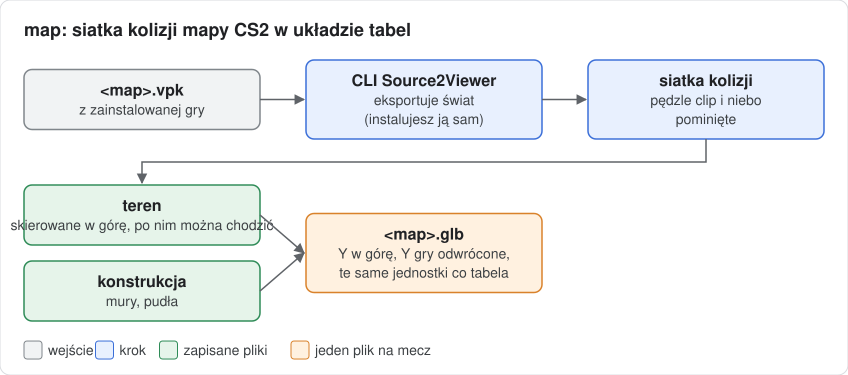

# Eksport mapy (`map`) {#map-export-map}

`python -m heat3d_cs2 map <mapa> -o <plik.glb>` zapisuje mapę CS2 jako geometrię poziomu: **siatkę kolizji** świata, w układzie i jednostkach, w których rysowane są [tabele mapy cieplnej](output-table.md). Kod:
[`heat3d_cs2/mapexport.py`](https://github.com/Holdi601/3DHeat-CS2/blob/main/heat3d_cs2/mapexport.py),
[`heat3d_cs2/glb.py`](https://github.com/Holdi601/3DHeat-CS2/blob/main/heat3d_cs2/glb.py).
Opcje i komunikaty: [Polecenia](commands.md#map---a-maps-geometry-as-glb).



## Dlaczego siatka kolizji {#why-the-collision-mesh}

Siatka kolizji to to, po czym chodzą gracze i za czym się chowają - podłogi, ściany, schody, skrzynie - bez dekoracji: bez propów, które tylko wyglądają jak coś, bez tekstur, z dużo mniejszą liczbą trójkątów niż siatki renderowania. Mapa cieplna potrzebuje właśnie tego pod sobą: czegoś, do czego można odnosić pozycje, a nie renderu mapy.

## Skąd jest pobierana {#how-it-is-obtained}

1. **Znajdź mapę.** Ścieżka kończąca się na `.vpk`, która istnieje, jest używana tak, jak została podana. W przeciwnym razie szukany jest `<nazwa>.vpk` w `<folder CS2>\game\csgo\maps\`, gdzie folder CS2 to `--game` albo `steamapps\common\Counter-Strike Global Offensive` w każdej znalezionej bibliotece Steam (zob. [Instalacja](installing.md#where-cs2-is-looked-for)).
2. **Znajdź wiersz poleceń Source2Viewer**: `--source2viewer`, potem `HEAT3D_SOURCE2VIEWER`, potem `Source2Viewer-CLI` / `Source2Viewer-CLI.exe` w `PATH`.
3. **Wyeksportuj fizykę świata.** Source2Viewer jest uruchamiany tak:

   ```text
   Source2Viewer-CLI -i <mapa>.vpk -d -f maps/<mapa>/world_physics.vmdl_c --gltf_export_format glb -o <folder tymczasowy>
   ```

   Dekoduje on skompilowaną fizykę Source 2 z własnego archiwum mapy i zapisuje model (pusty: świat nie ma własnej siatki renderowania) oraz jego fizykę obok. Największy zapisany `.glb` to fizyka. Gdy Source2Viewer się nie uda albo nie zapisze `.glb`, polecenie się zatrzymuje i pokazuje ostatnie 800 znaków swojego wyjścia i błędów.
4. **Odczytaj ją.** Każdy węzeł sceny jest przechodzony z jego przekształceniem (macierz albo przesunięcie-obrót-skala) i każdy prymityw trójkątów jest brany, z buforem indeksów albo bez, we współrzędnych świata.
5. **Odrzuć to, co nie jest ścianą ani podłogą.** Węzeł, którego nazwa zawiera `clip` - clipy graczy, clipy NPC, clipy granatów: niewidzialne ściany, które zatrzymują graczy i granaty - albo `sky`, bez względu na wielkość liter, jest usuwany.
6. **Nazwij powierzchnię.** Grupy fizyki są nazwane według ich powierzchni; nazwa małymi literami, z usuniętym początkowym `physics`, `physics_group` albo `physics_passbullets` (i podkreślnikiem po nim), to powierzchnia: `physics_group_concrete` to `concrete`, `physics_passbullets_chainlink` to `chainlink`, a sam `physics_group` to `world`. Powierzchnie, przez które przechodzą kule, są zachowywane.
7. **Z powrotem do układu gry.** Source2Viewer zapisuje glTF w metrach, z osią Y skierowaną w górę: (Y, Z, X) gry pomnożone przez 0,0254. To jest cofane - każdy punkt staje się (X, Y, Z) gry w calach.
8. **Rozdziel podłoże od konstrukcji**, trójkąt po trójkącie: ścianka, której normalna wskazuje w górę co najmniej o 0,7 (jej składowa Z, znormalizowana) - nachylenia do około 45 stopni, mniej więcej najbardziej stromo, po czym chodzi gracz CS2 - to **podłoże**; wszystko inne, także ściany i sufity, to **konstrukcja**.
9. **Do układu widoku.** Każdy punkt jest zapisywany jako (X, Z, -Y): Y w górę, Y gry z odwróconym znakiem - układ, w którym widok rysuje tabele, gdy stosuje ich podpowiedzi `heat3d`. To obrót, a nie odbicie lustrzane.
10. **Zapisz `.glb`.** Jeśli nic nie zostało (same clipy), polecenie kończy się błędem. W przeciwnym razie wypisuje plik, mapę, liczbę trójkątów, ile z nich to podłoże, i liczbę części.

Nic tu nie czyta niczego poza własnym `.vpk` mapy, a nic z Source2Viewer nie jest dołączane ani kopiowane.

## Plik {#the-file}

Binarny glTF 2.0 (`.glb`), jeden bufor, zapisany przez `heat3d_cs2` (`asset.generator`):

| Aspekt | Co |
|---|---|
| Węzły | jeden na część, wszystkie w korzeniu, bez przekształceń, każdy z własną siatką o tej samej nazwie |
| Nazwy węzłów | `ground:<powierzchnia>` albo `structure:<powierzchnia>` (`ground:concrete`, `structure:metal`, `structure:world`), posortowane według nazwy |
| Prymitywy | jeden na siatkę, trójkąty, `POSITION` (float32, z min/max) i `NORMAL` (float32), indeksy `uint32` |
| Cieniowanie | płaskie: jeden wierzchołek na narożnik trójkąta, każdy z normalną swojego trójkąta |
| Materiały, tekstury, UV, kolory | brak |
| Jednostki | jednostki gry (**cale**), a nie metry - inaczej niż zakłada glTF |
| Układ | (X, Z, -Y) gry: wysokość gry to Y w glTF, a -Y gry to Z w glTF |

Prefiks `ground:` / `structure:` to konwencja wszystkich eksporterów poziomów 3DHeat: widok bierze część nazwaną w ten sposób za pewnik, zamiast zgadywać z geometrii, więc podłogi dostają cieniowanie podłoża, a ściany rysunek konstrukcji, bez żadnego kroku klasyfikacji.

Ponieważ jednostki to cale, inny podgląd glTF pokaże mapę około 39 razy za dużą (odczyta je jako metry); w razie potrzeby przeskaluj przez 0,0254. W 3DHeat leży ona dokładnie pod tabelą, która jest w tych samych jednostkach ze skalą 1.

## Sprawdzenie, że układ jest poprawny {#the-check-that-the-frame-is-right}

Test `test_players_stand_on_the_exported_floor` (uruchamiany tylko wtedy, gdy podano dema i Source2Viewer, zob. [Rozwój](development.md#tests)) eksportuje mapę, na której zagrano dema, bierze 300 losowych próbek pozycji z meczu i dla każdej patrzy prosto w dół, szukając najwyższego trójkąta podłoża najwyżej 4 jednostki nad stopami gracza. Wymaga, aby co najmniej 98 % próbek znalazło podłoże, a mediana wysokości nad nim była mniejsza niż 5 jednostek. Mapa odbita lustrzanie to nie przechodzi: na mapie odbitej złą osią duża część graczy stoi nad niczym. README podaje wyniki tego sprawdzenia dla map obecnej puli rankingowej.

## Czego nie robi {#what-it-does-not-do}

- Brak geometrii renderowania, tekstur i dekoracji - zob. *dlaczego* powyżej.
- Eksportowane jest tylko to, co jest w modelu `world_physics` mapy. Nie sprawdzono, czy ruchome części (drzwi) albo elementy do zniszczenia są w nim zawarte.
- Brak uproszczenia: widok 3DHeat upraszcza przy imporcie ustawieniem **Cel upraszczania** (Simplification target).
- Mapy, których nie ma w zainstalowanej grze (mapy warsztatowe gdzie indziej na dysku), działają, gdy ich `.vpk` zostanie podane jako ścieżka i zawiera `maps/<nazwa>/world_physics.vmdl_c`; nie sprawdzono tego.
