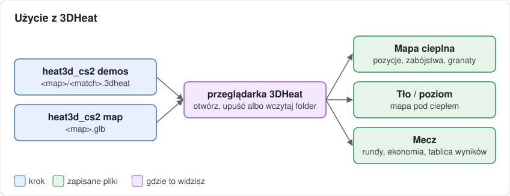

# Użycie z 3DHeat {#using-it-with-3dheat}

Wyniki trafiają do tych miejsc [przeglądarki 3DHeat](https://holdi601.github.io/3DHeat):

| Plik | Gdzie | Co daje |
|---|---|---|
| `<mecz>.3dheat` (domyślnie) | karta **Mapa cieplna**, panel **Źródło**, albo karta **Mecz** | tabela i dokument meczu razem, jeden plik na mecz ([kontener](https://holdi601.github.io/3DHeat/container.html)) |
| `<mecz>.parquet` | karta **Mapa cieplna**, panel **Źródło** | pozycje i zdarzenia jako mapa cieplna, powtórka w pudełku, trasy |
| `<mecz>.match.json` | karta **Mecz**, **Wczytaj pliki meczów…** | tablica wyników, rundy, lista zabójstw, statystyki między meczami, linki do mapy cieplnej |
| `<mapa>.glb` | panel **Tło / poziom**, **Model 3D…** | mapa pod mapą cieplną |

Dokumentacja samej przeglądarki opisuje każdą kartę w całości: strony
[Analiza meczu](https://holdi601.github.io/3DHeat/match-analysis.html),
[Wczytywanie plików](https://holdi601.github.io/3DHeat/loading-files.html),
[Mapowanie kolumn](https://holdi601.github.io/3DHeat/column-mapping.html)
i [Powtórka w pudełku](https://holdi601.github.io/3DHeat/box-replay.html).
Ta strona to część dotycząca CS2.



Przeglądarka: [github.com/Holdi601/3DHeat](https://github.com/Holdi601/3DHeat),
dokumentacja [holdi601.github.io/3DHeat](https://holdi601.github.io/3DHeat/).

## Typowa sesja {#a-typical-session}

```bash
python -m heat3d_cs2 demos D:\Demos\event -o out
python -m heat3d_cs2 map <mapa> -o out/<mapa>/<mapa>.glb
```

1. **Karta Mapa cieplna -> Źródło:** wybierz folder `out/<mapa>` (albo upuść go tam).
   Każdy `.parquet` w nim staje się jednym zestawem danych; pliki `.json` i `.glb` w tym samym folderze są pomijane jako „not a csv/parquet file”. Wczytaj go.
2. **Tło / poziom -> Model 3D…:** wskaż `out/<mapa>/<mapa>.glb`.
   **Zapisz w bibliotece** zachowuje go w przeglądarce na następny raz.
3. **Karta Mecz -> Wczytaj pliki meczów…:** wskaż pliki `.match.json` z tego samego folderu (kilka naraz) albo upuść je na widok, gdy karta Mecz jest otwarta.

Wczytuj naraz tabele tylko jednej mapy: współrzędne różnych map nachodzą na siebie, a mapa cieplna dwóch map naraz nic nie znaczy. Folder na każdą mapę jest po to właśnie.

## Tabela otwiera się bez żadnych ustawień {#the-table-opens-with-nothing-to-set}

Widok czyta wpis stopki `heat3d` pierwszego wybranego pliku
([Tabela mapy cieplnej](output-table.md#the-heat3d-footer-hints)) i nakłada go na własne domysły:

| Ustawienie widoku | Ustaw na |
|---|---|
| Pozycja | `x`, `y`, `z` |
| Oś pionowa w źródle | Z jest w górę |
| Odwróć Y (Flip Y) | włączone - żeby mapa była we właściwą stronę, a nie odbita lustrzanie |
| Skala jednostek | 1 - odległości w jednostkach gry (podpisane „m”; 1 jednostka = 1 cal) |
| Czas | `time`, w sekundach |
| Osoba | `player` |
| Grupa | `side` (T / CT) |
| Sesja | `roundId` - każda runda to sesja, `<mecz> #NN` |
| Kierunek patrzenia | wektor, `dirX` / `dirY` / `dirZ` |
| Kolumny filtrów | `event`, `match`, `round`, `roundTime`, `phase`, `weapon`, `place`, `won`, `buy`, `opening`, `team` |
| Rozmiar encji | 32 - powtórka w pudełku rysuje gracza na 32 jednostki szerokości, z promieniem patrzenia 4 x 32 |

Każda podpowiedziana wartość nadal pokazuje się w mapowaniu kolumn i może zostać zmieniona. Pozostałe kolumny (`headshot`, `traded`, `other`, `steamid`, `health`, `money`, `damage`, `duration`, ...) można tam dodać ręcznie jako filtry.

Przy wczytanej mapie skala jednostek zostaje na 1: `.glb` jest w tych samych jednostkach gry i poziom nie jest przeskalowywany razem z tabelą.

### Przydatne filtry {#useful-filters}

- `event` = `position`, by zobaczyć, gdzie byli gracze; `kill` / `death`, by zobaczyć, gdzie wygrywano i przegrywano pojedynki; `smoke`, `flash`, `molotov`, `he`, by zobaczyć, gdzie wylądował granat; `throw`, by zobaczyć, skąd rzucano; `plant`, by zobaczyć miejsca podłożeń.
- `side` (grupa) = `T` albo `CT`, `phase` = `live`, by pominąć fazę po, `buy` = `eco` / `force` / `full`, by zobaczyć rundy jednej ekonomii, `won` = 1 dla rund, które strona wiersza wygrała.
- `opening` = 1 z `kill` i `death`, by zobaczyć pojedynki otwierające.
- `roundTime` jako zakres, by zobaczyć jakiś moment rundy: pierwsze 20 sekund, sytuację po podłożeniu.

## Karta Mecz {#the-match-tab}

Karta Mecz przyjmuje plik JSON, którego `format` to `heat3d-cs2-match` i który ma tablice `rounds`, `players` i `teams`
([Dokument meczu](output-match-json.md)). Pokazuje wynik i połowy, pasek rund pokolorowany według zwycięskiej strony z oznaczeniem, jak każda się skończyła, ekonomię każdej rundy, podłożenie, listę zabójstw, clutche i ocaleli, tablicę wyników oraz statystyki ze wszystkich wczytanych meczów.

Jej linki **Pokaż na mapie cieplnej** niczego nie wczytują. Ustawiają filtry w tabeli już wczytanej w karcie Mapa cieplna: `match`, `round` (i sesję rundy `<mecz> #NN`), `event`, gracza, stronę. To działa, bo dokument meczu i tabela mają te same nazwy meczów, numery rund, nazwy graczy i strony. **Powtórka rundy** przełącza mapę cieplną w powtórkę w pudełku i odtwarza sesję rundy od jej początku.

Wczytaj więc oba: tabele mapy w karcie Mapa cieplna, a ich dokumenty meczów w karcie Mecz. Dokument meczu bez tabeli nadal pokazuje tablicę wyników i rundy, a linki mówią, że nie są wczytane żadne dane mapy cieplnej.

## Bez 3DHeat {#without-3dheat}

- Tabela to zwykły Parquet: pandas, Polars, DuckDB, Spark, `arrow` w R czytają go wszystkie; wpis `heat3d` jest ignorowany, a kolumny tekstowe czytane są jako ciągi albo kategorie.
- Dokument meczu to zwykły JSON.
- Mapa jest prawidłowym binarnym glTF, w calach, a nie w metrach: dla narzędzi zakładających metry przeskaluj przez 0,0254. Jej układ to własny układ glTF (Y w górę), więc żeby nałożyć tabelę gdzie indziej, rysuj każdy wiersz (x, y, z) jako (x, z, -y), jak robi to 3DHeat.
