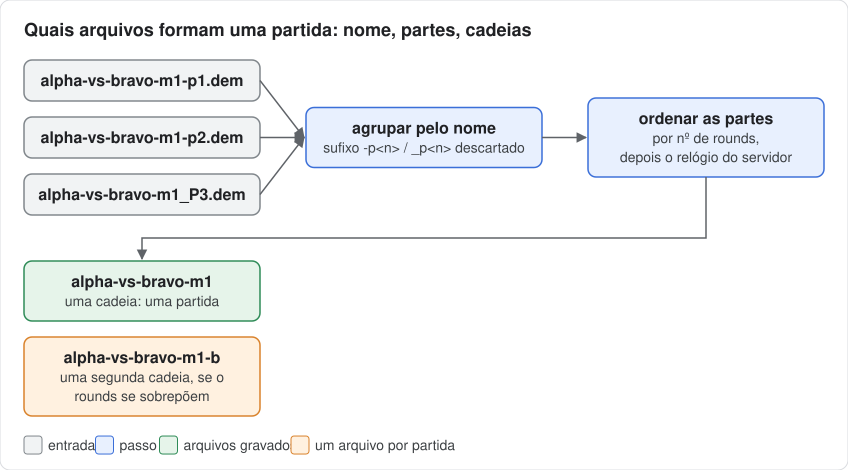

# Construir uma partida {#building-a-match}

Como uma partida é feita a partir das suas partes de demo: quais ficheiros pertencem
juntos, um só relógio para todos, os rounds e como cada um foi ganho, as equipas e os
seus lados, e cada linha da tabela de calor com mortes, trocas, aberturas, dano,
flashes e economia. Código:
[`heat3d_cs2/match.py`](https://github.com/Holdi601/3DHeat-CS2/blob/main/heat3d_cs2/match.py).
O placar calculado a partir dela está em [Estatísticas](statistics.md).

## Visão geral {#overview}

1. Cada ficheiro de um nome de partida é lido ([Ler uma demo](reading-demos.md)).
2. As linhas duplicadas de jogadores de cada ficheiro (rounds restaurados) são resolvidas.
3. Os ficheiros são ordenados em **cadeias** - partidas - e cada cadeia é posta em ordem.
4. Cada parte é colocada no **relógio da partida**.
5. Os **rounds** são encontrados em cada parte; o relato de um round numa parte posterior
   substitui o da parte anterior.
6. Os **jogadores** e as **equipas** recebem nome, e os lados e o resultado de cada round
   são dados pelo nome da equipa. Com os lados conhecidos, seguem o comprimento da metade,
   as rondas de pistola e a **compra** de cada lado.
7. As **linhas** são construídas: posições, tiros, lançamentos, detonações, plantas,
   desativações, mortes, feridas, cegueiras, explosões.
8. Cada linha recebe o seu round, fase, tempo do round, se o seu lado ganhou e a compra do
   seu lado; as linhas fora de qualquer round são eliminadas.

## Rounds restaurados: uma linha por jogador por tick {#restored-rounds-one-row-per-player-per-tick}

Quando um round é restaurado a partir de uma cópia de segurança dentro de um ficheiro, a
demo guarda durante alguns segundos os corpos antigos dos jogadores junto com os novos:
duas linhas para um jogador no mesmo tick, uma onde o round anulado os deixou, outra no
nascimento do round restaurado. Para cada um desses jogadores, os ticks duplicados são
percorridos **para trás** a partir da primeira linha simples que vem depois: em cada tick,
fica o candidato mais perto da posição seguinte, e esse passa a ser a referência do tick
anterior. Se não houver linha simples depois, fica o último candidato. Assim, cada
jogador mantém a linha que o leva para onde vai a seguir.

## A parte viva de um ficheiro {#the-live-part-of-a-file}

O **início vivo** de um ficheiro é o tick do seu último evento
`round_announce_match_start`, ou o tick 0 se não tiver nenhum (uma parte posterior de
uma partida dividida costuma não ter). Tudo antes do início vivo fica de fora, e também
tudo o que está marcado com `is_warmup_period`. Um round de faca ou um reinício antes do
anúncio ficam, portanto, de fora; um round de faca *sem* um anúncio de início de partida
a seguir não é reconhecido como tal (ver [Limites](limits.md)).

Os **rounds** de um ficheiro são os eventos `round_freeze_end` a partir do início vivo,
fora do aquecimento, identificados pelo seu `total_rounds_played` (o índice do round a ser jogado, começando em 0 no jogo). Um ficheiro sem nenhum não tem rounds e não pertence a
nenhuma partida.

## O relógio {#the-clock}

Os tempos estão em segundos. Dentro de um ficheiro, o tempo é contado em **ticks**: o
`game_time` do servidor no primeiro tick amostrado, mais os ticks desde então / 64.
O relógio do próprio servidor para durante uma pausa, enquanto os ticks continuam; se fosse lido pelo relógio, dois momentos de uma partida pausada teriam o mesmo tempo.

Cada ficheiro tem um *primeiro relógio* (o tempo no seu início vivo) e um *último relógio*
(no seu último tick amostrado).

### Partes e cadeias {#parts-and-chains}

Os ficheiros com nome de uma mesma partida ([Comandos](commands.md#which-files-are-one-match))
são ordenados primeiro pelo índice do seu primeiro round, e depois pelo seu primeiro
relógio. Depois, cada um, por essa ordem, se junta à primeira cadeia que continua, ou
começa uma nova cadeia. Uma parte continua uma cadeia quando o índice do seu primeiro round
é pelo menos o índice do último round da última parte da cadeia, **e** uma destas
condições se verifica:

- o relógio do servidor continua: o seu primeiro relógio não é anterior ao último relógio
  da cadeia menos 5 s; ou
- a contagem de rounds continua: o índice do seu primeiro round é o último índice da cadeia
  ou o seguinte.

A contagem decide e o relógio desempata, porque um servidor reiniciado para restaurar um
round volta a começar o seu relógio, enquanto duas partidas diferentes com o mesmo nome
(as mesmas equipas no mesmo mapa em dois eventos) têm contagens de rounds que se
sobrepõem. As cadeias são ordenadas pelo número de rounds que abrangem, o maior primeiro;
a primeira fica com o nome da partida, as outras são escritas como `<nome>-b`,
`<nome>-c`, ...

### O relógio da partida {#the-match-clock}

O zero da partida é o primeiro relógio da primeira parte: **o tempo de partida 0 é o início
vivo do primeiro ficheiro**. Cada parte seguinte é colocada nele:

- onde o relógio do servidor continua (o seu primeiro relógio não é anterior ao último
  relógio da parte anterior menos 5 s), usa-se o relógio do servidor tal como está;
- onde ele foi reiniciado, a parte é colocada para seguir **um segundo** depois do fim da
  parte anterior.

## Rounds {#rounds}

Para cada `round_freeze_end` de uma parte (em ordem de tick), a janela do round vai até ao
próximo freeze end dessa parte, ou até ao fim do ficheiro. Dentro dela, o round fica
**decidido** no primeiro tick amostrado em que o estado do jogo mostra
`total_rounds_played` = o índice do round + 1 e `round_win_status` 1 (empate), 2 (T ganhou)
ou 3 (CT ganhou). Um round sem nenhuma amostra desse tipo na sua janela foi cortado pelo
fim do ficheiro; o seu número vai para a lista **incomplete** da partida (a menos que outra
parte tenha o round completo).

| Campo do round | De onde vem |
|---|---|
| `number` | o índice + 1 (a partir de 1, como o jogo conta) |
| `start` | tempo da partida no fim do tempo de congelamento - os jogadores já se podem mexer |
| `end` | tempo da partida na primeira amostra que mostra o round decidido |
| `until` | tempo da partida do próximo `round_prestart` depois de `end`, se estiver dentro da janela; senão, o fim da janela ou o último tick do ficheiro, o que vier primeiro (e nunca antes de `end`) |
| `winner` | `T` para o estado 2, `CT` para o 3, vazio para o 1: um empate é decidido, sem vencedor |
| `reason` | `round_win_reason` nessa amostra, com o nome abaixo |
| `score` | nome da equipa -> rounds ganhos depois deste: o `team_rounds_total` de cada lado na amostra que decide; quando a demo não o tem, o resultado do round anterior mais um para o vencedor |
| `sides` | nome da equipa -> `T` / `CT` neste round |
| `equipment` | lado -> a soma de `current_equip_value` dos jogadores **vivos** desse lado na primeira amostra a partir do fim do congelamento |
| `buy` | lado -> `pistol`, `eco`, `force` ou `full` ([Economia](#economy-and-buy-types)) |
| `plant` | o primeiro `bomb_planted` depois do fim do congelamento e até `end`, ou nenhum |
| `exploded` | tempo da partida do primeiro `bomb_exploded` depois dessa planta e antes do próximo fim de congelamento, se houver (não está no documento da partida; marca a linha `explode`) |

`reason`, a partir do `CSRoundEndReason` do jogo:

| Código | `reason` |
|---|---|
| 1 | `bomb` (alvo com bomba) |
| 7 | `defuse` |
| 8, 9 | `elimination` (CT ganham / T ganham por eliminação) |
| 10 | `draw` |
| 12 | `time` (alvo guardado) |
| 17, 18 | `surrender` |
| qualquer outro | `other` |

Quando várias partes têm o mesmo round (pelo índice), fica a versão da parte posterior.
Os rounds são depois listados pelo índice. Uma partida cujo primeiro round não é o round 1
regista os números em falta (`missing` no documento da partida); a linha de comando diz
*recorded from round N*.

### A planta {#the-plant}

| Campo | De onde vem |
|---|---|
| `site` | `A` ou `B`: a zona de bomba que o jogo diz em que o plantador estava (`which_bomb_zone`, 1 A, 2 B); sem ele, o nome do lugar do plantador (`BombsiteA`, `BombsiteB`); sem isso, a letra que outra planta do mesmo ficheiro na mesma zona deu (o `site` do evento é o número da entidade da zona). Vazio quando nada o diz - nunca o número. |
| `time` | segundos **dentro do round** (desde o seu fim do congelamento), como o tempo de uma morte |
| `player`, `steamid` | o plantador |
| `x`, `y`, `z` | a posição do plantador, em unidades do jogo: onde a bomba fica |
| `place` | o nome do lugar do plantador na planta |

### As fases {#the-phases}

O tempo de `start` até `end` é a fase **live** do round; de `end` até `until` é a sua fase
**after**, em que os vencedores caçam e os perdedores poupam. Uma linha pertence ao round
cujo `[start, until)` contém o seu tempo, e é `after` quando o seu tempo é posterior a
`end`. O tempo de congelamento fica entre rounds e não pertence a nenhum.

## Jogadores e equipas {#players-and-teams}

Um **jogador** é qualquer pessoa que esteve viva pelo menos uma vez num lado (equipa 2 ou 3),
fora do tempo de congelamento e do aquecimento, depois do início vivo. Um treinador ou um
caster no lado de uma equipa nunca está vivo e não é jogador. Cada jogador é identificado
pelo seu Steam ID; o nome é o último visto.

A **equipa** de um jogador é o nome de clã que o jogo deu ao seu lado (`team_clan_name`), o
visto mais vezes para ele - a demo o limpa no fim. Uma partida jogada sem nomes de clã
nomeia as equipas pelo lado em que começaram: `Started T` e `Started CT`.

Os **lados** de cada round vêm de quem estava em que lado entre o fim do congelamento e o
fim do round: a cada lado é dada o rótulo de equipa que a maioria dos seus jogadores tem.
A lista `teams` da partida está em ordem de aparecimento, round a round, o lado T antes do
CT; normalmente a equipa que começou em T vem primeiro.

## As linhas {#the-rows}

Cada amostra de posição e cada evento torna-se uma linha da
[tabela de calor](output-table.md). Os jogadores estão num lado apenas quando o seu
`team_num` é 2 ou 3.

### Posições {#positions}

A partir das linhas amostradas de jogadores vivos de um lado, fora do tempo de congelamento
e do aquecimento, depois do início vivo: posição, direção do olhar, vida, colete, dinheiro,
valor do equipamento, arma na mão, lugar.

A direção do olhar é um vetor unitário no referencial do jogo:
`(cos pitch * cos yaw, cos pitch * sin yaw, -sin pitch)` - o pitch do jogo é positivo a
olhar para baixo, por isso olhar para baixo dá um Z negativo.

A arma na mão é o `active_weapon_name` tal como o jogo o chama, exceto que qualquer nome que
contenha `Knife`, `Bayonet`, `Karambit` ou `Daggers` passa a ser `Knife`.

### Tiros e lançamentos {#shots-and-throws}

A partir de `weapon_fire`, na posição do atirador. Facas (`knife`, `bayonet` no id da arma) e
o C4 ficam de fora. Granadas (`smokegrenade`, `flashbang`, `hegrenade`, `molotov`,
`incgrenade`, `decoy`) são linhas de **lançamento** (**throw**), tudo o resto são linhas de
**tiro** (**shot**). A arma é dada como o jogo a mostra (abaixo).

### Detonações de granadas {#grenade-detonations}

| Evento | Linha | `weapon` |
|---|---|---|
| `smokegrenade_detonate` | `smoke` | Smoke Grenade |
| `flashbang_detonate` | `flash` | Flashbang |
| `hegrenade_detonate` | `he` | High Explosive Grenade |
| `inferno_startburn` (molotov e incendiária) | `molotov` | Molotov |
| `decoy_detonate` | `decoy` | Decoy Grenade |

A posição é **onde a granada explodiu** (os `x`, `y`, `z` do evento); o jogador e o lado são
os de quem lançou. A demo não dá nome de lugar a uma granada, só aos jogadores, por isso
`place` fica vazio: uma linha não reclama um lugar onde não estava. O lugar de quem lançou
nesse momento fica guardado como `throwerPlace`.

### Plantas e desativações {#plants-and-defuses}

Linhas `plant` e `defuse` na posição do jogador, com arma `C4 Explosive`. Uma bomba plantada
que explodiu recebe uma linha **explode**: na posição da planta, no tempo de
`bomb_exploded`, com o plantador como jogador (com o seu Steam ID), lado `T`, a equipa T do
round como `team`, e o lugar da planta. Inclui uma bomba que explode depois dos Ts já terem
ganho por eliminação. Quando a demo não tem `bomb_exploded`, um round ganho pela bomba
(`reason` = `bomb`) com uma planta recebe a linha no `end` do round.

### Mortes e kills {#kills-and-deaths}

Cada `player_death` num round dá um **registo de morte** (a tabela `kills` da partida) com:

| Campo | É |
|---|---|
| attacker, victim, assister | nomes, Steam IDs, lados; o atacante fica vazio para o mundo (dano de queda, a bomba) |
| `weapon` | a arma do evento, com o nome que o jogo mostra |
| `headshot` | a marca do evento |
| `wallbang` | `penetrated` > 0 |
| `throughSmoke` | `thrusmoke` |
| `flashAssist` | `assistedflash` |
| `noscope`, `attackerBlind` | as marcas do evento (`noscope`, `attackerblind`); colunas das linhas `kill` e `death`, e dos kills do documento da partida |
| `suicide` | atacante e vítima o mesmo jogador: uma granada própria, por exemplo |
| `teamkill` | atacante e vítima do mesmo lado, com atacante, e não um suicídio |
| `opening` | a primeira kill de um inimigo no round (abaixo) |
| `traded`, `trade` | abaixo |
| posições | a posição e o lugar do atacante e da vítima |

De cada registo, a tabela recebe uma linha **death** na posição da vítima (todas as mortes, as
do mundo, teamkills e suicídios incluídos) e - para as mortes por um inimigo (um atacante, sem
teamkill, sem suicídio) - uma linha **kill** na posição do assassino.

**Abertura.** A primeira kill de um inimigo em cada round, enquanto ele está vivo, é o seu
duelo de abertura. Um teamkill, um suicídio ou uma morte para o mundo antes disso são
ignorados, por isso a abertura continua a ser o primeiro duelo do round; um round sem kill de
inimigo enquanto está vivo não tem nenhuma.

**Traded** e **trade.** Uma morte por um inimigo é **traded** quando o seu assassino é morto
por alguém do lado da vítima até **5 segundos** depois (mais de 0 e no máximo 5 s depois, no
mesmo round); a primeira kill dessas é uma kill de **trade**. Na tabela, a coluna `traded` de
uma linha `kill` é 1 para uma kill de trade; a de uma linha `death` é 1 para uma morte que foi
vingada. As kills da fase after também contam.

### Dano {#damage}

A partir de `player_hurt`, entre **inimigos** apenas (ambos num lado, lados diferentes). O dano
é a vida efetivamente **perdida**: para cada vítima em cada round, a vida começa em 100; cada
golpe conta `min(dmg_health, vida antes)`, e a `health` do evento (o que sobra) torna-se a
"vida antes" do golpe seguinte. Um headshot de 137 de dano num jogador com 40 de vida conta 40,
como o placar do jogo o conta. Golpes de `hegrenade`, `inferno`, `molotov` e `incgrenade` são
dano de **utilitário**. Cada golpe é uma linha **hurt** na posição da vítima, com o atacante
como `other`. O dano de equipa e o dano a si próprio não estão nem na tabela nem nas
estatísticas.

### Flashes {#flashes}

A partir de `player_blind`, apenas **inimigos** (não companheiros, nem um treinador ou um
caster a ver): uma linha **blind** por jogador cegado, na posição do jogador flashado, com o
flasher como `other`, e o tempo de cegueira em segundos como `duration`. Todas as durações são
guardadas; as estatísticas contam só as cegueiras de pelo menos um segundo.

## Nomes das armas {#weapon-names}

Um id de arma de um evento (`ak47`, `weapon_ak47`, `knife_karambit`) é mostrado como o jogo o
chama no `active_weapon_name` dos próprios jogadores, para que a arma de uma kill e a arma na
mão se leiam igual: `ak47` -> `AK-47`, `m4a1` -> `M4A4`, `m4a1_silencer` -> `M4A1-S`,
`hkp2000` -> `P2000`, `taser` -> `Zeus x27`, `inferno` e `molotov` -> `Molotov`, `incgrenade`
-> `Incendiary Grenade`, `c4` e `planted_c4` -> `C4 Explosive`, `world` -> `World`, e assim por
diante para cada arma e granada (a tabela `WEAPONS` em `match.py`). Qualquer coisa com `knife`
ou `bayonet` no id é `Knife`. Um id que não está na tabela fica como está.

## Economia e tipos de compra {#economy-and-buy-types}

No fim do tempo de congelamento, o valor do equipamento de cada lado é somado sobre os seus
jogadores vivos, na primeira amostra a partir daí, e dividido pelo número de jogadores:

| Round | Equipamento médio por jogador | `buy` |
|---|---|---|
| uma ronda de pistola (a primeira de cada metade regulamentar) | qualquer | `pistol` |
| outro | abaixo de 1.500 $ | `eco` |
| outro | de 1.500 $ a menos de 4.000 $ | `force` |
| outro | 4.000 $ ou mais | `full` |

As rondas de pistola seguem a metade com que a partida foi jogada, não um formato fixo. A
metade acaba onde os lados trocam pela primeira vez entre dois rounds seguidos, ambos em
regulamentar: o seu comprimento (`halfLength` no documento da partida) é o round antes da
troca - 12 no formato de 24 rounds, 15 no de 30. O round 1 e o round a seguir à metade são as
rondas de pistola. Um round é de prolongamento quando a contagem de prolongamento do jogo
(`m_nOvertimePlaying`) é superior a 0 no seu fim do congelamento; onde uma demo não tem essa
contagem, é todo round depois de duas metades. As metades de prolongamento começam com o
dinheiro que o servidor define e não têm ronda de pistola, embora os lados também troquem. Uma
gravação que nunca mostra a troca no meio da partida - começa depois dela, ou acaba antes -
deixa a metade desconhecida, e só o round 1 é ronda de pistola.

## Rótulos e ordem {#labelling-and-order}

No fim, cada linha recebe:

- `match` - o nome da partida; `map` - o mapa do cabeçalho da demo;
- `round` e `roundId` (`<match> #NN`, dois dígitos);
- `phase` - `live` ou `after`;
- `roundTime` - segundos desde que terminou o tempo de congelamento do round;
- `won` - 1 se o lado da linha ganhou o round, 0 se não, vazio para uma linha sem lado;
- `buy` - a compra do lado da linha nesse round;
- `team` - a equipa do jogador da linha, pelo Steam ID.

As linhas cujo tempo não está em nenhum round - antes do fim do congelamento do primeiro round,
durante o tempo de congelamento, depois do último round - são eliminadas. As linhas são
ordenadas pelo tempo, e pelo nome do evento dentro de um mesmo tempo.
