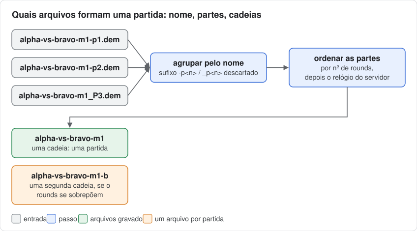

# Comandos {#commands}

Não está habituado à linha de comandos? Leia primeiro [Antes de começar](before-you-start.md).
Escreva estes comandos num terminal aberto na pasta onde descompactou ou clonou o projeto;
`<...>` são marcadores a substituir, e um caminho com espaços vai entre aspas.

```text
python -m heat3d_cs2 demos <ficheiros ou pastas de demos> -o <pasta> [--every 8] [--jobs N] [--map TEXT] [--force] [--no-bulk] [--loose]
python -m heat3d_cs2 map <nome do mapa ou caminho do seu .vpk> -o <ficheiro.glb> [--game PASTA] [--source2viewer EXE]
python -m heat3d_cs2 scoreboard <match.3dheat | match.json>
```

`python -m heat3d_cs2 --help` e `python -m heat3d_cs2 <verbo> --help` listam as mesmas opções;
a [Referência de comandos](../cli-reference.md) mostra todas. Cada inicialização corre primeiro a
verificação de versão descrita em [Atualizações](updates.md) (desligada com `HEAT3D_NO_UPDATE=1`).

Código: [`heat3d_cs2/cli.py`](https://github.com/Holdi601/3DHeat-CS2/blob/main/heat3d_cs2/cli.py).

## `demos` - demos em tabelas e documentos de partida {#demos---demos-into-tables-and-match-documents}

```powershell
python -m heat3d_cs2 demos D:\Demos\evento -o out
python -m heat3d_cs2 demos alpha-vs-bravo-m1-p1.dem alpha-vs-bravo-m1-p2.dem -o out
python -m heat3d_cs2 demos D:\Demos -o out --map final --jobs 4
```

| Argumento | Padrão | Faz |
|---|---|---|
| `paths` (um ou mais) | - | ficheiros e pastas de demos. Um ficheiro é aceito quando a sua extensão é `.dem` (em qualquer maiúscula ou minúscula). Uma pasta é pesquisada **recursivamente** à procura de ficheiros que acabam em `.dem`, em qualquer maiúscula ou minúscula, em ordem alfabética. Demos comprimidas (`.dem.zst`, `.dem.bz2`, ficheiros) não são lidas: descompacte-as primeiro. |
| `-o`, `--out` | obrigatório | a pasta onde escrever; criada se for preciso |
| `--every N` | `8` | amostra cada jogador a cada *N* ticks. As demos do CS2 correm a 64 ticks por segundo, por isso 8 são oito amostras por segundo, 4 são dezesseis, 64 é uma. Os eventos são sempre lidos no seu próprio tick, seja qual for o *N*. |
| `--jobs N` | `0` = metade dos núcleos da CPU | quantas partidas são convertidas ao mesmo tempo, cada uma no seu processo. Nunca menos de 1, nunca mais do que as partidas por fazer. |
| `--map TEXT` | - | só partidas cujo **nome** contém *TEXT*, sem distinguir maiúsculas (`--map final`). Filtra pelo nome do ficheiro, não pelo mapa que a demo acaba por ter. |
| `--force` | desligado | converte partidas que já estão escritas, substituindo-as |
| `--loose` | desligado | guarda cada partida em ficheiros separados - tabela, `.match.json`, ficheiros auxiliares - em vez dos juntar num único contentor `.3dheat`. Ver [Um ficheiro por partida](output-container.md). |
| `--container` | ligado | junta cada partida num único ficheiro `.3dheat`; é o padrão, por isso só existe para ser explícito |
| `--no-bulk` | desligado | deixa de fora o fluxo de entidades, os comandos dos jogadores e o fluxo de animações do ficheiro de pacotes - mais de metade do tamanho de uma demo, mesmo comprimida. A autoverificação do documento da partida conta-os então como `lost`, pelo nome. |


### Quais ficheiros são uma partida {#which-files-are-one-match}



O nome da partida é o nome do ficheiro da demo sem a extensão e sem o sufixo de parte:
`-p<dígitos>` ou `_p<dígitos>` no fim, em qualquer maiúscula ou minúscula. Assim,
`alpha-vs-bravo-m1-p1.dem`, `alpha-vs-bravo-m1-p2.dem` e `alpha-vs-bravo-m1_P3.dem` são as
partes de uma só partida, `alpha-vs-bravo-m1`. Os ficheiros são agrupados só por esse nome -
dois ficheiros com o mesmo nome em pastas diferentes também ficam agrupados.

O sufixo não diz nada sobre a ordem: um `-p2` pode ser a metade anterior. As partes são postas
em ordem pelo número de rounds que têm, e depois pelo relógio do servidor; um grupo que se
revela ter duas partidas diferentes (as mesmas equipas no mesmo mapa em dois eventos, por
exemplo) é separado em **cadeias**: a cadeia com mais rounds fica com o próprio nome, a
seguinte chama-se `<nome>-b`, depois `<nome>-c`, e assim por diante. Um ficheiro sem nenhum
round (só aquecimento, uma pausa) não pertence a nenhuma cadeia. Como as cadeias são
encontradas, está descrito em [Construir uma partida](building-matches.md#parts-and-chains).

### O que é escrito {#what-is-written}

Para cada partida, numa pasta com o nome do mapa que o cabeçalho da demo indica (`unknown` se
não indicar nenhum), um ficheiro `.3dheat`:

```text
out/
  de_x/
    alpha-vs-bravo-m1.3dheat
    alpha-vs-bravo-m2.3dheat
  de_y/
    ...
```

Na demo sintética de dois rounds dos testes:


Com `--loose`, cada partida é a tabela, o seu documento de partida e quatro ficheiros auxiliares
lado a lado ([Um ficheiro por partida](output-container.md)):


Um mapa de calor é de um só mapa, por isso carregar uma pasta no visualizador é carregar as
partidas de um só mapa. Ver [A tabela de calor](output-table.md) e
[O documento da partida](output-match-json.md).

### O que é saltado {#what-is-skipped}

Antes de ler o que for, todos os `*.3dheat` em qualquer lugar dentro de `--out` (um
contentor é escrito por inteiro ou não é escrito) e todos os `*.parquet` que têm o seu
documento de partida (`<nome>.match.json`) ao lado são listados, e uma partida cujo nome é igual
ao de um desses nomes de ficheiro (sem extensão) é saltada, a menos que use `--force`. Uma
tabela sem o seu documento de partida - uma execução parada entre escrever um e outro - não
conta, por isso essa partida é convertida outra vez. A verificação é só pelo nome: uma partida
convertida para outra pasta de mapa, ou com outro `--every`, continua a contar como feita. Sem
nada por fazer:

```text
nothing to do: no demos found, or every match already written (--force redoes them)
```

### O que é impresso {#what-is-printed}

Primeiro a quantidade de trabalho, depois uma linha por partida à medida que cada uma acaba (pela
ordem em que acabam, não pela ordem dos ficheiros):

```text
3 match(es), 3 at a time
alpha-vs-bravo-m1: de_x, 21 rounds (Alpha 13 Bravo 8), 412,377 rows, lost 0
alpha-vs-bravo-m2: de_y, 30 rounds (Bravo 16 Alpha 14), 598,104 rows, 1 incomplete round(s) left out, lost 0
alpha-vs-bravo-m3: de_y, 18 rounds (Alpha 13 Bravo 5), 330,981 rows, recorded from round 3, lost 1,204,331 (svc_PacketEntities, svc_UserCmds, DEM_AnimationData)
```

(Os números são ilustrativos.) O resultado é o do último round, equipa a equipa, pela ordem em
que o documento da partida as lista. *incomplete round(s) left out* conta os rounds que uma demo
cortou antes de serem decididos; *recorded from round N* diz que a gravação começa tarde;
*lost* é a autoverificação do documento da partida - quantos itens da demo não foram a lugar nenhum, e de que tipos (`--no-bulk` faz do bulk um `lost`). Uma partida que não produz nada diz
porquê:

```text
alpha-vs-bravo-m4: no round in 1 file(s) - nothing written
alpha-vs-bravo-m4-b: no complete round in 1 file(s) - nothing written
```

Um erro numa partida não para as outras; é impresso como `<nome>: failed - <erro>`.

### Código de saída {#exit-code}

`0` quando todas as partidas foram convertidas (ou não havia nada a fazer), `1` quando pelo menos
uma falhou.

### Quanto tempo demora {#how-long-it-takes}

Cada partida é lida e construída num processo de trabalho. Uma pasta com algumas centenas de demos
demora minutos com o `--jobs` padrão. A memória por tarefa cresce com o comprimento da
partida e com um `--every` mais pequeno: cada trabalhador guarda cada linha de jogador amostrada
da sua partida (cerca de dez jogadores vezes 64 / *N* linhas por segundo de gravação) antes de
escrever.

Os ficheiros auxiliares demoram mais do que a tabela: cada propriedade que o analisador lê é lida
em cada tick, uma janela de ticks de cada vez (cerca de dois minutos para uma demo de 40 minutos,
no máximo perto de 3 GB de memória por tarefa), e depois a demo é percorrida mais uma vez para os
seus quadros e mensagens.

## `map` - a geometria de um mapa como `.glb` {#map---a-maps-geometry-as-glb}


```powershell
python -m heat3d_cs2 map <mapa> -o out/<mapa>/<mapa>.glb
python -m heat3d_cs2 map <mapa> -o <mapa>.glb --game "D:\Jogos\Steam\steamapps\common\Counter-Strike Global Offensive"
python -m heat3d_cs2 map "D:\mapas\<mapa>.vpk" -o <mapa>.glb --source2viewer C:\Ferramentas\Source2Viewer-CLI.exe
```

| Argumento | Padrão | Faz |
|---|---|---|
| `name` | - | o nome do mapa (como `de_x`), ou o caminho para o seu `.vpk`. Um caminho que acaba em `.vpk` e que existe é usado tal como está; qualquer outra coisa é procurada pelo nome do ficheiro no jogo instalado. |
| `-o`, `--out` | obrigatório | o `.glb` a escrever; a sua pasta é criada se for preciso |
| `--game PASTA` | as bibliotecas do Steam | a pasta de instalação do CS2 (a que contém `game\csgo`), quando o Steam não a conhece. Com `--game`, só essa pasta é pesquisada. |
| `--source2viewer EXE` | `HEAT3D_SOURCE2VIEWER`, depois `PATH` | o executável CLI do Source2Viewer |

Impresso em caso de sucesso:

```text
out/de_x/de_x.glb: de_x, 412,880 triangles (151,204 ground) in 14 parts
```

(números ilustrativos). Escrever o `.glb` ao lado das tabelas do mapa (`out/<mapa>/<mapa>.glb`)
mantém os dados e a geometria de um mapa numa só pasta. Como funciona a exportação:
[Exportar o mapa](map-export.md).

Erros, cada um impresso como `error: ...` com código de saída `2`:

| Mensagem | Significa |
|---|---|
| `no de_x.vpk found in an installed CS2 - pass --game <CS2 folder> or the .vpk path` | o mapa não está em nenhuma biblioteca do Steam encontrada, ou o nome está errado |
| `Source2Viewer-CLI not found: ...` | nenhum de `--source2viewer`, `HEAT3D_SOURCE2VIEWER`, `PATH` deu um ficheiro existente |
| `Source2Viewer did not export de_x's collision mesh:` seguido do fim da sua saída | falhou, ou não escreveu nenhum `.glb` |
| `de_x's collision mesh has nothing but clip brushes` | depois de deixar de fora os clips e o céu, não sobrou nada |

## `scoreboard` - uma partida como texto {#scoreboard---a-match-as-text}

```bash
python -m heat3d_cs2 scoreboard out/de_x/alpha-vs-bravo-m1.3dheat
python -m heat3d_cs2 scoreboard out/de_x/alpha-vs-bravo-m1.match.json   # depois de demos --loose
```

Imprime o placar da partida a partir do seu [documento de partida](output-match-json.md), sem
abrir o visualizador. Lê o documento dentro de um contentor `.3dheat`, ou um `<partida>.match.json`
solto. Na demo sintética de dois rounds dos testes:


```text
alpha-vs-bravo-m1 - de_test  Alpha 2  Bravo 0

Alpha
player                 K   D   A  +/-    ADR   KAST   HS%  OK-OD  clutch
ash                    1   0   0   +1   50.0 100.0%    0%   0-0     1/1
ace                    1   1   0   +0   50.0 100.0%  100%   1-0     0/0

Bravo
player                 K   D   A  +/-    ADR   KAST   HS%  OK-OD  clutch
ben                    1   1   0   +0   50.0 100.0%    0%   0-0     0/1
bob                    0   1   0   -1    0.0 100.0%    0%   0-1     0/0

rounds  1:TK 2:TB
```

- A primeira linha: o nome da partida, o mapa e o resultado final por equipa.
- Uma tabela por equipa, pela ordem de `teams` do documento da partida; jogadores pela ordem do
  documento (por mortes menos mortes sofridas, depois mortes, a melhor primeiro). Os nomes são
  cortados aos 19 caracteres.
- Colunas: **K** mortes, **D** mortes sofridas, **A** assistências *incluindo* as assistências de
  flash, **+/-** mortes menos mortes sofridas, **ADR**, **KAST** (%), **HS%** (arredondado a
  percentagem inteira), **OK-OD** aberturas ganhas - aberturas perdidas, **clutch** clutches
  ganhos / clutches jogados. Definições: [Estatísticas](statistics.md).
- A faixa de rounds: `<round>:<lado vencedor><como>`, com **B** bomba explodiu, **D** desativada,
  **K** eliminação, **T** tempo esgotado, e **?** para qualquer outra coisa (empate, rendição,
  outro). Um empate não tem lado vencedor: `<round>:?`.

Um ficheiro que não é JSON válido, ou que não se encontra, para com um erro; um documento JSON sem
os campos do documento de partida falha com um erro do Python (não é validado mais do que isso).
